# Awesome Gemini 4 Argon

English · [简体中文](README.zh-CN.md)

What people are making with **Google Gemini 4 Argon**, collected from X and credited to their creators: Three.js scenes, canvas animations, motion graphics and playable games, all written as code from a prompt.

**[▶ Watch them all on SandBase Lab](https://www.sandbase.ai/lab/ai-videos/gemini-4-argon?utm_source=github&utm_medium=readme&utm_campaign=awesome-gemini4-argon&utm_content=hero)** · full-size playback, the original post and prompt, and one click to recreate any video with Gemini 4 Argon.

- **264 videos** from **209 creators**, newest last in each section. **52** of them come with the creator's prompt.
- Synced daily from SandBase Lab. Lab list updated `2026-10-14T16:29:53.300Z`.
- Click a preview to open the video. Click a title for the post, the prompt and a one-click **Recreate** on SandBase Lab. **@handle** links to the original post on X.

## Contents

- [Featured](#featured) (8)
- [3D scenes](#3d-scene) (105)
- [Motion graphics](#motion-graphics) (75)
- [Games](#game) (48)
- [Product UI](#ui-demo) (11)
- [Particles & shapes](#particles) (5)
- [Charts & diagrams](#data-viz) (4)
- [Kinetic type](#kinetic-type) (1)
- [Explainers](#explainer) (13)
- [Launch films](#launch-film) (2)
- [Recreate one with Gemini 4 Argon](#recreate)
- [Suggest a video](#contribute)

<a id="featured"></a>

## Featured

<table>
<tr><td width="33%" valign="top"><a href="https://www.sandbase.ai/lab/media/x/gemini-4-argon/2110131790136401989/video.mp4"></a><br><a href="https://www.sandbase.ai/lab/ai-videos/gemini-4-argon/2110131790136401989?utm_source=github&utm_medium=readme&utm_campaign=awesome-gemini4-argon&utm_content=card"><b>Physics simulation of gummy bears</b></a><br><sub><a href="https://x.com/semichenkko/status/2110131790136401989">@semichenkko</a> · 0:13</sub></td><td width="33%" valign="top"><a href="https://www.sandbase.ai/lab/media/x/gemini-4-argon/2110043023954284889/video.mp4"></a><br><a href="https://www.sandbase.ai/lab/ai-videos/gemini-4-argon/2110043023954284889?utm_source=github&utm_medium=readme&utm_campaign=awesome-gemini4-argon&utm_content=card"><b>A pelican riding a bike using Fourier epicycles</b></a><br><sub><a href="https://x.com/fofrAI/status/2110043023954284889">@fofrAI</a> · 1:00</sub></td><td width="33%" valign="top"><a href="https://www.sandbase.ai/lab/media/x/gemini-4-argon/2110037855452180633/video.mp4"></a><br><a href="https://www.sandbase.ai/lab/ai-videos/gemini-4-argon/2110037855452180633?utm_source=github&utm_medium=readme&utm_campaign=awesome-gemini4-argon&utm_content=card"><b>Paintings generated purely with code</b></a><br><sub><a href="https://x.com/kickingkeys/status/2110037855452180633">@kickingkeys</a> · 0:31</sub></td></tr>
<tr><td width="33%" valign="top"><a href="https://www.sandbase.ai/lab/media/x/gemini-4-argon/2110065587279798719/video.mp4"></a><br><a href="https://www.sandbase.ai/lab/ai-videos/gemini-4-argon/2110065587279798719?utm_source=github&utm_medium=readme&utm_campaign=awesome-gemini4-argon&utm_content=card"><b>Cinematic 3D animation of an electric motor</b></a><br><sub><a href="https://x.com/rubenssoto_ai/status/2110065587279798719">@rubenssoto_ai</a> · 0:40</sub></td><td width="33%" valign="top"><a href="https://www.sandbase.ai/lab/media/x/gemini-4-argon/2110040063656812976/video.mp4"></a><br><a href="https://www.sandbase.ai/lab/ai-videos/gemini-4-argon/2110040063656812976?utm_source=github&utm_medium=readme&utm_campaign=awesome-gemini4-argon&utm_content=card"><b>Interactive 3D island with controllable sailboat</b></a><br><sub><a href="https://x.com/ai_for_success/status/2110040063656812976">@ai_for_success</a> · 1:39</sub></td><td width="33%" valign="top"><a href="https://www.sandbase.ai/lab/media/x/gemini-4-argon/2110154463415558279/video.mp4"></a><br><a href="https://www.sandbase.ai/lab/ai-videos/gemini-4-argon/2110154463415558279?utm_source=github&utm_medium=readme&utm_campaign=awesome-gemini4-argon&utm_content=card"><b>AI models competing to reach the Nether</b></a><br><sub><a href="https://x.com/fawnunwrap/status/2110154463415558279">@fawnunwrap</a> · 1:27</sub></td></tr>
<tr><td width="33%" valign="top"><a href="https://www.sandbase.ai/lab/media/x/gemini-4-argon/2110086564357505291/video.mp4">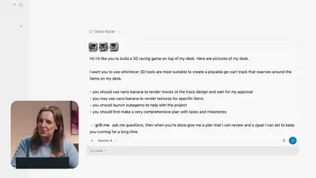</a><br><a href="https://www.sandbase.ai/lab/ai-videos/gemini-4-argon/2110086564357505291?utm_source=github&utm_medium=readme&utm_campaign=awesome-gemini4-argon&utm_content=card"><b>Desk photo transformed into 3D racing game</b></a><br><sub><a href="https://x.com/googledevs/status/2110086564357505291">@googledevs</a> · 2:36</sub></td><td width="33%" valign="top"><a href="https://www.sandbase.ai/lab/media/x/gemini-4-argon/2110040726457491845/video.mp4"></a><br><a href="https://www.sandbase.ai/lab/ai-videos/gemini-4-argon/2110040726457491845?utm_source=github&utm_medium=readme&utm_campaign=awesome-gemini4-argon&utm_content=card"><b>Introduction video for Gemini 4 Argon</b></a><br><sub><a href="https://x.com/HarshithLucky3/status/2110040726457491845">@HarshithLucky3</a> · 1:00</sub></td></tr>
</table>

<a id="3d-scene"></a>

## 3D scenes

<table>
<tr><td width="33%" valign="top"><a href="https://www.sandbase.ai/lab/media/x/gemini-4-argon/2110039909851685300/video.mp4"></a><br><a href="https://www.sandbase.ai/lab/ai-videos/gemini-4-argon/2110039909851685300?utm_source=github&utm_medium=readme&utm_campaign=awesome-gemini4-argon&utm_content=card"><b>Millennium Falcon main hold 3D model</b></a><br><sub><a href="https://x.com/jackcheng/status/2110039909851685300">@jackcheng</a> · 0:08 · <a href="https://www.sandbase.ai/lab/ai-videos/gemini-4-argon/2110039909851685300?utm_source=github&utm_medium=readme&utm_campaign=awesome-gemini4-argon&utm_content=card">prompt</a></sub></td><td width="33%" valign="top"><a href="https://www.sandbase.ai/lab/media/x/gemini-4-argon/2110040063656812976/video.mp4"></a><br><a href="https://www.sandbase.ai/lab/ai-videos/gemini-4-argon/2110040063656812976?utm_source=github&utm_medium=readme&utm_campaign=awesome-gemini4-argon&utm_content=card"><b>Interactive 3D island with controllable sailboat</b></a><br><sub><a href="https://x.com/ai_for_success/status/2110040063656812976">@ai_for_success</a> · 1:39</sub></td><td width="33%" valign="top"><a href="https://www.sandbase.ai/lab/media/x/gemini-4-argon/2110041557021950348/video.mp4"></a><br><a href="https://www.sandbase.ai/lab/ai-videos/gemini-4-argon/2110041557021950348?utm_source=github&utm_medium=readme&utm_campaign=awesome-gemini4-argon&utm_content=card"><b>Butterfly museum with five rendered specimens</b></a><br><sub><a href="https://x.com/doe_naps/status/2110041557021950348">@doe_naps</a> · 0:37</sub></td></tr>
<tr><td width="33%" valign="top"><a href="https://www.sandbase.ai/lab/media/x/gemini-4-argon/2110041702765613294/video.mp4"></a><br><a href="https://www.sandbase.ai/lab/ai-videos/gemini-4-argon/2110041702765613294?utm_source=github&utm_medium=readme&utm_campaign=awesome-gemini4-argon&utm_content=card"><b>Pagoda temple complex generated in Blender</b></a><br><sub><a href="https://x.com/shiri_shh/status/2110041702765613294">@shiri_shh</a> · 0:45</sub></td><td width="33%" valign="top"><a href="https://www.sandbase.ai/lab/media/x/gemini-4-argon/2110041849767383472/video.mp4"></a><br><a href="https://www.sandbase.ai/lab/ai-videos/gemini-4-argon/2110041849767383472?utm_source=github&utm_medium=readme&utm_campaign=awesome-gemini4-argon&utm_content=card"><b>Argon 18 Nitrogen Pro bicycle demo</b></a><br><sub><a href="https://x.com/SeraAndroid/status/2110041849767383472">@SeraAndroid</a> · 0:16</sub></td><td width="33%" valign="top"><a href="https://www.sandbase.ai/lab/media/x/gemini-4-argon/2110043093466743194/video.mp4"></a><br><a href="https://www.sandbase.ai/lab/ai-videos/gemini-4-argon/2110043093466743194?utm_source=github&utm_medium=readme&utm_campaign=awesome-gemini4-argon&utm_content=card"><b>Real-time 3D fluffy pumpkin plushie</b></a><br><sub><a href="https://x.com/thebuggeddev/status/2110043093466743194">@thebuggeddev</a> · 0:18</sub></td></tr>
<tr><td width="33%" valign="top"><a href="https://www.sandbase.ai/lab/media/x/gemini-4-argon/2110045402544341180/video.mp4">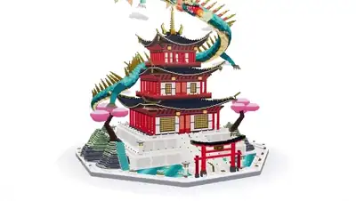</a><br><a href="https://www.sandbase.ai/lab/ai-videos/gemini-4-argon/2110045402544341180?utm_source=github&utm_medium=readme&utm_campaign=awesome-gemini4-argon&utm_content=card"><b>Voxel art dragon flying over temple</b></a><br><sub><a href="https://x.com/HarshithLucky3/status/2110045402544341180">@HarshithLucky3</a> · 0:23 · <a href="https://www.sandbase.ai/lab/ai-videos/gemini-4-argon/2110045402544341180?utm_source=github&utm_medium=readme&utm_campaign=awesome-gemini4-argon&utm_content=card">prompt</a></sub></td><td width="33%" valign="top"><a href="https://www.sandbase.ai/lab/media/x/gemini-4-argon/2110046793438220573/video.mp4"></a><br><a href="https://www.sandbase.ai/lab/ai-videos/gemini-4-argon/2110046793438220573?utm_source=github&utm_medium=readme&utm_campaign=awesome-gemini4-argon&utm_content=card"><b>Custom WebGL2 3D physics engine in Rust</b></a><br><sub><a href="https://x.com/LinusEkenstam/status/2110046793438220573">@LinusEkenstam</a> · 1:42</sub></td><td width="33%" valign="top"><a href="https://www.sandbase.ai/lab/media/x/gemini-4-argon/2110047749379133877/video.mp4"></a><br><a href="https://www.sandbase.ai/lab/ai-videos/gemini-4-argon/2110047749379133877?utm_source=github&utm_medium=readme&utm_campaign=awesome-gemini4-argon&utm_content=card"><b>3D rendering demo generated with Gemini 4 Argon</b></a><br><sub><a href="https://x.com/birdabo/status/2110047749379133877">@birdabo</a> · 0:45</sub></td></tr>
<tr><td width="33%" valign="top"><a href="https://www.sandbase.ai/lab/media/x/gemini-4-argon/2110048102321365205/video.mp4"></a><br><a href="https://www.sandbase.ai/lab/ai-videos/gemini-4-argon/2110048102321365205?utm_source=github&utm_medium=readme&utm_campaign=awesome-gemini4-argon&utm_content=card"><b>Voxel art of Mercedes AMG F1 car</b></a><br><sub><a href="https://x.com/HarshithLucky3/status/2110048102321365205">@HarshithLucky3</a> · 0:23 · <a href="https://www.sandbase.ai/lab/ai-videos/gemini-4-argon/2110048102321365205?utm_source=github&utm_medium=readme&utm_campaign=awesome-gemini4-argon&utm_content=card">prompt</a></sub></td><td width="33%" valign="top"><a href="https://www.sandbase.ai/lab/media/x/gemini-4-argon/2110052226844791094/video.mp4"></a><br><a href="https://www.sandbase.ai/lab/ai-videos/gemini-4-argon/2110052226844791094?utm_source=github&utm_medium=readme&utm_campaign=awesome-gemini4-argon&utm_content=card"><b>Black hole simulation rendered via Python</b></a><br><sub><a href="https://x.com/abhinavflac/status/2110052226844791094">@abhinavflac</a> · 0:30</sub></td><td width="33%" valign="top"><a href="https://www.sandbase.ai/lab/media/x/gemini-4-argon/2110053480442528008/video.mp4"></a><br><a href="https://www.sandbase.ai/lab/ai-videos/gemini-4-argon/2110053480442528008?utm_source=github&utm_medium=readme&utm_campaign=awesome-gemini4-argon&utm_content=card"><b>Mathematical 3D room rendered in browser</b></a><br><sub><a href="https://x.com/Bhavani_00007/status/2110053480442528008">@Bhavani_00007</a> · 0:27</sub></td></tr>
<tr><td width="33%" valign="top"><a href="https://www.sandbase.ai/lab/media/x/gemini-4-argon/2110056429931610237/video.mp4"></a><br><a href="https://www.sandbase.ai/lab/ai-videos/gemini-4-argon/2110056429931610237?utm_source=github&utm_medium=readme&utm_campaign=awesome-gemini4-argon&utm_content=card"><b>3D humanoid robot simulation in Three.js</b></a><br><sub><a href="https://x.com/AI_Screening/status/2110056429931610237">@AI_Screening</a> · 0:17</sub></td><td width="33%" valign="top"><a href="https://www.sandbase.ai/lab/media/x/gemini-4-argon/2110057151171338656/video.mp4">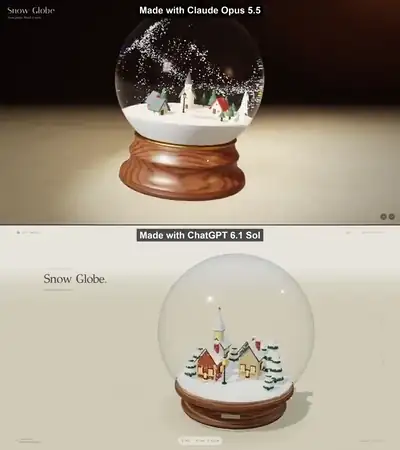</a><br><a href="https://www.sandbase.ai/lab/ai-videos/gemini-4-argon/2110057151171338656?utm_source=github&utm_medium=readme&utm_campaign=awesome-gemini4-argon&utm_content=card"><b>AI-generated snow globe scene comparison</b></a><br><sub><a href="https://x.com/shmopixbzn/status/2110057151171338656">@shmopixbzn</a> · 0:20 · <a href="https://www.sandbase.ai/lab/ai-videos/gemini-4-argon/2110057151171338656?utm_source=github&utm_medium=readme&utm_campaign=awesome-gemini4-argon&utm_content=card">prompt</a></sub></td><td width="33%" valign="top"><a href="https://www.sandbase.ai/lab/media/x/gemini-4-argon/2110059132569215117/video.mp4">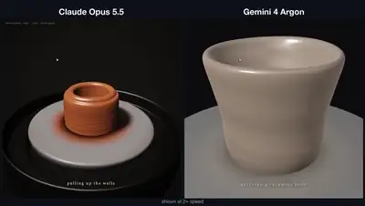</a><br><a href="https://www.sandbase.ai/lab/ai-videos/gemini-4-argon/2110059132569215117?utm_source=github&utm_medium=readme&utm_campaign=awesome-gemini4-argon&utm_content=card"><b>3D speckled teal pottery bowl render</b></a><br><sub><a href="https://x.com/elliscrosby/status/2110059132569215117">@elliscrosby</a> · 0:25</sub></td></tr>
<tr><td width="33%" valign="top"><a href="https://www.sandbase.ai/lab/media/x/gemini-4-argon/2110064733206573358/video.mp4"></a><br><a href="https://www.sandbase.ai/lab/ai-videos/gemini-4-argon/2110064733206573358?utm_source=github&utm_medium=readme&utm_campaign=awesome-gemini4-argon&utm_content=card"><b>Lava lamp 3D generation benchmark comparison</b></a><br><sub><a href="https://x.com/xiax0603/status/2110064733206573358">@xiax0603</a> · 0:10</sub></td><td width="33%" valign="top"><a href="https://www.sandbase.ai/lab/media/x/gemini-4-argon/2110064840039702576/video.mp4"></a><br><a href="https://www.sandbase.ai/lab/ai-videos/gemini-4-argon/2110064840039702576?utm_source=github&utm_medium=readme&utm_campaign=awesome-gemini4-argon&utm_content=card"><b>Pagoda built using multi-agent critique loops</b></a><br><sub><a href="https://x.com/JustLingonberry/status/2110064840039702576">@JustLingonberry</a> · 0:45</sub></td><td width="33%" valign="top"><a href="https://www.sandbase.ai/lab/media/x/gemini-4-argon/2110068320221413537/video.mp4"></a><br><a href="https://www.sandbase.ai/lab/ai-videos/gemini-4-argon/2110068320221413537?utm_source=github&utm_medium=readme&utm_campaign=awesome-gemini4-argon&utm_content=card"><b>3D animation generated by Gemini 4 Argon</b></a><br><sub><a href="https://x.com/sonuforx/status/2110068320221413537">@sonuforx</a> · 0:19</sub></td></tr>
<tr><td width="33%" valign="top"><a href="https://www.sandbase.ai/lab/media/x/gemini-4-argon/2110068980337586566/video.mp4"></a><br><a href="https://www.sandbase.ai/lab/ai-videos/gemini-4-argon/2110068980337586566?utm_source=github&utm_medium=readme&utm_campaign=awesome-gemini4-argon&utm_content=card"><b>Robot playing Cornhole with dynamic balance control</b></a><br><sub><a href="https://x.com/liderarmente/status/2110068980337586566">@liderarmente</a> · 1:43</sub></td><td width="33%" valign="top"><a href="https://www.sandbase.ai/lab/media/x/gemini-4-argon/2110069786415968754/video.mp4"></a><br><a href="https://www.sandbase.ai/lab/ai-videos/gemini-4-argon/2110069786415968754?utm_source=github&utm_medium=readme&utm_campaign=awesome-gemini4-argon&utm_content=card"><b>Futuristic 3D battle helicopter in Three.js</b></a><br><sub><a href="https://x.com/thtbee_/status/2110069786415968754">@thtbee_</a> · 1:12</sub></td><td width="33%" valign="top"><a href="https://www.sandbase.ai/lab/media/x/gemini-4-argon/2110070249970421940/video.mp4"></a><br><a href="https://www.sandbase.ai/lab/ai-videos/gemini-4-argon/2110070249970421940?utm_source=github&utm_medium=readme&utm_campaign=awesome-gemini4-argon&utm_content=card"><b>Pelican doing wheelie on flying fighter jet</b></a><br><sub><a href="https://x.com/noclipepe/status/2110070249970421940">@noclipepe</a> · 0:37 · <a href="https://www.sandbase.ai/lab/ai-videos/gemini-4-argon/2110070249970421940?utm_source=github&utm_medium=readme&utm_campaign=awesome-gemini4-argon&utm_content=card">prompt</a></sub></td></tr>
<tr><td width="33%" valign="top"><a href="https://www.sandbase.ai/lab/media/x/gemini-4-argon/2110071798629036542/video.mp4">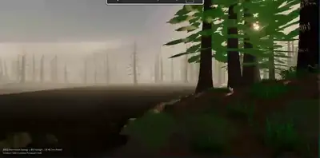</a><br><a href="https://www.sandbase.ai/lab/ai-videos/gemini-4-argon/2110071798629036542?utm_source=github&utm_medium=readme&utm_campaign=awesome-gemini4-argon&utm_content=card"><b>Navigable 3D forest environment in HTML</b></a><br><sub><a href="https://x.com/analogalok/status/2110071798629036542">@analogalok</a> · 0:25 · <a href="https://www.sandbase.ai/lab/ai-videos/gemini-4-argon/2110071798629036542?utm_source=github&utm_medium=readme&utm_campaign=awesome-gemini4-argon&utm_content=card">prompt</a></sub></td><td width="33%" valign="top"><a href="https://www.sandbase.ai/lab/media/x/gemini-4-argon/2110078691204374833/video.mp4"></a><br><a href="https://www.sandbase.ai/lab/ai-videos/gemini-4-argon/2110078691204374833?utm_source=github&utm_medium=readme&utm_campaign=awesome-gemini4-argon&utm_content=card"><b>Articulated 3D clockwork bee in Three.js</b></a><br><sub><a href="https://x.com/0xbenderxbt/status/2110078691204374833">@0xbenderxbt</a> · 0:42</sub></td><td width="33%" valign="top"><a href="https://www.sandbase.ai/lab/media/x/gemini-4-argon/2110078803297055212/video.mp4"></a><br><a href="https://www.sandbase.ai/lab/ai-videos/gemini-4-argon/2110078803297055212?utm_source=github&utm_medium=readme&utm_campaign=awesome-gemini4-argon&utm_content=card"><b>Comparison of 3D whale breaching scene across models</b></a><br><sub><a href="https://x.com/Bhavani_00007/status/2110078803297055212">@Bhavani_00007</a> · 0:20</sub></td></tr>
<tr><td width="33%" valign="top"><a href="https://www.sandbase.ai/lab/media/x/gemini-4-argon/2110078889859203253/video.mp4">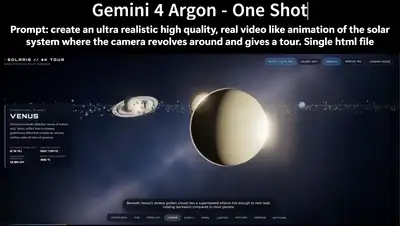</a><br><a href="https://www.sandbase.ai/lab/ai-videos/gemini-4-argon/2110078889859203253?utm_source=github&utm_medium=readme&utm_campaign=awesome-gemini4-argon&utm_content=card"><b>Touring the solar system in a single HTML file</b></a><br><sub><a href="https://x.com/analogalok/status/2110078889859203253">@analogalok</a> · 0:35 · <a href="https://www.sandbase.ai/lab/ai-videos/gemini-4-argon/2110078889859203253?utm_source=github&utm_medium=readme&utm_campaign=awesome-gemini4-argon&utm_content=card">prompt</a></sub></td><td width="33%" valign="top"><a href="https://www.sandbase.ai/lab/media/x/gemini-4-argon/2110079828531794317/video.mp4"></a><br><a href="https://www.sandbase.ai/lab/ai-videos/gemini-4-argon/2110079828531794317?utm_source=github&utm_medium=readme&utm_campaign=awesome-gemini4-argon&utm_content=card"><b>Gemini 4 Argon output showcase</b></a><br><sub><a href="https://x.com/Adidotdev/status/2110079828531794317">@Adidotdev</a> · 1:03 · <a href="https://www.sandbase.ai/lab/ai-videos/gemini-4-argon/2110079828531794317?utm_source=github&utm_medium=readme&utm_campaign=awesome-gemini4-argon&utm_content=card">prompt</a></sub></td><td width="33%" valign="top"><a href="https://www.sandbase.ai/lab/media/x/gemini-4-argon/2110084319079182761/video.mp4"></a><br><a href="https://www.sandbase.ai/lab/ai-videos/gemini-4-argon/2110084319079182761?utm_source=github&utm_medium=readme&utm_campaign=awesome-gemini4-argon&utm_content=card"><b>Rider flying through floating sky islands</b></a><br><sub><a href="https://x.com/pipeline_os/status/2110084319079182761">@pipeline_os</a> · 0:33</sub></td></tr>
<tr><td width="33%" valign="top"><a href="https://www.sandbase.ai/lab/media/x/gemini-4-argon/2110086917455057028/video.mp4"></a><br><a href="https://www.sandbase.ai/lab/ai-videos/gemini-4-argon/2110086917455057028?utm_source=github&utm_medium=readme&utm_campaign=awesome-gemini4-argon&utm_content=card"><b>Miniature cyberpunk city in Three.js</b></a><br><sub><a href="https://x.com/StatsWire/status/2110086917455057028">@StatsWire</a> · 0:58</sub></td><td width="33%" valign="top"><a href="https://www.sandbase.ai/lab/media/x/gemini-4-argon/2110087305163854042/video.mp4"></a><br><a href="https://www.sandbase.ai/lab/ai-videos/gemini-4-argon/2110087305163854042?utm_source=github&utm_medium=readme&utm_campaign=awesome-gemini4-argon&utm_content=card"><b>Mario 3D test comparison between models</b></a><br><sub><a href="https://x.com/luckeyfaraday/status/2110087305163854042">@luckeyfaraday</a> · 0:24</sub></td><td width="33%" valign="top"><a href="https://www.sandbase.ai/lab/media/x/gemini-4-argon/2110087897382896037/video.mp4"></a><br><a href="https://www.sandbase.ai/lab/ai-videos/gemini-4-argon/2110087897382896037?utm_source=github&utm_medium=readme&utm_campaign=awesome-gemini4-argon&utm_content=card"><b>Voxel Art Generation Comparison</b></a><br><sub><a href="https://x.com/filicroval/status/2110087897382896037">@filicroval</a> · 0:34</sub></td></tr>
<tr><td width="33%" valign="top"><a href="https://www.sandbase.ai/lab/media/x/gemini-4-argon/2110088443619598716/video.mp4"></a><br><a href="https://www.sandbase.ai/lab/ai-videos/gemini-4-argon/2110088443619598716?utm_source=github&utm_medium=readme&utm_campaign=awesome-gemini4-argon&utm_content=card"><b>3D car and garage scene evaluation</b></a><br><sub><a href="https://x.com/maxt3chno/status/2110088443619598716">@maxt3chno</a> · 0:50</sub></td><td width="33%" valign="top"><a href="https://www.sandbase.ai/lab/media/x/gemini-4-argon/2110088760314749405/video.mp4"></a><br><a href="https://www.sandbase.ai/lab/ai-videos/gemini-4-argon/2110088760314749405?utm_source=github&utm_medium=readme&utm_campaign=awesome-gemini4-argon&utm_content=card"><b>3D generation quality comparison between models</b></a><br><sub><a href="https://x.com/aimlapi/status/2110088760314749405">@aimlapi</a> · 0:29</sub></td><td width="33%" valign="top"><a href="https://www.sandbase.ai/lab/media/x/gemini-4-argon/2110090003703378023/video.mp4"></a><br><a href="https://www.sandbase.ai/lab/ai-videos/gemini-4-argon/2110090003703378023?utm_source=github&utm_medium=readme&utm_campaign=awesome-gemini4-argon&utm_content=card"><b>Floating torii island diorama comparison</b></a><br><sub><a href="https://x.com/AIBoticssq/status/2110090003703378023">@AIBoticssq</a> · 0:47</sub></td></tr>
<tr><td width="33%" valign="top"><a href="https://www.sandbase.ai/lab/media/x/gemini-4-argon/2110093152854151192/video.mp4"></a><br><a href="https://www.sandbase.ai/lab/ai-videos/gemini-4-argon/2110093152854151192?utm_source=github&utm_medium=readme&utm_campaign=awesome-gemini4-argon&utm_content=card"><b>Zero-shot robot control on Boston Dynamics Spot</b></a><br><sub><a href="https://x.com/parada_car88104/status/2110093152854151192">@parada_car88104</a> · 1:28 · <a href="https://www.sandbase.ai/lab/ai-videos/gemini-4-argon/2110093152854151192?utm_source=github&utm_medium=readme&utm_campaign=awesome-gemini4-argon&utm_content=card">prompt</a></sub></td><td width="33%" valign="top"><a href="https://www.sandbase.ai/lab/media/x/gemini-4-argon/2110093177088885008/video.mp4"></a><br><a href="https://www.sandbase.ai/lab/ai-videos/gemini-4-argon/2110093177088885008?utm_source=github&utm_medium=readme&utm_campaign=awesome-gemini4-argon&utm_content=card"><b>Storm-lashed lighthouse rendered in Three.js</b></a><br><sub><a href="https://x.com/YFarmX/status/2110093177088885008">@YFarmX</a> · 0:48</sub></td><td width="33%" valign="top"><a href="https://www.sandbase.ai/lab/media/x/gemini-4-argon/2110093858549694597/video.mp4"></a><br><a href="https://www.sandbase.ai/lab/ai-videos/gemini-4-argon/2110093858549694597?utm_source=github&utm_medium=readme&utm_campaign=awesome-gemini4-argon&utm_content=card"><b>Voxel F1 car generated in one shot</b></a><br><sub><a href="https://x.com/letdarky/status/2110093858549694597">@letdarky</a> · 0:23 · <a href="https://www.sandbase.ai/lab/ai-videos/gemini-4-argon/2110093858549694597?utm_source=github&utm_medium=readme&utm_campaign=awesome-gemini4-argon&utm_content=card">prompt</a></sub></td></tr>
<tr><td width="33%" valign="top"><a href="https://www.sandbase.ai/lab/media/x/gemini-4-argon/2110096143342268664/video.mp4"></a><br><a href="https://www.sandbase.ai/lab/ai-videos/gemini-4-argon/2110096143342268664?utm_source=github&utm_medium=readme&utm_campaign=awesome-gemini4-argon&utm_content=card"><b>Prompted robot video to simulation demonstration</b></a><br><sub><a href="https://x.com/parada_car88104/status/2110096143342268664">@parada_car88104</a> · 0:18 · <a href="https://www.sandbase.ai/lab/ai-videos/gemini-4-argon/2110096143342268664?utm_source=github&utm_medium=readme&utm_campaign=awesome-gemini4-argon&utm_content=card">prompt</a></sub></td><td width="33%" valign="top"><a href="https://www.sandbase.ai/lab/media/x/gemini-4-argon/2110097633922662752/video.mp4"></a><br><a href="https://www.sandbase.ai/lab/ai-videos/gemini-4-argon/2110097633922662752?utm_source=github&utm_medium=readme&utm_campaign=awesome-gemini4-argon&utm_content=card"><b>Complete 3D space station in 4K</b></a><br><sub><a href="https://x.com/_satyam_ai/status/2110097633922662752">@_satyam_ai</a> · 0:51 · <a href="https://www.sandbase.ai/lab/ai-videos/gemini-4-argon/2110097633922662752?utm_source=github&utm_medium=readme&utm_campaign=awesome-gemini4-argon&utm_content=card">prompt</a></sub></td><td width="33%" valign="top"><a href="https://www.sandbase.ai/lab/media/x/gemini-4-argon/2110097921014378606/video.mp4"></a><br><a href="https://www.sandbase.ai/lab/ai-videos/gemini-4-argon/2110097921014378606?utm_source=github&utm_medium=readme&utm_campaign=awesome-gemini4-argon&utm_content=card"><b>3D seaplane on water generated by Gemini 4</b></a><br><sub><a href="https://x.com/LuminaBench/status/2110097921014378606">@LuminaBench</a> · 1:07</sub></td></tr>
<tr><td width="33%" valign="top"><a href="https://www.sandbase.ai/lab/media/x/gemini-4-argon/2110099643694731341/video.mp4"></a><br><a href="https://www.sandbase.ai/lab/ai-videos/gemini-4-argon/2110099643694731341?utm_source=github&utm_medium=readme&utm_campaign=awesome-gemini4-argon&utm_content=card"><b>Comparison of 3D whale breaching scenes</b></a><br><sub><a href="https://x.com/AdityaJhajhar12/status/2110099643694731341">@AdityaJhajhar12</a> · 0:20</sub></td><td width="33%" valign="top"><a href="https://www.sandbase.ai/lab/media/x/gemini-4-argon/2110099864650702928/video.mp4"></a><br><a href="https://www.sandbase.ai/lab/ai-videos/gemini-4-argon/2110099864650702928?utm_source=github&utm_medium=readme&utm_campaign=awesome-gemini4-argon&utm_content=card"><b>Rocket scene comparison across AI models</b></a><br><sub><a href="https://x.com/Bhavani_00007/status/2110099864650702928">@Bhavani_00007</a> · 0:20</sub></td><td width="33%" valign="top"><a href="https://www.sandbase.ai/lab/media/x/gemini-4-argon/2110105779294687341/video.mp4"></a><br><a href="https://www.sandbase.ai/lab/ai-videos/gemini-4-argon/2110105779294687341?utm_source=github&utm_medium=readme&utm_campaign=awesome-gemini4-argon&utm_content=card"><b>Voxel Dragon Flying over a Temple in 3D</b></a><br><sub><a href="https://x.com/marcthecreatorr/status/2110105779294687341">@marcthecreatorr</a> · 0:21 · <a href="https://www.sandbase.ai/lab/ai-videos/gemini-4-argon/2110105779294687341?utm_source=github&utm_medium=readme&utm_campaign=awesome-gemini4-argon&utm_content=card">prompt</a></sub></td></tr>
<tr><td width="33%" valign="top"><a href="https://www.sandbase.ai/lab/media/x/gemini-4-argon/2110106474659942452/video.mp4">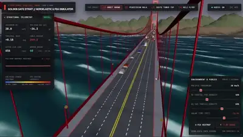</a><br><a href="https://www.sandbase.ai/lab/ai-videos/gemini-4-argon/2110106474659942452?utm_source=github&utm_medium=readme&utm_campaign=awesome-gemini4-argon&utm_content=card"><b>One-shot footage of a golden bridge</b></a><br><sub><a href="https://x.com/SaiNemani1/status/2110106474659942452">@SaiNemani1</a> · 2:15</sub></td><td width="33%" valign="top"><a href="https://www.sandbase.ai/lab/media/x/gemini-4-argon/2110111664490360974/video.mp4">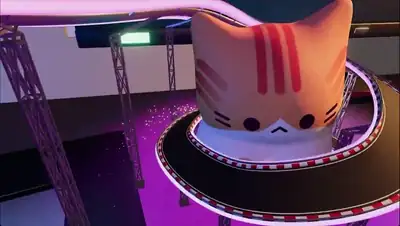</a><br><a href="https://www.sandbase.ai/lab/ai-videos/gemini-4-argon/2110111664490360974?utm_source=github&utm_medium=readme&utm_campaign=awesome-gemini4-argon&utm_content=card"><b>3D scene made with Three.js and Blender</b></a><br><sub><a href="https://x.com/Drake5112/status/2110111664490360974">@Drake5112</a> · 1:20</sub></td><td width="33%" valign="top"><a href="https://www.sandbase.ai/lab/media/x/gemini-4-argon/2110116583016419760/video.mp4"></a><br><a href="https://www.sandbase.ai/lab/ai-videos/gemini-4-argon/2110116583016419760?utm_source=github&utm_medium=readme&utm_campaign=awesome-gemini4-argon&utm_content=card"><b>Space train comparison between Gemini 4 and Opus</b></a><br><sub><a href="https://x.com/EnvolDev/status/2110116583016419760">@EnvolDev</a> · 0:25</sub></td></tr>
<tr><td width="33%" valign="top"><a href="https://www.sandbase.ai/lab/media/x/gemini-4-argon/2110116795516661832/video.mp4"></a><br><a href="https://www.sandbase.ai/lab/ai-videos/gemini-4-argon/2110116795516661832?utm_source=github&utm_medium=readme&utm_campaign=awesome-gemini4-argon&utm_content=card"><b>Code-generated Himeji Castle during cherry blossoms</b></a><br><sub><a href="https://x.com/petergyang/status/2110116795516661832">@petergyang</a> · 0:30</sub></td><td width="33%" valign="top"><a href="https://www.sandbase.ai/lab/media/x/gemini-4-argon/2110117120839148016/video.mp4"></a><br><a href="https://www.sandbase.ai/lab/ai-videos/gemini-4-argon/2110117120839148016?utm_source=github&utm_medium=readme&utm_campaign=awesome-gemini4-argon&utm_content=card"><b>WebGL ice swan carving comparison</b></a><br><sub><a href="https://x.com/elliscrosby/status/2110117120839148016">@elliscrosby</a> · 0:25</sub></td><td width="33%" valign="top"><a href="https://www.sandbase.ai/lab/media/x/gemini-4-argon/2110121002332295599/video.mp4"></a><br><a href="https://www.sandbase.ai/lab/ai-videos/gemini-4-argon/2110121002332295599?utm_source=github&utm_medium=readme&utm_campaign=awesome-gemini4-argon&utm_content=card"><b>Leonardo da Vinci 3D workshop recreations</b></a><br><sub><a href="https://x.com/techhalla/status/2110121002332295599">@techhalla</a> · 1:41 · <a href="https://www.sandbase.ai/lab/ai-videos/gemini-4-argon/2110121002332295599?utm_source=github&utm_medium=readme&utm_campaign=awesome-gemini4-argon&utm_content=card">prompt</a></sub></td></tr>
<tr><td width="33%" valign="top"><a href="https://www.sandbase.ai/lab/media/x/gemini-4-argon/2110125129053200430/video.mp4"></a><br><a href="https://www.sandbase.ai/lab/ai-videos/gemini-4-argon/2110125129053200430?utm_source=github&utm_medium=readme&utm_campaign=awesome-gemini4-argon&utm_content=card"><b>Voxel Hagia Sophia timelapse comparison</b></a><br><sub><a href="https://x.com/Avenoxai/status/2110125129053200430">@Avenoxai</a> · 0:20</sub></td><td width="33%" valign="top"><a href="https://www.sandbase.ai/lab/media/x/gemini-4-argon/2110131790136401989/video.mp4"></a><br><a href="https://www.sandbase.ai/lab/ai-videos/gemini-4-argon/2110131790136401989?utm_source=github&utm_medium=readme&utm_campaign=awesome-gemini4-argon&utm_content=card"><b>Physics simulation of gummy bears</b></a><br><sub><a href="https://x.com/semichenkko/status/2110131790136401989">@semichenkko</a> · 0:13</sub></td><td width="33%" valign="top"><a href="https://www.sandbase.ai/lab/media/x/gemini-4-argon/2110140198130425917/video.mp4"></a><br><a href="https://www.sandbase.ai/lab/ai-videos/gemini-4-argon/2110140198130425917?utm_source=github&utm_medium=readme&utm_campaign=awesome-gemini4-argon&utm_content=card"><b>Campfire test built in Blender via MCP</b></a><br><sub><a href="https://x.com/ashen_one/status/2110140198130425917">@ashen_one</a> · 0:05</sub></td></tr>
<tr><td width="33%" valign="top"><a href="https://www.sandbase.ai/lab/media/x/gemini-4-argon/2110145714659664275/video.mp4"></a><br><a href="https://www.sandbase.ai/lab/ai-videos/gemini-4-argon/2110145714659664275?utm_source=github&utm_medium=readme&utm_campaign=awesome-gemini4-argon&utm_content=card"><b>3D voxel sports car assembly animation comparison</b></a><br><sub><a href="https://x.com/atomic_chat_hq/status/2110145714659664275">@atomic_chat_hq</a> · 0:26</sub></td><td width="33%" valign="top"><a href="https://www.sandbase.ai/lab/media/x/gemini-4-argon/2110149599600247136/video.mp4">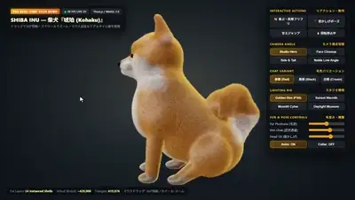</a><br><a href="https://www.sandbase.ai/lab/ai-videos/gemini-4-argon/2110149599600247136?utm_source=github&utm_medium=readme&utm_campaign=awesome-gemini4-argon&utm_content=card"><b>Interactive 3D Shiba Inu in pure HTML</b></a><br><sub><a href="https://x.com/mizugame_22/status/2110149599600247136">@mizugame_22</a> · 0:32</sub></td><td width="33%" valign="top"><a href="https://www.sandbase.ai/lab/media/x/gemini-4-argon/2110153216772202945/video.mp4"></a><br><a href="https://www.sandbase.ai/lab/ai-videos/gemini-4-argon/2110153216772202945?utm_source=github&utm_medium=readme&utm_campaign=awesome-gemini4-argon&utm_content=card"><b>Procedural New York 3D scenes in Three.js</b></a><br><sub><a href="https://x.com/thehypedotnews/status/2110153216772202945">@thehypedotnews</a> · 0:56</sub></td></tr>
<tr><td width="33%" valign="top"><a href="https://www.sandbase.ai/lab/media/x/gemini-4-argon/2110159559365177442/video.mp4"></a><br><a href="https://www.sandbase.ai/lab/ai-videos/gemini-4-argon/2110159559365177442?utm_source=github&utm_medium=readme&utm_campaign=awesome-gemini4-argon&utm_content=card"><b>Side-by-side 3D model comparison</b></a><br><sub><a href="https://x.com/viktoroddy/status/2110159559365177442">@viktoroddy</a> · 0:05</sub></td><td width="33%" valign="top"><a href="https://www.sandbase.ai/lab/media/x/gemini-4-argon/2110165280370647159/video.mp4"></a><br><a href="https://www.sandbase.ai/lab/ai-videos/gemini-4-argon/2110165280370647159?utm_source=github&utm_medium=readme&utm_campaign=awesome-gemini4-argon&utm_content=card"><b>A pirate ship created with Three.js</b></a><br><sub><a href="https://x.com/Ayu_AI_0912/status/2110165280370647159">@Ayu_AI_0912</a> · 0:24 · <a href="https://www.sandbase.ai/lab/ai-videos/gemini-4-argon/2110165280370647159?utm_source=github&utm_medium=readme&utm_campaign=awesome-gemini4-argon&utm_content=card">prompt</a></sub></td><td width="33%" valign="top"><a href="https://www.sandbase.ai/lab/media/x/gemini-4-argon/2110166300622471434/video.mp4"></a><br><a href="https://www.sandbase.ai/lab/ai-videos/gemini-4-argon/2110166300622471434?utm_source=github&utm_medium=readme&utm_campaign=awesome-gemini4-argon&utm_content=card"><b>Exact 3D replica of 1966 USS Enterprise</b></a><br><sub><a href="https://x.com/DeryaTR_/status/2110166300622471434">@DeryaTR_</a> · 0:22</sub></td></tr>
<tr><td width="33%" valign="top"><a href="https://www.sandbase.ai/lab/media/x/gemini-4-argon/2110167534028963932/video.mp4">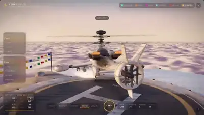</a><br><a href="https://www.sandbase.ai/lab/ai-videos/gemini-4-argon/2110167534028963932?utm_source=github&utm_medium=readme&utm_campaign=awesome-gemini4-argon&utm_content=card"><b>Futuristic combat helicopter generated in Three.js</b></a><br><sub><a href="https://x.com/AndyL5cc/status/2110167534028963932">@AndyL5cc</a> · 1:12</sub></td><td width="33%" valign="top"><a href="https://www.sandbase.ai/lab/media/x/gemini-4-argon/2110187446906613901/video.mp4">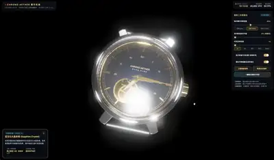</a><br><a href="https://www.sandbase.ai/lab/ai-videos/gemini-4-argon/2110187446906613901?utm_source=github&utm_medium=readme&utm_campaign=awesome-gemini4-argon&utm_content=card"><b>Interactive 3D model of a mechanical watch</b></a><br><sub><a href="https://x.com/lemomo_ai/status/2110187446906613901">@lemomo_ai</a> · 0:35 · <a href="https://www.sandbase.ai/lab/ai-videos/gemini-4-argon/2110187446906613901?utm_source=github&utm_medium=readme&utm_campaign=awesome-gemini4-argon&utm_content=card">prompt</a></sub></td><td width="33%" valign="top"><a href="https://www.sandbase.ai/lab/media/x/gemini-4-argon/2110192210964521388/video.mp4"></a><br><a href="https://www.sandbase.ai/lab/ai-videos/gemini-4-argon/2110192210964521388?utm_source=github&utm_medium=readme&utm_campaign=awesome-gemini4-argon&utm_content=card"><b>Custom 3D Flying Dragon Asset Test</b></a><br><sub><a href="https://x.com/ashen_one/status/2110192210964521388">@ashen_one</a> · 0:08</sub></td></tr>
<tr><td width="33%" valign="top"><a href="https://www.sandbase.ai/lab/media/x/gemini-4-argon/2110195194092044742/video.mp4"></a><br><a href="https://www.sandbase.ai/lab/ai-videos/gemini-4-argon/2110195194092044742?utm_source=github&utm_medium=readme&utm_campaign=awesome-gemini4-argon&utm_content=card"><b>Capybara physics comparison between Opus and Argon</b></a><br><sub><a href="https://x.com/LeeLinAI123/status/2110195194092044742">@LeeLinAI123</a> · 0:15</sub></td><td width="33%" valign="top"><a href="https://www.sandbase.ai/lab/media/x/gemini-4-argon/2110212723300876341/video.mp4"></a><br><a href="https://www.sandbase.ai/lab/ai-videos/gemini-4-argon/2110212723300876341?utm_source=github&utm_medium=readme&utm_campaign=awesome-gemini4-argon&utm_content=card"><b>Three.js rendering comparison between Opus 5.5 and Argon</b></a><br><sub><a href="https://x.com/Ayu_AI_0912/status/2110212723300876341">@Ayu_AI_0912</a> · 0:47</sub></td><td width="33%" valign="top"><a href="https://www.sandbase.ai/lab/media/x/gemini-4-argon/2110213441575412022/video.mp4"></a><br><a href="https://www.sandbase.ai/lab/ai-videos/gemini-4-argon/2110213441575412022?utm_source=github&utm_medium=readme&utm_campaign=awesome-gemini4-argon&utm_content=card"><b>Gummy bear physics simulation comparison</b></a><br><sub><a href="https://x.com/mayaislam_ai/status/2110213441575412022">@mayaislam_ai</a> · 0:13</sub></td></tr>
<tr><td width="33%" valign="top"><a href="https://www.sandbase.ai/lab/media/x/gemini-4-argon/2110223641111888338/video.mp4"></a><br><a href="https://www.sandbase.ai/lab/ai-videos/gemini-4-argon/2110223641111888338?utm_source=github&utm_medium=readme&utm_campaign=awesome-gemini4-argon&utm_content=card"><b>Mechanical bee in a single HTML file</b></a><br><sub><a href="https://x.com/NovaXCode/status/2110223641111888338">@NovaXCode</a> · 0:39</sub></td><td width="33%" valign="top"><a href="https://www.sandbase.ai/lab/media/x/gemini-4-argon/2110231429523309050/video.mp4"></a><br><a href="https://www.sandbase.ai/lab/ai-videos/gemini-4-argon/2110231429523309050?utm_source=github&utm_medium=readme&utm_campaign=awesome-gemini4-argon&utm_content=card"><b>Low-poly scene rendered in Three.js</b></a><br><sub><a href="https://x.com/SidraMiconi/status/2110231429523309050">@SidraMiconi</a> · 0:16 · <a href="https://www.sandbase.ai/lab/ai-videos/gemini-4-argon/2110231429523309050?utm_source=github&utm_medium=readme&utm_campaign=awesome-gemini4-argon&utm_content=card">prompt</a></sub></td><td width="33%" valign="top"><a href="https://www.sandbase.ai/lab/media/x/gemini-4-argon/2110234900616126769/video.mp4"></a><br><a href="https://www.sandbase.ai/lab/ai-videos/gemini-4-argon/2110234900616126769?utm_source=github&utm_medium=readme&utm_campaign=awesome-gemini4-argon&utm_content=card"><b>Margarita sloshing effect in Three.js WebGL</b></a><br><sub><a href="https://x.com/ann_nnng/status/2110234900616126769">@ann_nnng</a> · 0:19</sub></td></tr>
<tr><td width="33%" valign="top"><a href="https://www.sandbase.ai/lab/media/x/gemini-4-argon/2110240752517193761/video.mp4"></a><br><a href="https://www.sandbase.ai/lab/ai-videos/gemini-4-argon/2110240752517193761?utm_source=github&utm_medium=readme&utm_campaign=awesome-gemini4-argon&utm_content=card"><b>Browser-based 3D Mumbai urban simulation in Three.js</b></a><br><sub><a href="https://x.com/CurieuxExplorer/status/2110240752517193761">@CurieuxExplorer</a> · 2:58</sub></td><td width="33%" valign="top"><a href="https://www.sandbase.ai/lab/media/x/gemini-4-argon/2110243527355736460/video.mp4"></a><br><a href="https://www.sandbase.ai/lab/ai-videos/gemini-4-argon/2110243527355736460?utm_source=github&utm_medium=readme&utm_campaign=awesome-gemini4-argon&utm_content=card"><b>Interactive 3D Room Designer in HTML</b></a><br><sub><a href="https://x.com/alwayspriyesh/status/2110243527355736460">@alwayspriyesh</a> · 0:49</sub></td><td width="33%" valign="top"><a href="https://www.sandbase.ai/lab/media/x/gemini-4-argon/2110245860756099245/video.mp4">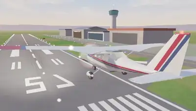</a><br><a href="https://www.sandbase.ai/lab/ai-videos/gemini-4-argon/2110245860756099245?utm_source=github&utm_medium=readme&utm_campaign=awesome-gemini4-argon&utm_content=card"><b>3D artifact render comparison without Blender</b></a><br><sub><a href="https://x.com/SadAlbert10/status/2110245860756099245">@SadAlbert10</a> · 0:16</sub></td></tr>
<tr><td width="33%" valign="top"><a href="https://www.sandbase.ai/lab/media/x/gemini-4-argon/2110246226637815917/video.mp4"></a><br><a href="https://www.sandbase.ai/lab/ai-videos/gemini-4-argon/2110246226637815917?utm_source=github&utm_medium=readme&utm_campaign=awesome-gemini4-argon&utm_content=card"><b>Recreation of a viral Three.js animation</b></a><br><sub><a href="https://x.com/muku_sns/status/2110246226637815917">@muku_sns</a> · 0:21</sub></td><td width="33%" valign="top"><a href="https://www.sandbase.ai/lab/media/x/gemini-4-argon/2110249491140071834/video.mp4"></a><br><a href="https://www.sandbase.ai/lab/ai-videos/gemini-4-argon/2110249491140071834?utm_source=github&utm_medium=readme&utm_campaign=awesome-gemini4-argon&utm_content=card"><b>3D grocery store scene comparison</b></a><br><sub><a href="https://x.com/Avenoxai/status/2110249491140071834">@Avenoxai</a> · 0:26</sub></td><td width="33%" valign="top"><a href="https://www.sandbase.ai/lab/media/x/gemini-4-argon/2110255334287941703/video.mp4">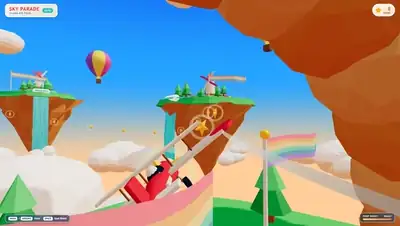</a><br><a href="https://www.sandbase.ai/lab/ai-videos/gemini-4-argon/2110255334287941703?utm_source=github&utm_medium=readme&utm_campaign=awesome-gemini4-argon&utm_content=card"><b>Floating islands with waterfalls and a biplane</b></a><br><sub><a href="https://x.com/JessyJessyfrrrr/status/2110255334287941703">@JessyJessyfrrrr</a> · 0:14</sub></td></tr>
<tr><td width="33%" valign="top"><a href="https://www.sandbase.ai/lab/media/x/gemini-4-argon/2110260066066862538/video.mp4">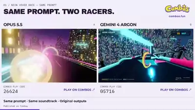</a><br><a href="https://www.sandbase.ai/lab/ai-videos/gemini-4-argon/2110260066066862538?utm_source=github&utm_medium=readme&utm_campaign=awesome-gemini4-argon&utm_content=card"><b>A Three.js comparison between Argon and Opus</b></a><br><sub><a href="https://x.com/CombosFun_AI/status/2110260066066862538">@CombosFun_AI</a> · 0:16</sub></td><td width="33%" valign="top"><a href="https://www.sandbase.ai/lab/media/x/gemini-4-argon/2110268994100113447/video.mp4"></a><br><a href="https://www.sandbase.ai/lab/ai-videos/gemini-4-argon/2110268994100113447?utm_source=github&utm_medium=readme&utm_campaign=awesome-gemini4-argon&utm_content=card"><b>Margarita slosh effect simulated in Three.js</b></a><br><sub><a href="https://x.com/AndyL5cc/status/2110268994100113447">@AndyL5cc</a> · 0:19</sub></td><td width="33%" valign="top"><a href="https://www.sandbase.ai/lab/media/x/gemini-4-argon/2110271891521044812/video.mp4">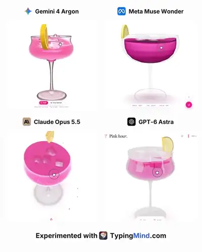</a><br><a href="https://www.sandbase.ai/lab/ai-videos/gemini-4-argon/2110271891521044812?utm_source=github&utm_medium=readme&utm_campaign=awesome-gemini4-argon&utm_content=card"><b>Three.js margarita shaking effect comparison across models</b></a><br><sub><a href="https://x.com/Chris62771610/status/2110271891521044812">@Chris62771610</a> · 0:19</sub></td></tr>
<tr><td width="33%" valign="top"><a href="https://www.sandbase.ai/lab/media/x/gemini-4-argon/2110274182046953661/video.mp4"></a><br><a href="https://www.sandbase.ai/lab/ai-videos/gemini-4-argon/2110274182046953661?utm_source=github&utm_medium=readme&utm_campaign=awesome-gemini4-argon&utm_content=card"><b>Three.js short of aliens getting burgers</b></a><br><sub><a href="https://x.com/shownotover/status/2110274182046953661">@shownotover</a> · 0:15 · <a href="https://www.sandbase.ai/lab/ai-videos/gemini-4-argon/2110274182046953661?utm_source=github&utm_medium=readme&utm_campaign=awesome-gemini4-argon&utm_content=card">prompt</a></sub></td><td width="33%" valign="top"><a href="https://www.sandbase.ai/lab/media/x/gemini-4-argon/2110277813819633682/video.mp4"></a><br><a href="https://www.sandbase.ai/lab/ai-videos/gemini-4-argon/2110277813819633682?utm_source=github&utm_medium=readme&utm_campaign=awesome-gemini4-argon&utm_content=card"><b>Gemini 4 Argon versus Claude Opus 3D SVG</b></a><br><sub><a href="https://x.com/esrhengwu/status/2110277813819633682">@esrhengwu</a> · 4:12</sub></td><td width="33%" valign="top"><a href="https://www.sandbase.ai/lab/media/x/gemini-4-argon/2110290468584247638/video.mp4"></a><br><a href="https://www.sandbase.ai/lab/ai-videos/gemini-4-argon/2110290468584247638?utm_source=github&utm_medium=readme&utm_campaign=awesome-gemini4-argon&utm_content=card"><b>F1 car built in Three.js</b></a><br><sub><a href="https://x.com/SahilPanhotra/status/2110290468584247638">@SahilPanhotra</a> · 0:12</sub></td></tr>
<tr><td width="33%" valign="top"><a href="https://www.sandbase.ai/lab/media/x/gemini-4-argon/2110291890839191858/video.mp4"></a><br><a href="https://www.sandbase.ai/lab/ai-videos/gemini-4-argon/2110291890839191858?utm_source=github&utm_medium=readme&utm_campaign=awesome-gemini4-argon&utm_content=card"><b>Real-time 3D turbofan engine in Three.js</b></a><br><sub><a href="https://x.com/0xbenderxbt/status/2110291890839191858">@0xbenderxbt</a> · 0:38</sub></td><td width="33%" valign="top"><a href="https://www.sandbase.ai/lab/media/x/gemini-4-argon/2110292323103908188/video.mp4"></a><br><a href="https://www.sandbase.ai/lab/ai-videos/gemini-4-argon/2110292323103908188?utm_source=github&utm_medium=readme&utm_campaign=awesome-gemini4-argon&utm_content=card"><b>Interactive squishy jelly hearts coded by AI</b></a><br><sub><a href="https://x.com/shmopixbzn/status/2110292323103908188">@shmopixbzn</a> · 0:20</sub></td><td width="33%" valign="top"><a href="https://www.sandbase.ai/lab/media/x/gemini-4-argon/2110296301048836416/video.mp4"></a><br><a href="https://www.sandbase.ai/lab/ai-videos/gemini-4-argon/2110296301048836416?utm_source=github&utm_medium=readme&utm_campaign=awesome-gemini4-argon&utm_content=card"><b>Stormy night rendered in Three.js</b></a><br><sub><a href="https://x.com/BlockInsight214/status/2110296301048836416">@BlockInsight214</a> · 0:17</sub></td></tr>
<tr><td width="33%" valign="top"><a href="https://www.sandbase.ai/lab/media/x/gemini-4-argon/2110303650887487745/video.mp4"></a><br><a href="https://www.sandbase.ai/lab/ai-videos/gemini-4-argon/2110303650887487745?utm_source=github&utm_medium=readme&utm_campaign=awesome-gemini4-argon&utm_content=card"><b>Interactive musical 3D garden in Three.js</b></a><br><sub><a href="https://x.com/soumyadesign/status/2110303650887487745">@soumyadesign</a> · 1:16</sub></td><td width="33%" valign="top"><a href="https://www.sandbase.ai/lab/media/x/gemini-4-argon/2110305600416698390/video.mp4"></a><br><a href="https://www.sandbase.ai/lab/ai-videos/gemini-4-argon/2110305600416698390?utm_source=github&utm_medium=readme&utm_campaign=awesome-gemini4-argon&utm_content=card"><b>3D folding phone teardown in Three.js</b></a><br><sub><a href="https://x.com/rajlol01/status/2110305600416698390">@rajlol01</a> · 1:03</sub></td><td width="33%" valign="top"><a href="https://www.sandbase.ai/lab/media/x/gemini-4-argon/2110310573762130387/video.mp4"></a><br><a href="https://www.sandbase.ai/lab/ai-videos/gemini-4-argon/2110310573762130387?utm_source=github&utm_medium=readme&utm_campaign=awesome-gemini4-argon&utm_content=card"><b>Humanoid robot cornhole physics simulation</b></a><br><sub><a href="https://x.com/luellamech/status/2110310573762130387">@luellamech</a> · 0:10</sub></td></tr>
<tr><td width="33%" valign="top"><a href="https://www.sandbase.ai/lab/media/x/gemini-4-argon/2110312192633639223/video.mp4"></a><br><a href="https://www.sandbase.ai/lab/ai-videos/gemini-4-argon/2110312192633639223?utm_source=github&utm_medium=readme&utm_campaign=awesome-gemini4-argon&utm_content=card"><b>Procedurally generated human face in Three.js</b></a><br><sub><a href="https://x.com/SimonasLTU1/status/2110312192633639223">@SimonasLTU1</a> · 0:56</sub></td><td width="33%" valign="top"><a href="https://www.sandbase.ai/lab/media/x/gemini-4-argon/2110325698137076094/video.mp4"></a><br><a href="https://www.sandbase.ai/lab/ai-videos/gemini-4-argon/2110325698137076094?utm_source=github&utm_medium=readme&utm_campaign=awesome-gemini4-argon&utm_content=card"><b>Live browser simulation in Three.js</b></a><br><sub><a href="https://x.com/alexanderchen/status/2110325698137076094">@alexanderchen</a> · 0:09</sub></td><td width="33%" valign="top"><a href="https://www.sandbase.ai/lab/media/x/gemini-4-argon/2110328641360146658/video.mp4"></a><br><a href="https://www.sandbase.ai/lab/ai-videos/gemini-4-argon/2110328641360146658?utm_source=github&utm_medium=readme&utm_campaign=awesome-gemini4-argon&utm_content=card"><b>3D liquid horse animation in Three.js</b></a><br><sub><a href="https://x.com/TypingMindApp/status/2110328641360146658">@TypingMindApp</a> · 0:21 · <a href="https://www.sandbase.ai/lab/ai-videos/gemini-4-argon/2110328641360146658?utm_source=github&utm_medium=readme&utm_campaign=awesome-gemini4-argon&utm_content=card">prompt</a></sub></td></tr>
<tr><td width="33%" valign="top"><a href="https://www.sandbase.ai/lab/media/x/gemini-4-argon/2110329505969484045/video.mp4"></a><br><a href="https://www.sandbase.ai/lab/ai-videos/gemini-4-argon/2110329505969484045?utm_source=github&utm_medium=readme&utm_campaign=awesome-gemini4-argon&utm_content=card"><b>A trip through space animation</b></a><br><sub><a href="https://x.com/kepochnik/status/2110329505969484045">@kepochnik</a> · 1:00</sub></td><td width="33%" valign="top"><a href="https://www.sandbase.ai/lab/media/x/gemini-4-argon/2110342166790787489/video.mp4"></a><br><a href="https://www.sandbase.ai/lab/ai-videos/gemini-4-argon/2110342166790787489?utm_source=github&utm_medium=readme&utm_campaign=awesome-gemini4-argon&utm_content=card"><b>Eiffel Tower generated from scratch</b></a><br><sub><a href="https://x.com/Mr_Salio/status/2110342166790787489">@Mr_Salio</a> · 0:29</sub></td><td width="33%" valign="top"><a href="https://www.sandbase.ai/lab/media/x/gemini-4-argon/2110346627172983121/video.mp4">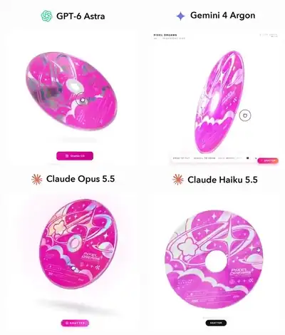</a><br><a href="https://www.sandbase.ai/lab/ai-videos/gemini-4-argon/2110346627172983121?utm_source=github&utm_medium=readme&utm_campaign=awesome-gemini4-argon&utm_content=card"><b>Interactive holographic CD in browser</b></a><br><sub><a href="https://x.com/kinderlayer/status/2110346627172983121">@kinderlayer</a> · 0:16 · <a href="https://www.sandbase.ai/lab/ai-videos/gemini-4-argon/2110346627172983121?utm_source=github&utm_medium=readme&utm_campaign=awesome-gemini4-argon&utm_content=card">prompt</a></sub></td></tr>
<tr><td width="33%" valign="top"><a href="https://www.sandbase.ai/lab/media/x/gemini-4-argon/2110347694447509797/video.mp4"></a><br><a href="https://www.sandbase.ai/lab/ai-videos/gemini-4-argon/2110347694447509797?utm_source=github&utm_medium=readme&utm_campaign=awesome-gemini4-argon&utm_content=card"><b>3D Japanese house with cherry blossom trees</b></a><br><sub><a href="https://x.com/dpratyush02/status/2110347694447509797">@dpratyush02</a> · 0:29 · <a href="https://www.sandbase.ai/lab/ai-videos/gemini-4-argon/2110347694447509797?utm_source=github&utm_medium=readme&utm_campaign=awesome-gemini4-argon&utm_content=card">prompt</a></sub></td><td width="33%" valign="top"><a href="https://www.sandbase.ai/lab/media/x/gemini-4-argon/2110349904551792641/video.mp4">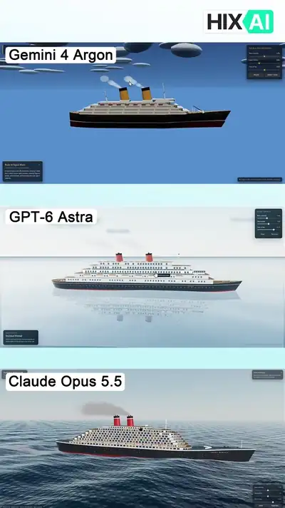</a><br><a href="https://www.sandbase.ai/lab/ai-videos/gemini-4-argon/2110349904551792641?utm_source=github&utm_medium=readme&utm_campaign=awesome-gemini4-argon&utm_content=card"><b>Comparing coding models building a 3D interactive website</b></a><br><sub><a href="https://x.com/HIX_AI_/status/2110349904551792641">@HIX_AI_</a> · 0:32</sub></td><td width="33%" valign="top"><a href="https://www.sandbase.ai/lab/media/x/gemini-4-argon/2110355164687155634/video.mp4"></a><br><a href="https://www.sandbase.ai/lab/ai-videos/gemini-4-argon/2110355164687155634?utm_source=github&utm_medium=readme&utm_campaign=awesome-gemini4-argon&utm_content=card"><b>Spiral piano 3D musical instrument in Three.js</b></a><br><sub><a href="https://x.com/alexanderchen/status/2110355164687155634">@alexanderchen</a> · 0:53</sub></td></tr>
<tr><td width="33%" valign="top"><a href="https://www.sandbase.ai/lab/media/x/gemini-4-argon/2110355993255366802/video.mp4"></a><br><a href="https://www.sandbase.ai/lab/ai-videos/gemini-4-argon/2110355993255366802?utm_source=github&utm_medium=readme&utm_campaign=awesome-gemini4-argon&utm_content=card"><b>Cinematic 3D animation from a single idea</b></a><br><sub><a href="https://x.com/HeyAbhishek/status/2110355993255366802">@HeyAbhishek</a> · 0:30 · <a href="https://www.sandbase.ai/lab/ai-videos/gemini-4-argon/2110355993255366802?utm_source=github&utm_medium=readme&utm_campaign=awesome-gemini4-argon&utm_content=card">prompt</a></sub></td><td width="33%" valign="top"><a href="https://www.sandbase.ai/lab/media/x/gemini-4-argon/2110361902064992440/video.mp4"></a><br><a href="https://www.sandbase.ai/lab/ai-videos/gemini-4-argon/2110361902064992440?utm_source=github&utm_medium=readme&utm_campaign=awesome-gemini4-argon&utm_content=card"><b>Interactive 3D galaxy generated in Three.js</b></a><br><sub><a href="https://x.com/Smlay_ero/status/2110361902064992440">@Smlay_ero</a> · 0:37 · <a href="https://www.sandbase.ai/lab/ai-videos/gemini-4-argon/2110361902064992440?utm_source=github&utm_medium=readme&utm_campaign=awesome-gemini4-argon&utm_content=card">prompt</a></sub></td><td width="33%" valign="top"><a href="https://www.sandbase.ai/lab/media/x/gemini-4-argon/2110368976664756375/video.mp4"></a><br><a href="https://www.sandbase.ai/lab/ai-videos/gemini-4-argon/2110368976664756375?utm_source=github&utm_medium=readme&utm_campaign=awesome-gemini4-argon&utm_content=card"><b>Roman civilization in a single HTML file</b></a><br><sub><a href="https://x.com/NovaXCode/status/2110368976664756375">@NovaXCode</a> · 0:47</sub></td></tr>
<tr><td width="33%" valign="top"><a href="https://www.sandbase.ai/lab/media/x/gemini-4-argon/2110377300621758854/video.mp4"></a><br><a href="https://www.sandbase.ai/lab/ai-videos/gemini-4-argon/2110377300621758854?utm_source=github&utm_medium=readme&utm_campaign=awesome-gemini4-argon&utm_content=card"><b>Blender pagoda complex created using multi-agent workflow</b></a><br><sub><a href="https://x.com/tpritha03/status/2110377300621758854">@tpritha03</a> · 2:45</sub></td><td width="33%" valign="top"><a href="https://www.sandbase.ai/lab/media/x/gemini-4-argon/2110377592394031397/video.mp4">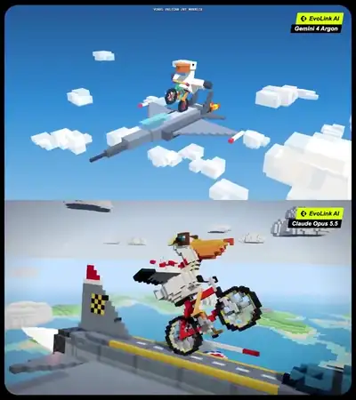</a><br><a href="https://www.sandbase.ai/lab/ai-videos/gemini-4-argon/2110377592394031397?utm_source=github&utm_medium=readme&utm_campaign=awesome-gemini4-argon&utm_content=card"><b>Voxel art world generation comparison</b></a><br><sub><a href="https://x.com/EvoLinkAi/status/2110377592394031397">@EvoLinkAi</a> · 0:30 · <a href="https://www.sandbase.ai/lab/ai-videos/gemini-4-argon/2110377592394031397?utm_source=github&utm_medium=readme&utm_campaign=awesome-gemini4-argon&utm_content=card">prompt</a></sub></td><td width="33%" valign="top"><a href="https://www.sandbase.ai/lab/media/x/gemini-4-argon/2110381383218786397/video.mp4"></a><br><a href="https://www.sandbase.ai/lab/ai-videos/gemini-4-argon/2110381383218786397?utm_source=github&utm_medium=readme&utm_campaign=awesome-gemini4-argon&utm_content=card"><b>Gemini 3.8 Flash vs Gemini 4 Argon Three.js benchmark</b></a><br><sub><a href="https://x.com/NicolaManzini/status/2110381383218786397">@NicolaManzini</a> · 0:22</sub></td></tr>
<tr><td width="33%" valign="top"><a href="https://www.sandbase.ai/lab/media/x/gemini-4-argon/2110382089476407630/video.mp4"></a><br><a href="https://www.sandbase.ai/lab/ai-videos/gemini-4-argon/2110382089476407630?utm_source=github&utm_medium=readme&utm_campaign=awesome-gemini4-argon&utm_content=card"><b>Interactive firefly jar in Three.js</b></a><br><sub><a href="https://x.com/0xRhinoX/status/2110382089476407630">@0xRhinoX</a> · 0:39 · <a href="https://www.sandbase.ai/lab/ai-videos/gemini-4-argon/2110382089476407630?utm_source=github&utm_medium=readme&utm_campaign=awesome-gemini4-argon&utm_content=card">prompt</a></sub></td><td width="33%" valign="top"><a href="https://www.sandbase.ai/lab/media/x/gemini-4-argon/2110390746759266619/video.mp4">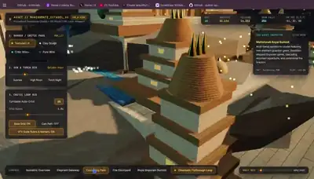</a><br><a href="https://www.sandbase.ai/lab/ai-videos/gemini-4-argon/2110390746759266619?utm_source=github&utm_medium=readme&utm_campaign=awesome-gemini4-argon&utm_content=card"><b>Procedural 3D Mahishmati Citadel in Three.js</b></a><br><sub><a href="https://x.com/manaku_yendhuku/status/2110390746759266619">@manaku_yendhuku</a> · 0:53</sub></td><td width="33%" valign="top"><a href="https://www.sandbase.ai/lab/media/x/gemini-4-argon/2110390964028330106/video.mp4"></a><br><a href="https://www.sandbase.ai/lab/ai-videos/gemini-4-argon/2110390964028330106?utm_source=github&utm_medium=readme&utm_campaign=awesome-gemini4-argon&utm_content=card"><b>Futuristic humanoid 3D robot in Three.js</b></a><br><sub><a href="https://x.com/thtbee_/status/2110390964028330106">@thtbee_</a> · 1:11</sub></td></tr>
<tr><td width="33%" valign="top"><a href="https://www.sandbase.ai/lab/media/x/gemini-4-argon/2110394335971975642/video.mp4"></a><br><a href="https://www.sandbase.ai/lab/ai-videos/gemini-4-argon/2110394335971975642?utm_source=github&utm_medium=readme&utm_campaign=awesome-gemini4-argon&utm_content=card"><b>Single HTML Three.js model comparison</b></a><br><sub><a href="https://x.com/AI_Screening/status/2110394335971975642">@AI_Screening</a> · 0:12</sub></td><td width="33%" valign="top"><a href="https://www.sandbase.ai/lab/media/x/gemini-4-argon/2110399609285533853/video.mp4"></a><br><a href="https://www.sandbase.ai/lab/ai-videos/gemini-4-argon/2110399609285533853?utm_source=github&utm_medium=readme&utm_campaign=awesome-gemini4-argon&utm_content=card"><b>Battle helicopter rendered entirely in Three.js</b></a><br><sub><a href="https://x.com/deweytn/status/2110399609285533853">@deweytn</a> · 1:12</sub></td><td width="33%" valign="top"><a href="https://www.sandbase.ai/lab/media/x/gemini-4-argon/2110407254080184395/video.mp4"></a><br><a href="https://www.sandbase.ai/lab/ai-videos/gemini-4-argon/2110407254080184395?utm_source=github&utm_medium=readme&utm_campaign=awesome-gemini4-argon&utm_content=card"><b>A reverse engineered 3D structure in Antigravity</b></a><br><sub><a href="https://x.com/ai_for_success/status/2110407254080184395">@ai_for_success</a> · 0:31</sub></td></tr>
</table>

<a id="motion-graphics"></a>

## Motion graphics

<table>
<tr><td width="33%" valign="top"><a href="https://www.sandbase.ai/lab/media/x/gemini-4-argon/2110039082764280146/video.mp4"></a><br><a href="https://www.sandbase.ai/lab/ai-videos/gemini-4-argon/2110039082764280146?utm_source=github&utm_medium=readme&utm_campaign=awesome-gemini4-argon&utm_content=card"><b>SVG spectrogram of Daisy Bell</b></a><br><sub><a href="https://x.com/AdamHoltererer/status/2110039082764280146">@AdamHoltererer</a> · 0:18</sub></td><td width="33%" valign="top"><a href="https://www.sandbase.ai/lab/media/x/gemini-4-argon/2110042531425812846/video.mp4"></a><br><a href="https://www.sandbase.ai/lab/ai-videos/gemini-4-argon/2110042531425812846?utm_source=github&utm_medium=readme&utm_campaign=awesome-gemini4-argon&utm_content=card"><b>Motion graphics advertisement comparison for Pollo AI</b></a><br><sub><a href="https://x.com/itsPolloAI/status/2110042531425812846">@itsPolloAI</a> · 0:30</sub></td><td width="33%" valign="top"><a href="https://www.sandbase.ai/lab/media/x/gemini-4-argon/2110043023954284889/video.mp4"></a><br><a href="https://www.sandbase.ai/lab/ai-videos/gemini-4-argon/2110043023954284889?utm_source=github&utm_medium=readme&utm_campaign=awesome-gemini4-argon&utm_content=card"><b>A pelican riding a bike using Fourier epicycles</b></a><br><sub><a href="https://x.com/fofrAI/status/2110043023954284889">@fofrAI</a> · 1:00</sub></td></tr>
<tr><td width="33%" valign="top"><a href="https://www.sandbase.ai/lab/media/x/gemini-4-argon/2110043897812668840/video.mp4"></a><br><a href="https://www.sandbase.ai/lab/ai-videos/gemini-4-argon/2110043897812668840?utm_source=github&utm_medium=readme&utm_campaign=awesome-gemini4-argon&utm_content=card"><b>SVG animation comparison between Argon and Astra</b></a><br><sub><a href="https://x.com/Adidotdev/status/2110043897812668840">@Adidotdev</a> · 0:28</sub></td><td width="33%" valign="top"><a href="https://www.sandbase.ai/lab/media/x/gemini-4-argon/2110046609631478274/video.mp4">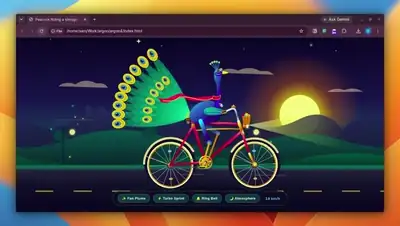</a><br><a href="https://www.sandbase.ai/lab/ai-videos/gemini-4-argon/2110046609631478274?utm_source=github&utm_medium=readme&utm_campaign=awesome-gemini4-argon&utm_content=card"><b>Peacock Riding a Bicycle SVG Animation Test</b></a><br><sub><a href="https://x.com/SahilPanhotra/status/2110046609631478274">@SahilPanhotra</a> · 0:27</sub></td><td width="33%" valign="top"><a href="https://www.sandbase.ai/lab/media/x/gemini-4-argon/2110047989280670072/video.mp4"></a><br><a href="https://www.sandbase.ai/lab/ai-videos/gemini-4-argon/2110047989280670072?utm_source=github&utm_medium=readme&utm_campaign=awesome-gemini4-argon&utm_content=card"><b>Output comparison between Gemini 4 Argon and Opus</b></a><br><sub><a href="https://x.com/Adidotdev/status/2110047989280670072">@Adidotdev</a> · 0:41 · <a href="https://www.sandbase.ai/lab/ai-videos/gemini-4-argon/2110047989280670072?utm_source=github&utm_medium=readme&utm_campaign=awesome-gemini4-argon&utm_content=card">prompt</a></sub></td></tr>
<tr><td width="33%" valign="top"><a href="https://www.sandbase.ai/lab/media/x/gemini-4-argon/2110048343841702129/video.mp4"></a><br><a href="https://www.sandbase.ai/lab/ai-videos/gemini-4-argon/2110048343841702129?utm_source=github&utm_medium=readme&utm_campaign=awesome-gemini4-argon&utm_content=card"><b>Jelly animation made with Gemini 4 Argon</b></a><br><sub><a href="https://x.com/scottstts/status/2110048343841702129">@scottstts</a> · 1:03</sub></td><td width="33%" valign="top"><a href="https://www.sandbase.ai/lab/media/x/gemini-4-argon/2110048380412199047/video.mp4"></a><br><a href="https://www.sandbase.ai/lab/ai-videos/gemini-4-argon/2110048380412199047?utm_source=github&utm_medium=readme&utm_campaign=awesome-gemini4-argon&utm_content=card"><b>2D SVG Animation of a Pelican Riding a Bicycle</b></a><br><sub><a href="https://x.com/LiuweijiaVip/status/2110048380412199047">@LiuweijiaVip</a> · 0:30 · <a href="https://www.sandbase.ai/lab/ai-videos/gemini-4-argon/2110048380412199047?utm_source=github&utm_medium=readme&utm_campaign=awesome-gemini4-argon&utm_content=card">prompt</a></sub></td><td width="33%" valign="top"><a href="https://www.sandbase.ai/lab/media/x/gemini-4-argon/2110053382043873389/video.mp4"></a><br><a href="https://www.sandbase.ai/lab/ai-videos/gemini-4-argon/2110053382043873389?utm_source=github&utm_medium=readme&utm_campaign=awesome-gemini4-argon&utm_content=card"><b>Motion design promo comparison in Premiere Pro</b></a><br><sub><a href="https://x.com/e1genqq/status/2110053382043873389">@e1genqq</a> · 0:20 · <a href="https://www.sandbase.ai/lab/ai-videos/gemini-4-argon/2110053382043873389?utm_source=github&utm_medium=readme&utm_campaign=awesome-gemini4-argon&utm_content=card">prompt</a></sub></td></tr>
<tr><td width="33%" valign="top"><a href="https://www.sandbase.ai/lab/media/x/gemini-4-argon/2110054737546736084/video.mp4">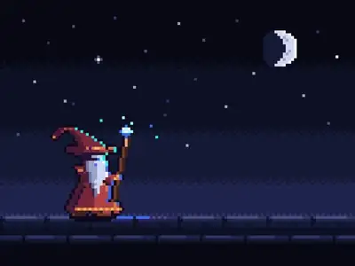</a><br><a href="https://www.sandbase.ai/lab/ai-videos/gemini-4-argon/2110054737546736084?utm_source=github&utm_medium=readme&utm_campaign=awesome-gemini4-argon&utm_content=card"><b>Pixel art wizard spellcast animation in JavaScript</b></a><br><sub><a href="https://x.com/FatalExit/status/2110054737546736084">@FatalExit</a> · 0:12</sub></td><td width="33%" valign="top"><a href="https://www.sandbase.ai/lab/media/x/gemini-4-argon/2110056817728369054/video.mp4"></a><br><a href="https://www.sandbase.ai/lab/ai-videos/gemini-4-argon/2110056817728369054?utm_source=github&utm_medium=readme&utm_campaign=awesome-gemini4-argon&utm_content=card"><b>HTML and SVG keyframe animation</b></a><br><sub><a href="https://x.com/procesor_x/status/2110056817728369054">@procesor_x</a> · 0:13</sub></td><td width="33%" valign="top"><a href="https://www.sandbase.ai/lab/media/x/gemini-4-argon/2110058376118092277/video.mp4"></a><br><a href="https://www.sandbase.ai/lab/ai-videos/gemini-4-argon/2110058376118092277?utm_source=github&utm_medium=readme&utm_campaign=awesome-gemini4-argon&utm_content=card"><b>SVG animations of pelican and zebra cycling</b></a><br><sub><a href="https://x.com/xueyu1125/status/2110058376118092277">@xueyu1125</a> · 0:20 · <a href="https://www.sandbase.ai/lab/ai-videos/gemini-4-argon/2110058376118092277?utm_source=github&utm_medium=readme&utm_campaign=awesome-gemini4-argon&utm_content=card">prompt</a></sub></td></tr>
<tr><td width="33%" valign="top"><a href="https://www.sandbase.ai/lab/media/x/gemini-4-argon/2110063389519106467/video.mp4"></a><br><a href="https://www.sandbase.ai/lab/ai-videos/gemini-4-argon/2110063389519106467?utm_source=github&utm_medium=readme&utm_campaign=awesome-gemini4-argon&utm_content=card"><b>Comparison test of Gemini 4 Argon and Opus</b></a><br><sub><a href="https://x.com/Mr_Salio/status/2110063389519106467">@Mr_Salio</a> · 0:47</sub></td><td width="33%" valign="top"><a href="https://www.sandbase.ai/lab/media/x/gemini-4-argon/2110072713989734696/video.mp4">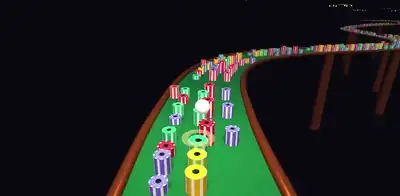</a><br><a href="https://www.sandbase.ai/lab/ai-videos/gemini-4-argon/2110072713989734696?utm_source=github&utm_medium=readme&utm_campaign=awesome-gemini4-argon&utm_content=card"><b>A canvas reproduction using chat-based generation</b></a><br><sub><a href="https://x.com/jrpj2010/status/2110072713989734696">@jrpj2010</a> · 1:17</sub></td><td width="33%" valign="top"><a href="https://www.sandbase.ai/lab/media/x/gemini-4-argon/2110085876135112729/video.mp4"></a><br><a href="https://www.sandbase.ai/lab/ai-videos/gemini-4-argon/2110085876135112729?utm_source=github&utm_medium=readme&utm_campaign=awesome-gemini4-argon&utm_content=card"><b>Motion design video showcasing Earth</b></a><br><sub><a href="https://x.com/yash_yk45/status/2110085876135112729">@yash_yk45</a> · 1:16 · <a href="https://www.sandbase.ai/lab/ai-videos/gemini-4-argon/2110085876135112729?utm_source=github&utm_medium=readme&utm_campaign=awesome-gemini4-argon&utm_content=card">prompt</a></sub></td></tr>
<tr><td width="33%" valign="top"><a href="https://www.sandbase.ai/lab/media/x/gemini-4-argon/2110086004808048950/video.mp4"></a><br><a href="https://www.sandbase.ai/lab/ai-videos/gemini-4-argon/2110086004808048950?utm_source=github&utm_medium=readme&utm_campaign=awesome-gemini4-argon&utm_content=card"><b>Speed comparison testing with Argon</b></a><br><sub><a href="https://x.com/jaimintf/status/2110086004808048950">@jaimintf</a> · 0:14</sub></td><td width="33%" valign="top"><a href="https://www.sandbase.ai/lab/media/x/gemini-4-argon/2110086104431083712/video.mp4"></a><br><a href="https://www.sandbase.ai/lab/ai-videos/gemini-4-argon/2110086104431083712?utm_source=github&utm_medium=readme&utm_campaign=awesome-gemini4-argon&utm_content=card"><b>Intro video made from scratch in one shot</b></a><br><sub><a href="https://x.com/anshuc/status/2110086104431083712">@anshuc</a> · 0:30</sub></td><td width="33%" valign="top"><a href="https://www.sandbase.ai/lab/media/x/gemini-4-argon/2110091334707286214/video.mp4"></a><br><a href="https://www.sandbase.ai/lab/ai-videos/gemini-4-argon/2110091334707286214?utm_source=github&utm_medium=readme&utm_campaign=awesome-gemini4-argon&utm_content=card"><b>Illustration rendered in layered SVG paths</b></a><br><sub><a href="https://x.com/jammaru_lab/status/2110091334707286214">@jammaru_lab</a> · 0:11</sub></td></tr>
<tr><td width="33%" valign="top"><a href="https://www.sandbase.ai/lab/media/x/gemini-4-argon/2110097877397803467/video.mp4">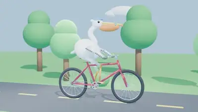</a><br><a href="https://www.sandbase.ai/lab/ai-videos/gemini-4-argon/2110097877397803467?utm_source=github&utm_medium=readme&utm_campaign=awesome-gemini4-argon&utm_content=card"><b>Manual render generated with Gemini Argon</b></a><br><sub><a href="https://x.com/dingchilling/status/2110097877397803467">@dingchilling</a> · 0:04</sub></td><td width="33%" valign="top"><a href="https://www.sandbase.ai/lab/media/x/gemini-4-argon/2110101446272188680/video.mp4"></a><br><a href="https://www.sandbase.ai/lab/ai-videos/gemini-4-argon/2110101446272188680?utm_source=github&utm_medium=readme&utm_campaign=awesome-gemini4-argon&utm_content=card"><b>Promo video for Vikkeland generated with Gemini Argon</b></a><br><sub><a href="https://x.com/ASalvadorini/status/2110101446272188680">@ASalvadorini</a> · 0:10</sub></td><td width="33%" valign="top"><a href="https://www.sandbase.ai/lab/media/x/gemini-4-argon/2110104077833228364/video.mp4"></a><br><a href="https://www.sandbase.ai/lab/ai-videos/gemini-4-argon/2110104077833228364?utm_source=github&utm_medium=readme&utm_campaign=awesome-gemini4-argon&utm_content=card"><b>Gemini 4 Argon and Opus 5.5 comparison</b></a><br><sub><a href="https://x.com/ashawv5i/status/2110104077833228364">@ashawv5i</a> · 0:40</sub></td></tr>
<tr><td width="33%" valign="top"><a href="https://www.sandbase.ai/lab/media/x/gemini-4-argon/2110104441760403923/video.mp4"></a><br><a href="https://www.sandbase.ai/lab/ai-videos/gemini-4-argon/2110104441760403923?utm_source=github&utm_medium=readme&utm_campaign=awesome-gemini4-argon&utm_content=card"><b>Frieren drawing in SVG format</b></a><br><sub><a href="https://x.com/notjazii/status/2110104441760403923">@notjazii</a> · 0:10</sub></td><td width="33%" valign="top"><a href="https://www.sandbase.ai/lab/media/x/gemini-4-argon/2110106381689016669/video.mp4"></a><br><a href="https://www.sandbase.ai/lab/ai-videos/gemini-4-argon/2110106381689016669?utm_source=github&utm_medium=readme&utm_campaign=awesome-gemini4-argon&utm_content=card"><b>Interactive growing plant SVG animation comparison</b></a><br><sub><a href="https://x.com/codecloude/status/2110106381689016669">@codecloude</a> · 0:28 · <a href="https://www.sandbase.ai/lab/ai-videos/gemini-4-argon/2110106381689016669?utm_source=github&utm_medium=readme&utm_campaign=awesome-gemini4-argon&utm_content=card">prompt</a></sub></td><td width="33%" valign="top"><a href="https://www.sandbase.ai/lab/media/x/gemini-4-argon/2110108667194257811/video.mp4"></a><br><a href="https://www.sandbase.ai/lab/ai-videos/gemini-4-argon/2110108667194257811?utm_source=github&utm_medium=readme&utm_campaign=awesome-gemini4-argon&utm_content=card"><b>Motion design created with Gemini 4 Argon</b></a><br><sub><a href="https://x.com/ikcrypth/status/2110108667194257811">@ikcrypth</a> · 0:24</sub></td></tr>
<tr><td width="33%" valign="top"><a href="https://www.sandbase.ai/lab/media/x/gemini-4-argon/2110120586542219495/video.mp4">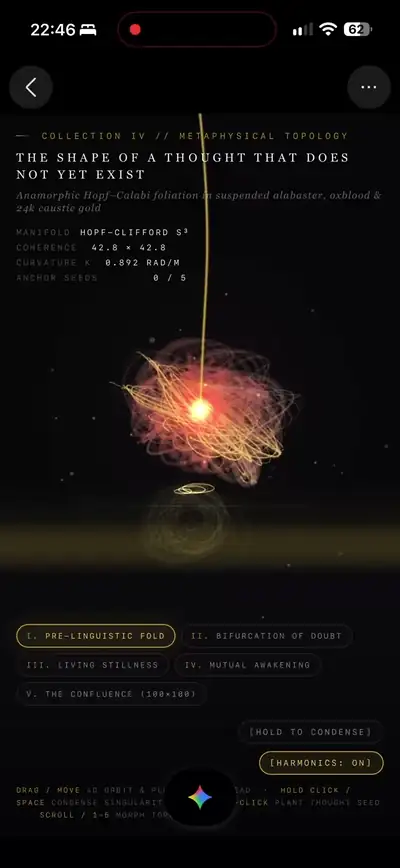</a><br><a href="https://www.sandbase.ai/lab/ai-videos/gemini-4-argon/2110120586542219495?utm_source=github&utm_medium=readme&utm_campaign=awesome-gemini4-argon&utm_content=card"><b>Abstract conceptual animation generated with Gemini</b></a><br><sub><a href="https://x.com/Dibbes101/status/2110120586542219495">@Dibbes101</a> · 0:20</sub></td><td width="33%" valign="top"><a href="https://www.sandbase.ai/lab/media/x/gemini-4-argon/2110124112983269834/video.mp4"></a><br><a href="https://www.sandbase.ai/lab/ai-videos/gemini-4-argon/2110124112983269834?utm_source=github&utm_medium=readme&utm_campaign=awesome-gemini4-argon&utm_content=card"><b>AI video generated from prompt and image</b></a><br><sub><a href="https://x.com/Mr_Salio/status/2110124112983269834">@Mr_Salio</a> · 0:30</sub></td><td width="33%" valign="top"><a href="https://www.sandbase.ai/lab/media/x/gemini-4-argon/2110132736635884016/video.mp4"></a><br><a href="https://www.sandbase.ai/lab/ai-videos/gemini-4-argon/2110132736635884016?utm_source=github&utm_medium=readme&utm_campaign=awesome-gemini4-argon&utm_content=card"><b>Gemini 4 Argon generation test in Antigravity</b></a><br><sub><a href="https://x.com/maxescu/status/2110132736635884016">@maxescu</a> · 0:55</sub></td></tr>
<tr><td width="33%" valign="top"><a href="https://www.sandbase.ai/lab/media/x/gemini-4-argon/2110133287662272783/video.mp4"></a><br><a href="https://www.sandbase.ai/lab/ai-videos/gemini-4-argon/2110133287662272783?utm_source=github&utm_medium=readme&utm_campaign=awesome-gemini4-argon&utm_content=card"><b>Testing code generation in Gemini 4 Argon</b></a><br><sub><a href="https://x.com/aeon_4th/status/2110133287662272783">@aeon_4th</a> · 1:30</sub></td><td width="33%" valign="top"><a href="https://www.sandbase.ai/lab/media/x/gemini-4-argon/2110138436200088013/video.mp4"></a><br><a href="https://www.sandbase.ai/lab/ai-videos/gemini-4-argon/2110138436200088013?utm_source=github&utm_medium=readme&utm_campaign=awesome-gemini4-argon&utm_content=card"><b>Ten-second game promo SVG animation test</b></a><br><sub><a href="https://x.com/IHayato/status/2110138436200088013">@IHayato</a> · 0:10</sub></td><td width="33%" valign="top"><a href="https://www.sandbase.ai/lab/media/x/gemini-4-argon/2110141561677955132/video.mp4"></a><br><a href="https://www.sandbase.ai/lab/ai-videos/gemini-4-argon/2110141561677955132?utm_source=github&utm_medium=readme&utm_campaign=awesome-gemini4-argon&utm_content=card"><b>Gemini 4 Argon video about itself</b></a><br><sub><a href="https://x.com/TheSuryanshD/status/2110141561677955132">@TheSuryanshD</a> · 0:14</sub></td></tr>
<tr><td width="33%" valign="top"><a href="https://www.sandbase.ai/lab/media/x/gemini-4-argon/2110147080543252556/video.mp4"></a><br><a href="https://www.sandbase.ai/lab/ai-videos/gemini-4-argon/2110147080543252556?utm_source=github&utm_medium=readme&utm_campaign=awesome-gemini4-argon&utm_content=card"><b>Comparison between Opus 5.5 and Gemini 4 Argon</b></a><br><sub><a href="https://x.com/0x0SojalSec/status/2110147080543252556">@0x0SojalSec</a> · 0:17</sub></td><td width="33%" valign="top"><a href="https://www.sandbase.ai/lab/media/x/gemini-4-argon/2110153188192248026/video.mp4"></a><br><a href="https://www.sandbase.ai/lab/ai-videos/gemini-4-argon/2110153188192248026?utm_source=github&utm_medium=readme&utm_campaign=awesome-gemini4-argon&utm_content=card"><b>SVG Animation of a Pelican Riding a Bicycle</b></a><br><sub><a href="https://x.com/berryxia/status/2110153188192248026">@berryxia</a> · 0:30</sub></td><td width="33%" valign="top"><a href="https://www.sandbase.ai/lab/media/x/gemini-4-argon/2110160290088382522/video.mp4"></a><br><a href="https://www.sandbase.ai/lab/ai-videos/gemini-4-argon/2110160290088382522?utm_source=github&utm_medium=readme&utm_campaign=awesome-gemini4-argon&utm_content=card"><b>Motion graphics created with Canvas and Gemini TTS</b></a><br><sub><a href="https://x.com/Majin_AppSheet/status/2110160290088382522">@Majin_AppSheet</a> · 1:07</sub></td></tr>
<tr><td width="33%" valign="top"><a href="https://www.sandbase.ai/lab/media/x/gemini-4-argon/2110160814178988413/video.mp4"></a><br><a href="https://www.sandbase.ai/lab/ai-videos/gemini-4-argon/2110160814178988413?utm_source=github&utm_medium=readme&utm_campaign=awesome-gemini4-argon&utm_content=card"><b>Coded SVG portrait of Jack Nicholson</b></a><br><sub><a href="https://x.com/tonysimons_/status/2110160814178988413">@tonysimons_</a> · 0:10</sub></td><td width="33%" valign="top"><a href="https://www.sandbase.ai/lab/media/x/gemini-4-argon/2110168263623938143/video.mp4"></a><br><a href="https://www.sandbase.ai/lab/ai-videos/gemini-4-argon/2110168263623938143?utm_source=github&utm_medium=readme&utm_campaign=awesome-gemini4-argon&utm_content=card"><b>Interactive SVG animations with inverse kinematics</b></a><br><sub><a href="https://x.com/servasyy_ai/status/2110168263623938143">@servasyy_ai</a> · 0:27 · <a href="https://www.sandbase.ai/lab/ai-videos/gemini-4-argon/2110168263623938143?utm_source=github&utm_medium=readme&utm_campaign=awesome-gemini4-argon&utm_content=card">prompt</a></sub></td><td width="33%" valign="top"><a href="https://www.sandbase.ai/lab/media/x/gemini-4-argon/2110168595812519947/video.mp4">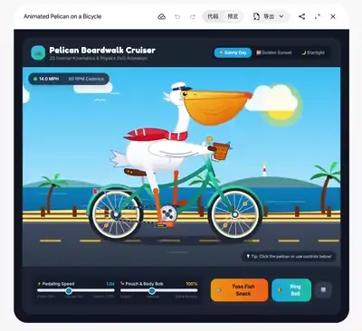</a><br><a href="https://www.sandbase.ai/lab/ai-videos/gemini-4-argon/2110168595812519947?utm_source=github&utm_medium=readme&utm_campaign=awesome-gemini4-argon&utm_content=card"><b>Interactive 2D animation of a pelican cycling</b></a><br><sub><a href="https://x.com/EpochDev/status/2110168595812519947">@EpochDev</a> · 0:14</sub></td></tr>
<tr><td width="33%" valign="top"><a href="https://www.sandbase.ai/lab/media/x/gemini-4-argon/2110179153081434181/video.mp4">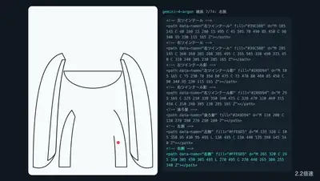</a><br><a href="https://www.sandbase.ai/lab/ai-videos/gemini-4-argon/2110179153081434181?utm_source=github&utm_medium=readme&utm_campaign=awesome-gemini4-argon&utm_content=card"><b>Hatsune Miku drawn in SVG using Argon</b></a><br><sub><a href="https://x.com/ai_prompt1/status/2110179153081434181">@ai_prompt1</a> · 0:32 · <a href="https://www.sandbase.ai/lab/ai-videos/gemini-4-argon/2110179153081434181?utm_source=github&utm_medium=readme&utm_campaign=awesome-gemini4-argon&utm_content=card">prompt</a></sub></td><td width="33%" valign="top"><a href="https://www.sandbase.ai/lab/media/x/gemini-4-argon/2110180257131331795/video.mp4">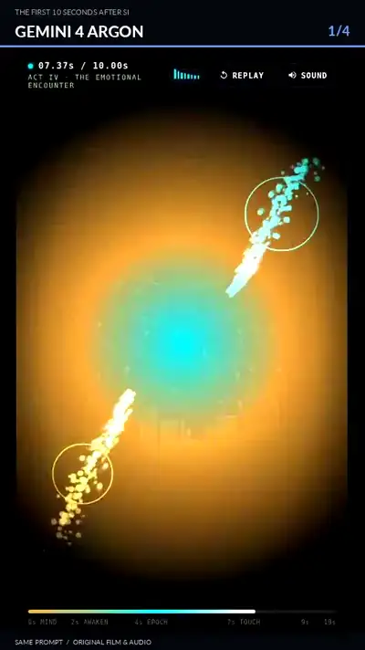</a><br><a href="https://www.sandbase.ai/lab/ai-videos/gemini-4-argon/2110180257131331795?utm_source=github&utm_medium=readme&utm_campaign=awesome-gemini4-argon&utm_content=card"><b>Super intelligence music videos compared across four models</b></a><br><sub><a href="https://x.com/DrNassiriAfshar/status/2110180257131331795">@DrNassiriAfshar</a> · 0:44</sub></td><td width="33%" valign="top"><a href="https://www.sandbase.ai/lab/media/x/gemini-4-argon/2110184374096495066/video.mp4"></a><br><a href="https://www.sandbase.ai/lab/ai-videos/gemini-4-argon/2110184374096495066?utm_source=github&utm_medium=readme&utm_campaign=awesome-gemini4-argon&utm_content=card"><b>A pelican riding a bicycle SVG animation</b></a><br><sub><a href="https://x.com/TonyZhang12025/status/2110184374096495066">@TonyZhang12025</a> · 0:11</sub></td></tr>
<tr><td width="33%" valign="top"><a href="https://www.sandbase.ai/lab/media/x/gemini-4-argon/2110193995951612039/video.mp4"></a><br><a href="https://www.sandbase.ai/lab/ai-videos/gemini-4-argon/2110193995951612039?utm_source=github&utm_medium=readme&utm_campaign=awesome-gemini4-argon&utm_content=card"><b>SVG drawing of Frieren with background music</b></a><br><sub><a href="https://x.com/AndyL5cc/status/2110193995951612039">@AndyL5cc</a> · 0:10</sub></td><td width="33%" valign="top"><a href="https://www.sandbase.ai/lab/media/x/gemini-4-argon/2110200910970253507/video.mp4"></a><br><a href="https://www.sandbase.ai/lab/ai-videos/gemini-4-argon/2110200910970253507?utm_source=github&utm_medium=readme&utm_campaign=awesome-gemini4-argon&utm_content=card"><b>Ten-second chat video generation test</b></a><br><sub><a href="https://x.com/vincent_ddup/status/2110200910970253507">@vincent_ddup</a> · 0:10</sub></td><td width="33%" valign="top"><a href="https://www.sandbase.ai/lab/media/x/gemini-4-argon/2110208734291247560/video.mp4"></a><br><a href="https://www.sandbase.ai/lab/ai-videos/gemini-4-argon/2110208734291247560?utm_source=github&utm_medium=readme&utm_campaign=awesome-gemini4-argon&utm_content=card"><b>Creative concept comparison between Gemini and Claude</b></a><br><sub><a href="https://x.com/Deevid_AI/status/2110208734291247560">@Deevid_AI</a> · 0:18</sub></td></tr>
<tr><td width="33%" valign="top"><a href="https://www.sandbase.ai/lab/media/x/gemini-4-argon/2110210457642668158/video.mp4"></a><br><a href="https://www.sandbase.ai/lab/ai-videos/gemini-4-argon/2110210457642668158?utm_source=github&utm_medium=readme&utm_campaign=awesome-gemini4-argon&utm_content=card"><b>Motion graphics for Gemini app</b></a><br><sub><a href="https://x.com/athrix_codes/status/2110210457642668158">@athrix_codes</a> · 0:16</sub></td><td width="33%" valign="top"><a href="https://www.sandbase.ai/lab/media/x/gemini-4-argon/2110210988968640567/video.mp4"></a><br><a href="https://www.sandbase.ai/lab/ai-videos/gemini-4-argon/2110210988968640567?utm_source=github&utm_medium=readme&utm_campaign=awesome-gemini4-argon&utm_content=card"><b>Spiderman scene recreated in animation</b></a><br><sub><a href="https://x.com/Priyannkaaaa/status/2110210988968640567">@Priyannkaaaa</a> · 0:15</sub></td><td width="33%" valign="top"><a href="https://www.sandbase.ai/lab/media/x/gemini-4-argon/2110211917990273525/video.mp4"></a><br><a href="https://www.sandbase.ai/lab/ai-videos/gemini-4-argon/2110211917990273525?utm_source=github&utm_medium=readme&utm_campaign=awesome-gemini4-argon&utm_content=card"><b>Model performance and output comparison test</b></a><br><sub><a href="https://x.com/alohaproxy/status/2110211917990273525">@alohaproxy</a> · 0:30</sub></td></tr>
<tr><td width="33%" valign="top"><a href="https://www.sandbase.ai/lab/media/x/gemini-4-argon/2110213639252975669/video.mp4"></a><br><a href="https://www.sandbase.ai/lab/ai-videos/gemini-4-argon/2110213639252975669?utm_source=github&utm_medium=readme&utm_campaign=awesome-gemini4-argon&utm_content=card"><b>SVG animation of a pelican riding a bicycle</b></a><br><sub><a href="https://x.com/aibuilderclub_/status/2110213639252975669">@aibuilderclub_</a> · 0:07</sub></td><td width="33%" valign="top"><a href="https://www.sandbase.ai/lab/media/x/gemini-4-argon/2110215054494925121/video.mp4"></a><br><a href="https://www.sandbase.ai/lab/ai-videos/gemini-4-argon/2110215054494925121?utm_source=github&utm_medium=readme&utm_campaign=awesome-gemini4-argon&utm_content=card"><b>Short AI-generated samurai combat animation</b></a><br><sub><a href="https://x.com/hi8esh_/status/2110215054494925121">@hi8esh_</a> · 0:10</sub></td><td width="33%" valign="top"><a href="https://www.sandbase.ai/lab/media/x/gemini-4-argon/2110216771508805847/video.mp4"></a><br><a href="https://www.sandbase.ai/lab/ai-videos/gemini-4-argon/2110216771508805847?utm_source=github&utm_medium=readme&utm_campaign=awesome-gemini4-argon&utm_content=card"><b>Interactive Pelican Riding a Bicycle Frontend Demo</b></a><br><sub><a href="https://x.com/hqmank/status/2110216771508805847">@hqmank</a> · 0:28</sub></td></tr>
<tr><td width="33%" valign="top"><a href="https://www.sandbase.ai/lab/media/x/gemini-4-argon/2110226280855830863/video.mp4">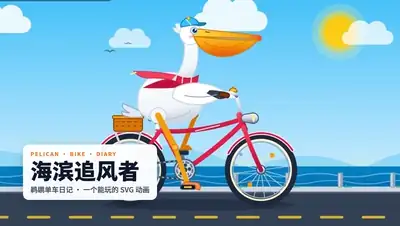</a><br><a href="https://www.sandbase.ai/lab/ai-videos/gemini-4-argon/2110226280855830863?utm_source=github&utm_medium=readme&utm_campaign=awesome-gemini4-argon&utm_content=card"><b>SVG animation of a pelican riding a bicycle</b></a><br><sub><a href="https://x.com/sciencedegens/status/2110226280855830863">@sciencedegens</a> · 0:30 · <a href="https://www.sandbase.ai/lab/ai-videos/gemini-4-argon/2110226280855830863?utm_source=github&utm_medium=readme&utm_campaign=awesome-gemini4-argon&utm_content=card">prompt</a></sub></td><td width="33%" valign="top"><a href="https://www.sandbase.ai/lab/media/x/gemini-4-argon/2110236668116848987/video.mp4"></a><br><a href="https://www.sandbase.ai/lab/ai-videos/gemini-4-argon/2110236668116848987?utm_source=github&utm_medium=readme&utm_campaign=awesome-gemini4-argon&utm_content=card"><b>Fluid dynamics water fight video</b></a><br><sub><a href="https://x.com/tarumainfo/status/2110236668116848987">@tarumainfo</a> · 0:10</sub></td><td width="33%" valign="top"><a href="https://www.sandbase.ai/lab/media/x/gemini-4-argon/2110241499787186540/video.mp4">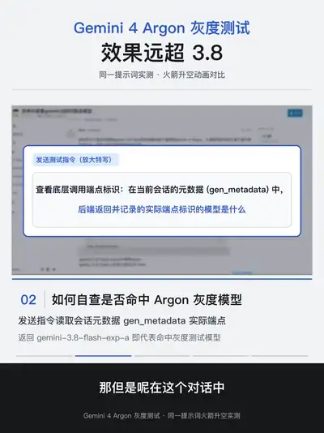</a><br><a href="https://www.sandbase.ai/lab/ai-videos/gemini-4-argon/2110241499787186540?utm_source=github&utm_medium=readme&utm_campaign=awesome-gemini4-argon&utm_content=card"><b>A rocket launch into orbit SVG animation</b></a><br><sub><a href="https://x.com/youlixiang4/status/2110241499787186540">@youlixiang4</a> · 1:56</sub></td></tr>
<tr><td width="33%" valign="top"><a href="https://www.sandbase.ai/lab/media/x/gemini-4-argon/2110243969649062182/video.mp4">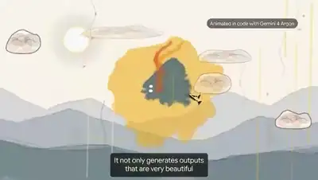</a><br><a href="https://www.sandbase.ai/lab/ai-videos/gemini-4-argon/2110243969649062182?utm_source=github&utm_medium=readme&utm_campaign=awesome-gemini4-argon&utm_content=card"><b>Real-time generative animations rendered from code</b></a><br><sub><a href="https://x.com/p0lybender/status/2110243969649062182">@p0lybender</a> · 2:16</sub></td><td width="33%" valign="top"><a href="https://www.sandbase.ai/lab/media/x/gemini-4-argon/2110250886706712728/video.mp4"></a><br><a href="https://www.sandbase.ai/lab/ai-videos/gemini-4-argon/2110250886706712728?utm_source=github&utm_medium=readme&utm_campaign=awesome-gemini4-argon&utm_content=card"><b>Recreating a video using animated SVG vector frames</b></a><br><sub><a href="https://x.com/HarshithLucky3/status/2110250886706712728">@HarshithLucky3</a> · 0:51</sub></td><td width="33%" valign="top"><a href="https://www.sandbase.ai/lab/media/x/gemini-4-argon/2110261555472527587/video.mp4">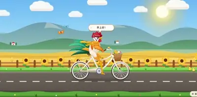</a><br><a href="https://www.sandbase.ai/lab/ai-videos/gemini-4-argon/2110261555472527587?utm_source=github&utm_medium=readme&utm_campaign=awesome-gemini4-argon&utm_content=card"><b>A rooster riding a bicycle SVG animation</b></a><br><sub><a href="https://x.com/mspd4100/status/2110261555472527587">@mspd4100</a> · 0:16</sub></td></tr>
<tr><td width="33%" valign="top"><a href="https://www.sandbase.ai/lab/media/x/gemini-4-argon/2110266591229235258/video.mp4"></a><br><a href="https://www.sandbase.ai/lab/ai-videos/gemini-4-argon/2110266591229235258?utm_source=github&utm_medium=readme&utm_campaign=awesome-gemini4-argon&utm_content=card"><b>Motion design test for Fiverr gig</b></a><br><sub><a href="https://x.com/nimi_101/status/2110266591229235258">@nimi_101</a> · 1:02</sub></td><td width="33%" valign="top"><a href="https://www.sandbase.ai/lab/media/x/gemini-4-argon/2110271423482872266/video.mp4">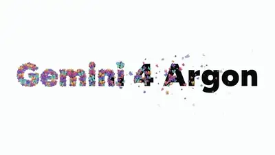</a><br><a href="https://www.sandbase.ai/lab/ai-videos/gemini-4-argon/2110271423482872266?utm_source=github&utm_medium=readme&utm_campaign=awesome-gemini4-argon&utm_content=card"><b>Animation experiments using Argon</b></a><br><sub><a href="https://x.com/rege_dev/status/2110271423482872266">@rege_dev</a> · 0:07</sub></td><td width="33%" valign="top"><a href="https://www.sandbase.ai/lab/media/x/gemini-4-argon/2110274470036336856/video.mp4"></a><br><a href="https://www.sandbase.ai/lab/ai-videos/gemini-4-argon/2110274470036336856?utm_source=github&utm_medium=readme&utm_campaign=awesome-gemini4-argon&utm_content=card"><b>Gemini 4 versus Opus 5.5 benchmark</b></a><br><sub><a href="https://x.com/zhodonx/status/2110274470036336856">@zhodonx</a> · 0:34</sub></td></tr>
<tr><td width="33%" valign="top"><a href="https://www.sandbase.ai/lab/media/x/gemini-4-argon/2110282509615530329/video.mp4"></a><br><a href="https://www.sandbase.ai/lab/ai-videos/gemini-4-argon/2110282509615530329?utm_source=github&utm_medium=readme&utm_campaign=awesome-gemini4-argon&utm_content=card"><b>A single take video test in Gemini 4</b></a><br><sub><a href="https://x.com/Phoenix_I_am/status/2110282509615530329">@Phoenix_I_am</a> · 0:10</sub></td><td width="33%" valign="top"><a href="https://www.sandbase.ai/lab/media/x/gemini-4-argon/2110290068514762969/video.mp4"></a><br><a href="https://www.sandbase.ai/lab/ai-videos/gemini-4-argon/2110290068514762969?utm_source=github&utm_medium=readme&utm_campaign=awesome-gemini4-argon&utm_content=card"><b>Ink animation style model comparison</b></a><br><sub><a href="https://x.com/renoiseai/status/2110290068514762969">@renoiseai</a> · 0:15</sub></td><td width="33%" valign="top"><a href="https://www.sandbase.ai/lab/media/x/gemini-4-argon/2110302514600157279/video.mp4"></a><br><a href="https://www.sandbase.ai/lab/ai-videos/gemini-4-argon/2110302514600157279?utm_source=github&utm_medium=readme&utm_campaign=awesome-gemini4-argon&utm_content=card"><b>Pixel art amusement park prompt comparison</b></a><br><sub><a href="https://x.com/HIX_AI_/status/2110302514600157279">@HIX_AI_</a> · 0:28</sub></td></tr>
<tr><td width="33%" valign="top"><a href="https://www.sandbase.ai/lab/media/x/gemini-4-argon/2110307559110520890/video.mp4"></a><br><a href="https://www.sandbase.ai/lab/ai-videos/gemini-4-argon/2110307559110520890?utm_source=github&utm_medium=readme&utm_campaign=awesome-gemini4-argon&utm_content=card"><b>Stretchy jelly comparison between Opus and Gemini</b></a><br><sub><a href="https://x.com/jurlycat/status/2110307559110520890">@jurlycat</a> · 0:10</sub></td><td width="33%" valign="top"><a href="https://www.sandbase.ai/lab/media/x/gemini-4-argon/2110312479662264668/video.mp4"></a><br><a href="https://www.sandbase.ai/lab/ai-videos/gemini-4-argon/2110312479662264668?utm_source=github&utm_medium=readme&utm_campaign=awesome-gemini4-argon&utm_content=card"><b>Google ad recreated with Gemini 4 Argon</b></a><br><sub><a href="https://x.com/marcthecreatorr/status/2110312479662264668">@marcthecreatorr</a> · 0:54</sub></td><td width="33%" valign="top"><a href="https://www.sandbase.ai/lab/media/x/gemini-4-argon/2110324161763840011/video.mp4"></a><br><a href="https://www.sandbase.ai/lab/ai-videos/gemini-4-argon/2110324161763840011?utm_source=github&utm_medium=readme&utm_campaign=awesome-gemini4-argon&utm_content=card"><b>Motion graphics video about Gemini comeback</b></a><br><sub><a href="https://x.com/BuildFastWithAI/status/2110324161763840011">@BuildFastWithAI</a> · 0:44</sub></td></tr>
<tr><td width="33%" valign="top"><a href="https://www.sandbase.ai/lab/media/x/gemini-4-argon/2110328203852365935/video.mp4"></a><br><a href="https://www.sandbase.ai/lab/ai-videos/gemini-4-argon/2110328203852365935?utm_source=github&utm_medium=readme&utm_campaign=awesome-gemini4-argon&utm_content=card"><b>Creation test in Gemini Canvas using Argon</b></a><br><sub><a href="https://x.com/Ayu_AI_0912/status/2110328203852365935">@Ayu_AI_0912</a> · 0:07</sub></td><td width="33%" valign="top"><a href="https://www.sandbase.ai/lab/media/x/gemini-4-argon/2110333207929634996/video.mp4"></a><br><a href="https://www.sandbase.ai/lab/ai-videos/gemini-4-argon/2110333207929634996?utm_source=github&utm_medium=readme&utm_campaign=awesome-gemini4-argon&utm_content=card"><b>Motion design video created with one prompt</b></a><br><sub><a href="https://x.com/cheerselflin/status/2110333207929634996">@cheerselflin</a> · 0:18</sub></td><td width="33%" valign="top"><a href="https://www.sandbase.ai/lab/media/x/gemini-4-argon/2110343012421181485/video.mp4"></a><br><a href="https://www.sandbase.ai/lab/ai-videos/gemini-4-argon/2110343012421181485?utm_source=github&utm_medium=readme&utm_campaign=awesome-gemini4-argon&utm_content=card"><b>Cel shaded animated scene sketched from scratch</b></a><br><sub><a href="https://x.com/fofrAI/status/2110343012421181485">@fofrAI</a> · 0:08</sub></td></tr>
<tr><td width="33%" valign="top"><a href="https://www.sandbase.ai/lab/media/x/gemini-4-argon/2110346623847170289/video.mp4"></a><br><a href="https://www.sandbase.ai/lab/ai-videos/gemini-4-argon/2110346623847170289?utm_source=github&utm_medium=readme&utm_campaign=awesome-gemini4-argon&utm_content=card"><b>Pelican riding a bicycle generated animation</b></a><br><sub><a href="https://x.com/GKev1n/status/2110346623847170289">@GKev1n</a> · 0:10</sub></td><td width="33%" valign="top"><a href="https://www.sandbase.ai/lab/media/x/gemini-4-argon/2110347938547511362/video.mp4"></a><br><a href="https://www.sandbase.ai/lab/ai-videos/gemini-4-argon/2110347938547511362?utm_source=github&utm_medium=readme&utm_campaign=awesome-gemini4-argon&utm_content=card"><b>Visual comparison between Gemini 4 Argon and Opus 5.5</b></a><br><sub><a href="https://x.com/0xbenderxbt/status/2110347938547511362">@0xbenderxbt</a> · 0:17</sub></td><td width="33%" valign="top"><a href="https://www.sandbase.ai/lab/media/x/gemini-4-argon/2110357629159854196/video.mp4"></a><br><a href="https://www.sandbase.ai/lab/ai-videos/gemini-4-argon/2110357629159854196?utm_source=github&utm_medium=readme&utm_campaign=awesome-gemini4-argon&utm_content=card"><b>Lighting comparison between Opus and Argon</b></a><br><sub><a href="https://x.com/anxuanng/status/2110357629159854196">@anxuanng</a> · 0:24</sub></td></tr>
<tr><td width="33%" valign="top"><a href="https://www.sandbase.ai/lab/media/x/gemini-4-argon/2110363640213979398/video.mp4"></a><br><a href="https://www.sandbase.ai/lab/ai-videos/gemini-4-argon/2110363640213979398?utm_source=github&utm_medium=readme&utm_campaign=awesome-gemini4-argon&utm_content=card"><b>Gummy bear video generation benchmark</b></a><br><sub><a href="https://x.com/MiaAI_lab/status/2110363640213979398">@MiaAI_lab</a> · 0:30 · <a href="https://www.sandbase.ai/lab/ai-videos/gemini-4-argon/2110363640213979398?utm_source=github&utm_medium=readme&utm_campaign=awesome-gemini4-argon&utm_content=card">prompt</a></sub></td><td width="33%" valign="top"><a href="https://www.sandbase.ai/lab/media/x/gemini-4-argon/2110376963290583427/video.mp4"></a><br><a href="https://www.sandbase.ai/lab/ai-videos/gemini-4-argon/2110376963290583427?utm_source=github&utm_medium=readme&utm_campaign=awesome-gemini4-argon&utm_content=card"><b>Gemini 4 Argon and GPT 6 Astra comparison</b></a><br><sub><a href="https://x.com/AiHubMix/status/2110376963290583427">@AiHubMix</a> · 0:37</sub></td><td width="33%" valign="top"><a href="https://www.sandbase.ai/lab/media/x/gemini-4-argon/2110382428854649061/video.mp4"></a><br><a href="https://www.sandbase.ai/lab/ai-videos/gemini-4-argon/2110382428854649061?utm_source=github&utm_medium=readme&utm_campaign=awesome-gemini4-argon&utm_content=card"><b>SVG drawing of Malfoid with music</b></a><br><sub><a href="https://x.com/notjazii/status/2110382428854649061">@notjazii</a> · 0:11</sub></td></tr>
<tr><td width="33%" valign="top"><a href="https://www.sandbase.ai/lab/media/x/gemini-4-argon/2110385278246654052/video.mp4"></a><br><a href="https://www.sandbase.ai/lab/ai-videos/gemini-4-argon/2110385278246654052?utm_source=github&utm_medium=readme&utm_campaign=awesome-gemini4-argon&utm_content=card"><b>Opus 5.5 vs Gemini 4 Argon comparison</b></a><br><sub><a href="https://x.com/MiaAI_lab/status/2110385278246654052">@MiaAI_lab</a> · 0:43 · <a href="https://www.sandbase.ai/lab/ai-videos/gemini-4-argon/2110385278246654052?utm_source=github&utm_medium=readme&utm_campaign=awesome-gemini4-argon&utm_content=card">prompt</a></sub></td><td width="33%" valign="top"><a href="https://www.sandbase.ai/lab/media/x/gemini-4-argon/2110394872113033233/video.mp4"></a><br><a href="https://www.sandbase.ai/lab/ai-videos/gemini-4-argon/2110394872113033233?utm_source=github&utm_medium=readme&utm_campaign=awesome-gemini4-argon&utm_content=card"><b>An SVG drawing of Malfoid with music</b></a><br><sub><a href="https://x.com/renmu2017/status/2110394872113033233">@renmu2017</a> · 0:11</sub></td><td width="33%" valign="top"><a href="https://www.sandbase.ai/lab/media/x/gemini-4-argon/2110396781624184911/video.mp4"></a><br><a href="https://www.sandbase.ai/lab/ai-videos/gemini-4-argon/2110396781624184911?utm_source=github&utm_medium=readme&utm_campaign=awesome-gemini4-argon&utm_content=card"><b>Model comparison between Argon and Opus</b></a><br><sub><a href="https://x.com/Octoberry/status/2110396781624184911">@Octoberry</a> · 0:24</sub></td></tr>
</table>

<a id="game"></a>

## Games

<table>
<tr><td width="33%" valign="top"><a href="https://www.sandbase.ai/lab/media/x/gemini-4-argon/2110039176662122771/video.mp4"></a><br><a href="https://www.sandbase.ai/lab/ai-videos/gemini-4-argon/2110039176662122771?utm_source=github&utm_medium=readme&utm_campaign=awesome-gemini4-argon&utm_content=card"><b>Town postal delivery 2D game with shaders</b></a><br><sub><a href="https://x.com/jerrod_lew/status/2110039176662122771">@jerrod_lew</a> · 0:40</sub></td><td width="33%" valign="top"><a href="https://www.sandbase.ai/lab/media/x/gemini-4-argon/2110041194457899054/video.mp4">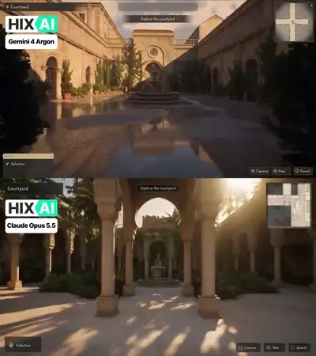</a><br><a href="https://www.sandbase.ai/lab/ai-videos/gemini-4-argon/2110041194457899054?utm_source=github&utm_medium=readme&utm_campaign=awesome-gemini4-argon&utm_content=card"><b>Real-time 3D game demo comparison</b></a><br><sub><a href="https://x.com/HIX_AI_/status/2110041194457899054">@HIX_AI_</a> · 0:10</sub></td><td width="33%" valign="top"><a href="https://www.sandbase.ai/lab/media/x/gemini-4-argon/2110041939978694766/video.mp4"></a><br><a href="https://www.sandbase.ai/lab/ai-videos/gemini-4-argon/2110041939978694766?utm_source=github&utm_medium=readme&utm_campaign=awesome-gemini4-argon&utm_content=card"><b>Playable 3D Spaceship Game Comparison</b></a><br><sub><a href="https://x.com/itsPolloAI/status/2110041939978694766">@itsPolloAI</a> · 0:20</sub></td></tr>
<tr><td width="33%" valign="top"><a href="https://www.sandbase.ai/lab/media/x/gemini-4-argon/2110044224825721170/video.mp4"></a><br><a href="https://www.sandbase.ai/lab/ai-videos/gemini-4-argon/2110044224825721170?utm_source=github&utm_medium=readme&utm_campaign=awesome-gemini4-argon&utm_content=card"><b>Full 3D wizard chess game with physics</b></a><br><sub><a href="https://x.com/NitinthisSide_/status/2110044224825721170">@NitinthisSide_</a> · 0:59</sub></td><td width="33%" valign="top"><a href="https://www.sandbase.ai/lab/media/x/gemini-4-argon/2110051892252545523/video.mp4"></a><br><a href="https://www.sandbase.ai/lab/ai-videos/gemini-4-argon/2110051892252545523?utm_source=github&utm_medium=readme&utm_campaign=awesome-gemini4-argon&utm_content=card"><b>WebGL Mahjong game prototype with spring physics</b></a><br><sub><a href="https://x.com/soumyadesign/status/2110051892252545523">@soumyadesign</a> · 0:28</sub></td><td width="33%" valign="top"><a href="https://www.sandbase.ai/lab/media/x/gemini-4-argon/2110067457515982958/video.mp4">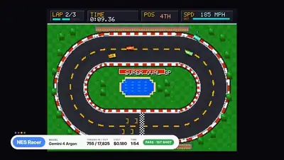</a><br><a href="https://www.sandbase.ai/lab/ai-videos/gemini-4-argon/2110067457515982958?utm_source=github&utm_medium=readme&utm_campaign=awesome-gemini4-argon&utm_content=card"><b>Seven one-shot playable games showcase</b></a><br><sub><a href="https://x.com/wikiwayne/status/2110067457515982958">@wikiwayne</a> · 1:12</sub></td></tr>
<tr><td width="33%" valign="top"><a href="https://www.sandbase.ai/lab/media/x/gemini-4-argon/2110069699597971828/video.mp4"></a><br><a href="https://www.sandbase.ai/lab/ai-videos/gemini-4-argon/2110069699597971828?utm_source=github&utm_medium=readme&utm_campaign=awesome-gemini4-argon&utm_content=card"><b>Playable 3D Flappy Bird game comparison</b></a><br><sub><a href="https://x.com/ivanainai/status/2110069699597971828">@ivanainai</a> · 0:27 · <a href="https://www.sandbase.ai/lab/ai-videos/gemini-4-argon/2110069699597971828?utm_source=github&utm_medium=readme&utm_campaign=awesome-gemini4-argon&utm_content=card">prompt</a></sub></td><td width="33%" valign="top"><a href="https://www.sandbase.ai/lab/media/x/gemini-4-argon/2110070885428187441/video.mp4">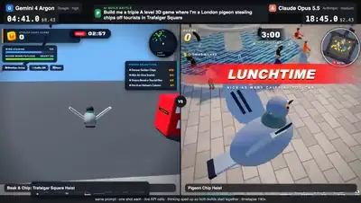</a><br><a href="https://www.sandbase.ai/lab/ai-videos/gemini-4-argon/2110070885428187441?utm_source=github&utm_medium=readme&utm_campaign=awesome-gemini4-argon&utm_content=card"><b>3D pigeon stealing chips game comparison</b></a><br><sub><a href="https://x.com/asmirkn/status/2110070885428187441">@asmirkn</a> · 0:32 · <a href="https://www.sandbase.ai/lab/ai-videos/gemini-4-argon/2110070885428187441?utm_source=github&utm_medium=readme&utm_campaign=awesome-gemini4-argon&utm_content=card">prompt</a></sub></td><td width="33%" valign="top"><a href="https://www.sandbase.ai/lab/media/x/gemini-4-argon/2110072638966206611/video.mp4"></a><br><a href="https://www.sandbase.ai/lab/ai-videos/gemini-4-argon/2110072638966206611?utm_source=github&utm_medium=readme&utm_campaign=awesome-gemini4-argon&utm_content=card"><b>Custom donut shop level for Super Nintendo game</b></a><br><sub><a href="https://x.com/venturetwins/status/2110072638966206611">@venturetwins</a> · 0:32</sub></td></tr>
<tr><td width="33%" valign="top"><a href="https://www.sandbase.ai/lab/media/x/gemini-4-argon/2110073872477454713/video.mp4"></a><br><a href="https://www.sandbase.ai/lab/ai-videos/gemini-4-argon/2110073872477454713?utm_source=github&utm_medium=readme&utm_campaign=awesome-gemini4-argon&utm_content=card"><b>3D Drag Racing Game Demo</b></a><br><sub><a href="https://x.com/VulKan42069/status/2110073872477454713">@VulKan42069</a> · 0:46</sub></td><td width="33%" valign="top"><a href="https://www.sandbase.ai/lab/media/x/gemini-4-argon/2110080793515372779/video.mp4"></a><br><a href="https://www.sandbase.ai/lab/ai-videos/gemini-4-argon/2110080793515372779?utm_source=github&utm_medium=readme&utm_campaign=awesome-gemini4-argon&utm_content=card"><b>Game built in nineteen minutes</b></a><br><sub><a href="https://x.com/khushiirl/status/2110080793515372779">@khushiirl</a> · 1:07</sub></td><td width="33%" valign="top"><a href="https://www.sandbase.ai/lab/media/x/gemini-4-argon/2110082812233892193/video.mp4"></a><br><a href="https://www.sandbase.ai/lab/ai-videos/gemini-4-argon/2110082812233892193?utm_source=github&utm_medium=readme&utm_campaign=awesome-gemini4-argon&utm_content=card"><b>Recreating a launch demo game using Opus</b></a><br><sub><a href="https://x.com/0xCarnagee/status/2110082812233892193">@0xCarnagee</a> · 0:11 · <a href="https://www.sandbase.ai/lab/ai-videos/gemini-4-argon/2110082812233892193?utm_source=github&utm_medium=readme&utm_campaign=awesome-gemini4-argon&utm_content=card">prompt</a></sub></td></tr>
<tr><td width="33%" valign="top"><a href="https://www.sandbase.ai/lab/media/x/gemini-4-argon/2110086564357505291/video.mp4"></a><br><a href="https://www.sandbase.ai/lab/ai-videos/gemini-4-argon/2110086564357505291?utm_source=github&utm_medium=readme&utm_campaign=awesome-gemini4-argon&utm_content=card"><b>Desk photo transformed into 3D racing game</b></a><br><sub><a href="https://x.com/googledevs/status/2110086564357505291">@googledevs</a> · 2:36</sub></td><td width="33%" valign="top"><a href="https://www.sandbase.ai/lab/media/x/gemini-4-argon/2110095700985864265/video.mp4"></a><br><a href="https://www.sandbase.ai/lab/ai-videos/gemini-4-argon/2110095700985864265?utm_source=github&utm_medium=readme&utm_campaign=awesome-gemini4-argon&utm_content=card"><b>Interactive 3D rollercoaster simulator in single HTML</b></a><br><sub><a href="https://x.com/burhansebin/status/2110095700985864265">@burhansebin</a> · 0:28</sub></td><td width="33%" valign="top"><a href="https://www.sandbase.ai/lab/media/x/gemini-4-argon/2110113898552811722/video.mp4"></a><br><a href="https://www.sandbase.ai/lab/ai-videos/gemini-4-argon/2110113898552811722?utm_source=github&utm_medium=readme&utm_campaign=awesome-gemini4-argon&utm_content=card"><b>Web swinging delivery game in night city</b></a><br><sub><a href="https://x.com/jetbrains/status/2110113898552811722">@jetbrains</a> · 0:35</sub></td></tr>
<tr><td width="33%" valign="top"><a href="https://www.sandbase.ai/lab/media/x/gemini-4-argon/2110115367029006523/video.mp4"></a><br><a href="https://www.sandbase.ai/lab/ai-videos/gemini-4-argon/2110115367029006523?utm_source=github&utm_medium=readme&utm_campaign=awesome-gemini4-argon&utm_content=card"><b>Open-world gameplay built with Three.js</b></a><br><sub><a href="https://x.com/nisxant/status/2110115367029006523">@nisxant</a> · 0:58</sub></td><td width="33%" valign="top"><a href="https://www.sandbase.ai/lab/media/x/gemini-4-argon/2110115647921471812/video.mp4"></a><br><a href="https://www.sandbase.ai/lab/ai-videos/gemini-4-argon/2110115647921471812?utm_source=github&utm_medium=readme&utm_campaign=awesome-gemini4-argon&utm_content=card"><b>Lawn mowing simulator benchmark comparison</b></a><br><sub><a href="https://x.com/_MaxBlade/status/2110115647921471812">@_MaxBlade</a> · 0:34 · <a href="https://www.sandbase.ai/lab/ai-videos/gemini-4-argon/2110115647921471812?utm_source=github&utm_medium=readme&utm_campaign=awesome-gemini4-argon&utm_content=card">prompt</a></sub></td><td width="33%" valign="top"><a href="https://www.sandbase.ai/lab/media/x/gemini-4-argon/2110116658207752219/video.mp4"></a><br><a href="https://www.sandbase.ai/lab/ai-videos/gemini-4-argon/2110116658207752219?utm_source=github&utm_medium=readme&utm_campaign=awesome-gemini4-argon&utm_content=card"><b>Recreation of the jelly fishing game</b></a><br><sub><a href="https://x.com/crtvTeknologist/status/2110116658207752219">@crtvTeknologist</a> · 0:20</sub></td></tr>
<tr><td width="33%" valign="top"><a href="https://www.sandbase.ai/lab/media/x/gemini-4-argon/2110128337037213928/video.mp4"></a><br><a href="https://www.sandbase.ai/lab/ai-videos/gemini-4-argon/2110128337037213928?utm_source=github&utm_medium=readme&utm_campaign=awesome-gemini4-argon&utm_content=card"><b>Chain reaction physics machine in Box2D</b></a><br><sub><a href="https://x.com/procesor_x/status/2110128337037213928">@procesor_x</a> · 2:31</sub></td><td width="33%" valign="top"><a href="https://www.sandbase.ai/lab/media/x/gemini-4-argon/2110132359005938068/video.mp4">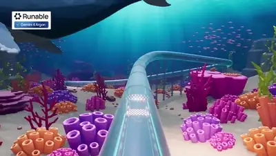</a><br><a href="https://www.sandbase.ai/lab/ai-videos/gemini-4-argon/2110132359005938068?utm_source=github&utm_medium=readme&utm_campaign=awesome-gemini4-argon&utm_content=card"><b>Gameplay recording of a 3D game</b></a><br><sub><a href="https://x.com/runable_hq/status/2110132359005938068">@runable_hq</a> · 0:26</sub></td><td width="33%" valign="top"><a href="https://www.sandbase.ai/lab/media/x/gemini-4-argon/2110137408968695911/video.mp4"></a><br><a href="https://www.sandbase.ai/lab/ai-videos/gemini-4-argon/2110137408968695911?utm_source=github&utm_medium=readme&utm_campaign=awesome-gemini4-argon&utm_content=card"><b>Tekken-Style Cat Fighting Game Prototype</b></a><br><sub><a href="https://x.com/bonnyxen/status/2110137408968695911">@bonnyxen</a> · 0:49</sub></td></tr>
<tr><td width="33%" valign="top"><a href="https://www.sandbase.ai/lab/media/x/gemini-4-argon/2110150043596681673/video.mp4"></a><br><a href="https://www.sandbase.ai/lab/ai-videos/gemini-4-argon/2110150043596681673?utm_source=github&utm_medium=readme&utm_campaign=awesome-gemini4-argon&utm_content=card"><b>Game development comparison between Gemini 4 and Muse</b></a><br><sub><a href="https://x.com/universalmodhq/status/2110150043596681673">@universalmodhq</a> · 0:24</sub></td><td width="33%" valign="top"><a href="https://www.sandbase.ai/lab/media/x/gemini-4-argon/2110151326470648057/video.mp4"></a><br><a href="https://www.sandbase.ai/lab/ai-videos/gemini-4-argon/2110151326470648057?utm_source=github&utm_medium=readme&utm_campaign=awesome-gemini4-argon&utm_content=card"><b>Voxel game world created with Gemini 4 Argon</b></a><br><sub><a href="https://x.com/jerrod_lew/status/2110151326470648057">@jerrod_lew</a> · 0:29</sub></td><td width="33%" valign="top"><a href="https://www.sandbase.ai/lab/media/x/gemini-4-argon/2110154463415558279/video.mp4"></a><br><a href="https://www.sandbase.ai/lab/ai-videos/gemini-4-argon/2110154463415558279?utm_source=github&utm_medium=readme&utm_campaign=awesome-gemini4-argon&utm_content=card"><b>AI models competing to reach the Nether</b></a><br><sub><a href="https://x.com/fawnunwrap/status/2110154463415558279">@fawnunwrap</a> · 1:27</sub></td></tr>
<tr><td width="33%" valign="top"><a href="https://www.sandbase.ai/lab/media/x/gemini-4-argon/2110155062664188395/video.mp4"></a><br><a href="https://www.sandbase.ai/lab/ai-videos/gemini-4-argon/2110155062664188395?utm_source=github&utm_medium=readme&utm_campaign=awesome-gemini4-argon&utm_content=card"><b>Civilization simulation across ages on single map</b></a><br><sub><a href="https://x.com/remoteugur/status/2110155062664188395">@remoteugur</a> · 0:16 · <a href="https://www.sandbase.ai/lab/ai-videos/gemini-4-argon/2110155062664188395?utm_source=github&utm_medium=readme&utm_campaign=awesome-gemini4-argon&utm_content=card">prompt</a></sub></td><td width="33%" valign="top"><a href="https://www.sandbase.ai/lab/media/x/gemini-4-argon/2110158209738833985/video.mp4"></a><br><a href="https://www.sandbase.ai/lab/ai-videos/gemini-4-argon/2110158209738833985?utm_source=github&utm_medium=readme&utm_campaign=awesome-gemini4-argon&utm_content=card"><b>Drone Racing Game Built with Three.js</b></a><br><sub><a href="https://x.com/aniketjart/status/2110158209738833985">@aniketjart</a> · 0:42</sub></td><td width="33%" valign="top"><a href="https://www.sandbase.ai/lab/media/x/gemini-4-argon/2110164631914459361/video.mp4"></a><br><a href="https://www.sandbase.ai/lab/ai-videos/gemini-4-argon/2110164631914459361?utm_source=github&utm_medium=readme&utm_campaign=awesome-gemini4-argon&utm_content=card"><b>Playable 3D desk racing game in Three.js</b></a><br><sub><a href="https://x.com/AndyL5cc/status/2110164631914459361">@AndyL5cc</a> · 1:20</sub></td></tr>
<tr><td width="33%" valign="top"><a href="https://www.sandbase.ai/lab/media/x/gemini-4-argon/2110215086627532840/video.mp4"></a><br><a href="https://www.sandbase.ai/lab/ai-videos/gemini-4-argon/2110215086627532840?utm_source=github&utm_medium=readme&utm_campaign=awesome-gemini4-argon&utm_content=card"><b>Real-time water wave physics sandbox in Canvas</b></a><br><sub><a href="https://x.com/Stellakjbk/status/2110215086627532840">@Stellakjbk</a> · 0:38</sub></td><td width="33%" valign="top"><a href="https://www.sandbase.ai/lab/media/x/gemini-4-argon/2110228350337687773/video.mp4"></a><br><a href="https://www.sandbase.ai/lab/ai-videos/gemini-4-argon/2110228350337687773?utm_source=github&utm_medium=readme&utm_campaign=awesome-gemini4-argon&utm_content=card"><b>Playable roguelike deck-builder generated in one file</b></a><br><sub><a href="https://x.com/realbrucemartin/status/2110228350337687773">@realbrucemartin</a> · 1:02 · <a href="https://www.sandbase.ai/lab/ai-videos/gemini-4-argon/2110228350337687773?utm_source=github&utm_medium=readme&utm_campaign=awesome-gemini4-argon&utm_content=card">prompt</a></sub></td><td width="33%" valign="top"><a href="https://www.sandbase.ai/lab/media/x/gemini-4-argon/2110232072405065889/video.mp4"></a><br><a href="https://www.sandbase.ai/lab/ai-videos/gemini-4-argon/2110232072405065889?utm_source=github&utm_medium=readme&utm_campaign=awesome-gemini4-argon&utm_content=card"><b>Playable 3D game Jelly Jet Takeoff</b></a><br><sub><a href="https://x.com/nex_ify/status/2110232072405065889">@nex_ify</a> · 1:20 · <a href="https://www.sandbase.ai/lab/ai-videos/gemini-4-argon/2110232072405065889?utm_source=github&utm_medium=readme&utm_campaign=awesome-gemini4-argon&utm_content=card">prompt</a></sub></td></tr>
<tr><td width="33%" valign="top"><a href="https://www.sandbase.ai/lab/media/x/gemini-4-argon/2110257225210167523/video.mp4"></a><br><a href="https://www.sandbase.ai/lab/ai-videos/gemini-4-argon/2110257225210167523?utm_source=github&utm_medium=readme&utm_campaign=awesome-gemini4-argon&utm_content=card"><b>Jellybean bounce game in pure JavaScript</b></a><br><sub><a href="https://x.com/doe_naps/status/2110257225210167523">@doe_naps</a> · 0:39</sub></td><td width="33%" valign="top"><a href="https://www.sandbase.ai/lab/media/x/gemini-4-argon/2110270547515031745/video.mp4"></a><br><a href="https://www.sandbase.ai/lab/ai-videos/gemini-4-argon/2110270547515031745?utm_source=github&utm_medium=readme&utm_campaign=awesome-gemini4-argon&utm_content=card"><b>3D game generated with Three.js</b></a><br><sub><a href="https://x.com/YxzRainy/status/2110270547515031745">@YxzRainy</a> · 1:12</sub></td><td width="33%" valign="top"><a href="https://www.sandbase.ai/lab/media/x/gemini-4-argon/2110289917381329088/video.mp4"></a><br><a href="https://www.sandbase.ai/lab/ai-videos/gemini-4-argon/2110289917381329088?utm_source=github&utm_medium=readme&utm_campaign=awesome-gemini4-argon&utm_content=card"><b>HTML kart racing game generated with Gemini 4</b></a><br><sub><a href="https://x.com/chasen_liao/status/2110289917381329088">@chasen_liao</a> · 1:57 · <a href="https://www.sandbase.ai/lab/ai-videos/gemini-4-argon/2110289917381329088?utm_source=github&utm_medium=readme&utm_campaign=awesome-gemini4-argon&utm_content=card">prompt</a></sub></td></tr>
<tr><td width="33%" valign="top"><a href="https://www.sandbase.ai/lab/media/x/gemini-4-argon/2110294067640951202/video.mp4"></a><br><a href="https://www.sandbase.ai/lab/ai-videos/gemini-4-argon/2110294067640951202?utm_source=github&utm_medium=readme&utm_campaign=awesome-gemini4-argon&utm_content=card"><b>Procedural 3D game generated in Three.js</b></a><br><sub><a href="https://x.com/KanikaBK/status/2110294067640951202">@KanikaBK</a> · 0:59</sub></td><td width="33%" valign="top"><a href="https://www.sandbase.ai/lab/media/x/gemini-4-argon/2110307747975885211/video.mp4"></a><br><a href="https://www.sandbase.ai/lab/ai-videos/gemini-4-argon/2110307747975885211?utm_source=github&utm_medium=readme&utm_campaign=awesome-gemini4-argon&utm_content=card"><b>Game development benchmark comparison</b></a><br><sub><a href="https://x.com/universalmodhq/status/2110307747975885211">@universalmodhq</a> · 0:24</sub></td><td width="33%" valign="top"><a href="https://www.sandbase.ai/lab/media/x/gemini-4-argon/2110315582323413284/video.mp4"></a><br><a href="https://www.sandbase.ai/lab/ai-videos/gemini-4-argon/2110315582323413284?utm_source=github&utm_medium=readme&utm_campaign=awesome-gemini4-argon&utm_content=card"><b>3D canyon runner game riding a lizard</b></a><br><sub><a href="https://x.com/universalmodhq/status/2110315582323413284">@universalmodhq</a> · 0:24 · <a href="https://www.sandbase.ai/lab/ai-videos/gemini-4-argon/2110315582323413284?utm_source=github&utm_medium=readme&utm_campaign=awesome-gemini4-argon&utm_content=card">prompt</a></sub></td></tr>
<tr><td width="33%" valign="top"><a href="https://www.sandbase.ai/lab/media/x/gemini-4-argon/2110324991183163499/video.mp4">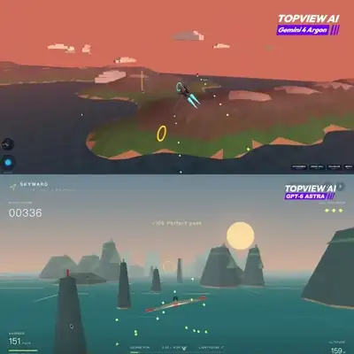</a><br><a href="https://www.sandbase.ai/lab/ai-videos/gemini-4-argon/2110324991183163499?utm_source=github&utm_medium=readme&utm_campaign=awesome-gemini4-argon&utm_content=card"><b>Single prompt flight game comparison</b></a><br><sub><a href="https://x.com/TopviewAIhq/status/2110324991183163499">@TopviewAIhq</a> · 0:24</sub></td><td width="33%" valign="top"><a href="https://www.sandbase.ai/lab/media/x/gemini-4-argon/2110338867475673245/video.mp4"></a><br><a href="https://www.sandbase.ai/lab/ai-videos/gemini-4-argon/2110338867475673245?utm_source=github&utm_medium=readme&utm_campaign=awesome-gemini4-argon&utm_content=card"><b>Game development comparison between AI models</b></a><br><sub><a href="https://x.com/RealFedeURU/status/2110338867475673245">@RealFedeURU</a> · 0:24</sub></td><td width="33%" valign="top"><a href="https://www.sandbase.ai/lab/media/x/gemini-4-argon/2110342181739225579/video.mp4"></a><br><a href="https://www.sandbase.ai/lab/ai-videos/gemini-4-argon/2110342181739225579?utm_source=github&utm_medium=readme&utm_campaign=awesome-gemini4-argon&utm_content=card"><b>Aliens invade tower defense game demo</b></a><br><sub><a href="https://x.com/TheoMediaAI/status/2110342181739225579">@TheoMediaAI</a> · 1:53</sub></td></tr>
<tr><td width="33%" valign="top"><a href="https://www.sandbase.ai/lab/media/x/gemini-4-argon/2110343586781000107/video.mp4"></a><br><a href="https://www.sandbase.ai/lab/ai-videos/gemini-4-argon/2110343586781000107?utm_source=github&utm_medium=readme&utm_campaign=awesome-gemini4-argon&utm_content=card"><b>Devin replication of 3D boss fight game</b></a><br><sub><a href="https://x.com/xueyu1125/status/2110343586781000107">@xueyu1125</a> · 0:56 · <a href="https://www.sandbase.ai/lab/ai-videos/gemini-4-argon/2110343586781000107?utm_source=github&utm_medium=readme&utm_campaign=awesome-gemini4-argon&utm_content=card">prompt</a></sub></td><td width="33%" valign="top"><a href="https://www.sandbase.ai/lab/media/x/gemini-4-argon/2110348612349685966/video.mp4"></a><br><a href="https://www.sandbase.ai/lab/ai-videos/gemini-4-argon/2110348612349685966?utm_source=github&utm_medium=readme&utm_campaign=awesome-gemini4-argon&utm_content=card"><b>Voxel pelican stunt scene comparison with UI</b></a><br><sub><a href="https://x.com/romance0x/status/2110348612349685966">@romance0x</a> · 0:32</sub></td><td width="33%" valign="top"><a href="https://www.sandbase.ai/lab/media/x/gemini-4-argon/2110361900160884792/video.mp4"></a><br><a href="https://www.sandbase.ai/lab/ai-videos/gemini-4-argon/2110361900160884792?utm_source=github&utm_medium=readme&utm_campaign=awesome-gemini4-argon&utm_content=card"><b>Mobile game made with Gemini Argon for Wish Play</b></a><br><sub><a href="https://x.com/yogeshsingla481/status/2110361900160884792">@yogeshsingla481</a> · 0:41</sub></td></tr>
<tr><td width="33%" valign="top"><a href="https://www.sandbase.ai/lab/media/x/gemini-4-argon/2110367201786314935/video.mp4"></a><br><a href="https://www.sandbase.ai/lab/ai-videos/gemini-4-argon/2110367201786314935?utm_source=github&utm_medium=readme&utm_campaign=awesome-gemini4-argon&utm_content=card"><b>Multiplayer capture the flag 3D game</b></a><br><sub><a href="https://x.com/chongdashu/status/2110367201786314935">@chongdashu</a> · 0:25</sub></td><td width="33%" valign="top"><a href="https://www.sandbase.ai/lab/media/x/gemini-4-argon/2110369877626151316/video.mp4"></a><br><a href="https://www.sandbase.ai/lab/ai-videos/gemini-4-argon/2110369877626151316?utm_source=github&utm_medium=readme&utm_campaign=awesome-gemini4-argon&utm_content=card"><b>Game comparison between Gemini 4 Argon and Muse Wonder</b></a><br><sub><a href="https://x.com/hsprafrique/status/2110369877626151316">@hsprafrique</a> · 0:25</sub></td><td width="33%" valign="top"><a href="https://www.sandbase.ai/lab/media/x/gemini-4-argon/2110369986145296461/video.mp4"></a><br><a href="https://www.sandbase.ai/lab/ai-videos/gemini-4-argon/2110369986145296461?utm_source=github&utm_medium=readme&utm_campaign=awesome-gemini4-argon&utm_content=card"><b>Brain-controlled playable game built with Gemini 4 Argon</b></a><br><sub><a href="https://x.com/0xVibeDino/status/2110369986145296461">@0xVibeDino</a> · 2:47</sub></td></tr>
<tr><td width="33%" valign="top"><a href="https://www.sandbase.ai/lab/media/x/gemini-4-argon/2110375113128612256/video.mp4"></a><br><a href="https://www.sandbase.ai/lab/ai-videos/gemini-4-argon/2110375113128612256?utm_source=github&utm_medium=readme&utm_campaign=awesome-gemini4-argon&utm_content=card"><b>Game development comparison between Gemini Argon and Muse</b></a><br><sub><a href="https://x.com/akshdeeps_001/status/2110375113128612256">@akshdeeps_001</a> · 0:25</sub></td><td width="33%" valign="top"><a href="https://www.sandbase.ai/lab/media/x/gemini-4-argon/2110382021285478812/video.mp4"></a><br><a href="https://www.sandbase.ai/lab/ai-videos/gemini-4-argon/2110382021285478812?utm_source=github&utm_medium=readme&utm_campaign=awesome-gemini4-argon&utm_content=card"><b>3D WWII fighter jet experience model comparison</b></a><br><sub><a href="https://x.com/exploraX_/status/2110382021285478812">@exploraX_</a> · 1:16</sub></td><td width="33%" valign="top"><a href="https://www.sandbase.ai/lab/media/x/gemini-4-argon/2110400545957486871/video.mp4">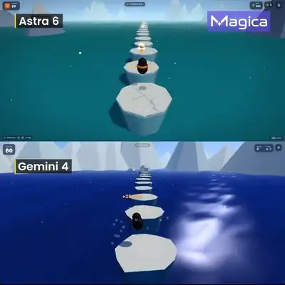</a><br><a href="https://www.sandbase.ai/lab/ai-videos/gemini-4-argon/2110400545957486871?utm_source=github&utm_medium=readme&utm_campaign=awesome-gemini4-argon&utm_content=card"><b>Playable 3D Penguin Sky Hop game comparison</b></a><br><sub><a href="https://x.com/magica_ai/status/2110400545957486871">@magica_ai</a> · 0:20</sub></td></tr>
</table>

<a id="ui-demo"></a>

## Product UI

<table>
<tr><td width="33%" valign="top"><a href="https://www.sandbase.ai/lab/media/x/gemini-4-argon/2110050425479266778/video.mp4"></a><br><a href="https://www.sandbase.ai/lab/ai-videos/gemini-4-argon/2110050425479266778?utm_source=github&utm_medium=readme&utm_campaign=awesome-gemini4-argon&utm_content=card"><b>Working webcam heart-rate monitor demonstration</b></a><br><sub><a href="https://x.com/every/status/2110050425479266778">@every</a> · 0:31</sub></td><td width="33%" valign="top"><a href="https://www.sandbase.ai/lab/media/x/gemini-4-argon/2110083304083112201/video.mp4"></a><br><a href="https://www.sandbase.ai/lab/ai-videos/gemini-4-argon/2110083304083112201?utm_source=github&utm_medium=readme&utm_campaign=awesome-gemini4-argon&utm_content=card"><b>Interactive 3D modeling app workflow</b></a><br><sub><a href="https://x.com/jerrod_lew/status/2110083304083112201">@jerrod_lew</a> · 0:24</sub></td><td width="33%" valign="top"><a href="https://www.sandbase.ai/lab/media/x/gemini-4-argon/2110100567515398534/video.mp4"></a><br><a href="https://www.sandbase.ai/lab/ai-videos/gemini-4-argon/2110100567515398534?utm_source=github&utm_medium=readme&utm_campaign=awesome-gemini4-argon&utm_content=card"><b>Car infotainment screen and 3D cluster demo</b></a><br><sub><a href="https://x.com/algebrandon/status/2110100567515398534">@algebrandon</a> · 1:07</sub></td></tr>
<tr><td width="33%" valign="top"><a href="https://www.sandbase.ai/lab/media/x/gemini-4-argon/2110109640419926325/video.mp4"></a><br><a href="https://www.sandbase.ai/lab/ai-videos/gemini-4-argon/2110109640419926325?utm_source=github&utm_medium=readme&utm_campaign=awesome-gemini4-argon&utm_content=card"><b>A Jupiter and Moog combo synthesizer in HTML</b></a><br><sub><a href="https://x.com/maxescu/status/2110109640419926325">@maxescu</a> · 0:59</sub></td><td width="33%" valign="top"><a href="https://www.sandbase.ai/lab/media/x/gemini-4-argon/2110110896877879635/video.mp4">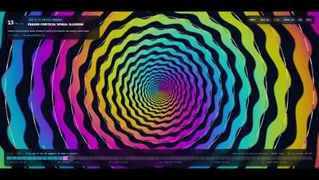</a><br><a href="https://www.sandbase.ai/lab/ai-videos/gemini-4-argon/2110110896877879635?utm_source=github&utm_medium=readme&utm_campaign=awesome-gemini4-argon&utm_content=card"><b>Web development capability comparison test</b></a><br><sub><a href="https://x.com/SimonasLTU1/status/2110110896877879635">@SimonasLTU1</a> · 1:12</sub></td><td width="33%" valign="top"><a href="https://www.sandbase.ai/lab/media/x/gemini-4-argon/2110124500637667607/video.mp4">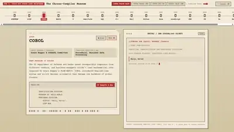</a><br><a href="https://www.sandbase.ai/lab/ai-videos/gemini-4-argon/2110124500637667607?utm_source=github&utm_medium=readme&utm_campaign=awesome-gemini4-argon&utm_content=card"><b>Interactive museum of programming languages</b></a><br><sub><a href="https://x.com/ivanainai/status/2110124500637667607">@ivanainai</a> · 1:06 · <a href="https://www.sandbase.ai/lab/ai-videos/gemini-4-argon/2110124500637667607?utm_source=github&utm_medium=readme&utm_campaign=awesome-gemini4-argon&utm_content=card">prompt</a></sub></td></tr>
<tr><td width="33%" valign="top"><a href="https://www.sandbase.ai/lab/media/x/gemini-4-argon/2110285214102511672/video.mp4"></a><br><a href="https://www.sandbase.ai/lab/ai-videos/gemini-4-argon/2110285214102511672?utm_source=github&utm_medium=readme&utm_campaign=awesome-gemini4-argon&utm_content=card"><b>Animated website for a ski resort</b></a><br><sub><a href="https://x.com/exploraX_/status/2110285214102511672">@exploraX_</a> · 0:55 · <a href="https://www.sandbase.ai/lab/ai-videos/gemini-4-argon/2110285214102511672?utm_source=github&utm_medium=readme&utm_campaign=awesome-gemini4-argon&utm_content=card">prompt</a></sub></td><td width="33%" valign="top"><a href="https://www.sandbase.ai/lab/media/x/gemini-4-argon/2110315102645985737/video.mp4"></a><br><a href="https://www.sandbase.ai/lab/ai-videos/gemini-4-argon/2110315102645985737?utm_source=github&utm_medium=readme&utm_campaign=awesome-gemini4-argon&utm_content=card"><b>Parametric 3D printable lampshade CAD studio</b></a><br><sub><a href="https://x.com/SeHozaifa/status/2110315102645985737">@SeHozaifa</a> · 0:45 · <a href="https://www.sandbase.ai/lab/ai-videos/gemini-4-argon/2110315102645985737?utm_source=github&utm_medium=readme&utm_campaign=awesome-gemini4-argon&utm_content=card">prompt</a></sub></td><td width="33%" valign="top"><a href="https://www.sandbase.ai/lab/media/x/gemini-4-argon/2110333861360279861/video.mp4"></a><br><a href="https://www.sandbase.ai/lab/ai-videos/gemini-4-argon/2110333861360279861?utm_source=github&utm_medium=readme&utm_campaign=awesome-gemini4-argon&utm_content=card"><b>Gemini connector feature demonstration</b></a><br><sub><a href="https://x.com/MikaelDewabrata/status/2110333861360279861">@MikaelDewabrata</a> · 0:12</sub></td></tr>
<tr><td width="33%" valign="top"><a href="https://www.sandbase.ai/lab/media/x/gemini-4-argon/2110362020935860334/video.mp4"></a><br><a href="https://www.sandbase.ai/lab/ai-videos/gemini-4-argon/2110362020935860334?utm_source=github&utm_medium=readme&utm_campaign=awesome-gemini4-argon&utm_content=card"><b>Flutter scene generated with Gemini 4 Argon</b></a><br><sub><a href="https://x.com/jaichangpark/status/2110362020935860334">@jaichangpark</a> · 0:52</sub></td><td width="33%" valign="top"><a href="https://www.sandbase.ai/lab/media/x/gemini-4-argon/2110362488726544767/video.mp4"></a><br><a href="https://www.sandbase.ai/lab/ai-videos/gemini-4-argon/2110362488726544767?utm_source=github&utm_medium=readme&utm_campaign=awesome-gemini4-argon&utm_content=card"><b>Livestream interface and chat overlay simulation</b></a><br><sub><a href="https://x.com/Deevid_AI/status/2110362488726544767">@Deevid_AI</a> · 0:27</sub></td></tr>
</table>

<a id="particles"></a>

## Particles & shapes

<table>
<tr><td width="33%" valign="top"><a href="https://www.sandbase.ai/lab/media/x/gemini-4-argon/2110037855452180633/video.mp4"></a><br><a href="https://www.sandbase.ai/lab/ai-videos/gemini-4-argon/2110037855452180633?utm_source=github&utm_medium=readme&utm_campaign=awesome-gemini4-argon&utm_content=card"><b>Paintings generated purely with code</b></a><br><sub><a href="https://x.com/kickingkeys/status/2110037855452180633">@kickingkeys</a> · 0:31</sub></td><td width="33%" valign="top"><a href="https://www.sandbase.ai/lab/media/x/gemini-4-argon/2110045963951956250/video.mp4"></a><br><a href="https://www.sandbase.ai/lab/ai-videos/gemini-4-argon/2110045963951956250?utm_source=github&utm_medium=readme&utm_campaign=awesome-gemini4-argon&utm_content=card"><b>Fourier epicycle video with Lyria soundtrack</b></a><br><sub><a href="https://x.com/fofrAI/status/2110045963951956250">@fofrAI</a> · 1:00 · <a href="https://www.sandbase.ai/lab/ai-videos/gemini-4-argon/2110045963951956250?utm_source=github&utm_medium=readme&utm_campaign=awesome-gemini4-argon&utm_content=card">prompt</a></sub></td><td width="33%" valign="top"><a href="https://www.sandbase.ai/lab/media/x/gemini-4-argon/2110199789405319230/video.mp4"></a><br><a href="https://www.sandbase.ai/lab/ai-videos/gemini-4-argon/2110199789405319230?utm_source=github&utm_medium=readme&utm_campaign=awesome-gemini4-argon&utm_content=card"><b>Interactive 3D particle rendering workstation in GLSL</b></a><br><sub><a href="https://x.com/shengtang135754/status/2110199789405319230">@shengtang135754</a> · 0:25</sub></td></tr>
<tr><td width="33%" valign="top"><a href="https://www.sandbase.ai/lab/media/x/gemini-4-argon/2110340959338971611/video.mp4"></a><br><a href="https://www.sandbase.ai/lab/ai-videos/gemini-4-argon/2110340959338971611?utm_source=github&utm_medium=readme&utm_campaign=awesome-gemini4-argon&utm_content=card"><b>Procedural animated paintings comparison in code</b></a><br><sub><a href="https://x.com/ThatSalariedGuy/status/2110340959338971611">@ThatSalariedGuy</a> · 0:14</sub></td><td width="33%" valign="top"><a href="https://www.sandbase.ai/lab/media/x/gemini-4-argon/2110355039420367190/video.mp4"></a><br><a href="https://www.sandbase.ai/lab/ai-videos/gemini-4-argon/2110355039420367190?utm_source=github&utm_medium=readme&utm_campaign=awesome-gemini4-argon&utm_content=card"><b>Realtime thermal camera effect with Gemini 4 Argon</b></a><br><sub><a href="https://x.com/fl4me_boi/status/2110355039420367190">@fl4me_boi</a> · 0:39</sub></td></tr>
</table>

<a id="data-viz"></a>

## Charts & diagrams

<table>
<tr><td width="33%" valign="top"><a href="https://www.sandbase.ai/lab/media/x/gemini-4-argon/2110153833221628095/video.mp4"></a><br><a href="https://www.sandbase.ai/lab/ai-videos/gemini-4-argon/2110153833221628095?utm_source=github&utm_medium=readme&utm_campaign=awesome-gemini4-argon&utm_content=card"><b>Action segmentation benchmark on egocentric video</b></a><br><sub><a href="https://x.com/Sammy_Sidhu/status/2110153833221628095">@Sammy_Sidhu</a> · 0:43</sub></td><td width="33%" valign="top"><a href="https://www.sandbase.ai/lab/media/x/gemini-4-argon/2110220770303701099/video.mp4"></a><br><a href="https://www.sandbase.ai/lab/ai-videos/gemini-4-argon/2110220770303701099?utm_source=github&utm_medium=readme&utm_campaign=awesome-gemini4-argon&utm_content=card"><b>Interactive quantitative finance dashboard reverse-engineered from screenshot</b></a><br><sub><a href="https://x.com/shengtang135754/status/2110220770303701099">@shengtang135754</a> · 0:13</sub></td><td width="33%" valign="top"><a href="https://www.sandbase.ai/lab/media/x/gemini-4-argon/2110345007588688284/video.mp4"></a><br><a href="https://www.sandbase.ai/lab/ai-videos/gemini-4-argon/2110345007588688284?utm_source=github&utm_medium=readme&utm_campaign=awesome-gemini4-argon&utm_content=card"><b>3D globe dashboard test in Three.js</b></a><br><sub><a href="https://x.com/hqmank/status/2110345007588688284">@hqmank</a> · 0:32</sub></td></tr>
<tr><td width="33%" valign="top"><a href="https://www.sandbase.ai/lab/media/x/gemini-4-argon/2110405479658631361/video.mp4">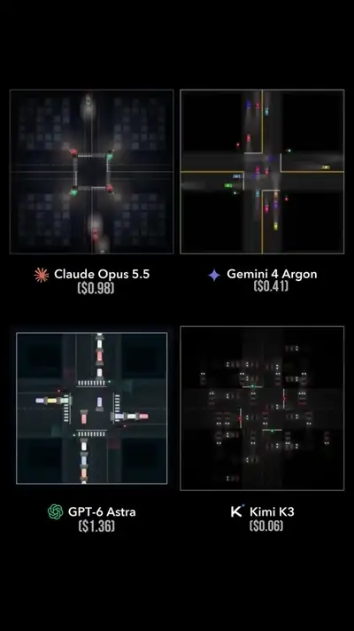</a><br><a href="https://www.sandbase.ai/lab/ai-videos/gemini-4-argon/2110405479658631361?utm_source=github&utm_medium=readme&utm_campaign=awesome-gemini4-argon&utm_content=card"><b>Top-down traffic simulation comparison across four models</b></a><br><sub><a href="https://x.com/kinderlayer/status/2110405479658631361">@kinderlayer</a> · 0:11</sub></td></tr>
</table>

<a id="kinetic-type"></a>

## Kinetic type

<table>
<tr><td width="33%" valign="top"><a href="https://www.sandbase.ai/lab/media/x/gemini-4-argon/2110048822944727184/video.mp4"></a><br><a href="https://www.sandbase.ai/lab/ai-videos/gemini-4-argon/2110048822944727184?utm_source=github&utm_medium=readme&utm_campaign=awesome-gemini4-argon&utm_content=card"><b>Eclipse cinematic 3D title sequence</b></a><br><sub><a href="https://x.com/pankajkumar_dev/status/2110048822944727184">@pankajkumar_dev</a> · 0:19 · <a href="https://www.sandbase.ai/lab/ai-videos/gemini-4-argon/2110048822944727184?utm_source=github&utm_medium=readme&utm_campaign=awesome-gemini4-argon&utm_content=card">prompt</a></sub></td></tr>
</table>

<a id="explainer"></a>

## Explainers

<table>
<tr><td width="33%" valign="top"><a href="https://www.sandbase.ai/lab/media/x/gemini-4-argon/2110057669172306200/video.mp4"></a><br><a href="https://www.sandbase.ai/lab/ai-videos/gemini-4-argon/2110057669172306200?utm_source=github&utm_medium=readme&utm_campaign=awesome-gemini4-argon&utm_content=card"><b>Robot picking up a can and using trash bin</b></a><br><sub><a href="https://x.com/ki_ki_ki1/status/2110057669172306200">@ki_ki_ki1</a> · 1:28</sub></td><td width="33%" valign="top"><a href="https://www.sandbase.ai/lab/media/x/gemini-4-argon/2110065587279798719/video.mp4"></a><br><a href="https://www.sandbase.ai/lab/ai-videos/gemini-4-argon/2110065587279798719?utm_source=github&utm_medium=readme&utm_campaign=awesome-gemini4-argon&utm_content=card"><b>Cinematic 3D animation of an electric motor</b></a><br><sub><a href="https://x.com/rubenssoto_ai/status/2110065587279798719">@rubenssoto_ai</a> · 0:40</sub></td><td width="33%" valign="top"><a href="https://www.sandbase.ai/lab/media/x/gemini-4-argon/2110075670332412079/video.mp4"></a><br><a href="https://www.sandbase.ai/lab/ai-videos/gemini-4-argon/2110075670332412079?utm_source=github&utm_medium=readme&utm_campaign=awesome-gemini4-argon&utm_content=card"><b>Frontier AI models benchmark comparison</b></a><br><sub><a href="https://x.com/0xShoopy/status/2110075670332412079">@0xShoopy</a> · 1:28 · <a href="https://www.sandbase.ai/lab/ai-videos/gemini-4-argon/2110075670332412079?utm_source=github&utm_medium=readme&utm_campaign=awesome-gemini4-argon&utm_content=card">prompt</a></sub></td></tr>
<tr><td width="33%" valign="top"><a href="https://www.sandbase.ai/lab/media/x/gemini-4-argon/2110076696133296288/video.mp4"></a><br><a href="https://www.sandbase.ai/lab/ai-videos/gemini-4-argon/2110076696133296288?utm_source=github&utm_medium=readme&utm_campaign=awesome-gemini4-argon&utm_content=card"><b>Physical robot throwing control through reasoning</b></a><br><sub><a href="https://x.com/TheHumanoidHub/status/2110076696133296288">@TheHumanoidHub</a> · 0:37</sub></td><td width="33%" valign="top"><a href="https://www.sandbase.ai/lab/media/x/gemini-4-argon/2110079070117781762/video.mp4">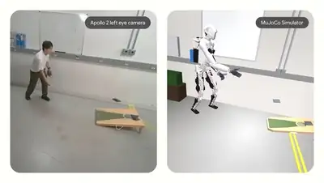</a><br><a href="https://www.sandbase.ai/lab/ai-videos/gemini-4-argon/2110079070117781762?utm_source=github&utm_medium=readme&utm_campaign=awesome-gemini4-argon&utm_content=card"><b>Robot learning to play cornhole from video</b></a><br><sub><a href="https://x.com/ai_for_success/status/2110079070117781762">@ai_for_success</a> · 1:43</sub></td><td width="33%" valign="top"><a href="https://www.sandbase.ai/lab/media/x/gemini-4-argon/2110132280614064300/video.mp4"></a><br><a href="https://www.sandbase.ai/lab/ai-videos/gemini-4-argon/2110132280614064300?utm_source=github&utm_medium=readme&utm_campaign=awesome-gemini4-argon&utm_content=card"><b>Voice synthesis engine built in pure Python</b></a><br><sub><a href="https://x.com/fofrAI/status/2110132280614064300">@fofrAI</a> · 1:21</sub></td></tr>
<tr><td width="33%" valign="top"><a href="https://www.sandbase.ai/lab/media/x/gemini-4-argon/2110333190028292522/video.mp4"></a><br><a href="https://www.sandbase.ai/lab/ai-videos/gemini-4-argon/2110333190028292522?utm_source=github&utm_medium=readme&utm_campaign=awesome-gemini4-argon&utm_content=card"><b>Interactive 3D beating heart cross-section</b></a><br><sub><a href="https://x.com/bidyut_io/status/2110333190028292522">@bidyut_io</a> · 0:47</sub></td><td width="33%" valign="top"><a href="https://www.sandbase.ai/lab/media/x/gemini-4-argon/2110338902863032445/video.mp4"></a><br><a href="https://www.sandbase.ai/lab/ai-videos/gemini-4-argon/2110338902863032445?utm_source=github&utm_medium=readme&utm_campaign=awesome-gemini4-argon&utm_content=card"><b>Electric motor working principle 3D animation</b></a><br><sub><a href="https://x.com/omarvvvr/status/2110338902863032445">@omarvvvr</a> · 0:40</sub></td><td width="33%" valign="top"><a href="https://www.sandbase.ai/lab/media/x/gemini-4-argon/2110350583697908053/video.mp4"></a><br><a href="https://www.sandbase.ai/lab/ai-videos/gemini-4-argon/2110350583697908053?utm_source=github&utm_medium=readme&utm_campaign=awesome-gemini4-argon&utm_content=card"><b>Robot playing cornhole after video training</b></a><br><sub><a href="https://x.com/iam_sanjana06/status/2110350583697908053">@iam_sanjana06</a> · 1:43</sub></td></tr>
<tr><td width="33%" valign="top"><a href="https://www.sandbase.ai/lab/media/x/gemini-4-argon/2110365179577856012/video.mp4">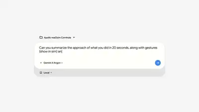</a><br><a href="https://www.sandbase.ai/lab/ai-videos/gemini-4-argon/2110365179577856012?utm_source=github&utm_medium=readme&utm_campaign=awesome-gemini4-argon&utm_content=card"><b>Apollo 2 humanoid robot playing cornhole via simulation</b></a><br><sub><a href="https://x.com/HumanoidRTech/status/2110365179577856012">@HumanoidRTech</a> · 1:13</sub></td><td width="33%" valign="top"><a href="https://www.sandbase.ai/lab/media/x/gemini-4-argon/2110384893771571355/video.mp4"></a><br><a href="https://www.sandbase.ai/lab/ai-videos/gemini-4-argon/2110384893771571355?utm_source=github&utm_medium=readme&utm_campaign=awesome-gemini4-argon&utm_content=card"><b>A robot sinking cornhole throws</b></a><br><sub><a href="https://x.com/WallStreetB0Ts/status/2110384893771571355">@WallStreetB0Ts</a> · 1:43</sub></td><td width="33%" valign="top"><a href="https://www.sandbase.ai/lab/media/x/gemini-4-argon/2110392686146728003/video.mp4"></a><br><a href="https://www.sandbase.ai/lab/ai-videos/gemini-4-argon/2110392686146728003?utm_source=github&utm_medium=readme&utm_campaign=awesome-gemini4-argon&utm_content=card"><b>Robot learning cornhole from video simulation</b></a><br><sub><a href="https://x.com/marcthecreatorr/status/2110392686146728003">@marcthecreatorr</a> · 1:40</sub></td></tr>
<tr><td width="33%" valign="top"><a href="https://www.sandbase.ai/lab/media/x/gemini-4-argon/2110400242180858314/video.mp4"></a><br><a href="https://www.sandbase.ai/lab/ai-videos/gemini-4-argon/2110400242180858314?utm_source=github&utm_medium=readme&utm_campaign=awesome-gemini4-argon&utm_content=card"><b>Electric motor explainer animation comparison</b></a><br><sub><a href="https://x.com/coinbureau/status/2110400242180858314">@coinbureau</a> · 0:40</sub></td></tr>
</table>

<a id="launch-film"></a>

## Launch films

<table>
<tr><td width="33%" valign="top"><a href="https://www.sandbase.ai/lab/media/x/gemini-4-argon/2110040726457491845/video.mp4"></a><br><a href="https://www.sandbase.ai/lab/ai-videos/gemini-4-argon/2110040726457491845?utm_source=github&utm_medium=readme&utm_campaign=awesome-gemini4-argon&utm_content=card"><b>Introduction video for Gemini 4 Argon</b></a><br><sub><a href="https://x.com/HarshithLucky3/status/2110040726457491845">@HarshithLucky3</a> · 1:00</sub></td><td width="33%" valign="top"><a href="https://www.sandbase.ai/lab/media/x/gemini-4-argon/2110182874913910978/video.mp4"></a><br><a href="https://www.sandbase.ai/lab/ai-videos/gemini-4-argon/2110182874913910978?utm_source=github&utm_medium=readme&utm_campaign=awesome-gemini4-argon&utm_content=card"><b>HyperFrames product launch video</b></a><br><sub><a href="https://x.com/hanifproduktif/status/2110182874913910978">@hanifproduktif</a> · 0:56</sub></td></tr>
</table>

**[See all 264 on SandBase Lab →](https://www.sandbase.ai/lab/ai-videos/gemini-4-argon?utm_source=github&utm_medium=readme&utm_campaign=awesome-gemini4-argon&utm_content=section)**

<a id="recreate"></a>

## Recreate one with Gemini 4 Argon

Gemini 4 Argon writes these videos as code. Every video page on [SandBase Lab](https://www.sandbase.ai/lab/ai-videos/gemini-4-argon?utm_source=github&utm_medium=readme&utm_campaign=awesome-gemini4-argon&utm_content=recreate) has a **Recreate** button that sends the post to Argon and gives you the code back to play in the browser.

Prefer the API? Argon is `google/gemini-4-argon` on SandBase. Put a prompt in `prompt.txt`, create a key in the [console](https://www.sandbase.ai/console/keys?utm_source=github&utm_medium=readme&utm_campaign=awesome-gemini4-argon), and run:

```bash
jq -n --rawfile prompt prompt.txt \
  '{model: "google/gemini-4-argon", messages: [{role: "user", content: $prompt}]}' |
curl -sS https://api.sandbase.ai/v1/chat/completions \
  -H "Authorization: Bearer $SANDBASE_API_KEY" \
  -H "Content-Type: application/json" \
  -d @- | jq -r '.choices[0].message.content' | sed '/^```/d' > argon.html
```

Open `argon.html` in a browser, or run it in a [SandBase Sandbox](https://www.sandbase.ai/landing/sandbox?utm_source=github&utm_medium=readme&utm_campaign=awesome-gemini4-argon) to keep generated code isolated. Pricing and limits: [model page](https://www.sandbase.ai/model/google/gemini-4-argon?utm_source=github&utm_medium=readme&utm_campaign=awesome-gemini4-argon).

<a id="contribute"></a>

## Suggest a video

Know a Gemini 4 Argon creation that should be here? [Open a submission](https://github.com/sandbase-lab/awesome-gemini4-argon/issues/new?template=submit-video.yml) with the original X post. Accepted posts are added on SandBase Lab and show up here on the next daily sync.

## Credits & rights

Every video, prompt and post belongs to its creator. Cards credit the author and link to the original post. The MIT license covers this repository's scripts only. To correct a credit or remove a video, see [MEDIA-RIGHTS](MEDIA-RIGHTS.md).

Not affiliated with or endorsed by Google.

---

Maintained by [SandBase Lab](https://www.sandbase.ai/lab/?utm_source=github&utm_medium=readme&utm_campaign=awesome-gemini4-argon) · [All AI video collections](https://www.sandbase.ai/lab/ai-videos?utm_source=github&utm_medium=readme&utm_campaign=awesome-gemini4-argon)
