# Awesome Gemini 4 Argon

[English](README.md) · 简体中文

[](https://awesome.re) [](#contents) [](docs/zh-CN/prompts.md) [](https://github.com/sandbase-lab/awesome-gemini4-argon/actions/workflows/sync.yml) [](https://www.sandbase.ai/model/google/gemini-4-argon?utm_source=github&utm_medium=readme&utm_campaign=awesome-gemini4-argon)

[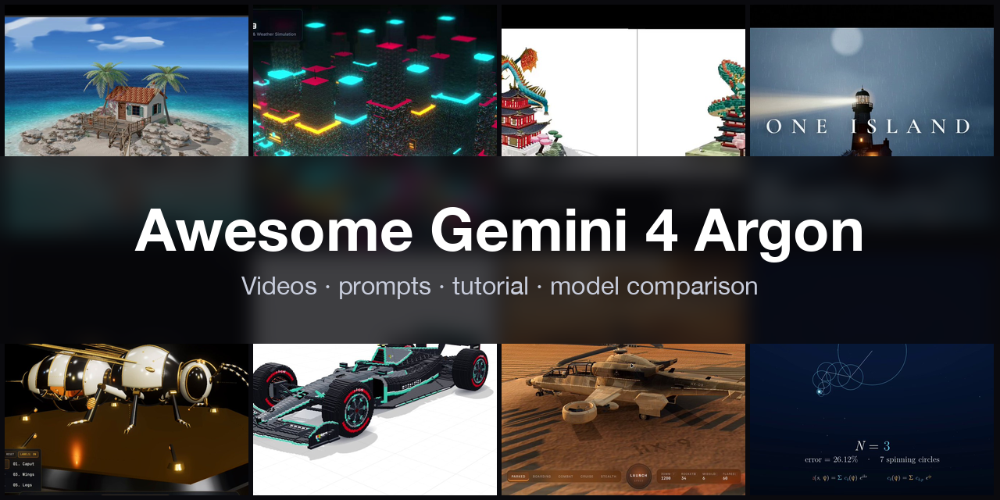](https://www.sandbase.ai/lab/ai-videos/gemini-4-argon?lang=zh-CN&utm_source=github&utm_medium=readme&utm_campaign=awesome-gemini4-argon&utm_content=banner)

精选 **Gemini 4 Argon 案例**合集：用 Google Gemini 4 Argon 模型做出的视频、提示词和演示。包括 Three.js / WebGL 3D 场景、SVG 与 Canvas 动画、动效和可在浏览器里玩的游戏，每一个都是模型根据提示词写成的代码，均注明作者并链接原帖。

共 **400 条视频**，来自 **275 位创作者** · **70 条**附作者提示词 · 每天从 [SandBase Lab](https://www.sandbase.ai/lab/ai-videos/gemini-4-argon?lang=zh-CN&utm_source=github&utm_medium=readme&utm_campaign=awesome-gemini4-argon&utm_content=stats) 同步

## 从这里开始

| 我想… | 去这里 |
|---|---|
| 看视频 | 在下方 [按分类浏览](#contents)，或 [在 SandBase Lab 大屏播放](https://www.sandbase.ai/lab/ai-videos/gemini-4-argon?lang=zh-CN&utm_source=github&utm_medium=readme&utm_campaign=awesome-gemini4-argon&utm_content=quickstart) |
| 复制提示词 | [提示词索引](docs/zh-CN/prompts.md)：所有附带提示词的视频 |
| 自己写提示词 | [提示词写法](docs/zh-CN/prompt-guide.md)：7 条写法和一个填空模板 |
| 做一个视频 | [教程](docs/zh-CN/tutorial.md)：提示词 → HTML → MP4，含 API 调用和录屏脚本 |
| 选模型 | [Gemini 4 Argon 对比 Claude Opus 5.5、GPT-6 等模型](docs/zh-CN/model-comparison.md) |
| 马上试试 | [在 Lab 竞技场运行 Gemini 4 Argon](https://www.sandbase.ai/lab/x/llm-arena?models=google%2Fgemini-4-argon&lang=zh-CN&utm_source=github&utm_medium=readme&utm_campaign=awesome-gemini4-argon&utm_content=quickstart)，和其他模型并排对比 |

<a id="contents"></a>

## 目录

- [精选](#featured) (8)
- [3D 场景](#3d-scene) (97)
- [动效](#motion-graphics) (60)
- [游戏](#game) (41)
- [产品界面](#ui-demo) (23)
- [粒子与形状](#particles) (4)
- [图表图解](#data-viz) (4)
- [文字动效](#kinetic-type) (2)
- [讲解](#explainer) (17)
- [发布片](#launch-film) (2)
- [测试对比](#comparison) (150)
- [用 Gemini 4 Argon 复刻视频](#recreate)
- [常见问题](#faq)
- [延伸阅读](#reading)
- [推荐作品](#contribute)

点击预览图播放视频；点击标题前往 SandBase Lab 查看原帖、提示词，并一键 **复刻**；**@作者** 链接到 X 原帖。

<a id="featured"></a>

## 精选

<table>
<tr><td width="33%" valign="top"><a href="https://www.sandbase.ai/lab/media/x/gemini-4-argon/2110973461690802487/video.mp4">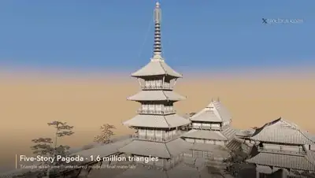</a><br><a href="https://www.sandbase.ai/lab/ai-videos/gemini-4-argon/2110973461690802487?lang=zh-CN&utm_source=github&utm_medium=readme&utm_campaign=awesome-gemini4-argon&utm_content=card"><b>在Blender中构建飞鸟时代日本佛塔寺庙</b></a><br><sub><a href="https://x.com/ai_for_success/status/2110973461690802487">@ai_for_success</a> · 1:02</sub></td><td width="33%" valign="top"><a href="https://www.sandbase.ai/lab/media/x/gemini-4-argon/2111821910442991632/video.mp4">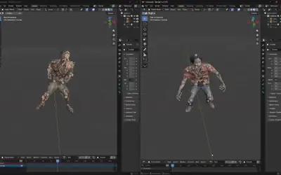</a><br><a href="https://www.sandbase.ai/lab/ai-videos/gemini-4-argon/2111821910442991632?lang=zh-CN&utm_source=github&utm_medium=readme&utm_campaign=awesome-gemini4-argon&utm_content=card"><b>利用Mixamo工作流驱动人形丧尸3D模型动画</b></a><br><sub><a href="https://x.com/maxt3chno/status/2111821910442991632">@maxt3chno</a> · 0:43</sub></td><td width="33%" valign="top"><a href="https://www.sandbase.ai/lab/media/x/gemini-4-argon/2110109640419926325/video.mp4">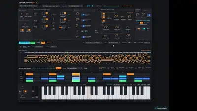</a><br><a href="https://www.sandbase.ai/lab/ai-videos/gemini-4-argon/2110109640419926325?lang=zh-CN&utm_source=github&utm_medium=readme&utm_campaign=awesome-gemini4-argon&utm_content=card"><b>单个HTML实现的组合合成器</b></a><br><sub><a href="https://x.com/maxescu/status/2110109640419926325">@maxescu</a> · 0:59</sub></td></tr>
<tr><td width="33%" valign="top"><a href="https://www.sandbase.ai/lab/media/x/gemini-4-argon/2110609385546547532/video.mp4">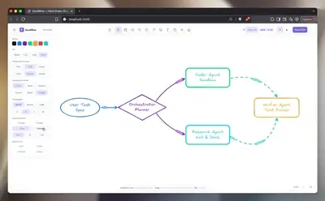</a><br><a href="https://www.sandbase.ai/lab/ai-videos/gemini-4-argon/2110609385546547532?lang=zh-CN&utm_source=github&utm_medium=readme&utm_campaign=awesome-gemini4-argon&utm_content=card"><b>用Gemini 4 Argon构建的动态Excalidraw</b></a><br><sub><a href="https://x.com/Saboo_Shubham_/status/2110609385546547532">@Saboo_Shubham_</a> · 0:42</sub></td><td width="33%" valign="top"><a href="https://www.sandbase.ai/lab/media/x/gemini-4-argon/2110367201786314935/video.mp4">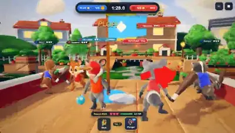</a><br><a href="https://www.sandbase.ai/lab/ai-videos/gemini-4-argon/2110367201786314935?lang=zh-CN&utm_source=github&utm_medium=readme&utm_campaign=awesome-gemini4-argon&utm_content=card"><b>多人夺旗3D卡通动物游戏</b></a><br><sub><a href="https://x.com/chongdashu/status/2110367201786314935">@chongdashu</a> · 0:25</sub></td><td width="33%" valign="top"><a href="https://www.sandbase.ai/lab/media/x/gemini-4-argon/2110698310705074655/video.mp4">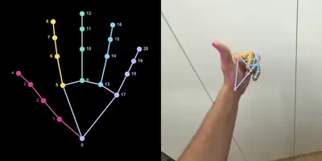</a><br><a href="https://www.sandbase.ai/lab/ai-videos/gemini-4-argon/2110698310705074655?lang=zh-CN&utm_source=github&utm_medium=readme&utm_campaign=awesome-gemini4-argon&utm_content=card"><b>视频每帧中的手部关键点检测实验</b></a><br><sub><a href="https://x.com/skalskip92/status/2110698310705074655">@skalskip92</a> · 0:04 · <a href="https://www.sandbase.ai/lab/ai-videos/gemini-4-argon/2110698310705074655?lang=zh-CN&utm_source=github&utm_medium=readme&utm_campaign=awesome-gemini4-argon&utm_content=card">提示词</a></sub></td></tr>
<tr><td width="33%" valign="top"><a href="https://www.sandbase.ai/lab/media/x/gemini-4-argon/2110343012421181485/video.mp4">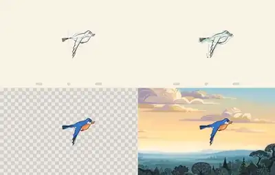</a><br><a href="https://www.sandbase.ai/lab/ai-videos/gemini-4-argon/2110343012421181485?lang=zh-CN&utm_source=github&utm_medium=readme&utm_campaign=awesome-gemini4-argon&utm_content=card"><b>从零草绘的卡通渲染动画场景</b></a><br><sub><a href="https://x.com/fofrAI/status/2110343012421181485">@fofrAI</a> · 0:08</sub></td><td width="33%" valign="top"><a href="https://www.sandbase.ai/lab/media/x/gemini-4-argon/2110803894028960087/video.mp4">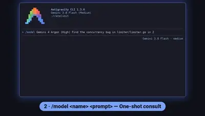</a><br><a href="https://www.sandbase.ai/lab/ai-videos/gemini-4-argon/2110803894028960087?lang=zh-CN&utm_source=github&utm_medium=readme&utm_campaign=awesome-gemini4-argon&utm_content=card"><b>Antigravity CLI中使用Gemini 4 Argon的工作流技巧</b></a><br><sub><a href="https://x.com/shengzheyao/status/2110803894028960087">@shengzheyao</a> · 1:20</sub></td></tr>
</table>

<a id="3d-scene"></a>

## 3D 场景

<table>
<tr><td width="33%" valign="top"><a href="https://www.sandbase.ai/lab/media/x/gemini-4-argon/2110039909851685300/video.mp4">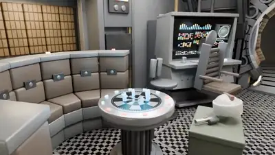</a><br><a href="https://www.sandbase.ai/lab/ai-videos/gemini-4-argon/2110039909851685300?lang=zh-CN&utm_source=github&utm_medium=readme&utm_campaign=awesome-gemini4-argon&utm_content=card"><b>千年隼号主舱室超写实三维模型</b></a><br><sub><a href="https://x.com/jackcheng/status/2110039909851685300">@jackcheng</a> · 0:08 · <a href="https://www.sandbase.ai/lab/ai-videos/gemini-4-argon/2110039909851685300?lang=zh-CN&utm_source=github&utm_medium=readme&utm_campaign=awesome-gemini4-argon&utm_content=card">提示词</a></sub></td><td width="33%" valign="top"><a href="https://www.sandbase.ai/lab/media/x/gemini-4-argon/2110040063656812976/video.mp4">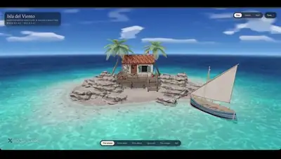</a><br><a href="https://www.sandbase.ai/lab/ai-videos/gemini-4-argon/2110040063656812976?lang=zh-CN&utm_source=github&utm_medium=readme&utm_campaign=awesome-gemini4-argon&utm_content=card"><b>带有可操控帆船的3D小岛场景</b></a><br><sub><a href="https://x.com/ai_for_success/status/2110040063656812976">@ai_for_success</a> · 1:39</sub></td><td width="33%" valign="top"><a href="https://www.sandbase.ai/lab/media/x/gemini-4-argon/2110041557021950348/video.mp4">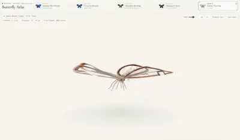</a><br><a href="https://www.sandbase.ai/lab/ai-videos/gemini-4-argon/2110041557021950348?lang=zh-CN&utm_source=github&utm_medium=readme&utm_campaign=awesome-gemini4-argon&utm_content=card"><b>从零渲染的五只标本蝴蝶博物馆</b></a><br><sub><a href="https://x.com/doe_naps/status/2110041557021950348">@doe_naps</a> · 0:37</sub></td></tr>
<tr><td width="33%" valign="top"><a href="https://www.sandbase.ai/lab/media/x/gemini-4-argon/2110041702765613294/video.mp4"></a><br><a href="https://www.sandbase.ai/lab/ai-videos/gemini-4-argon/2110041702765613294?lang=zh-CN&utm_source=github&utm_medium=readme&utm_campaign=awesome-gemini4-argon&utm_content=card"><b>Blender中自主构建的宝塔寺庙群</b></a><br><sub><a href="https://x.com/shiri_shh/status/2110041702765613294">@shiri_shh</a> · 0:45</sub></td><td width="33%" valign="top"><a href="https://www.sandbase.ai/lab/media/x/gemini-4-argon/2110041849767383472/video.mp4">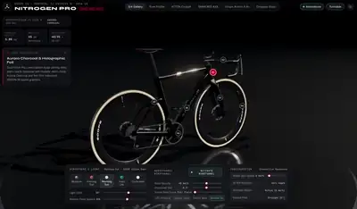</a><br><a href="https://www.sandbase.ai/lab/ai-videos/gemini-4-argon/2110041849767383472?lang=zh-CN&utm_source=github&utm_medium=readme&utm_campaign=awesome-gemini4-argon&utm_content=card"><b>Argon 18 Nitrogen Pro 自行车演示</b></a><br><sub><a href="https://x.com/SeraAndroid/status/2110041849767383472">@SeraAndroid</a> · 0:16</sub></td><td width="33%" valign="top"><a href="https://www.sandbase.ai/lab/media/x/gemini-4-argon/2110043093466743194/video.mp4">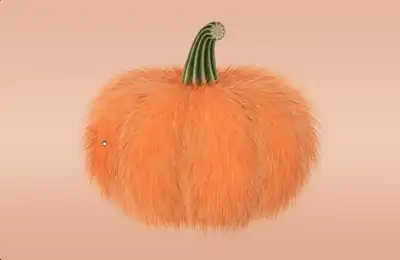</a><br><a href="https://www.sandbase.ai/lab/ai-videos/gemini-4-argon/2110043093466743194?lang=zh-CN&utm_source=github&utm_medium=readme&utm_campaign=awesome-gemini4-argon&utm_content=card"><b>实时毛发物理效果3D南瓜玩偶</b></a><br><sub><a href="https://x.com/thebuggeddev/status/2110043093466743194">@thebuggeddev</a> · 0:18</sub></td></tr>
</table>

<details>
<summary><b>展开全部 97 条</b></summary>

<table>
<tr><td width="33%" valign="top"><a href="https://www.sandbase.ai/lab/media/x/gemini-4-argon/2110046793438220573/video.mp4">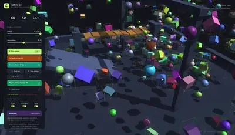</a><br><a href="https://www.sandbase.ai/lab/ai-videos/gemini-4-argon/2110046793438220573?lang=zh-CN&utm_source=github&utm_medium=readme&utm_campaign=awesome-gemini4-argon&utm_content=card"><b>用Rust构建的自定义WebGL2 3D物理引擎</b></a><br><sub><a href="https://x.com/LinusEkenstam/status/2110046793438220573">@LinusEkenstam</a> · 1:42</sub></td><td width="33%" valign="top"><a href="https://www.sandbase.ai/lab/media/x/gemini-4-argon/2110047749379133877/video.mp4"></a><br><a href="https://www.sandbase.ai/lab/ai-videos/gemini-4-argon/2110047749379133877?lang=zh-CN&utm_source=github&utm_medium=readme&utm_campaign=awesome-gemini4-argon&utm_content=card"><b>Gemini 4 Argon 生成的 3D 渲染演示</b></a><br><sub><a href="https://x.com/birdabo/status/2110047749379133877">@birdabo</a> · 0:45</sub></td><td width="33%" valign="top"><a href="https://www.sandbase.ai/lab/media/x/gemini-4-argon/2110048102321365205/video.mp4">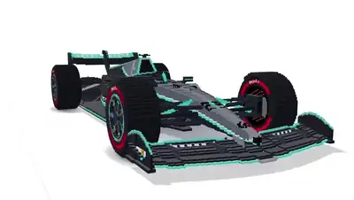</a><br><a href="https://www.sandbase.ai/lab/ai-videos/gemini-4-argon/2110048102321365205?lang=zh-CN&utm_source=github&utm_medium=readme&utm_campaign=awesome-gemini4-argon&utm_content=card"><b>梅赛德斯AMG F1赛车体素艺术</b></a><br><sub><a href="https://x.com/HarshithLucky3/status/2110048102321365205">@HarshithLucky3</a> · 0:23 · <a href="https://www.sandbase.ai/lab/ai-videos/gemini-4-argon/2110048102321365205?lang=zh-CN&utm_source=github&utm_medium=readme&utm_campaign=awesome-gemini4-argon&utm_content=card">提示词</a></sub></td></tr>
<tr><td width="33%" valign="top"><a href="https://www.sandbase.ai/lab/media/x/gemini-4-argon/2110052226844791094/video.mp4">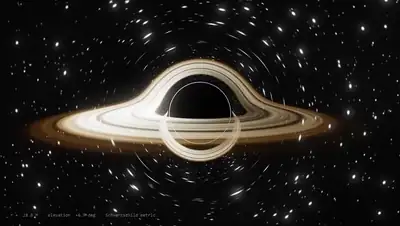</a><br><a href="https://www.sandbase.ai/lab/ai-videos/gemini-4-argon/2110052226844791094?lang=zh-CN&utm_source=github&utm_medium=readme&utm_campaign=awesome-gemini4-argon&utm_content=card"><b>纯Python脚本渲染的黑洞模拟</b></a><br><sub><a href="https://x.com/abhinavflac/status/2110052226844791094">@abhinavflac</a> · 0:30</sub></td><td width="33%" valign="top"><a href="https://www.sandbase.ai/lab/media/x/gemini-4-argon/2110053480442528008/video.mp4">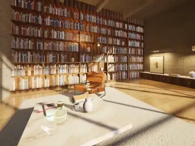</a><br><a href="https://www.sandbase.ai/lab/ai-videos/gemini-4-argon/2110053480442528008?lang=zh-CN&utm_source=github&utm_medium=readme&utm_campaign=awesome-gemini4-argon&utm_content=card"><b>纯数学构建的浏览器三维室内场景</b></a><br><sub><a href="https://x.com/Bhavani_00007/status/2110053480442528008">@Bhavani_00007</a> · 0:27</sub></td><td width="33%" valign="top"><a href="https://www.sandbase.ai/lab/media/x/gemini-4-argon/2110064840039702576/video.mp4"></a><br><a href="https://www.sandbase.ai/lab/ai-videos/gemini-4-argon/2110064840039702576?lang=zh-CN&utm_source=github&utm_medium=readme&utm_campaign=awesome-gemini4-argon&utm_content=card"><b>多智能体视觉审查循环构建的宝塔</b></a><br><sub><a href="https://x.com/JustLingonberry/status/2110064840039702576">@JustLingonberry</a> · 0:45</sub></td></tr>
<tr><td width="33%" valign="top"><a href="https://www.sandbase.ai/lab/media/x/gemini-4-argon/2110068320221413537/video.mp4">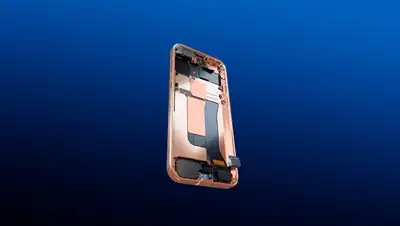</a><br><a href="https://www.sandbase.ai/lab/ai-videos/gemini-4-argon/2110068320221413537?lang=zh-CN&utm_source=github&utm_medium=readme&utm_campaign=awesome-gemini4-argon&utm_content=card"><b>Gemini 4 Argon 生成的 3D 动画</b></a><br><sub><a href="https://x.com/sonuforx/status/2110068320221413537">@sonuforx</a> · 0:19</sub></td><td width="33%" valign="top"><a href="https://www.sandbase.ai/lab/media/x/gemini-4-argon/2110068980337586566/video.mp4">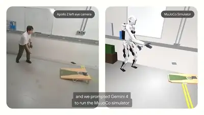</a><br><a href="https://www.sandbase.ai/lab/ai-videos/gemini-4-argon/2110068980337586566?lang=zh-CN&utm_source=github&utm_medium=readme&utm_campaign=awesome-gemini4-argon&utm_content=card"><b>机器人沙包游戏与动态平衡控制演示</b></a><br><sub><a href="https://x.com/liderarmente/status/2110068980337586566">@liderarmente</a> · 1:43</sub></td><td width="33%" valign="top"><a href="https://www.sandbase.ai/lab/media/x/gemini-4-argon/2110069786415968754/video.mp4"></a><br><a href="https://www.sandbase.ai/lab/ai-videos/gemini-4-argon/2110069786415968754?lang=zh-CN&utm_source=github&utm_medium=readme&utm_campaign=awesome-gemini4-argon&utm_content=card"><b>Three.js生成的未来3D武装直升机</b></a><br><sub><a href="https://x.com/thtbee_/status/2110069786415968754">@thtbee_</a> · 1:12</sub></td></tr>
<tr><td width="33%" valign="top"><a href="https://www.sandbase.ai/lab/media/x/gemini-4-argon/2110078691204374833/video.mp4">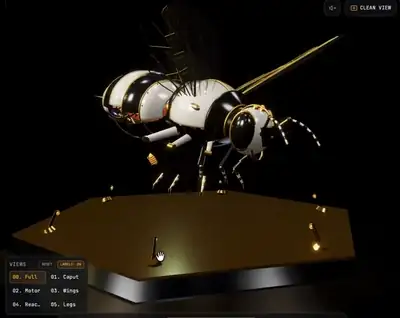</a><br><a href="https://www.sandbase.ai/lab/ai-videos/gemini-4-argon/2110078691204374833?lang=zh-CN&utm_source=github&utm_medium=readme&utm_campaign=awesome-gemini4-argon&utm_content=card"><b>Three.js可活动发条机械蜜蜂</b></a><br><sub><a href="https://x.com/0xbenderxbt/status/2110078691204374833">@0xbenderxbt</a> · 0:42</sub></td><td width="33%" valign="top"><a href="https://www.sandbase.ai/lab/media/x/gemini-4-argon/2110079828531794317/video.mp4">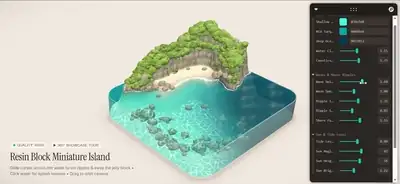</a><br><a href="https://www.sandbase.ai/lab/ai-videos/gemini-4-argon/2110079828531794317?lang=zh-CN&utm_source=github&utm_medium=readme&utm_campaign=awesome-gemini4-argon&utm_content=card"><b>Gemini 4 Argon 生成成果展示</b></a><br><sub><a href="https://x.com/Adidotdev/status/2110079828531794317">@Adidotdev</a> · 1:03 · <a href="https://www.sandbase.ai/lab/ai-videos/gemini-4-argon/2110079828531794317?lang=zh-CN&utm_source=github&utm_medium=readme&utm_campaign=awesome-gemini4-argon&utm_content=card">提示词</a></sub></td><td width="33%" valign="top"><a href="https://www.sandbase.ai/lab/media/x/gemini-4-argon/2110086917455057028/video.mp4">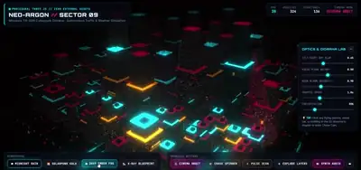</a><br><a href="https://www.sandbase.ai/lab/ai-videos/gemini-4-argon/2110086917455057028?lang=zh-CN&utm_source=github&utm_medium=readme&utm_campaign=awesome-gemini4-argon&utm_content=card"><b>Three.js打造的微缩赛博朋克城市</b></a><br><sub><a href="https://x.com/StatsWire/status/2110086917455057028">@StatsWire</a> · 0:58</sub></td></tr>
<tr><td width="33%" valign="top"><a href="https://www.sandbase.ai/lab/media/x/gemini-4-argon/2110088443619598716/video.mp4">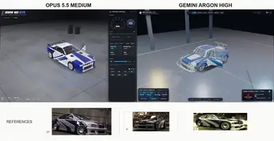</a><br><a href="https://www.sandbase.ai/lab/ai-videos/gemini-4-argon/2110088443619598716?lang=zh-CN&utm_source=github&utm_medium=readme&utm_campaign=awesome-gemini4-argon&utm_content=card"><b>3D汽车与车库场景评估</b></a><br><sub><a href="https://x.com/maxt3chno/status/2110088443619598716">@maxt3chno</a> · 0:50</sub></td><td width="33%" valign="top"><a href="https://www.sandbase.ai/lab/media/x/gemini-4-argon/2110093152854151192/video.mp4">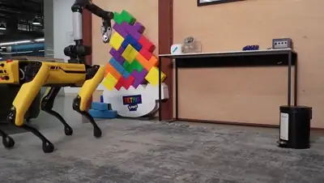</a><br><a href="https://www.sandbase.ai/lab/ai-videos/gemini-4-argon/2110093152854151192?lang=zh-CN&utm_source=github&utm_medium=readme&utm_campaign=awesome-gemini4-argon&utm_content=card"><b>波士顿动力Spot机器狗零样本动作控制</b></a><br><sub><a href="https://x.com/parada_car88104/status/2110093152854151192">@parada_car88104</a> · 1:28 · <a href="https://www.sandbase.ai/lab/ai-videos/gemini-4-argon/2110093152854151192?lang=zh-CN&utm_source=github&utm_medium=readme&utm_campaign=awesome-gemini4-argon&utm_content=card">提示词</a></sub></td><td width="33%" valign="top"><a href="https://www.sandbase.ai/lab/media/x/gemini-4-argon/2110096143342268664/video.mp4">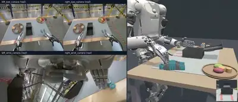</a><br><a href="https://www.sandbase.ai/lab/ai-videos/gemini-4-argon/2110096143342268664?lang=zh-CN&utm_source=github&utm_medium=readme&utm_campaign=awesome-gemini4-argon&utm_content=card"><b>机器人视频转物理仿真示例展示</b></a><br><sub><a href="https://x.com/parada_car88104/status/2110096143342268664">@parada_car88104</a> · 0:18 · <a href="https://www.sandbase.ai/lab/ai-videos/gemini-4-argon/2110096143342268664?lang=zh-CN&utm_source=github&utm_medium=readme&utm_campaign=awesome-gemini4-argon&utm_content=card">提示词</a></sub></td></tr>
<tr><td width="33%" valign="top"><a href="https://www.sandbase.ai/lab/media/x/gemini-4-argon/2110097633922662752/video.mp4">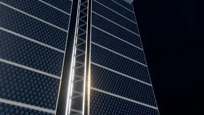</a><br><a href="https://www.sandbase.ai/lab/ai-videos/gemini-4-argon/2110097633922662752?lang=zh-CN&utm_source=github&utm_medium=readme&utm_campaign=awesome-gemini4-argon&utm_content=card"><b>4K分辨率渲染的完整三维空间站</b></a><br><sub><a href="https://x.com/_satyam_ai/status/2110097633922662752">@_satyam_ai</a> · 0:51 · <a href="https://www.sandbase.ai/lab/ai-videos/gemini-4-argon/2110097633922662752?lang=zh-CN&utm_source=github&utm_medium=readme&utm_campaign=awesome-gemini4-argon&utm_content=card">提示词</a></sub></td><td width="33%" valign="top"><a href="https://www.sandbase.ai/lab/media/x/gemini-4-argon/2110097921014378606/video.mp4">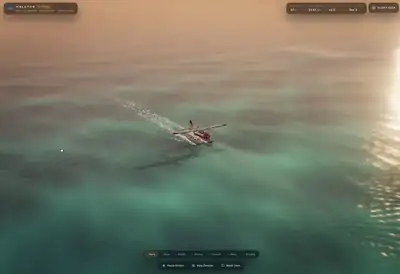</a><br><a href="https://www.sandbase.ai/lab/ai-videos/gemini-4-argon/2110097921014378606?lang=zh-CN&utm_source=github&utm_medium=readme&utm_campaign=awesome-gemini4-argon&utm_content=card"><b>Gemini 4 生成的水上 3D 水上飞机</b></a><br><sub><a href="https://x.com/LuminaBench/status/2110097921014378606">@LuminaBench</a> · 1:07</sub></td><td width="33%" valign="top"><a href="https://www.sandbase.ai/lab/media/x/gemini-4-argon/2110100604911792550/video.mp4">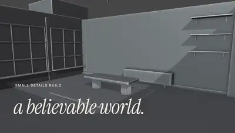</a><br><a href="https://www.sandbase.ai/lab/ai-videos/gemini-4-argon/2110100604911792550?lang=zh-CN&utm_source=github&utm_medium=readme&utm_campaign=awesome-gemini4-argon&utm_content=card"><b>在Blender中重构旧场景配置</b></a><br><sub><a href="https://x.com/charan_kilari/status/2110100604911792550">@charan_kilari</a> · 0:20</sub></td></tr>
<tr><td width="33%" valign="top"><a href="https://www.sandbase.ai/lab/media/x/gemini-4-argon/2110121002332295599/video.mp4">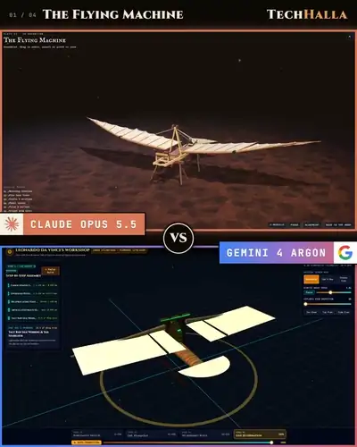</a><br><a href="https://www.sandbase.ai/lab/ai-videos/gemini-4-argon/2110121002332295599?lang=zh-CN&utm_source=github&utm_medium=readme&utm_campaign=awesome-gemini4-argon&utm_content=card"><b>达芬奇工作室及其发明3D重构对比</b></a><br><sub><a href="https://x.com/techhalla/status/2110121002332295599">@techhalla</a> · 1:41 · <a href="https://www.sandbase.ai/lab/ai-videos/gemini-4-argon/2110121002332295599?lang=zh-CN&utm_source=github&utm_medium=readme&utm_campaign=awesome-gemini4-argon&utm_content=card">提示词</a></sub></td><td width="33%" valign="top"><a href="https://www.sandbase.ai/lab/media/x/gemini-4-argon/2110140198130425917/video.mp4"></a><br><a href="https://www.sandbase.ai/lab/ai-videos/gemini-4-argon/2110140198130425917?lang=zh-CN&utm_source=github&utm_medium=readme&utm_campaign=awesome-gemini4-argon&utm_content=card"><b>通过Blender MCP构建的营火测试</b></a><br><sub><a href="https://x.com/ashen_one/status/2110140198130425917">@ashen_one</a> · 0:05</sub></td><td width="33%" valign="top"><a href="https://www.sandbase.ai/lab/media/x/gemini-4-argon/2110165280370647159/video.mp4">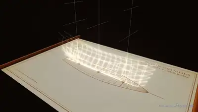</a><br><a href="https://www.sandbase.ai/lab/ai-videos/gemini-4-argon/2110165280370647159?lang=zh-CN&utm_source=github&utm_medium=readme&utm_campaign=awesome-gemini4-argon&utm_content=card"><b>用Three.js制作的海盗船</b></a><br><sub><a href="https://x.com/Ayu_AI_0912/status/2110165280370647159">@Ayu_AI_0912</a> · 0:24 · <a href="https://www.sandbase.ai/lab/ai-videos/gemini-4-argon/2110165280370647159?lang=zh-CN&utm_source=github&utm_medium=readme&utm_campaign=awesome-gemini4-argon&utm_content=card">提示词</a></sub></td></tr>
<tr><td width="33%" valign="top"><a href="https://www.sandbase.ai/lab/media/x/gemini-4-argon/2110166300622471434/video.mp4">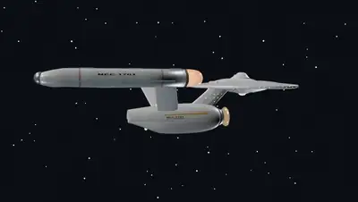</a><br><a href="https://www.sandbase.ai/lab/ai-videos/gemini-4-argon/2110166300622471434?lang=zh-CN&utm_source=github&utm_medium=readme&utm_campaign=awesome-gemini4-argon&utm_content=card"><b>1966版企业号星舰精确三维复刻</b></a><br><sub><a href="https://x.com/DeryaTR_/status/2110166300622471434">@DeryaTR_</a> · 0:22</sub></td><td width="33%" valign="top"><a href="https://www.sandbase.ai/lab/media/x/gemini-4-argon/2110184017261908025/video.mp4">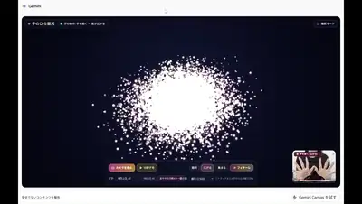</a><br><a href="https://www.sandbase.ai/lab/ai-videos/gemini-4-argon/2110184017261908025?lang=zh-CN&utm_source=github&utm_medium=readme&utm_campaign=awesome-gemini4-argon&utm_content=card"><b>手势交互控制的3D掌上星系</b></a><br><sub><a href="https://x.com/ayyh_18/status/2110184017261908025">@ayyh_18</a> · 0:40</sub></td><td width="33%" valign="top"><a href="https://www.sandbase.ai/lab/media/x/gemini-4-argon/2110192210964521388/video.mp4">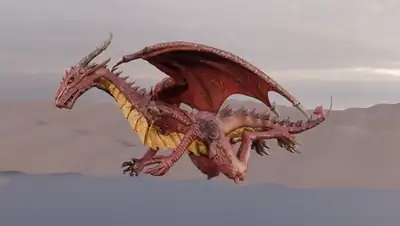</a><br><a href="https://www.sandbase.ai/lab/ai-videos/gemini-4-argon/2110192210964521388?lang=zh-CN&utm_source=github&utm_medium=readme&utm_campaign=awesome-gemini4-argon&utm_content=card"><b>自定义3D飞龙资产生成测试</b></a><br><sub><a href="https://x.com/ashen_one/status/2110192210964521388">@ashen_one</a> · 0:08</sub></td></tr>
<tr><td width="33%" valign="top"><a href="https://www.sandbase.ai/lab/media/x/gemini-4-argon/2110223641111888338/video.mp4">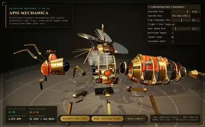</a><br><a href="https://www.sandbase.ai/lab/ai-videos/gemini-4-argon/2110223641111888338?lang=zh-CN&utm_source=github&utm_medium=readme&utm_campaign=awesome-gemini4-argon&utm_content=card"><b>单HTML文件构建的机械蜜蜂</b></a><br><sub><a href="https://x.com/NovaXCode/status/2110223641111888338">@NovaXCode</a> · 0:39</sub></td><td width="33%" valign="top"><a href="https://www.sandbase.ai/lab/media/x/gemini-4-argon/2110231429523309050/video.mp4">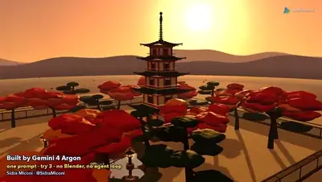</a><br><a href="https://www.sandbase.ai/lab/ai-videos/gemini-4-argon/2110231429523309050?lang=zh-CN&utm_source=github&utm_medium=readme&utm_campaign=awesome-gemini4-argon&utm_content=card"><b>Three.js渲染的低多边形3D场景</b></a><br><sub><a href="https://x.com/SidraMiconi/status/2110231429523309050">@SidraMiconi</a> · 0:16 · <a href="https://www.sandbase.ai/lab/ai-videos/gemini-4-argon/2110231429523309050?lang=zh-CN&utm_source=github&utm_medium=readme&utm_campaign=awesome-gemini4-argon&utm_content=card">提示词</a></sub></td><td width="33%" valign="top"><a href="https://www.sandbase.ai/lab/media/x/gemini-4-argon/2110240752517193761/video.mp4"></a><br><a href="https://www.sandbase.ai/lab/ai-videos/gemini-4-argon/2110240752517193761?lang=zh-CN&utm_source=github&utm_medium=readme&utm_campaign=awesome-gemini4-argon&utm_content=card"><b>浏览器端运行的孟买3D城市模拟</b></a><br><sub><a href="https://x.com/CurieuxExplorer/status/2110240752517193761">@CurieuxExplorer</a> · 2:58</sub></td></tr>
<tr><td width="33%" valign="top"><a href="https://www.sandbase.ai/lab/media/x/gemini-4-argon/2110243527355736460/video.mp4">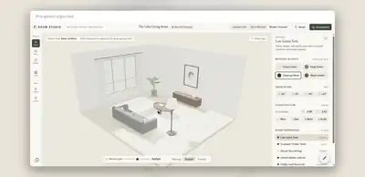</a><br><a href="https://www.sandbase.ai/lab/ai-videos/gemini-4-argon/2110243527355736460?lang=zh-CN&utm_source=github&utm_medium=readme&utm_campaign=awesome-gemini4-argon&utm_content=card"><b>单HTML文件的交互式3D房间设计器</b></a><br><sub><a href="https://x.com/alwayspriyesh/status/2110243527355736460">@alwayspriyesh</a> · 0:49</sub></td><td width="33%" valign="top"><a href="https://www.sandbase.ai/lab/media/x/gemini-4-argon/2110246226637815917/video.mp4">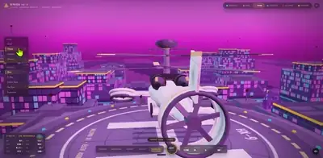</a><br><a href="https://www.sandbase.ai/lab/ai-videos/gemini-4-argon/2110246226637815917?lang=zh-CN&utm_source=github&utm_medium=readme&utm_campaign=awesome-gemini4-argon&utm_content=card"><b>复现热门Three.js动画效果</b></a><br><sub><a href="https://x.com/muku_sns/status/2110246226637815917">@muku_sns</a> · 0:21</sub></td><td width="33%" valign="top"><a href="https://www.sandbase.ai/lab/media/x/gemini-4-argon/2110263966270402879/video.mp4">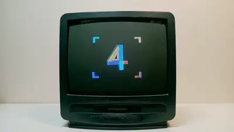</a><br><a href="https://www.sandbase.ai/lab/ai-videos/gemini-4-argon/2110263966270402879?lang=zh-CN&utm_source=github&utm_medium=readme&utm_campaign=awesome-gemini4-argon&utm_content=card"><b>Gemini 4 Argon 多维度测试与体验评测</b></a><br><sub><a href="https://x.com/athrix_codes/status/2110263966270402879">@athrix_codes</a> · 0:59</sub></td></tr>
<tr><td width="33%" valign="top"><a href="https://www.sandbase.ai/lab/media/x/gemini-4-argon/2110279443336102262/video.mp4">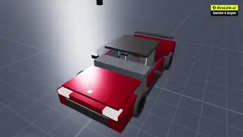</a><br><a href="https://www.sandbase.ai/lab/ai-videos/gemini-4-argon/2110279443336102262?lang=zh-CN&utm_source=github&utm_medium=readme&utm_campaign=awesome-gemini4-argon&utm_content=card"><b>单次生成的WebGL驾驶模拟器与座舱控制</b></a><br><sub><a href="https://x.com/EvoLinkAi/status/2110279443336102262">@EvoLinkAi</a> · 0:30 · <a href="https://www.sandbase.ai/lab/ai-videos/gemini-4-argon/2110279443336102262?lang=zh-CN&utm_source=github&utm_medium=readme&utm_campaign=awesome-gemini4-argon&utm_content=card">提示词</a></sub></td><td width="33%" valign="top"><a href="https://www.sandbase.ai/lab/media/x/gemini-4-argon/2110290468584247638/video.mp4">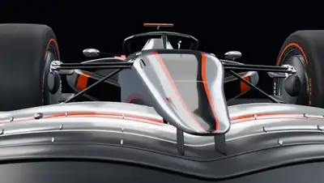</a><br><a href="https://www.sandbase.ai/lab/ai-videos/gemini-4-argon/2110290468584247638?lang=zh-CN&utm_source=github&utm_medium=readme&utm_campaign=awesome-gemini4-argon&utm_content=card"><b>Three.js 构建的一级方程式赛车</b></a><br><sub><a href="https://x.com/SahilPanhotra/status/2110290468584247638">@SahilPanhotra</a> · 0:12</sub></td><td width="33%" valign="top"><a href="https://www.sandbase.ai/lab/media/x/gemini-4-argon/2110291890839191858/video.mp4">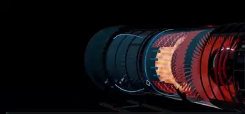</a><br><a href="https://www.sandbase.ai/lab/ai-videos/gemini-4-argon/2110291890839191858?lang=zh-CN&utm_source=github&utm_medium=readme&utm_campaign=awesome-gemini4-argon&utm_content=card"><b>Three.js 实时 3D 轴流涡扇发动机</b></a><br><sub><a href="https://x.com/0xbenderxbt/status/2110291890839191858">@0xbenderxbt</a> · 0:38</sub></td></tr>
<tr><td width="33%" valign="top"><a href="https://www.sandbase.ai/lab/media/x/gemini-4-argon/2110303650887487745/video.mp4">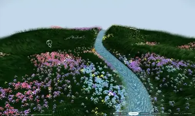</a><br><a href="https://www.sandbase.ai/lab/ai-videos/gemini-4-argon/2110303650887487745?lang=zh-CN&utm_source=github&utm_medium=readme&utm_campaign=awesome-gemini4-argon&utm_content=card"><b>Three.js交互式音乐3D数字花园</b></a><br><sub><a href="https://x.com/soumyadesign/status/2110303650887487745">@soumyadesign</a> · 1:16</sub></td><td width="33%" valign="top"><a href="https://www.sandbase.ai/lab/media/x/gemini-4-argon/2110305600416698390/video.mp4">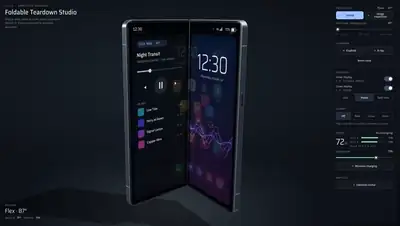</a><br><a href="https://www.sandbase.ai/lab/ai-videos/gemini-4-argon/2110305600416698390?lang=zh-CN&utm_source=github&utm_medium=readme&utm_campaign=awesome-gemini4-argon&utm_content=card"><b>Three.js 折叠屏手机三维拆解展示</b></a><br><sub><a href="https://x.com/rajlol01/status/2110305600416698390">@rajlol01</a> · 1:03</sub></td><td width="33%" valign="top"><a href="https://www.sandbase.ai/lab/media/x/gemini-4-argon/2110310573762130387/video.mp4"></a><br><a href="https://www.sandbase.ai/lab/ai-videos/gemini-4-argon/2110310573762130387?lang=zh-CN&utm_source=github&utm_medium=readme&utm_campaign=awesome-gemini4-argon&utm_content=card"><b>人形机器人投掷沙包物理模拟训练</b></a><br><sub><a href="https://x.com/luellamech/status/2110310573762130387">@luellamech</a> · 0:10</sub></td></tr>
<tr><td width="33%" valign="top"><a href="https://www.sandbase.ai/lab/media/x/gemini-4-argon/2110312192633639223/video.mp4">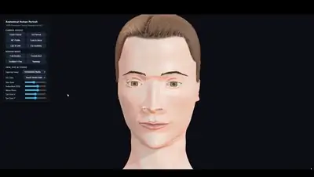</a><br><a href="https://www.sandbase.ai/lab/ai-videos/gemini-4-argon/2110312192633639223?lang=zh-CN&utm_source=github&utm_medium=readme&utm_campaign=awesome-gemini4-argon&utm_content=card"><b>Three.js 程序化生成人脸模型</b></a><br><sub><a href="https://x.com/SimonasLTU1/status/2110312192633639223">@SimonasLTU1</a> · 0:56</sub></td><td width="33%" valign="top"><a href="https://www.sandbase.ai/lab/media/x/gemini-4-argon/2110325698137076094/video.mp4">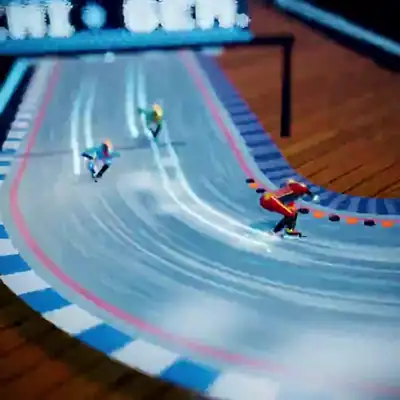</a><br><a href="https://www.sandbase.ai/lab/ai-videos/gemini-4-argon/2110325698137076094?lang=zh-CN&utm_source=github&utm_medium=readme&utm_campaign=awesome-gemini4-argon&utm_content=card"><b>Three.js浏览器实时运行模拟</b></a><br><sub><a href="https://x.com/alexanderchen/status/2110325698137076094">@alexanderchen</a> · 0:09</sub></td><td width="33%" valign="top"><a href="https://www.sandbase.ai/lab/media/x/gemini-4-argon/2110329505969484045/video.mp4"></a><br><a href="https://www.sandbase.ai/lab/ai-videos/gemini-4-argon/2110329505969484045?lang=zh-CN&utm_source=github&utm_medium=readme&utm_campaign=awesome-gemini4-argon&utm_content=card"><b>穿越太空动画演示</b></a><br><sub><a href="https://x.com/kepochnik/status/2110329505969484045">@kepochnik</a> · 1:00</sub></td></tr>
<tr><td width="33%" valign="top"><a href="https://www.sandbase.ai/lab/media/x/gemini-4-argon/2110342166790787489/video.mp4"></a><br><a href="https://www.sandbase.ai/lab/ai-videos/gemini-4-argon/2110342166790787489?lang=zh-CN&utm_source=github&utm_medium=readme&utm_campaign=awesome-gemini4-argon&utm_content=card"><b>从零单次生成的埃菲尔铁塔</b></a><br><sub><a href="https://x.com/Mr_Salio/status/2110342166790787489">@Mr_Salio</a> · 0:29</sub></td><td width="33%" valign="top"><a href="https://www.sandbase.ai/lab/media/x/gemini-4-argon/2110355164687155634/video.mp4">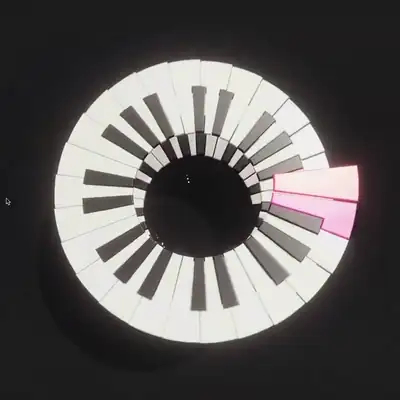</a><br><a href="https://www.sandbase.ai/lab/ai-videos/gemini-4-argon/2110355164687155634?lang=zh-CN&utm_source=github&utm_medium=readme&utm_campaign=awesome-gemini4-argon&utm_content=card"><b>Three.js 螺旋钢琴三维乐器</b></a><br><sub><a href="https://x.com/alexanderchen/status/2110355164687155634">@alexanderchen</a> · 0:53</sub></td><td width="33%" valign="top"><a href="https://www.sandbase.ai/lab/media/x/gemini-4-argon/2110355993255366802/video.mp4">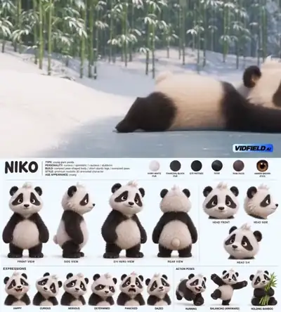</a><br><a href="https://www.sandbase.ai/lab/ai-videos/gemini-4-argon/2110355993255366802?lang=zh-CN&utm_source=github&utm_medium=readme&utm_campaign=awesome-gemini4-argon&utm_content=card"><b>单提示词生成的电影级三维动画</b></a><br><sub><a href="https://x.com/HeyAbhishek/status/2110355993255366802">@HeyAbhishek</a> · 0:30 · <a href="https://www.sandbase.ai/lab/ai-videos/gemini-4-argon/2110355993255366802?lang=zh-CN&utm_source=github&utm_medium=readme&utm_campaign=awesome-gemini4-argon&utm_content=card">提示词</a></sub></td></tr>
<tr><td width="33%" valign="top"><a href="https://www.sandbase.ai/lab/media/x/gemini-4-argon/2110361902064992440/video.mp4">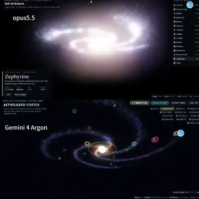</a><br><a href="https://www.sandbase.ai/lab/ai-videos/gemini-4-argon/2110361902064992440?lang=zh-CN&utm_source=github&utm_medium=readme&utm_campaign=awesome-gemini4-argon&utm_content=card"><b>Three.js 交互式三维星系模型</b></a><br><sub><a href="https://x.com/Smlay_ero/status/2110361902064992440">@Smlay_ero</a> · 0:37 · <a href="https://www.sandbase.ai/lab/ai-videos/gemini-4-argon/2110361902064992440?lang=zh-CN&utm_source=github&utm_medium=readme&utm_campaign=awesome-gemini4-argon&utm_content=card">提示词</a></sub></td><td width="33%" valign="top"><a href="https://www.sandbase.ai/lab/media/x/gemini-4-argon/2110368976664756375/video.mp4">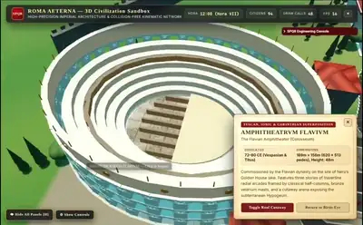</a><br><a href="https://www.sandbase.ai/lab/ai-videos/gemini-4-argon/2110368976664756375?lang=zh-CN&utm_source=github&utm_medium=readme&utm_campaign=awesome-gemini4-argon&utm_content=card"><b>单个HTML文件构建的罗马文明</b></a><br><sub><a href="https://x.com/NovaXCode/status/2110368976664756375">@NovaXCode</a> · 0:47</sub></td><td width="33%" valign="top"><a href="https://www.sandbase.ai/lab/media/x/gemini-4-argon/2110390964028330106/video.mp4"></a><br><a href="https://www.sandbase.ai/lab/ai-videos/gemini-4-argon/2110390964028330106?lang=zh-CN&utm_source=github&utm_medium=readme&utm_campaign=awesome-gemini4-argon&utm_content=card"><b>Three.js打造的未来感人形3D机器人</b></a><br><sub><a href="https://x.com/thtbee_/status/2110390964028330106">@thtbee_</a> · 1:11</sub></td></tr>
<tr><td width="33%" valign="top"><a href="https://www.sandbase.ai/lab/media/x/gemini-4-argon/2110399609285533853/video.mp4"></a><br><a href="https://www.sandbase.ai/lab/ai-videos/gemini-4-argon/2110399609285533853?lang=zh-CN&utm_source=github&utm_medium=readme&utm_campaign=awesome-gemini4-argon&utm_content=card"><b>完全在Three.js中代码生成的武装直升机</b></a><br><sub><a href="https://x.com/deweytn/status/2110399609285533853">@deweytn</a> · 1:12</sub></td><td width="33%" valign="top"><a href="https://www.sandbase.ai/lab/media/x/gemini-4-argon/2110407254080184395/video.mp4"></a><br><a href="https://www.sandbase.ai/lab/ai-videos/gemini-4-argon/2110407254080184395?lang=zh-CN&utm_source=github&utm_medium=readme&utm_campaign=awesome-gemini4-argon&utm_content=card"><b>在 Antigravity 中逆向工程生成的 3D 结构</b></a><br><sub><a href="https://x.com/ai_for_success/status/2110407254080184395">@ai_for_success</a> · 0:31</sub></td><td width="33%" valign="top"><a href="https://www.sandbase.ai/lab/media/x/gemini-4-argon/2110408842643419155/video.mp4"></a><br><a href="https://www.sandbase.ai/lab/ai-videos/gemini-4-argon/2110408842643419155?lang=zh-CN&utm_source=github&utm_medium=readme&utm_campaign=awesome-gemini4-argon&utm_content=card"><b>修复建筑的交互式3D WebGL视口</b></a><br><sub><a href="https://x.com/AnupamHaldkar/status/2110408842643419155">@AnupamHaldkar</a> · 0:22</sub></td></tr>
<tr><td width="33%" valign="top"><a href="https://www.sandbase.ai/lab/media/x/gemini-4-argon/2110414506241507722/video.mp4"></a><br><a href="https://www.sandbase.ai/lab/ai-videos/gemini-4-argon/2110414506241507722?lang=zh-CN&utm_source=github&utm_medium=readme&utm_campaign=awesome-gemini4-argon&utm_content=card"><b>通过MCP在Blender中构建的3D动画角色</b></a><br><sub><a href="https://x.com/SahilPanhotra/status/2110414506241507722">@SahilPanhotra</a> · 0:14</sub></td><td width="33%" valign="top"><a href="https://www.sandbase.ai/lab/media/x/gemini-4-argon/2110428004765794435/video.mp4"></a><br><a href="https://www.sandbase.ai/lab/ai-videos/gemini-4-argon/2110428004765794435?lang=zh-CN&utm_source=github&utm_medium=readme&utm_campaign=awesome-gemini4-argon&utm_content=card"><b>在 Blender 中构建的完整寺庙建筑群</b></a><br><sub><a href="https://x.com/deweytn/status/2110428004765794435">@deweytn</a> · 0:33</sub></td><td width="33%" valign="top"><a href="https://www.sandbase.ai/lab/media/x/gemini-4-argon/2110429931314503852/video.mp4"></a><br><a href="https://www.sandbase.ai/lab/ai-videos/gemini-4-argon/2110429931314503852?lang=zh-CN&utm_source=github&utm_medium=readme&utm_campaign=awesome-gemini4-argon&utm_content=card"><b>老款皮卡的交互式3D技术手册展示</b></a><br><sub><a href="https://x.com/Yarilo7brigada/status/2110429931314503852">@Yarilo7brigada</a> · 0:15</sub></td></tr>
<tr><td width="33%" valign="top"><a href="https://www.sandbase.ai/lab/media/x/gemini-4-argon/2110444219617751305/video.mp4"></a><br><a href="https://www.sandbase.ai/lab/ai-videos/gemini-4-argon/2110444219617751305?lang=zh-CN&utm_source=github&utm_medium=readme&utm_campaign=awesome-gemini4-argon&utm_content=card"><b>结合Opus与Argon生成的Three.js汽车</b></a><br><sub><a href="https://x.com/maxt3chno/status/2110444219617751305">@maxt3chno</a> · 0:34</sub></td><td width="33%" valign="top"><a href="https://www.sandbase.ai/lab/media/x/gemini-4-argon/2110458848381473138/video.mp4"></a><br><a href="https://www.sandbase.ai/lab/ai-videos/gemini-4-argon/2110458848381473138?lang=zh-CN&utm_source=github&utm_medium=readme&utm_campaign=awesome-gemini4-argon&utm_content=card"><b>Gemini 4 Argon生成的Three.js实验项目</b></a><br><sub><a href="https://x.com/runable_hq/status/2110458848381473138">@runable_hq</a> · 0:37</sub></td><td width="33%" valign="top"><a href="https://www.sandbase.ai/lab/media/x/gemini-4-argon/2110519826091495925/video.mp4"></a><br><a href="https://www.sandbase.ai/lab/ai-videos/gemini-4-argon/2110519826091495925?lang=zh-CN&utm_source=github&utm_medium=readme&utm_campaign=awesome-gemini4-argon&utm_content=card"><b>可交互的3D模拟合成器与黑胶唱机工作室</b></a><br><sub><a href="https://x.com/IamEmily2050/status/2110519826091495925">@IamEmily2050</a> · 2:00 · <a href="https://www.sandbase.ai/lab/ai-videos/gemini-4-argon/2110519826091495925?lang=zh-CN&utm_source=github&utm_medium=readme&utm_campaign=awesome-gemini4-argon&utm_content=card">提示词</a></sub></td></tr>
<tr><td width="33%" valign="top"><a href="https://www.sandbase.ai/lab/media/x/gemini-4-argon/2110627037266477497/video.mp4"></a><br><a href="https://www.sandbase.ai/lab/ai-videos/gemini-4-argon/2110627037266477497?lang=zh-CN&utm_source=github&utm_medium=readme&utm_campaign=awesome-gemini4-argon&utm_content=card"><b>由AI全自动重构的哥特维多利亚马车3D网页</b></a><br><sub><a href="https://x.com/thebuggeddev/status/2110627037266477497">@thebuggeddev</a> · 0:38</sub></td><td width="33%" valign="top"><a href="https://www.sandbase.ai/lab/media/x/gemini-4-argon/2110659959272997001/video.mp4"></a><br><a href="https://www.sandbase.ai/lab/ai-videos/gemini-4-argon/2110659959272997001?lang=zh-CN&utm_source=github&utm_medium=readme&utm_campaign=awesome-gemini4-argon&utm_content=card"><b>Three.js纯代码生成的F1赛车</b></a><br><sub><a href="https://x.com/universalmodhq/status/2110659959272997001">@universalmodhq</a> · 0:18</sub></td><td width="33%" valign="top"><a href="https://www.sandbase.ai/lab/media/x/gemini-4-argon/2110718876459979208/video.mp4"></a><br><a href="https://www.sandbase.ai/lab/ai-videos/gemini-4-argon/2110718876459979208?lang=zh-CN&utm_source=github&utm_medium=readme&utm_campaign=awesome-gemini4-argon&utm_content=card"><b>AI生成的电影感3D场景</b></a><br><sub><a href="https://x.com/HeyAbhishek/status/2110718876459979208">@HeyAbhishek</a> · 0:30 · <a href="https://www.sandbase.ai/lab/ai-videos/gemini-4-argon/2110718876459979208?lang=zh-CN&utm_source=github&utm_medium=readme&utm_campaign=awesome-gemini4-argon&utm_content=card">提示词</a></sub></td></tr>
<tr><td width="33%" valign="top"><a href="https://www.sandbase.ai/lab/media/x/gemini-4-argon/2110746137473007819/video.mp4"></a><br><a href="https://www.sandbase.ai/lab/ai-videos/gemini-4-argon/2110746137473007819?lang=zh-CN&utm_source=github&utm_medium=readme&utm_campaign=awesome-gemini4-argon&utm_content=card"><b>Claude Opus程序化生成的3D战舰生成器</b></a><br><sub><a href="https://x.com/Aprilzz423/status/2110746137473007819">@Aprilzz423</a> · 0:24</sub></td><td width="33%" valign="top"><a href="https://www.sandbase.ai/lab/media/x/gemini-4-argon/2110755854354170292/video.mp4"></a><br><a href="https://www.sandbase.ai/lab/ai-videos/gemini-4-argon/2110755854354170292?lang=zh-CN&utm_source=github&utm_medium=readme&utm_campaign=awesome-gemini4-argon&utm_content=card"><b>WebGL中程序化生成的交互式3D泰姬陵</b></a><br><sub><a href="https://x.com/devXritesh/status/2110755854354170292">@devXritesh</a> · 0:47</sub></td><td width="33%" valign="top"><a href="https://www.sandbase.ai/lab/media/x/gemini-4-argon/2110759576262123670/video.mp4"></a><br><a href="https://www.sandbase.ai/lab/ai-videos/gemini-4-argon/2110759576262123670?lang=zh-CN&utm_source=github&utm_medium=readme&utm_campaign=awesome-gemini4-argon&utm_content=card"><b>交互式3D农场动物园</b></a><br><sub><a href="https://x.com/jacalulu/status/2110759576262123670">@jacalulu</a> · 1:00</sub></td></tr>
<tr><td width="33%" valign="top"><a href="https://www.sandbase.ai/lab/media/x/gemini-4-argon/2110780282009784509/video.mp4"></a><br><a href="https://www.sandbase.ai/lab/ai-videos/gemini-4-argon/2110780282009784509?lang=zh-CN&utm_source=github&utm_medium=readme&utm_campaign=awesome-gemini4-argon&utm_content=card"><b>哥特工程风格可交互3D天象仪环境</b></a><br><sub><a href="https://x.com/Nyxelarm/status/2110780282009784509">@Nyxelarm</a> · 0:50</sub></td><td width="33%" valign="top"><a href="https://www.sandbase.ai/lab/media/x/gemini-4-argon/2110853170176065720/video.mp4"></a><br><a href="https://www.sandbase.ai/lab/ai-videos/gemini-4-argon/2110853170176065720?lang=zh-CN&utm_source=github&utm_medium=readme&utm_campaign=awesome-gemini4-argon&utm_content=card"><b>在Google Antigravity中测试复杂3D WebGL模拟</b></a><br><sub><a href="https://x.com/SammmAing/status/2110853170176065720">@SammmAing</a> · 0:28</sub></td><td width="33%" valign="top"><a href="https://www.sandbase.ai/lab/media/x/gemini-4-argon/2110973461690802487/video.mp4"></a><br><a href="https://www.sandbase.ai/lab/ai-videos/gemini-4-argon/2110973461690802487?lang=zh-CN&utm_source=github&utm_medium=readme&utm_campaign=awesome-gemini4-argon&utm_content=card"><b>在Blender中构建飞鸟时代日本佛塔寺庙</b></a><br><sub><a href="https://x.com/ai_for_success/status/2110973461690802487">@ai_for_success</a> · 1:02</sub></td></tr>
<tr><td width="33%" valign="top"><a href="https://www.sandbase.ai/lab/media/x/gemini-4-argon/2110992902755397677/video.mp4"></a><br><a href="https://www.sandbase.ai/lab/ai-videos/gemini-4-argon/2110992902755397677?lang=zh-CN&utm_source=github&utm_medium=readme&utm_campaign=awesome-gemini4-argon&utm_content=card"><b>Gemini 4 Argon 单次生成的 Three.js 场景</b></a><br><sub><a href="https://x.com/AI_Screening/status/2110992902755397677">@AI_Screening</a> · 0:14</sub></td><td width="33%" valign="top"><a href="https://www.sandbase.ai/lab/media/x/gemini-4-argon/2111071463155564733/video.mp4"></a><br><a href="https://www.sandbase.ai/lab/ai-videos/gemini-4-argon/2111071463155564733?lang=zh-CN&utm_source=github&utm_medium=readme&utm_campaign=awesome-gemini4-argon&utm_content=card"><b>基于Three.js着色器的3D寿司盒效果</b></a><br><sub><a href="https://x.com/ann_nnng/status/2111071463155564733">@ann_nnng</a> · 0:21</sub></td><td width="33%" valign="top"><a href="https://www.sandbase.ai/lab/media/x/gemini-4-argon/2111077472733200448/video.mp4"></a><br><a href="https://www.sandbase.ai/lab/ai-videos/gemini-4-argon/2111077472733200448?lang=zh-CN&utm_source=github&utm_medium=readme&utm_campaign=awesome-gemini4-argon&utm_content=card"><b>Gemini 4驱动的人形机器人投沙包仿真</b></a><br><sub><a href="https://x.com/WevolverApp/status/2111077472733200448">@WevolverApp</a> · 1:43</sub></td></tr>
<tr><td width="33%" valign="top"><a href="https://www.sandbase.ai/lab/media/x/gemini-4-argon/2111081875934748728/video.mp4"></a><br><a href="https://www.sandbase.ai/lab/ai-videos/gemini-4-argon/2111081875934748728?lang=zh-CN&utm_source=github&utm_medium=readme&utm_campaign=awesome-gemini4-argon&utm_content=card"><b>单HTML文件实现的交互式3D橙子</b></a><br><sub><a href="https://x.com/SahilPanhotra/status/2111081875934748728">@SahilPanhotra</a> · 0:16</sub></td><td width="33%" valign="top"><a href="https://www.sandbase.ai/lab/media/x/gemini-4-argon/2111126153406849494/video.mp4"></a><br><a href="https://www.sandbase.ai/lab/ai-videos/gemini-4-argon/2111126153406849494?lang=zh-CN&utm_source=github&utm_medium=readme&utm_campaign=awesome-gemini4-argon&utm_content=card"><b>WebGL三维机械木牛流马演示</b></a><br><sub><a href="https://x.com/GeekCatX/status/2111126153406849494">@GeekCatX</a> · 1:53</sub></td><td width="33%" valign="top"><a href="https://www.sandbase.ai/lab/media/x/gemini-4-argon/2111145884776116711/video.mp4"></a><br><a href="https://www.sandbase.ai/lab/ai-videos/gemini-4-argon/2111145884776116711?lang=zh-CN&utm_source=github&utm_medium=readme&utm_campaign=awesome-gemini4-argon&utm_content=card"><b>Three.js 生成的 3D 赛车模型</b></a><br><sub><a href="https://x.com/ayjaystyle/status/2111145884776116711">@ayjaystyle</a> · 0:20 · <a href="https://www.sandbase.ai/lab/ai-videos/gemini-4-argon/2111145884776116711?lang=zh-CN&utm_source=github&utm_medium=readme&utm_campaign=awesome-gemini4-argon&utm_content=card">提示词</a></sub></td></tr>
<tr><td width="33%" valign="top"><a href="https://www.sandbase.ai/lab/media/x/gemini-4-argon/2111154246229914026/video.mp4"></a><br><a href="https://www.sandbase.ai/lab/ai-videos/gemini-4-argon/2111154246229914026?lang=zh-CN&utm_source=github&utm_medium=readme&utm_campaign=awesome-gemini4-argon&utm_content=card"><b>Three.js交互式膝关节生物力学沙盒</b></a><br><sub><a href="https://x.com/GlitterPixely/status/2111154246229914026">@GlitterPixely</a> · 0:57</sub></td><td width="33%" valign="top"><a href="https://www.sandbase.ai/lab/media/x/gemini-4-argon/2111162436476948796/video.mp4"></a><br><a href="https://www.sandbase.ai/lab/ai-videos/gemini-4-argon/2111162436476948796?lang=zh-CN&utm_source=github&utm_medium=readme&utm_campaign=awesome-gemini4-argon&utm_content=card"><b>Three.js交互式光学透镜实验室演示</b></a><br><sub><a href="https://x.com/thtbee_/status/2111162436476948796">@thtbee_</a> · 0:29</sub></td><td width="33%" valign="top"><a href="https://www.sandbase.ai/lab/media/x/gemini-4-argon/2111642973272506696/video.mp4"></a><br><a href="https://www.sandbase.ai/lab/ai-videos/gemini-4-argon/2111642973272506696?lang=zh-CN&utm_source=github&utm_medium=readme&utm_campaign=awesome-gemini4-argon&utm_content=card"><b>永动机概念设计演示</b></a><br><sub><a href="https://x.com/GumVue/status/2111642973272506696">@GumVue</a> · 0:10</sub></td></tr>
<tr><td width="33%" valign="top"><a href="https://www.sandbase.ai/lab/media/x/gemini-4-argon/2111685770075672709/video.mp4"></a><br><a href="https://www.sandbase.ai/lab/ai-videos/gemini-4-argon/2111685770075672709?lang=zh-CN&utm_source=github&utm_medium=readme&utm_campaign=awesome-gemini4-argon&utm_content=card"><b>使用Three.js构建的古埃及场景</b></a><br><sub><a href="https://x.com/designwkarthick/status/2111685770075672709">@designwkarthick</a> · 0:10</sub></td><td width="33%" valign="top"><a href="https://www.sandbase.ai/lab/media/x/gemini-4-argon/2111821910442991632/video.mp4"></a><br><a href="https://www.sandbase.ai/lab/ai-videos/gemini-4-argon/2111821910442991632?lang=zh-CN&utm_source=github&utm_medium=readme&utm_campaign=awesome-gemini4-argon&utm_content=card"><b>利用Mixamo工作流驱动人形丧尸3D模型动画</b></a><br><sub><a href="https://x.com/maxt3chno/status/2111821910442991632">@maxt3chno</a> · 0:43</sub></td><td width="33%" valign="top"><a href="https://www.sandbase.ai/lab/media/x/gemini-4-argon/2111891517858087372/video.mp4"></a><br><a href="https://www.sandbase.ai/lab/ai-videos/gemini-4-argon/2111891517858087372?lang=zh-CN&utm_source=github&utm_medium=readme&utm_campaign=awesome-gemini4-argon&utm_content=card"><b>用Gemini与Blender制作的3D恐怖走廊</b></a><br><sub><a href="https://x.com/pipeline_os/status/2111891517858087372">@pipeline_os</a> · 0:10</sub></td></tr>
<tr><td width="33%" valign="top"><a href="https://www.sandbase.ai/lab/media/x/gemini-4-argon/2111932070079701238/video.mp4"></a><br><a href="https://www.sandbase.ai/lab/ai-videos/gemini-4-argon/2111932070079701238?lang=zh-CN&utm_source=github&utm_medium=readme&utm_campaign=awesome-gemini4-argon&utm_content=card"><b>历史遗迹的三维测绘场景展示</b></a><br><sub><a href="https://x.com/soumyadesign/status/2111932070079701238">@soumyadesign</a> · 0:38</sub></td><td width="33%" valign="top"><a href="https://www.sandbase.ai/lab/media/x/gemini-4-argon/2112094806084386839/video.mp4"></a><br><a href="https://www.sandbase.ai/lab/ai-videos/gemini-4-argon/2112094806084386839?lang=zh-CN&utm_source=github&utm_medium=readme&utm_campaign=awesome-gemini4-argon&utm_content=card"><b>Blender代码生成的可探索3D世界</b></a><br><sub><a href="https://x.com/GaoYipeng/status/2112094806084386839">@GaoYipeng</a> · 0:21</sub></td><td width="33%" valign="top"><a href="https://www.sandbase.ai/lab/media/x/gemini-4-argon/2112197089702666496/video.mp4"></a><br><a href="https://www.sandbase.ai/lab/ai-videos/gemini-4-argon/2112197089702666496?lang=zh-CN&utm_source=github&utm_medium=readme&utm_campaign=awesome-gemini4-argon&utm_content=card"><b>Three.js纯程序化生成的3D纽约直升机巡游</b></a><br><sub><a href="https://x.com/StatsWire/status/2112197089702666496">@StatsWire</a> · 1:05</sub></td></tr>
<tr><td width="33%" valign="top"><a href="https://www.sandbase.ai/lab/media/x/gemini-4-argon/2112206606255436050/video.mp4"></a><br><a href="https://www.sandbase.ai/lab/ai-videos/gemini-4-argon/2112206606255436050?lang=zh-CN&utm_source=github&utm_medium=readme&utm_campaign=awesome-gemini4-argon&utm_content=card"><b>WebGL速写合集与程序化音频</b></a><br><sub><a href="https://x.com/dcmotz/status/2112206606255436050">@dcmotz</a> · 0:20</sub></td><td width="33%" valign="top"><a href="https://www.sandbase.ai/lab/media/x/gemini-4-argon/2112481320081256666/video.mp4"></a><br><a href="https://www.sandbase.ai/lab/ai-videos/gemini-4-argon/2112481320081256666?lang=zh-CN&utm_source=github&utm_medium=readme&utm_campaign=awesome-gemini4-argon&utm_content=card"><b>3D动画网格替换测试</b></a><br><sub><a href="https://x.com/maxt3chno/status/2112481320081256666">@maxt3chno</a> · 0:43</sub></td><td width="33%" valign="top"><a href="https://www.sandbase.ai/lab/media/x/gemini-4-argon/2112499188957344210/video.mp4"></a><br><a href="https://www.sandbase.ai/lab/ai-videos/gemini-4-argon/2112499188957344210?lang=zh-CN&utm_source=github&utm_medium=readme&utm_campaign=awesome-gemini4-argon&utm_content=card"><b>浏览器中的互动式3D温布利球场</b></a><br><sub><a href="https://x.com/thebuggeddev/status/2112499188957344210">@thebuggeddev</a> · 0:45</sub></td></tr>
<tr><td width="33%" valign="top"><a href="https://www.sandbase.ai/lab/media/x/gemini-4-argon/2112543356634992799/video.mp4"></a><br><a href="https://www.sandbase.ai/lab/ai-videos/gemini-4-argon/2112543356634992799?lang=zh-CN&utm_source=github&utm_medium=readme&utm_campaign=awesome-gemini4-argon&utm_content=card"><b>男孩遛狗的3D动画</b></a><br><sub><a href="https://x.com/kayisagijr/status/2112543356634992799">@kayisagijr</a> · 0:10 · <a href="https://www.sandbase.ai/lab/ai-videos/gemini-4-argon/2112543356634992799?lang=zh-CN&utm_source=github&utm_medium=readme&utm_campaign=awesome-gemini4-argon&utm_content=card">提示词</a></sub></td><td width="33%" valign="top"><a href="https://www.sandbase.ai/lab/media/x/gemini-4-argon/2112627521401327712/video.mp4"></a><br><a href="https://www.sandbase.ai/lab/ai-videos/gemini-4-argon/2112627521401327712?lang=zh-CN&utm_source=github&utm_medium=readme&utm_campaign=awesome-gemini4-argon&utm_content=card"><b>乐高积木识别与交互式3D模型生成</b></a><br><sub><a href="https://x.com/kat_kampf/status/2112627521401327712">@kat_kampf</a> · 0:23</sub></td><td width="33%" valign="top"><a href="https://www.sandbase.ai/lab/media/x/gemini-4-argon/2112627670920163708/video.mp4"></a><br><a href="https://www.sandbase.ai/lab/ai-videos/gemini-4-argon/2112627670920163708?lang=zh-CN&utm_source=github&utm_medium=readme&utm_campaign=awesome-gemini4-argon&utm_content=card"><b>WebGL浏览器无库海洋模拟器</b></a><br><sub><a href="https://x.com/DrstaOne/status/2112627670920163708">@DrstaOne</a> · 0:55</sub></td></tr>
<tr><td width="33%" valign="top"><a href="https://www.sandbase.ai/lab/media/x/gemini-4-argon/2112678597593071722/video.mp4"></a><br><a href="https://www.sandbase.ai/lab/ai-videos/gemini-4-argon/2112678597593071722?lang=zh-CN&utm_source=github&utm_medium=readme&utm_campaign=awesome-gemini4-argon&utm_content=card"><b>浏览器中运行的实时3D毛发引擎</b></a><br><sub><a href="https://x.com/taziku_co/status/2112678597593071722">@taziku_co</a> · 0:43</sub></td><td width="33%" valign="top"><a href="https://www.sandbase.ai/lab/media/x/gemini-4-argon/2112706683499675695/video.mp4"></a><br><a href="https://www.sandbase.ai/lab/ai-videos/gemini-4-argon/2112706683499675695?lang=zh-CN&utm_source=github&utm_medium=readme&utm_campaign=awesome-gemini4-argon&utm_content=card"><b>与元素之歌同步的3D元素周期表</b></a><br><sub><a href="https://x.com/RoundtableSpace/status/2112706683499675695">@RoundtableSpace</a> · 1:28</sub></td><td width="33%" valign="top"><a href="https://www.sandbase.ai/lab/media/x/gemini-4-argon/2113079526641258526/video.mp4"></a><br><a href="https://www.sandbase.ai/lab/ai-videos/gemini-4-argon/2113079526641258526?lang=zh-CN&utm_source=github&utm_medium=readme&utm_campaign=awesome-gemini4-argon&utm_content=card"><b>海岸神庙的三维场景重建</b></a><br><sub><a href="https://x.com/ai_for_success/status/2113079526641258526">@ai_for_success</a> · 1:20</sub></td></tr>
<tr><td width="33%" valign="top"><a href="https://www.sandbase.ai/lab/media/x/gemini-4-argon/2113098378942828632/video.mp4"></a><br><a href="https://www.sandbase.ai/lab/ai-videos/gemini-4-argon/2113098378942828632?lang=zh-CN&utm_source=github&utm_medium=readme&utm_campaign=awesome-gemini4-argon&utm_content=card"><b>带全息箔的可撕交互式音乐会门票</b></a><br><sub><a href="https://x.com/SammmAing/status/2113098378942828632">@SammmAing</a> · 0:21 · <a href="https://www.sandbase.ai/lab/ai-videos/gemini-4-argon/2113098378942828632?lang=zh-CN&utm_source=github&utm_medium=readme&utm_campaign=awesome-gemini4-argon&utm_content=card">提示词</a></sub></td><td width="33%" valign="top"><a href="https://www.sandbase.ai/lab/media/x/gemini-4-argon/2113280913144734206/video.mp4"></a><br><a href="https://www.sandbase.ai/lab/ai-videos/gemini-4-argon/2113280913144734206?lang=zh-CN&utm_source=github&utm_medium=readme&utm_campaign=awesome-gemini4-argon&utm_content=card"><b>带有WebGL着色器的程序化CAD涡扇测试室</b></a><br><sub><a href="https://x.com/Adidotdev/status/2113280913144734206">@Adidotdev</a> · 0:10</sub></td><td width="33%" valign="top"><a href="https://www.sandbase.ai/lab/media/x/gemini-4-argon/2113624611711783040/video.mp4"></a><br><a href="https://www.sandbase.ai/lab/ai-videos/gemini-4-argon/2113624611711783040?lang=zh-CN&utm_source=github&utm_medium=readme&utm_campaign=awesome-gemini4-argon&utm_content=card"><b>Gemini 4 Argon 生成的车库汽车展示</b></a><br><sub><a href="https://x.com/parves075/status/2113624611711783040">@parves075</a> · 0:50</sub></td></tr>
<tr><td width="33%" valign="top"><a href="https://www.sandbase.ai/lab/media/x/gemini-4-argon/2113642584702615772/video.mp4"></a><br><a href="https://www.sandbase.ai/lab/ai-videos/gemini-4-argon/2113642584702615772?lang=zh-CN&utm_source=github&utm_medium=readme&utm_campaign=awesome-gemini4-argon&utm_content=card"><b>HTML单文件重现特斯拉跑车特技</b></a><br><sub><a href="https://x.com/alwayspriyesh/status/2113642584702615772">@alwayspriyesh</a> · 0:18 · <a href="https://www.sandbase.ai/lab/ai-videos/gemini-4-argon/2113642584702615772?lang=zh-CN&utm_source=github&utm_medium=readme&utm_campaign=awesome-gemini4-argon&utm_content=card">提示词</a></sub></td></tr>
</table>

</details>

<a id="motion-graphics"></a>

## 动效

<table>
<tr><td width="33%" valign="top"><a href="https://www.sandbase.ai/lab/media/x/gemini-4-argon/2110039082764280146/video.mp4"></a><br><a href="https://www.sandbase.ai/lab/ai-videos/gemini-4-argon/2110039082764280146?lang=zh-CN&utm_source=github&utm_medium=readme&utm_campaign=awesome-gemini4-argon&utm_content=card"><b>Daisy Bell 的 SVG 声谱图</b></a><br><sub><a href="https://x.com/AdamHoltererer/status/2110039082764280146">@AdamHoltererer</a> · 0:18</sub></td><td width="33%" valign="top"><a href="https://www.sandbase.ai/lab/media/x/gemini-4-argon/2110043023954284889/video.mp4"></a><br><a href="https://www.sandbase.ai/lab/ai-videos/gemini-4-argon/2110043023954284889?lang=zh-CN&utm_source=github&utm_medium=readme&utm_campaign=awesome-gemini4-argon&utm_content=card"><b>使用傅里叶本轮画出的骑车鹈鹕</b></a><br><sub><a href="https://x.com/fofrAI/status/2110043023954284889">@fofrAI</a> · 1:00</sub></td><td width="33%" valign="top"><a href="https://www.sandbase.ai/lab/media/x/gemini-4-argon/2110048343841702129/video.mp4"></a><br><a href="https://www.sandbase.ai/lab/ai-videos/gemini-4-argon/2110048343841702129?lang=zh-CN&utm_source=github&utm_medium=readme&utm_campaign=awesome-gemini4-argon&utm_content=card"><b>Gemini 4 Argon 制作的果冻动画</b></a><br><sub><a href="https://x.com/scottstts/status/2110048343841702129">@scottstts</a> · 1:03</sub></td></tr>
<tr><td width="33%" valign="top"><a href="https://www.sandbase.ai/lab/media/x/gemini-4-argon/2110048380412199047/video.mp4"></a><br><a href="https://www.sandbase.ai/lab/ai-videos/gemini-4-argon/2110048380412199047?lang=zh-CN&utm_source=github&utm_medium=readme&utm_campaign=awesome-gemini4-argon&utm_content=card"><b>鹈鹕骑自行车的2D SVG动画</b></a><br><sub><a href="https://x.com/LiuweijiaVip/status/2110048380412199047">@LiuweijiaVip</a> · 0:30 · <a href="https://www.sandbase.ai/lab/ai-videos/gemini-4-argon/2110048380412199047?lang=zh-CN&utm_source=github&utm_medium=readme&utm_campaign=awesome-gemini4-argon&utm_content=card">提示词</a></sub></td><td width="33%" valign="top"><a href="https://www.sandbase.ai/lab/media/x/gemini-4-argon/2110056817728369054/video.mp4"></a><br><a href="https://www.sandbase.ai/lab/ai-videos/gemini-4-argon/2110056817728369054?lang=zh-CN&utm_source=github&utm_medium=readme&utm_campaign=awesome-gemini4-argon&utm_content=card"><b>HTML 与 SVG 关键帧动画</b></a><br><sub><a href="https://x.com/procesor_x/status/2110056817728369054">@procesor_x</a> · 0:13</sub></td><td width="33%" valign="top"><a href="https://www.sandbase.ai/lab/media/x/gemini-4-argon/2110058376118092277/video.mp4"></a><br><a href="https://www.sandbase.ai/lab/ai-videos/gemini-4-argon/2110058376118092277?lang=zh-CN&utm_source=github&utm_medium=readme&utm_campaign=awesome-gemini4-argon&utm_content=card"><b>鹈鹕和斑马骑自行车的SVG动画展示</b></a><br><sub><a href="https://x.com/xueyu1125/status/2110058376118092277">@xueyu1125</a> · 0:20 · <a href="https://www.sandbase.ai/lab/ai-videos/gemini-4-argon/2110058376118092277?lang=zh-CN&utm_source=github&utm_medium=readme&utm_campaign=awesome-gemini4-argon&utm_content=card">提示词</a></sub></td></tr>
</table>

<details>
<summary><b>展开全部 60 条</b></summary>

<table>
<tr><td width="33%" valign="top"><a href="https://www.sandbase.ai/lab/media/x/gemini-4-argon/2110086104431083712/video.mp4"></a><br><a href="https://www.sandbase.ai/lab/ai-videos/gemini-4-argon/2110086104431083712?lang=zh-CN&utm_source=github&utm_medium=readme&utm_campaign=awesome-gemini4-argon&utm_content=card"><b>单次生成的开场片头视频</b></a><br><sub><a href="https://x.com/anshuc/status/2110086104431083712">@anshuc</a> · 0:30</sub></td><td width="33%" valign="top"><a href="https://www.sandbase.ai/lab/media/x/gemini-4-argon/2110091334707286214/video.mp4"></a><br><a href="https://www.sandbase.ai/lab/ai-videos/gemini-4-argon/2110091334707286214?lang=zh-CN&utm_source=github&utm_medium=readme&utm_campaign=awesome-gemini4-argon&utm_content=card"><b>分层 SVG 路径绘制的插画</b></a><br><sub><a href="https://x.com/jammaru_lab/status/2110091334707286214">@jammaru_lab</a> · 0:11</sub></td><td width="33%" valign="top"><a href="https://www.sandbase.ai/lab/media/x/gemini-4-argon/2110101446272188680/video.mp4"></a><br><a href="https://www.sandbase.ai/lab/ai-videos/gemini-4-argon/2110101446272188680?lang=zh-CN&utm_source=github&utm_medium=readme&utm_campaign=awesome-gemini4-argon&utm_content=card"><b>使用Gemini Argon生成的Vikkeland宣传视频</b></a><br><sub><a href="https://x.com/ASalvadorini/status/2110101446272188680">@ASalvadorini</a> · 0:10</sub></td></tr>
<tr><td width="33%" valign="top"><a href="https://www.sandbase.ai/lab/media/x/gemini-4-argon/2110104441760403923/video.mp4"></a><br><a href="https://www.sandbase.ai/lab/ai-videos/gemini-4-argon/2110104441760403923?lang=zh-CN&utm_source=github&utm_medium=readme&utm_campaign=awesome-gemini4-argon&utm_content=card"><b>SVG 格式绘制的芙莉莲</b></a><br><sub><a href="https://x.com/notjazii/status/2110104441760403923">@notjazii</a> · 0:10</sub></td><td width="33%" valign="top"><a href="https://www.sandbase.ai/lab/media/x/gemini-4-argon/2110108667194257811/video.mp4"></a><br><a href="https://www.sandbase.ai/lab/ai-videos/gemini-4-argon/2110108667194257811?lang=zh-CN&utm_source=github&utm_medium=readme&utm_campaign=awesome-gemini4-argon&utm_content=card"><b>Gemini 4 Argon动态设计作品</b></a><br><sub><a href="https://x.com/ikcrypth/status/2110108667194257811">@ikcrypth</a> · 0:24</sub></td><td width="33%" valign="top"><a href="https://www.sandbase.ai/lab/media/x/gemini-4-argon/2110124112983269834/video.mp4"></a><br><a href="https://www.sandbase.ai/lab/ai-videos/gemini-4-argon/2110124112983269834?lang=zh-CN&utm_source=github&utm_medium=readme&utm_campaign=awesome-gemini4-argon&utm_content=card"><b>由提示词和图像生成的AI视频</b></a><br><sub><a href="https://x.com/Mr_Salio/status/2110124112983269834">@Mr_Salio</a> · 0:30</sub></td></tr>
<tr><td width="33%" valign="top"><a href="https://www.sandbase.ai/lab/media/x/gemini-4-argon/2110132736635884016/video.mp4"></a><br><a href="https://www.sandbase.ai/lab/ai-videos/gemini-4-argon/2110132736635884016?lang=zh-CN&utm_source=github&utm_medium=readme&utm_campaign=awesome-gemini4-argon&utm_content=card"><b>在 Antigravity 中运行 Gemini 4 Argon 生成测试</b></a><br><sub><a href="https://x.com/maxescu/status/2110132736635884016">@maxescu</a> · 0:55</sub></td><td width="33%" valign="top"><a href="https://www.sandbase.ai/lab/media/x/gemini-4-argon/2110133287662272783/video.mp4"></a><br><a href="https://www.sandbase.ai/lab/ai-videos/gemini-4-argon/2110133287662272783?lang=zh-CN&utm_source=github&utm_medium=readme&utm_campaign=awesome-gemini4-argon&utm_content=card"><b>Gemini 4 Argon模型生成效果测试</b></a><br><sub><a href="https://x.com/aeon_4th/status/2110133287662272783">@aeon_4th</a> · 1:30</sub></td><td width="33%" valign="top"><a href="https://www.sandbase.ai/lab/media/x/gemini-4-argon/2110141561677955132/video.mp4"></a><br><a href="https://www.sandbase.ai/lab/ai-videos/gemini-4-argon/2110141561677955132?lang=zh-CN&utm_source=github&utm_medium=readme&utm_campaign=awesome-gemini4-argon&utm_content=card"><b>Gemini 4 Argon 自我介绍视频</b></a><br><sub><a href="https://x.com/TheSuryanshD/status/2110141561677955132">@TheSuryanshD</a> · 0:14</sub></td></tr>
<tr><td width="33%" valign="top"><a href="https://www.sandbase.ai/lab/media/x/gemini-4-argon/2110153188192248026/video.mp4"></a><br><a href="https://www.sandbase.ai/lab/ai-videos/gemini-4-argon/2110153188192248026?lang=zh-CN&utm_source=github&utm_medium=readme&utm_campaign=awesome-gemini4-argon&utm_content=card"><b>SVG鹈鹕骑自行车动画</b></a><br><sub><a href="https://x.com/berryxia/status/2110153188192248026">@berryxia</a> · 0:30</sub></td><td width="33%" valign="top"><a href="https://www.sandbase.ai/lab/media/x/gemini-4-argon/2110160290088382522/video.mp4"></a><br><a href="https://www.sandbase.ai/lab/ai-videos/gemini-4-argon/2110160290088382522?lang=zh-CN&utm_source=github&utm_medium=readme&utm_campaign=awesome-gemini4-argon&utm_content=card"><b>Canvas与语音合成制作的动态图形</b></a><br><sub><a href="https://x.com/Majin_AppSheet/status/2110160290088382522">@Majin_AppSheet</a> · 1:07</sub></td><td width="33%" valign="top"><a href="https://www.sandbase.ai/lab/media/x/gemini-4-argon/2110160814178988413/video.mp4"></a><br><a href="https://www.sandbase.ai/lab/ai-videos/gemini-4-argon/2110160814178988413?lang=zh-CN&utm_source=github&utm_medium=readme&utm_campaign=awesome-gemini4-argon&utm_content=card"><b>纯代码绘制的杰克尼科尔森SVG肖像</b></a><br><sub><a href="https://x.com/tonysimons/status/2110160814178988413">@tonysimons</a> · 0:10</sub></td></tr>
<tr><td width="33%" valign="top"><a href="https://www.sandbase.ai/lab/media/x/gemini-4-argon/2110168263623938143/video.mp4"></a><br><a href="https://www.sandbase.ai/lab/ai-videos/gemini-4-argon/2110168263623938143?lang=zh-CN&utm_source=github&utm_medium=readme&utm_campaign=awesome-gemini4-argon&utm_content=card"><b>基于逆运动学的交互式SVG动画</b></a><br><sub><a href="https://x.com/servasyy_ai/status/2110168263623938143">@servasyy_ai</a> · 0:27 · <a href="https://www.sandbase.ai/lab/ai-videos/gemini-4-argon/2110168263623938143?lang=zh-CN&utm_source=github&utm_medium=readme&utm_campaign=awesome-gemini4-argon&utm_content=card">提示词</a></sub></td><td width="33%" valign="top"><a href="https://www.sandbase.ai/lab/media/x/gemini-4-argon/2110200910970253507/video.mp4"></a><br><a href="https://www.sandbase.ai/lab/ai-videos/gemini-4-argon/2110200910970253507?lang=zh-CN&utm_source=github&utm_medium=readme&utm_campaign=awesome-gemini4-argon&utm_content=card"><b>对话框内生成10秒视频测试</b></a><br><sub><a href="https://x.com/vincent_ddup/status/2110200910970253507">@vincent_ddup</a> · 0:10</sub></td><td width="33%" valign="top"><a href="https://www.sandbase.ai/lab/media/x/gemini-4-argon/2110210457642668158/video.mp4"></a><br><a href="https://www.sandbase.ai/lab/ai-videos/gemini-4-argon/2110210457642668158?lang=zh-CN&utm_source=github&utm_medium=readme&utm_campaign=awesome-gemini4-argon&utm_content=card"><b>Gemini应用动态图形设计</b></a><br><sub><a href="https://x.com/athrix_codes/status/2110210457642668158">@athrix_codes</a> · 0:16</sub></td></tr>
<tr><td width="33%" valign="top"><a href="https://www.sandbase.ai/lab/media/x/gemini-4-argon/2110210988968640567/video.mp4"></a><br><a href="https://www.sandbase.ai/lab/ai-videos/gemini-4-argon/2110210988968640567?lang=zh-CN&utm_source=github&utm_medium=readme&utm_campaign=awesome-gemini4-argon&utm_content=card"><b>重现蜘蛛侠动画场景</b></a><br><sub><a href="https://x.com/Priyannkaaaa/status/2110210988968640567">@Priyannkaaaa</a> · 0:15</sub></td><td width="33%" valign="top"><a href="https://www.sandbase.ai/lab/media/x/gemini-4-argon/2110213639252975669/video.mp4"></a><br><a href="https://www.sandbase.ai/lab/ai-videos/gemini-4-argon/2110213639252975669?lang=zh-CN&utm_source=github&utm_medium=readme&utm_campaign=awesome-gemini4-argon&utm_content=card"><b>鹈鹕骑自行车的SVG动画演示</b></a><br><sub><a href="https://x.com/aibuilderclub_/status/2110213639252975669">@aibuilderclub_</a> · 0:07</sub></td><td width="33%" valign="top"><a href="https://www.sandbase.ai/lab/media/x/gemini-4-argon/2110216771508805847/video.mp4"></a><br><a href="https://www.sandbase.ai/lab/ai-videos/gemini-4-argon/2110216771508805847?lang=zh-CN&utm_source=github&utm_medium=readme&utm_campaign=awesome-gemini4-argon&utm_content=card"><b>鹈鹕骑自行车的交互式前端演示</b></a><br><sub><a href="https://x.com/hqmank/status/2110216771508805847">@hqmank</a> · 0:28</sub></td></tr>
<tr><td width="33%" valign="top"><a href="https://www.sandbase.ai/lab/media/x/gemini-4-argon/2110236668116848987/video.mp4"></a><br><a href="https://www.sandbase.ai/lab/ai-videos/gemini-4-argon/2110236668116848987?lang=zh-CN&utm_source=github&utm_medium=readme&utm_campaign=awesome-gemini4-argon&utm_content=card"><b>流体动力学水仗视频</b></a><br><sub><a href="https://x.com/tarumainfo/status/2110236668116848987">@tarumainfo</a> · 0:10</sub></td><td width="33%" valign="top"><a href="https://www.sandbase.ai/lab/media/x/gemini-4-argon/2110250886706712728/video.mp4"></a><br><a href="https://www.sandbase.ai/lab/ai-videos/gemini-4-argon/2110250886706712728?lang=zh-CN&utm_source=github&utm_medium=readme&utm_campaign=awesome-gemini4-argon&utm_content=card"><b>使用SVG矢量帧重绘原视频对比</b></a><br><sub><a href="https://x.com/HarshithLucky3/status/2110250886706712728">@HarshithLucky3</a> · 0:51</sub></td><td width="33%" valign="top"><a href="https://www.sandbase.ai/lab/media/x/gemini-4-argon/2110266591229235258/video.mp4"></a><br><a href="https://www.sandbase.ai/lab/ai-videos/gemini-4-argon/2110266591229235258?lang=zh-CN&utm_source=github&utm_medium=readme&utm_campaign=awesome-gemini4-argon&utm_content=card"><b>Fiverr 动效设计测试视频</b></a><br><sub><a href="https://x.com/nimi_101/status/2110266591229235258">@nimi_101</a> · 1:02</sub></td></tr>
<tr><td width="33%" valign="top"><a href="https://www.sandbase.ai/lab/media/x/gemini-4-argon/2110312479662264668/video.mp4"></a><br><a href="https://www.sandbase.ai/lab/ai-videos/gemini-4-argon/2110312479662264668?lang=zh-CN&utm_source=github&utm_medium=readme&utm_campaign=awesome-gemini4-argon&utm_content=card"><b>Gemini 4 Argon 从零复刻的谷歌广告</b></a><br><sub><a href="https://x.com/marcthecreatorr/status/2110312479662264668">@marcthecreatorr</a> · 0:54</sub></td><td width="33%" valign="top"><a href="https://www.sandbase.ai/lab/media/x/gemini-4-argon/2110324161763840011/video.mp4"></a><br><a href="https://www.sandbase.ai/lab/ai-videos/gemini-4-argon/2110324161763840011?lang=zh-CN&utm_source=github&utm_medium=readme&utm_campaign=awesome-gemini4-argon&utm_content=card"><b>关于Gemini逆袭的动态图形视频</b></a><br><sub><a href="https://x.com/BuildFastWithAI/status/2110324161763840011">@BuildFastWithAI</a> · 0:44</sub></td><td width="33%" valign="top"><a href="https://www.sandbase.ai/lab/media/x/gemini-4-argon/2110328203852365935/video.mp4"></a><br><a href="https://www.sandbase.ai/lab/ai-videos/gemini-4-argon/2110328203852365935?lang=zh-CN&utm_source=github&utm_medium=readme&utm_campaign=awesome-gemini4-argon&utm_content=card"><b>在Gemini Canvas中使用Argon的创作测试</b></a><br><sub><a href="https://x.com/Ayu_AI_0912/status/2110328203852365935">@Ayu_AI_0912</a> · 0:07</sub></td></tr>
<tr><td width="33%" valign="top"><a href="https://www.sandbase.ai/lab/media/x/gemini-4-argon/2110333207929634996/video.mp4"></a><br><a href="https://www.sandbase.ai/lab/ai-videos/gemini-4-argon/2110333207929634996?lang=zh-CN&utm_source=github&utm_medium=readme&utm_campaign=awesome-gemini4-argon&utm_content=card"><b>单条提示词直出的动态视频</b></a><br><sub><a href="https://x.com/cheerselflin/status/2110333207929634996">@cheerselflin</a> · 0:18</sub></td><td width="33%" valign="top"><a href="https://www.sandbase.ai/lab/media/x/gemini-4-argon/2110343012421181485/video.mp4"></a><br><a href="https://www.sandbase.ai/lab/ai-videos/gemini-4-argon/2110343012421181485?lang=zh-CN&utm_source=github&utm_medium=readme&utm_campaign=awesome-gemini4-argon&utm_content=card"><b>从零草绘的卡通渲染动画场景</b></a><br><sub><a href="https://x.com/fofrAI/status/2110343012421181485">@fofrAI</a> · 0:08</sub></td><td width="33%" valign="top"><a href="https://www.sandbase.ai/lab/media/x/gemini-4-argon/2110346623847170289/video.mp4"></a><br><a href="https://www.sandbase.ai/lab/ai-videos/gemini-4-argon/2110346623847170289?lang=zh-CN&utm_source=github&utm_medium=readme&utm_campaign=awesome-gemini4-argon&utm_content=card"><b>鹈鹕骑单车生成式动画</b></a><br><sub><a href="https://x.com/GKev1n/status/2110346623847170289">@GKev1n</a> · 0:10</sub></td></tr>
<tr><td width="33%" valign="top"><a href="https://www.sandbase.ai/lab/media/x/gemini-4-argon/2110363640213979398/video.mp4"></a><br><a href="https://www.sandbase.ai/lab/ai-videos/gemini-4-argon/2110363640213979398?lang=zh-CN&utm_source=github&utm_medium=readme&utm_campaign=awesome-gemini4-argon&utm_content=card"><b>小熊软糖视频生成测试对比</b></a><br><sub><a href="https://x.com/MiaAI_lab/status/2110363640213979398">@MiaAI_lab</a> · 0:30 · <a href="https://www.sandbase.ai/lab/ai-videos/gemini-4-argon/2110363640213979398?lang=zh-CN&utm_source=github&utm_medium=readme&utm_campaign=awesome-gemini4-argon&utm_content=card">提示词</a></sub></td><td width="33%" valign="top"><a href="https://www.sandbase.ai/lab/media/x/gemini-4-argon/2110382428854649061/video.mp4"></a><br><a href="https://www.sandbase.ai/lab/ai-videos/gemini-4-argon/2110382428854649061?lang=zh-CN&utm_source=github&utm_medium=readme&utm_campaign=awesome-gemini4-argon&utm_content=card"><b>配有背景音乐的Malfoid矢量图绘制</b></a><br><sub><a href="https://x.com/notjazii/status/2110382428854649061">@notjazii</a> · 0:11</sub></td><td width="33%" valign="top"><a href="https://www.sandbase.ai/lab/media/x/gemini-4-argon/2110386421823602914/video.mp4"></a><br><a href="https://www.sandbase.ai/lab/ai-videos/gemini-4-argon/2110386421823602914?lang=zh-CN&utm_source=github&utm_medium=readme&utm_campaign=awesome-gemini4-argon&utm_content=card"><b>Gemini 4 Argon生成的动效设计视频</b></a><br><sub><a href="https://x.com/heylaxxy/status/2110386421823602914">@heylaxxy</a> · 1:04</sub></td></tr>
<tr><td width="33%" valign="top"><a href="https://www.sandbase.ai/lab/media/x/gemini-4-argon/2110410805548335567/video.mp4"></a><br><a href="https://www.sandbase.ai/lab/ai-videos/gemini-4-argon/2110410805548335567?lang=zh-CN&utm_source=github&utm_medium=readme&utm_campaign=awesome-gemini4-argon&utm_content=card"><b>HTML打造的Diss曲合成器与舞台视觉效果</b></a><br><sub><a href="https://x.com/TechyAizen/status/2110410805548335567">@TechyAizen</a> · 0:46</sub></td><td width="33%" valign="top"><a href="https://www.sandbase.ai/lab/media/x/gemini-4-argon/2110419057602408658/video.mp4"></a><br><a href="https://www.sandbase.ai/lab/ai-videos/gemini-4-argon/2110419057602408658?lang=zh-CN&utm_source=github&utm_medium=readme&utm_campaign=awesome-gemini4-argon&utm_content=card"><b>将视频转换为SVG矢量动画</b></a><br><sub><a href="https://x.com/HarshithLucky3/status/2110419057602408658">@HarshithLucky3</a> · 1:03</sub></td><td width="33%" valign="top"><a href="https://www.sandbase.ai/lab/media/x/gemini-4-argon/2110421276456313063/video.mp4"></a><br><a href="https://www.sandbase.ai/lab/ai-videos/gemini-4-argon/2110421276456313063?lang=zh-CN&utm_source=github&utm_medium=readme&utm_campaign=awesome-gemini4-argon&utm_content=card"><b>使用Gemini逆向提取提示词生成的视频</b></a><br><sub><a href="https://x.com/GeekCatX/status/2110421276456313063">@GeekCatX</a> · 0:32</sub></td></tr>
<tr><td width="33%" valign="top"><a href="https://www.sandbase.ai/lab/media/x/gemini-4-argon/2110509507558154315/video.mp4"></a><br><a href="https://www.sandbase.ai/lab/ai-videos/gemini-4-argon/2110509507558154315?lang=zh-CN&utm_source=github&utm_medium=readme&utm_campaign=awesome-gemini4-argon&utm_content=card"><b>骑着巨型蜜蜂在峡谷飞行的微缩少女</b></a><br><sub><a href="https://x.com/wilzap/status/2110509507558154315">@wilzap</a> · 0:34 · <a href="https://www.sandbase.ai/lab/ai-videos/gemini-4-argon/2110509507558154315?lang=zh-CN&utm_source=github&utm_medium=readme&utm_campaign=awesome-gemini4-argon&utm_content=card">提示词</a></sub></td><td width="33%" valign="top"><a href="https://www.sandbase.ai/lab/media/x/gemini-4-argon/2110725249134436752/video.mp4"></a><br><a href="https://www.sandbase.ai/lab/ai-videos/gemini-4-argon/2110725249134436752?lang=zh-CN&utm_source=github&utm_medium=readme&utm_campaign=awesome-gemini4-argon&utm_content=card"><b>展现人类历史与成就的生成式视频</b></a><br><sub><a href="https://x.com/pbshgthm/status/2110725249134436752">@pbshgthm</a> · 1:04</sub></td><td width="33%" valign="top"><a href="https://www.sandbase.ai/lab/media/x/gemini-4-argon/2110726637243285904/video.mp4"></a><br><a href="https://www.sandbase.ai/lab/ai-videos/gemini-4-argon/2110726637243285904?lang=zh-CN&utm_source=github&utm_medium=readme&utm_campaign=awesome-gemini4-argon&utm_content=card"><b>纯代码生成的快节奏动画</b></a><br><sub><a href="https://x.com/ajaypv4/status/2110726637243285904">@ajaypv4</a> · 0:34</sub></td></tr>
<tr><td width="33%" valign="top"><a href="https://www.sandbase.ai/lab/media/x/gemini-4-argon/2110731331860918304/video.mp4"></a><br><a href="https://www.sandbase.ai/lab/ai-videos/gemini-4-argon/2110731331860918304?lang=zh-CN&utm_source=github&utm_medium=readme&utm_campaign=awesome-gemini4-argon&utm_content=card"><b>结合Blender与Gemini的动作捕捉视觉实验</b></a><br><sub><a href="https://x.com/charan_kilari/status/2110731331860918304">@charan_kilari</a> · 0:35</sub></td><td width="33%" valign="top"><a href="https://www.sandbase.ai/lab/media/x/gemini-4-argon/2110742865483563390/video.mp4"></a><br><a href="https://www.sandbase.ai/lab/ai-videos/gemini-4-argon/2110742865483563390?lang=zh-CN&utm_source=github&utm_medium=readme&utm_campaign=awesome-gemini4-argon&utm_content=card"><b>图像视频与动态结合生成效果展示</b></a><br><sub><a href="https://x.com/AntSeed/status/2110742865483563390">@AntSeed</a> · 0:30 · <a href="https://www.sandbase.ai/lab/ai-videos/gemini-4-argon/2110742865483563390?lang=zh-CN&utm_source=github&utm_medium=readme&utm_campaign=awesome-gemini4-argon&utm_content=card">提示词</a></sub></td><td width="33%" valign="top"><a href="https://www.sandbase.ai/lab/media/x/gemini-4-argon/2110750534516756655/video.mp4"></a><br><a href="https://www.sandbase.ai/lab/ai-videos/gemini-4-argon/2110750534516756655?lang=zh-CN&utm_source=github&utm_medium=readme&utm_campaign=awesome-gemini4-argon&utm_content=card"><b>保持角色一致性的动漫动画项目</b></a><br><sub><a href="https://x.com/karatademada/status/2110750534516756655">@karatademada</a> · 0:30</sub></td></tr>
<tr><td width="33%" valign="top"><a href="https://www.sandbase.ai/lab/media/x/gemini-4-argon/2111083488829149299/video.mp4"></a><br><a href="https://www.sandbase.ai/lab/ai-videos/gemini-4-argon/2111083488829149299?lang=zh-CN&utm_source=github&utm_medium=readme&utm_campaign=awesome-gemini4-argon&utm_content=card"><b>厨房中的霹雳舞展示</b></a><br><sub><a href="https://x.com/aibabbler/status/2111083488829149299">@aibabbler</a> · 0:10</sub></td><td width="33%" valign="top"><a href="https://www.sandbase.ai/lab/media/x/gemini-4-argon/2111381391246320012/video.mp4"></a><br><a href="https://www.sandbase.ai/lab/ai-videos/gemini-4-argon/2111381391246320012?lang=zh-CN&utm_source=github&utm_medium=readme&utm_campaign=awesome-gemini4-argon&utm_content=card"><b>动态动态图形设计作品展示</b></a><br><sub><a href="https://x.com/IamEmily2050/status/2111381391246320012">@IamEmily2050</a> · 0:45 · <a href="https://www.sandbase.ai/lab/ai-videos/gemini-4-argon/2111381391246320012?lang=zh-CN&utm_source=github&utm_medium=readme&utm_campaign=awesome-gemini4-argon&utm_content=card">提示词</a></sub></td><td width="33%" valign="top"><a href="https://www.sandbase.ai/lab/media/x/gemini-4-argon/2111457332077253089/video.mp4"></a><br><a href="https://www.sandbase.ai/lab/ai-videos/gemini-4-argon/2111457332077253089?lang=zh-CN&utm_source=github&utm_medium=readme&utm_campaign=awesome-gemini4-argon&utm_content=card"><b>Gemini Argon 4 生成的特斯拉跑车视频</b></a><br><sub><a href="https://x.com/nikkuv5787/status/2111457332077253089">@nikkuv5787</a> · 0:10</sub></td></tr>
<tr><td width="33%" valign="top"><a href="https://www.sandbase.ai/lab/media/x/gemini-4-argon/2111705141716169204/video.mp4"></a><br><a href="https://www.sandbase.ai/lab/ai-videos/gemini-4-argon/2111705141716169204?lang=zh-CN&utm_source=github&utm_medium=readme&utm_campaign=awesome-gemini4-argon&utm_content=card"><b>孔雀玩小轮车特技动画</b></a><br><sub><a href="https://x.com/SahilPanhotra/status/2111705141716169204">@SahilPanhotra</a> · 0:16</sub></td><td width="33%" valign="top"><a href="https://www.sandbase.ai/lab/media/x/gemini-4-argon/2111705741358670171/video.mp4"></a><br><a href="https://www.sandbase.ai/lab/ai-videos/gemini-4-argon/2111705741358670171?lang=zh-CN&utm_source=github&utm_medium=readme&utm_campaign=awesome-gemini4-argon&utm_content=card"><b>用Argon 4纯代码生成的视频</b></a><br><sub><a href="https://x.com/MATKA_r/status/2111705741358670171">@MATKA_r</a> · 0:59</sub></td><td width="33%" valign="top"><a href="https://www.sandbase.ai/lab/media/x/gemini-4-argon/2111826681224695962/video.mp4"></a><br><a href="https://www.sandbase.ai/lab/ai-videos/gemini-4-argon/2111826681224695962?lang=zh-CN&utm_source=github&utm_medium=readme&utm_campaign=awesome-gemini4-argon&utm_content=card"><b>将长视频重剪为竖屏短视频</b></a><br><sub><a href="https://x.com/TheoMediaAI/status/2111826681224695962">@TheoMediaAI</a> · 0:52</sub></td></tr>
<tr><td width="33%" valign="top"><a href="https://www.sandbase.ai/lab/media/x/gemini-4-argon/2111847116205375917/video.mp4"></a><br><a href="https://www.sandbase.ai/lab/ai-videos/gemini-4-argon/2111847116205375917?lang=zh-CN&utm_source=github&utm_medium=readme&utm_campaign=awesome-gemini4-argon&utm_content=card"><b>使用SVG技术从零重构参考图像</b></a><br><sub><a href="https://x.com/VulKan42069/status/2111847116205375917">@VulKan42069</a> · 0:41</sub></td><td width="33%" valign="top"><a href="https://www.sandbase.ai/lab/media/x/gemini-4-argon/2111953195836530934/video.mp4"></a><br><a href="https://www.sandbase.ai/lab/ai-videos/gemini-4-argon/2111953195836530934?lang=zh-CN&utm_source=github&utm_medium=readme&utm_campaign=awesome-gemini4-argon&utm_content=card"><b>Looping in the Liminal音乐视频</b></a><br><sub><a href="https://x.com/BossmanCom74811/status/2111953195836530934">@BossmanCom74811</a> · 2:19</sub></td><td width="33%" valign="top"><a href="https://www.sandbase.ai/lab/media/x/gemini-4-argon/2111987269594984920/video.mp4"></a><br><a href="https://www.sandbase.ai/lab/ai-videos/gemini-4-argon/2111987269594984920?lang=zh-CN&utm_source=github&utm_medium=readme&utm_campaign=awesome-gemini4-argon&utm_content=card"><b>使用Muse AI制作的动态设计</b></a><br><sub><a href="https://x.com/tirtaVEX/status/2111987269594984920">@tirtaVEX</a> · 0:22</sub></td></tr>
<tr><td width="33%" valign="top"><a href="https://www.sandbase.ai/lab/media/x/gemini-4-argon/2112067079365160969/video.mp4"></a><br><a href="https://www.sandbase.ai/lab/ai-videos/gemini-4-argon/2112067079365160969?lang=zh-CN&utm_source=github&utm_medium=readme&utm_campaign=awesome-gemini4-argon&utm_content=card"><b>小体积HTML冥想动画</b></a><br><sub><a href="https://x.com/Saboo_Shubham_/status/2112067079365160969">@Saboo_Shubham_</a> · 0:36</sub></td><td width="33%" valign="top"><a href="https://www.sandbase.ai/lab/media/x/gemini-4-argon/2112675646606356605/video.mp4"></a><br><a href="https://www.sandbase.ai/lab/ai-videos/gemini-4-argon/2112675646606356605?lang=zh-CN&utm_source=github&utm_medium=readme&utm_campaign=awesome-gemini4-argon&utm_content=card"><b>基于3D转SVG的交互式动态机械图解</b></a><br><sub><a href="https://x.com/vamsibatchuk/status/2112675646606356605">@vamsibatchuk</a> · 0:37</sub></td><td width="33%" valign="top"><a href="https://www.sandbase.ai/lab/media/x/gemini-4-argon/2112782528088297745/video.mp4"></a><br><a href="https://www.sandbase.ai/lab/ai-videos/gemini-4-argon/2112782528088297745?lang=zh-CN&utm_source=github&utm_medium=readme&utm_campaign=awesome-gemini4-argon&utm_content=card"><b>Gemini生成的宝塔SVG色彩动画</b></a><br><sub><a href="https://x.com/agenticjay/status/2112782528088297745">@agenticjay</a> · 0:09</sub></td></tr>
<tr><td width="33%" valign="top"><a href="https://www.sandbase.ai/lab/media/x/gemini-4-argon/2113233023034638482/video.mp4"></a><br><a href="https://www.sandbase.ai/lab/ai-videos/gemini-4-argon/2113233023034638482?lang=zh-CN&utm_source=github&utm_medium=readme&utm_campaign=awesome-gemini4-argon&utm_content=card"><b>鹈鹕骑自行车的SVG动画</b></a><br><sub><a href="https://x.com/DrstaOne/status/2113233023034638482">@DrstaOne</a> · 0:32</sub></td><td width="33%" valign="top"><a href="https://www.sandbase.ai/lab/media/x/gemini-4-argon/2113598755245289829/video.mp4"></a><br><a href="https://www.sandbase.ai/lab/ai-videos/gemini-4-argon/2113598755245289829?lang=zh-CN&utm_source=github&utm_medium=readme&utm_campaign=awesome-gemini4-argon&utm_content=card"><b>Gemini 4 Argon制作的动态设计</b></a><br><sub><a href="https://x.com/Fei2411/status/2113598755245289829">@Fei2411</a> · 0:15</sub></td><td width="33%" valign="top"><a href="https://www.sandbase.ai/lab/media/x/gemini-4-argon/2113653624320458902/video.mp4"></a><br><a href="https://www.sandbase.ai/lab/ai-videos/gemini-4-argon/2113653624320458902?lang=zh-CN&utm_source=github&utm_medium=readme&utm_campaign=awesome-gemini4-argon&utm_content=card"><b>在纽约拍摄的热敏纸ASCII定格动画</b></a><br><sub><a href="https://x.com/GoogleCL/status/2113653624320458902">@GoogleCL</a> · 0:08</sub></td></tr>
</table>

</details>

<a id="game"></a>

## 游戏

<table>
<tr><td width="33%" valign="top"><a href="https://www.sandbase.ai/lab/media/x/gemini-4-argon/2110039176662122771/video.mp4"></a><br><a href="https://www.sandbase.ai/lab/ai-videos/gemini-4-argon/2110039176662122771?lang=zh-CN&utm_source=github&utm_medium=readme&utm_campaign=awesome-gemini4-argon&utm_content=card"><b>带Shader效果的小镇邮递员2D游戏</b></a><br><sub><a href="https://x.com/jerrod_lew/status/2110039176662122771">@jerrod_lew</a> · 0:40</sub></td><td width="33%" valign="top"><a href="https://www.sandbase.ai/lab/media/x/gemini-4-argon/2110044224825721170/video.mp4"></a><br><a href="https://www.sandbase.ai/lab/ai-videos/gemini-4-argon/2110044224825721170?lang=zh-CN&utm_source=github&utm_medium=readme&utm_campaign=awesome-gemini4-argon&utm_content=card"><b>具备物理模拟的3D巫师棋游戏</b></a><br><sub><a href="https://x.com/NitinthisSide_/status/2110044224825721170">@NitinthisSide_</a> · 0:59</sub></td><td width="33%" valign="top"><a href="https://www.sandbase.ai/lab/media/x/gemini-4-argon/2110051892252545523/video.mp4"></a><br><a href="https://www.sandbase.ai/lab/ai-videos/gemini-4-argon/2110051892252545523?lang=zh-CN&utm_source=github&utm_medium=readme&utm_campaign=awesome-gemini4-argon&utm_content=card"><b>具备弹簧物理效果的WebGL麻将游戏原型</b></a><br><sub><a href="https://x.com/soumyadesign/status/2110051892252545523">@soumyadesign</a> · 0:28</sub></td></tr>
<tr><td width="33%" valign="top"><a href="https://www.sandbase.ai/lab/media/x/gemini-4-argon/2110072638966206611/video.mp4"></a><br><a href="https://www.sandbase.ai/lab/ai-videos/gemini-4-argon/2110072638966206611?lang=zh-CN&utm_source=github&utm_medium=readme&utm_campaign=awesome-gemini4-argon&utm_content=card"><b>超任经典游戏自制甜甜圈工坊关卡</b></a><br><sub><a href="https://x.com/venturetwins/status/2110072638966206611">@venturetwins</a> · 0:32</sub></td><td width="33%" valign="top"><a href="https://www.sandbase.ai/lab/media/x/gemini-4-argon/2110073872477454713/video.mp4"></a><br><a href="https://www.sandbase.ai/lab/ai-videos/gemini-4-argon/2110073872477454713?lang=zh-CN&utm_source=github&utm_medium=readme&utm_campaign=awesome-gemini4-argon&utm_content=card"><b>3D直线加速赛车游戏演示</b></a><br><sub><a href="https://x.com/VulKan42069/status/2110073872477454713">@VulKan42069</a> · 0:46</sub></td><td width="33%" valign="top"><a href="https://www.sandbase.ai/lab/media/x/gemini-4-argon/2110080793515372779/video.mp4"></a><br><a href="https://www.sandbase.ai/lab/ai-videos/gemini-4-argon/2110080793515372779?lang=zh-CN&utm_source=github&utm_medium=readme&utm_campaign=awesome-gemini4-argon&utm_content=card"><b>19分钟内构建的游戏演示</b></a><br><sub><a href="https://x.com/khushiirl/status/2110080793515372779">@khushiirl</a> · 1:07</sub></td></tr>
</table>

<details>
<summary><b>展开全部 41 条</b></summary>

<table>
<tr><td width="33%" valign="top"><a href="https://www.sandbase.ai/lab/media/x/gemini-4-argon/2110095700985864265/video.mp4"></a><br><a href="https://www.sandbase.ai/lab/ai-videos/gemini-4-argon/2110095700985864265?lang=zh-CN&utm_source=github&utm_medium=readme&utm_campaign=awesome-gemini4-argon&utm_content=card"><b>单 HTML 文件的交互式 3D 过山车模拟器</b></a><br><sub><a href="https://x.com/burhansebin/status/2110095700985864265">@burhansebin</a> · 0:28</sub></td><td width="33%" valign="top"><a href="https://www.sandbase.ai/lab/media/x/gemini-4-argon/2110115367029006523/video.mp4"></a><br><a href="https://www.sandbase.ai/lab/ai-videos/gemini-4-argon/2110115367029006523?lang=zh-CN&utm_source=github&utm_medium=readme&utm_campaign=awesome-gemini4-argon&utm_content=card"><b>基于Three.js构建的开放世界游戏</b></a><br><sub><a href="https://x.com/nisxant/status/2110115367029006523">@nisxant</a> · 0:58</sub></td><td width="33%" valign="top"><a href="https://www.sandbase.ai/lab/media/x/gemini-4-argon/2110116658207752219/video.mp4"></a><br><a href="https://www.sandbase.ai/lab/ai-videos/gemini-4-argon/2110116658207752219?lang=zh-CN&utm_source=github&utm_medium=readme&utm_campaign=awesome-gemini4-argon&utm_content=card"><b>重现水母钓鱼游戏</b></a><br><sub><a href="https://x.com/crtvTeknologist/status/2110116658207752219">@crtvTeknologist</a> · 0:20</sub></td></tr>
<tr><td width="33%" valign="top"><a href="https://www.sandbase.ai/lab/media/x/gemini-4-argon/2110119580207337739/video.mp4"></a><br><a href="https://www.sandbase.ai/lab/ai-videos/gemini-4-argon/2110119580207337739?lang=zh-CN&utm_source=github&utm_medium=readme&utm_campaign=awesome-gemini4-argon&utm_content=card"><b>Gemini生成的网页端3D射击游戏</b></a><br><sub><a href="https://x.com/npaka123/status/2110119580207337739">@npaka123</a> · 1:05 · <a href="https://www.sandbase.ai/lab/ai-videos/gemini-4-argon/2110119580207337739?lang=zh-CN&utm_source=github&utm_medium=readme&utm_campaign=awesome-gemini4-argon&utm_content=card">提示词</a></sub></td><td width="33%" valign="top"><a href="https://www.sandbase.ai/lab/media/x/gemini-4-argon/2110128337037213928/video.mp4"></a><br><a href="https://www.sandbase.ai/lab/ai-videos/gemini-4-argon/2110128337037213928?lang=zh-CN&utm_source=github&utm_medium=readme&utm_campaign=awesome-gemini4-argon&utm_content=card"><b>基于Box2D物理引擎的链式反应机器</b></a><br><sub><a href="https://x.com/procesor_x/status/2110128337037213928">@procesor_x</a> · 2:31</sub></td><td width="33%" valign="top"><a href="https://www.sandbase.ai/lab/media/x/gemini-4-argon/2110137408968695911/video.mp4"></a><br><a href="https://www.sandbase.ai/lab/ai-videos/gemini-4-argon/2110137408968695911?lang=zh-CN&utm_source=github&utm_medium=readme&utm_campaign=awesome-gemini4-argon&utm_content=card"><b>铁拳风格猫咪格斗游戏原型</b></a><br><sub><a href="https://x.com/bonnyxen/status/2110137408968695911">@bonnyxen</a> · 0:49</sub></td></tr>
<tr><td width="33%" valign="top"><a href="https://www.sandbase.ai/lab/media/x/gemini-4-argon/2110151326470648057/video.mp4"></a><br><a href="https://www.sandbase.ai/lab/ai-videos/gemini-4-argon/2110151326470648057?lang=zh-CN&utm_source=github&utm_medium=readme&utm_campaign=awesome-gemini4-argon&utm_content=card"><b>使用 Gemini 4 Argon 创建的体素游戏世界</b></a><br><sub><a href="https://x.com/jerrod_lew/status/2110151326470648057">@jerrod_lew</a> · 0:29</sub></td><td width="33%" valign="top"><a href="https://www.sandbase.ai/lab/media/x/gemini-4-argon/2110158209738833985/video.mp4"></a><br><a href="https://www.sandbase.ai/lab/ai-videos/gemini-4-argon/2110158209738833985?lang=zh-CN&utm_source=github&utm_medium=readme&utm_campaign=awesome-gemini4-argon&utm_content=card"><b>使用Three.js构建的无人机竞速游戏</b></a><br><sub><a href="https://x.com/aniketjart/status/2110158209738833985">@aniketjart</a> · 0:42</sub></td><td width="33%" valign="top"><a href="https://www.sandbase.ai/lab/media/x/gemini-4-argon/2110164631914459361/video.mp4"></a><br><a href="https://www.sandbase.ai/lab/ai-videos/gemini-4-argon/2110164631914459361?lang=zh-CN&utm_source=github&utm_medium=readme&utm_campaign=awesome-gemini4-argon&utm_content=card"><b>由办公桌照片生成的3D赛车游戏</b></a><br><sub><a href="https://x.com/AndyL5cc/status/2110164631914459361">@AndyL5cc</a> · 1:20</sub></td></tr>
<tr><td width="33%" valign="top"><a href="https://www.sandbase.ai/lab/media/x/gemini-4-argon/2110215086627532840/video.mp4"></a><br><a href="https://www.sandbase.ai/lab/ai-videos/gemini-4-argon/2110215086627532840?lang=zh-CN&utm_source=github&utm_medium=readme&utm_campaign=awesome-gemini4-argon&utm_content=card"><b>原生Canvas江南古镇实时水波物理沙盒</b></a><br><sub><a href="https://x.com/Stellakjbk/status/2110215086627532840">@Stellakjbk</a> · 0:38</sub></td><td width="33%" valign="top"><a href="https://www.sandbase.ai/lab/media/x/gemini-4-argon/2110232072405065889/video.mp4"></a><br><a href="https://www.sandbase.ai/lab/ai-videos/gemini-4-argon/2110232072405065889?lang=zh-CN&utm_source=github&utm_medium=readme&utm_campaign=awesome-gemini4-argon&utm_content=card"><b>可玩的 3D 游戏 Jelly Jet Takeoff</b></a><br><sub><a href="https://x.com/nex_ify/status/2110232072405065889">@nex_ify</a> · 1:20 · <a href="https://www.sandbase.ai/lab/ai-videos/gemini-4-argon/2110232072405065889?lang=zh-CN&utm_source=github&utm_medium=readme&utm_campaign=awesome-gemini4-argon&utm_content=card">提示词</a></sub></td><td width="33%" valign="top"><a href="https://www.sandbase.ai/lab/media/x/gemini-4-argon/2110257225210167523/video.mp4"></a><br><a href="https://www.sandbase.ai/lab/ai-videos/gemini-4-argon/2110257225210167523?lang=zh-CN&utm_source=github&utm_medium=readme&utm_campaign=awesome-gemini4-argon&utm_content=card"><b>纯 JavaScript 制作的跳跳糖豆游戏</b></a><br><sub><a href="https://x.com/doe_naps/status/2110257225210167523">@doe_naps</a> · 0:39</sub></td></tr>
<tr><td width="33%" valign="top"><a href="https://www.sandbase.ai/lab/media/x/gemini-4-argon/2110289917381329088/video.mp4"></a><br><a href="https://www.sandbase.ai/lab/ai-videos/gemini-4-argon/2110289917381329088?lang=zh-CN&utm_source=github&utm_medium=readme&utm_campaign=awesome-gemini4-argon&utm_content=card"><b>使用Gemini 4生成的HTML跑跑卡丁车游戏</b></a><br><sub><a href="https://x.com/chasen_liao/status/2110289917381329088">@chasen_liao</a> · 1:57 · <a href="https://www.sandbase.ai/lab/ai-videos/gemini-4-argon/2110289917381329088?lang=zh-CN&utm_source=github&utm_medium=readme&utm_campaign=awesome-gemini4-argon&utm_content=card">提示词</a></sub></td><td width="33%" valign="top"><a href="https://www.sandbase.ai/lab/media/x/gemini-4-argon/2110294067640951202/video.mp4"></a><br><a href="https://www.sandbase.ai/lab/ai-videos/gemini-4-argon/2110294067640951202?lang=zh-CN&utm_source=github&utm_medium=readme&utm_campaign=awesome-gemini4-argon&utm_content=card"><b>Three.js 生成式三维游戏演示</b></a><br><sub><a href="https://x.com/KanikaBK/status/2110294067640951202">@KanikaBK</a> · 0:59</sub></td><td width="33%" valign="top"><a href="https://www.sandbase.ai/lab/media/x/gemini-4-argon/2110342181739225579/video.mp4"></a><br><a href="https://www.sandbase.ai/lab/ai-videos/gemini-4-argon/2110342181739225579?lang=zh-CN&utm_source=github&utm_medium=readme&utm_campaign=awesome-gemini4-argon&utm_content=card"><b>外星人入侵塔防风格游戏演示</b></a><br><sub><a href="https://x.com/TheoMediaAI/status/2110342181739225579">@TheoMediaAI</a> · 1:53</sub></td></tr>
<tr><td width="33%" valign="top"><a href="https://www.sandbase.ai/lab/media/x/gemini-4-argon/2110343586781000107/video.mp4"></a><br><a href="https://www.sandbase.ai/lab/ai-videos/gemini-4-argon/2110343586781000107?lang=zh-CN&utm_source=github&utm_medium=readme&utm_campaign=awesome-gemini4-argon&utm_content=card"><b>Devin 复现 3D Boss 战游戏过程</b></a><br><sub><a href="https://x.com/xueyu1125/status/2110343586781000107">@xueyu1125</a> · 0:56 · <a href="https://www.sandbase.ai/lab/ai-videos/gemini-4-argon/2110343586781000107?lang=zh-CN&utm_source=github&utm_medium=readme&utm_campaign=awesome-gemini4-argon&utm_content=card">提示词</a></sub></td><td width="33%" valign="top"><a href="https://www.sandbase.ai/lab/media/x/gemini-4-argon/2110361900160884792/video.mp4"></a><br><a href="https://www.sandbase.ai/lab/ai-videos/gemini-4-argon/2110361900160884792?lang=zh-CN&utm_source=github&utm_medium=readme&utm_campaign=awesome-gemini4-argon&utm_content=card"><b>使用Gemini Argon制作的Wish Play手机游戏</b></a><br><sub><a href="https://x.com/yogeshsingla481/status/2110361900160884792">@yogeshsingla481</a> · 0:41</sub></td><td width="33%" valign="top"><a href="https://www.sandbase.ai/lab/media/x/gemini-4-argon/2110367201786314935/video.mp4"></a><br><a href="https://www.sandbase.ai/lab/ai-videos/gemini-4-argon/2110367201786314935?lang=zh-CN&utm_source=github&utm_medium=readme&utm_campaign=awesome-gemini4-argon&utm_content=card"><b>多人夺旗3D卡通动物游戏</b></a><br><sub><a href="https://x.com/chongdashu/status/2110367201786314935">@chongdashu</a> · 0:25</sub></td></tr>
<tr><td width="33%" valign="top"><a href="https://www.sandbase.ai/lab/media/x/gemini-4-argon/2110369986145296461/video.mp4"></a><br><a href="https://www.sandbase.ai/lab/ai-videos/gemini-4-argon/2110369986145296461?lang=zh-CN&utm_source=github&utm_medium=readme&utm_campaign=awesome-gemini4-argon&utm_content=card"><b>Gemini 4 Argon构建的脑控可玩游戏</b></a><br><sub><a href="https://x.com/0xVibeDino/status/2110369986145296461">@0xVibeDino</a> · 2:47</sub></td><td width="33%" valign="top"><a href="https://www.sandbase.ai/lab/media/x/gemini-4-argon/2110478526499447100/video.mp4"></a><br><a href="https://www.sandbase.ai/lab/ai-videos/gemini-4-argon/2110478526499447100?lang=zh-CN&utm_source=github&utm_medium=readme&utm_campaign=awesome-gemini4-argon&utm_content=card"><b>原生JS打造的可玩旅鼠农场模拟游戏</b></a><br><sub><a href="https://x.com/TheBalkanHacker/status/2110478526499447100">@TheBalkanHacker</a> · 2:51</sub></td><td width="33%" valign="top"><a href="https://www.sandbase.ai/lab/media/x/gemini-4-argon/2110579837996065183/video.mp4"></a><br><a href="https://www.sandbase.ai/lab/ai-videos/gemini-4-argon/2110579837996065183?lang=zh-CN&utm_source=github&utm_medium=readme&utm_campaign=awesome-gemini4-argon&utm_content=card"><b>用Gemini 4 Argon制作的跑酷风格游戏</b></a><br><sub><a href="https://x.com/zeviodotsh/status/2110579837996065183">@zeviodotsh</a> · 0:28</sub></td></tr>
<tr><td width="33%" valign="top"><a href="https://www.sandbase.ai/lab/media/x/gemini-4-argon/2110767286269456608/video.mp4"></a><br><a href="https://www.sandbase.ai/lab/ai-videos/gemini-4-argon/2110767286269456608?lang=zh-CN&utm_source=github&utm_medium=readme&utm_campaign=awesome-gemini4-argon&utm_content=card"><b>Three.js复刻地铁跑酷游戏</b></a><br><sub><a href="https://x.com/ash_twtz/status/2110767286269456608">@ash_twtz</a> · 0:12</sub></td><td width="33%" valign="top"><a href="https://www.sandbase.ai/lab/media/x/gemini-4-argon/2110769564074352813/video.mp4"></a><br><a href="https://www.sandbase.ai/lab/ai-videos/gemini-4-argon/2110769564074352813?lang=zh-CN&utm_source=github&utm_medium=readme&utm_campaign=awesome-gemini4-argon&utm_content=card"><b>Argon生成的机场模拟飞行游戏</b></a><br><sub><a href="https://x.com/yohakujpn/status/2110769564074352813">@yohakujpn</a> · 0:20</sub></td><td width="33%" valign="top"><a href="https://www.sandbase.ai/lab/media/x/gemini-4-argon/2110829963414757435/video.mp4"></a><br><a href="https://www.sandbase.ai/lab/ai-videos/gemini-4-argon/2110829963414757435?lang=zh-CN&utm_source=github&utm_medium=readme&utm_campaign=awesome-gemini4-argon&utm_content=card"><b>哥特式大教堂 3D 魂系 Boss 战游戏</b></a><br><sub><a href="https://x.com/Nyxelarm/status/2110829963414757435">@Nyxelarm</a> · 0:16 · <a href="https://www.sandbase.ai/lab/ai-videos/gemini-4-argon/2110829963414757435?lang=zh-CN&utm_source=github&utm_medium=readme&utm_campaign=awesome-gemini4-argon&utm_content=card">提示词</a></sub></td></tr>
<tr><td width="33%" valign="top"><a href="https://www.sandbase.ai/lab/media/x/gemini-4-argon/2110860677984207046/video.mp4"></a><br><a href="https://www.sandbase.ai/lab/ai-videos/gemini-4-argon/2110860677984207046?lang=zh-CN&utm_source=github&utm_medium=readme&utm_campaign=awesome-gemini4-argon&utm_content=card"><b>Gemini 4 Argon制作的赛车游戏演示</b></a><br><sub><a href="https://x.com/bonsaixbt/status/2110860677984207046">@bonsaixbt</a> · 0:46</sub></td><td width="33%" valign="top"><a href="https://www.sandbase.ai/lab/media/x/gemini-4-argon/2111427003899592819/video.mp4"></a><br><a href="https://www.sandbase.ai/lab/ai-videos/gemini-4-argon/2111427003899592819?lang=zh-CN&utm_source=github&utm_medium=readme&utm_campaign=awesome-gemini4-argon&utm_content=card"><b>可玩飞行的Tesla Roadster 3D游戏</b></a><br><sub><a href="https://x.com/StatsWire/status/2111427003899592819">@StatsWire</a> · 1:00 · <a href="https://www.sandbase.ai/lab/ai-videos/gemini-4-argon/2111427003899592819?lang=zh-CN&utm_source=github&utm_medium=readme&utm_campaign=awesome-gemini4-argon&utm_content=card">提示词</a></sub></td><td width="33%" valign="top"><a href="https://www.sandbase.ai/lab/media/x/gemini-4-argon/2111739836121964900/video.mp4"></a><br><a href="https://www.sandbase.ai/lab/ai-videos/gemini-4-argon/2111739836121964900?lang=zh-CN&utm_source=github&utm_medium=readme&utm_campaign=awesome-gemini4-argon&utm_content=card"><b>Gemini 4 Argon制作的互动跳舞游戏</b></a><br><sub><a href="https://x.com/OptimAILabs/status/2111739836121964900">@OptimAILabs</a> · 0:46</sub></td></tr>
<tr><td width="33%" valign="top"><a href="https://www.sandbase.ai/lab/media/x/gemini-4-argon/2111842128423014465/video.mp4"></a><br><a href="https://www.sandbase.ai/lab/ai-videos/gemini-4-argon/2111842128423014465?lang=zh-CN&utm_source=github&utm_medium=readme&utm_campaign=awesome-gemini4-argon&utm_content=card"><b>飞行特斯拉Roadster网页跑酷游戏</b></a><br><sub><a href="https://x.com/hsprafrique/status/2111842128423014465">@hsprafrique</a> · 0:30</sub></td><td width="33%" valign="top"><a href="https://www.sandbase.ai/lab/media/x/gemini-4-argon/2111847085284700312/video.mp4"></a><br><a href="https://www.sandbase.ai/lab/ai-videos/gemini-4-argon/2111847085284700312?lang=zh-CN&utm_source=github&utm_medium=readme&utm_campaign=awesome-gemini4-argon&utm_content=card"><b>3D射击游戏Shadow Strike演示</b></a><br><sub><a href="https://x.com/vorpal_onchain/status/2111847085284700312">@vorpal_onchain</a> · 1:28</sub></td><td width="33%" valign="top"><a href="https://www.sandbase.ai/lab/media/x/gemini-4-argon/2112148792623738955/video.mp4"></a><br><a href="https://www.sandbase.ai/lab/ai-videos/gemini-4-argon/2112148792623738955?lang=zh-CN&utm_source=github&utm_medium=readme&utm_campaign=awesome-gemini4-argon&utm_content=card"><b>用Blender与虚幻引擎制作的恐怖游戏场景</b></a><br><sub><a href="https://x.com/chirovisuals/status/2112148792623738955">@chirovisuals</a> · 0:52</sub></td></tr>
<tr><td width="33%" valign="top"><a href="https://www.sandbase.ai/lab/media/x/gemini-4-argon/2112192504950817120/video.mp4"></a><br><a href="https://www.sandbase.ai/lab/ai-videos/gemini-4-argon/2112192504950817120?lang=zh-CN&utm_source=github&utm_medium=readme&utm_campaign=awesome-gemini4-argon&utm_content=card"><b>自主AI智能体通关Minecraft</b></a><br><sub><a href="https://x.com/Mikadzyki_NFT/status/2112192504950817120">@Mikadzyki_NFT</a> · 0:15</sub></td><td width="33%" valign="top"><a href="https://www.sandbase.ai/lab/media/x/gemini-4-argon/2112208449056731188/video.mp4"></a><br><a href="https://www.sandbase.ai/lab/ai-videos/gemini-4-argon/2112208449056731188?lang=zh-CN&utm_source=github&utm_medium=readme&utm_campaign=awesome-gemini4-argon&utm_content=card"><b>Three.js 打造的特斯拉跑车飞跃峡谷模拟</b></a><br><sub><a href="https://x.com/AnshulDhawan001/status/2112208449056731188">@AnshulDhawan001</a> · 0:20</sub></td><td width="33%" valign="top"><a href="https://www.sandbase.ai/lab/media/x/gemini-4-argon/2112253223394279507/video.mp4"></a><br><a href="https://www.sandbase.ai/lab/ai-videos/gemini-4-argon/2112253223394279507?lang=zh-CN&utm_source=github&utm_medium=readme&utm_campaign=awesome-gemini4-argon&utm_content=card"><b>融合CS2炙热沙城与Skate4物理引擎的游戏演示</b></a><br><sub><a href="https://x.com/p0lybender/status/2112253223394279507">@p0lybender</a> · 0:31</sub></td></tr>
<tr><td width="33%" valign="top"><a href="https://www.sandbase.ai/lab/media/x/gemini-4-argon/2113333371527119352/video.mp4"></a><br><a href="https://www.sandbase.ai/lab/ai-videos/gemini-4-argon/2113333371527119352?lang=zh-CN&utm_source=github&utm_medium=readme&utm_campaign=awesome-gemini4-argon&utm_content=card"><b>在我的世界中构建的蜘蛛侠动画模组</b></a><br><sub><a href="https://x.com/NoorStruggling/status/2113333371527119352">@NoorStruggling</a> · 1:43</sub></td><td width="33%" valign="top"><a href="https://www.sandbase.ai/lab/media/x/gemini-4-argon/2113494641416790373/video.mp4"></a><br><a href="https://www.sandbase.ai/lab/ai-videos/gemini-4-argon/2113494641416790373?lang=zh-CN&utm_source=github&utm_medium=readme&utm_campaign=awesome-gemini4-argon&utm_content=card"><b>受GTA5启发的互动新加坡地图游戏</b></a><br><sub><a href="https://x.com/ashen_one/status/2113494641416790373">@ashen_one</a> · 2:21</sub></td></tr>
</table>

</details>

<a id="ui-demo"></a>

## 产品界面

<table>
<tr><td width="33%" valign="top"><a href="https://www.sandbase.ai/lab/media/x/gemini-4-argon/2110050425479266778/video.mp4"></a><br><a href="https://www.sandbase.ai/lab/ai-videos/gemini-4-argon/2110050425479266778?lang=zh-CN&utm_source=github&utm_medium=readme&utm_campaign=awesome-gemini4-argon&utm_content=card"><b>网页摄像头心率监测器功能演示</b></a><br><sub><a href="https://x.com/every/status/2110050425479266778">@every</a> · 0:31</sub></td><td width="33%" valign="top"><a href="https://www.sandbase.ai/lab/media/x/gemini-4-argon/2110083304083112201/video.mp4"></a><br><a href="https://www.sandbase.ai/lab/ai-videos/gemini-4-argon/2110083304083112201?lang=zh-CN&utm_source=github&utm_medium=readme&utm_campaign=awesome-gemini4-argon&utm_content=card"><b>3D建模应用程序演示</b></a><br><sub><a href="https://x.com/jerrod_lew/status/2110083304083112201">@jerrod_lew</a> · 0:24</sub></td><td width="33%" valign="top"><a href="https://www.sandbase.ai/lab/media/x/gemini-4-argon/2110100567515398534/video.mp4"></a><br><a href="https://www.sandbase.ai/lab/ai-videos/gemini-4-argon/2110100567515398534?lang=zh-CN&utm_source=github&utm_medium=readme&utm_campaign=awesome-gemini4-argon&utm_content=card"><b>车载车载系统仪表与中控 3D 界面演示</b></a><br><sub><a href="https://x.com/algebrandon/status/2110100567515398534">@algebrandon</a> · 1:07</sub></td></tr>
<tr><td width="33%" valign="top"><a href="https://www.sandbase.ai/lab/media/x/gemini-4-argon/2110109640419926325/video.mp4"></a><br><a href="https://www.sandbase.ai/lab/ai-videos/gemini-4-argon/2110109640419926325?lang=zh-CN&utm_source=github&utm_medium=readme&utm_campaign=awesome-gemini4-argon&utm_content=card"><b>单个HTML实现的组合合成器</b></a><br><sub><a href="https://x.com/maxescu/status/2110109640419926325">@maxescu</a> · 0:59</sub></td><td width="33%" valign="top"><a href="https://www.sandbase.ai/lab/media/x/gemini-4-argon/2110285214102511672/video.mp4"></a><br><a href="https://www.sandbase.ai/lab/ai-videos/gemini-4-argon/2110285214102511672?lang=zh-CN&utm_source=github&utm_medium=readme&utm_campaign=awesome-gemini4-argon&utm_content=card"><b>滑雪度假村动态网站设计</b></a><br><sub><a href="https://x.com/exploraX_/status/2110285214102511672">@exploraX_</a> · 0:55 · <a href="https://www.sandbase.ai/lab/ai-videos/gemini-4-argon/2110285214102511672?lang=zh-CN&utm_source=github&utm_medium=readme&utm_campaign=awesome-gemini4-argon&utm_content=card">提示词</a></sub></td><td width="33%" valign="top"><a href="https://www.sandbase.ai/lab/media/x/gemini-4-argon/2110315102645985737/video.mp4"></a><br><a href="https://www.sandbase.ai/lab/ai-videos/gemini-4-argon/2110315102645985737?lang=zh-CN&utm_source=github&utm_medium=readme&utm_campaign=awesome-gemini4-argon&utm_content=card"><b>参数化可3D打印灯罩CAD设计工具</b></a><br><sub><a href="https://x.com/SeHozaifa/status/2110315102645985737">@SeHozaifa</a> · 0:45 · <a href="https://www.sandbase.ai/lab/ai-videos/gemini-4-argon/2110315102645985737?lang=zh-CN&utm_source=github&utm_medium=readme&utm_campaign=awesome-gemini4-argon&utm_content=card">提示词</a></sub></td></tr>
</table>

<details>
<summary><b>展开全部 23 条</b></summary>

<table>
<tr><td width="33%" valign="top"><a href="https://www.sandbase.ai/lab/media/x/gemini-4-argon/2110333861360279861/video.mp4"></a><br><a href="https://www.sandbase.ai/lab/ai-videos/gemini-4-argon/2110333861360279861?lang=zh-CN&utm_source=github&utm_medium=readme&utm_campaign=awesome-gemini4-argon&utm_content=card"><b>Gemini连接器功能演示</b></a><br><sub><a href="https://x.com/MikaelDewabrata/status/2110333861360279861">@MikaelDewabrata</a> · 0:12</sub></td><td width="33%" valign="top"><a href="https://www.sandbase.ai/lab/media/x/gemini-4-argon/2110342050621407399/video.mp4"></a><br><a href="https://www.sandbase.ai/lab/ai-videos/gemini-4-argon/2110342050621407399?lang=zh-CN&utm_source=github&utm_medium=readme&utm_campaign=awesome-gemini4-argon&utm_content=card"><b>宇树G1人形机器人抓取塑料瓶演示</b></a><br><sub><a href="https://x.com/OsoneHiroyuki/status/2110342050621407399">@OsoneHiroyuki</a> · 3:21</sub></td><td width="33%" valign="top"><a href="https://www.sandbase.ai/lab/media/x/gemini-4-argon/2110362020935860334/video.mp4"></a><br><a href="https://www.sandbase.ai/lab/ai-videos/gemini-4-argon/2110362020935860334?lang=zh-CN&utm_source=github&utm_medium=readme&utm_campaign=awesome-gemini4-argon&utm_content=card"><b>Gemini 4 Argon单提示词生成的Flutter场景</b></a><br><sub><a href="https://x.com/jaichangpark/status/2110362020935860334">@jaichangpark</a> · 0:52</sub></td></tr>
<tr><td width="33%" valign="top"><a href="https://www.sandbase.ai/lab/media/x/gemini-4-argon/2110362488726544767/video.mp4"></a><br><a href="https://www.sandbase.ai/lab/ai-videos/gemini-4-argon/2110362488726544767?lang=zh-CN&utm_source=github&utm_medium=readme&utm_campaign=awesome-gemini4-argon&utm_content=card"><b>直播界面与互动聊天界面模拟</b></a><br><sub><a href="https://x.com/Deevid_AI/status/2110362488726544767">@Deevid_AI</a> · 0:27</sub></td><td width="33%" valign="top"><a href="https://www.sandbase.ai/lab/media/x/gemini-4-argon/2110609385546547532/video.mp4"></a><br><a href="https://www.sandbase.ai/lab/ai-videos/gemini-4-argon/2110609385546547532?lang=zh-CN&utm_source=github&utm_medium=readme&utm_campaign=awesome-gemini4-argon&utm_content=card"><b>用Gemini 4 Argon构建的动态Excalidraw</b></a><br><sub><a href="https://x.com/Saboo_Shubham_/status/2110609385546547532">@Saboo_Shubham_</a> · 0:42</sub></td><td width="33%" valign="top"><a href="https://www.sandbase.ai/lab/media/x/gemini-4-argon/2110737457994248521/video.mp4"></a><br><a href="https://www.sandbase.ai/lab/ai-videos/gemini-4-argon/2110737457994248521?lang=zh-CN&utm_source=github&utm_medium=readme&utm_campaign=awesome-gemini4-argon&utm_content=card"><b>AI角色动画与结算界面动态展示</b></a><br><sub><a href="https://x.com/Deevid_AI/status/2110737457994248521">@Deevid_AI</a> · 0:11</sub></td></tr>
<tr><td width="33%" valign="top"><a href="https://www.sandbase.ai/lab/media/x/gemini-4-argon/2110764134229008695/video.mp4"></a><br><a href="https://www.sandbase.ai/lab/ai-videos/gemini-4-argon/2110764134229008695?lang=zh-CN&utm_source=github&utm_medium=readme&utm_campaign=awesome-gemini4-argon&utm_content=card"><b>Gemini 4 Argon与Claude协同自主编程循环</b></a><br><sub><a href="https://x.com/alpha404ai/status/2110764134229008695">@alpha404ai</a> · 0:13</sub></td><td width="33%" valign="top"><a href="https://www.sandbase.ai/lab/media/x/gemini-4-argon/2110800755804242409/video.mp4"></a><br><a href="https://www.sandbase.ai/lab/ai-videos/gemini-4-argon/2110800755804242409?lang=zh-CN&utm_source=github&utm_medium=readme&utm_campaign=awesome-gemini4-argon&utm_content=card"><b>通过Google Argon将文档转为动画章节</b></a><br><sub><a href="https://x.com/0xSpikez/status/2110800755804242409">@0xSpikez</a> · 0:18</sub></td><td width="33%" valign="top"><a href="https://www.sandbase.ai/lab/media/x/gemini-4-argon/2111499376137056291/video.mp4"></a><br><a href="https://www.sandbase.ai/lab/ai-videos/gemini-4-argon/2111499376137056291?lang=zh-CN&utm_source=github&utm_medium=readme&utm_campaign=awesome-gemini4-argon&utm_content=card"><b>极简物理效果UI开关动画</b></a><br><sub><a href="https://x.com/thtbee_/status/2111499376137056291">@thtbee_</a> · 0:40 · <a href="https://www.sandbase.ai/lab/ai-videos/gemini-4-argon/2111499376137056291?lang=zh-CN&utm_source=github&utm_medium=readme&utm_campaign=awesome-gemini4-argon&utm_content=card">提示词</a></sub></td></tr>
<tr><td width="33%" valign="top"><a href="https://www.sandbase.ai/lab/media/x/gemini-4-argon/2112192839912231363/video.mp4"></a><br><a href="https://www.sandbase.ai/lab/ai-videos/gemini-4-argon/2112192839912231363?lang=zh-CN&utm_source=github&utm_medium=readme&utm_campaign=awesome-gemini4-argon&utm_content=card"><b>将已发邮件转化为AI记忆的云端工作流</b></a><br><sub><a href="https://x.com/Nazik2053/status/2112192839912231363">@Nazik2053</a> · 0:24</sub></td><td width="33%" valign="top"><a href="https://www.sandbase.ai/lab/media/x/gemini-4-argon/2112276833395962328/video.mp4"></a><br><a href="https://www.sandbase.ai/lab/ai-videos/gemini-4-argon/2112276833395962328?lang=zh-CN&utm_source=github&utm_medium=readme&utm_campaign=awesome-gemini4-argon&utm_content=card"><b>离线本地健康AI应用演示</b></a><br><sub><a href="https://x.com/itsPaulAi/status/2112276833395962328">@itsPaulAi</a> · 0:59</sub></td><td width="33%" valign="top"><a href="https://www.sandbase.ai/lab/media/x/gemini-4-argon/2112287676162592997/video.mp4"></a><br><a href="https://www.sandbase.ai/lab/ai-videos/gemini-4-argon/2112287676162592997?lang=zh-CN&utm_source=github&utm_medium=readme&utm_campaign=awesome-gemini4-argon&utm_content=card"><b>通过Canvas将PDF转为互动式应用</b></a><br><sub><a href="https://x.com/Drake5112/status/2112287676162592997">@Drake5112</a> · 0:21 · <a href="https://www.sandbase.ai/lab/ai-videos/gemini-4-argon/2112287676162592997?lang=zh-CN&utm_source=github&utm_medium=readme&utm_campaign=awesome-gemini4-argon&utm_content=card">提示词</a></sub></td></tr>
<tr><td width="33%" valign="top"><a href="https://www.sandbase.ai/lab/media/x/gemini-4-argon/2112428222340292917/video.mp4"></a><br><a href="https://www.sandbase.ai/lab/ai-videos/gemini-4-argon/2112428222340292917?lang=zh-CN&utm_source=github&utm_medium=readme&utm_campaign=awesome-gemini4-argon&utm_content=card"><b>Gemini 4 Argon Medium代码生成测试</b></a><br><sub><a href="https://x.com/vipinxtwt/status/2112428222340292917">@vipinxtwt</a> · 0:34 · <a href="https://www.sandbase.ai/lab/ai-videos/gemini-4-argon/2112428222340292917?lang=zh-CN&utm_source=github&utm_medium=readme&utm_campaign=awesome-gemini4-argon&utm_content=card">提示词</a></sub></td><td width="33%" valign="top"><a href="https://www.sandbase.ai/lab/media/x/gemini-4-argon/2112494073261265023/video.mp4"></a><br><a href="https://www.sandbase.ai/lab/ai-videos/gemini-4-argon/2112494073261265023?lang=zh-CN&utm_source=github&utm_medium=readme&utm_campaign=awesome-gemini4-argon&utm_content=card"><b>恐怖与科幻电影主题交互式网站</b></a><br><sub><a href="https://x.com/soumyadesign/status/2112494073261265023">@soumyadesign</a> · 0:29</sub></td><td width="33%" valign="top"><a href="https://www.sandbase.ai/lab/media/x/gemini-4-argon/2112554114957885657/video.mp4"></a><br><a href="https://www.sandbase.ai/lab/ai-videos/gemini-4-argon/2112554114957885657?lang=zh-CN&utm_source=github&utm_medium=readme&utm_campaign=awesome-gemini4-argon&utm_content=card"><b>Gemini 4 Argon低思考模式限额测试</b></a><br><sub><a href="https://x.com/vipinxtwt/status/2112554114957885657">@vipinxtwt</a> · 0:27</sub></td></tr>
<tr><td width="33%" valign="top"><a href="https://www.sandbase.ai/lab/media/x/gemini-4-argon/2112846917273358451/video.mp4"></a><br><a href="https://www.sandbase.ai/lab/ai-videos/gemini-4-argon/2112846917273358451?lang=zh-CN&utm_source=github&utm_medium=readme&utm_campaign=awesome-gemini4-argon&utm_content=card"><b>测试Gemini 4 Argon的用量消耗</b></a><br><sub><a href="https://x.com/vipinxtwt/status/2112846917273358451">@vipinxtwt</a> · 0:17 · <a href="https://www.sandbase.ai/lab/ai-videos/gemini-4-argon/2112846917273358451?lang=zh-CN&utm_source=github&utm_medium=readme&utm_campaign=awesome-gemini4-argon&utm_content=card">提示词</a></sub></td><td width="33%" valign="top"><a href="https://www.sandbase.ai/lab/media/x/gemini-4-argon/2113345711517716540/video.mp4"></a><br><a href="https://www.sandbase.ai/lab/ai-videos/gemini-4-argon/2113345711517716540?lang=zh-CN&utm_source=github&utm_medium=readme&utm_campaign=awesome-gemini4-argon&utm_content=card"><b>通过三份技能文件模仿个人写作风格</b></a><br><sub><a href="https://x.com/startupideaspod/status/2113345711517716540">@startupideaspod</a> · 3:39</sub></td></tr>
</table>

</details>

<a id="particles"></a>

## 粒子与形状

<table>
<tr><td width="33%" valign="top"><a href="https://www.sandbase.ai/lab/media/x/gemini-4-argon/2110037855452180633/video.mp4"></a><br><a href="https://www.sandbase.ai/lab/ai-videos/gemini-4-argon/2110037855452180633?lang=zh-CN&utm_source=github&utm_medium=readme&utm_campaign=awesome-gemini4-argon&utm_content=card"><b>纯代码生成的画作展示</b></a><br><sub><a href="https://x.com/kickingkeys/status/2110037855452180633">@kickingkeys</a> · 0:31</sub></td><td width="33%" valign="top"><a href="https://www.sandbase.ai/lab/media/x/gemini-4-argon/2110045963951956250/video.mp4"></a><br><a href="https://www.sandbase.ai/lab/ai-videos/gemini-4-argon/2110045963951956250?lang=zh-CN&utm_source=github&utm_medium=readme&utm_campaign=awesome-gemini4-argon&utm_content=card"><b>配有Lyria音效的傅里叶本轮动画</b></a><br><sub><a href="https://x.com/fofrAI/status/2110045963951956250">@fofrAI</a> · 1:00 · <a href="https://www.sandbase.ai/lab/ai-videos/gemini-4-argon/2110045963951956250?lang=zh-CN&utm_source=github&utm_medium=readme&utm_campaign=awesome-gemini4-argon&utm_content=card">提示词</a></sub></td><td width="33%" valign="top"><a href="https://www.sandbase.ai/lab/media/x/gemini-4-argon/2110199789405319230/video.mp4"></a><br><a href="https://www.sandbase.ai/lab/ai-videos/gemini-4-argon/2110199789405319230?lang=zh-CN&utm_source=github&utm_medium=readme&utm_campaign=awesome-gemini4-argon&utm_content=card"><b>纯GLSL手写的交互式3D粒子工作站</b></a><br><sub><a href="https://x.com/shengtang135754/status/2110199789405319230">@shengtang135754</a> · 0:25</sub></td></tr>
<tr><td width="33%" valign="top"><a href="https://www.sandbase.ai/lab/media/x/gemini-4-argon/2110355039420367190/video.mp4"></a><br><a href="https://www.sandbase.ai/lab/ai-videos/gemini-4-argon/2110355039420367190?lang=zh-CN&utm_source=github&utm_medium=readme&utm_campaign=awesome-gemini4-argon&utm_content=card"><b>使用Gemini 4 Argon制作的实时热成像效果</b></a><br><sub><a href="https://x.com/fl4me_boi/status/2110355039420367190">@fl4me_boi</a> · 0:39</sub></td></tr>
</table>

<a id="data-viz"></a>

## 图表图解

<table>
<tr><td width="33%" valign="top"><a href="https://www.sandbase.ai/lab/media/x/gemini-4-argon/2110345007588688284/video.mp4"></a><br><a href="https://www.sandbase.ai/lab/ai-videos/gemini-4-argon/2110345007588688284?lang=zh-CN&utm_source=github&utm_medium=readme&utm_campaign=awesome-gemini4-argon&utm_content=card"><b>Three.js 3D 地球仪表盘测试</b></a><br><sub><a href="https://x.com/hqmank/status/2110345007588688284">@hqmank</a> · 0:32</sub></td><td width="33%" valign="top"><a href="https://www.sandbase.ai/lab/media/x/gemini-4-argon/2110698310705074655/video.mp4"></a><br><a href="https://www.sandbase.ai/lab/ai-videos/gemini-4-argon/2110698310705074655?lang=zh-CN&utm_source=github&utm_medium=readme&utm_campaign=awesome-gemini4-argon&utm_content=card"><b>视频每帧中的手部关键点检测实验</b></a><br><sub><a href="https://x.com/skalskip92/status/2110698310705074655">@skalskip92</a> · 0:04 · <a href="https://www.sandbase.ai/lab/ai-videos/gemini-4-argon/2110698310705074655?lang=zh-CN&utm_source=github&utm_medium=readme&utm_campaign=awesome-gemini4-argon&utm_content=card">提示词</a></sub></td><td width="33%" valign="top"><a href="https://www.sandbase.ai/lab/media/x/gemini-4-argon/2111158169737077231/video.mp4"></a><br><a href="https://www.sandbase.ai/lab/ai-videos/gemini-4-argon/2111158169737077231?lang=zh-CN&utm_source=github&utm_medium=readme&utm_campaign=awesome-gemini4-argon&utm_content=card"><b>CEO访谈语音与语调分析展示</b></a><br><sub><a href="https://x.com/sgundoganX/status/2111158169737077231">@sgundoganX</a> · 0:23</sub></td></tr>
<tr><td width="33%" valign="top"><a href="https://www.sandbase.ai/lab/media/x/gemini-4-argon/2112606220293193965/video.mp4"></a><br><a href="https://www.sandbase.ai/lab/ai-videos/gemini-4-argon/2112606220293193965?lang=zh-CN&utm_source=github&utm_medium=readme&utm_campaign=awesome-gemini4-argon&utm_content=card"><b>投资组合数据分析与可视化面板</b></a><br><sub><a href="https://x.com/bindureddy/status/2112606220293193965">@bindureddy</a> · 1:05</sub></td></tr>
</table>

<a id="kinetic-type"></a>

## 文字动效

<table>
<tr><td width="33%" valign="top"><a href="https://www.sandbase.ai/lab/media/x/gemini-4-argon/2110048822944727184/video.mp4"></a><br><a href="https://www.sandbase.ai/lab/ai-videos/gemini-4-argon/2110048822944727184?lang=zh-CN&utm_source=github&utm_medium=readme&utm_campaign=awesome-gemini4-argon&utm_content=card"><b>《ECLIPSE》电影质感 3D 片头序列</b></a><br><sub><a href="https://x.com/pankajkumar_dev/status/2110048822944727184">@pankajkumar_dev</a> · 0:19 · <a href="https://www.sandbase.ai/lab/ai-videos/gemini-4-argon/2110048822944727184?lang=zh-CN&utm_source=github&utm_medium=readme&utm_campaign=awesome-gemini4-argon&utm_content=card">提示词</a></sub></td><td width="33%" valign="top"><a href="https://www.sandbase.ai/lab/media/x/gemini-4-argon/2112082421063819273/video.mp4"></a><br><a href="https://www.sandbase.ai/lab/ai-videos/gemini-4-argon/2112082421063819273?lang=zh-CN&utm_source=github&utm_medium=readme&utm_campaign=awesome-gemini4-argon&utm_content=card"><b>Gemini 4 Argon制作的动态排版特效</b></a><br><sub><a href="https://x.com/rege_dev/status/2112082421063819273">@rege_dev</a> · 0:07</sub></td></tr>
</table>

<a id="explainer"></a>

## 讲解

<table>
<tr><td width="33%" valign="top"><a href="https://www.sandbase.ai/lab/media/x/gemini-4-argon/2110057669172306200/video.mp4"></a><br><a href="https://www.sandbase.ai/lab/ai-videos/gemini-4-argon/2110057669172306200?lang=zh-CN&utm_source=github&utm_medium=readme&utm_campaign=awesome-gemini4-argon&utm_content=card"><b>机器人捡易拉罐踩踏垃圾桶演示</b></a><br><sub><a href="https://x.com/ki_ki_ki1/status/2110057669172306200">@ki_ki_ki1</a> · 1:28</sub></td><td width="33%" valign="top"><a href="https://www.sandbase.ai/lab/media/x/gemini-4-argon/2110076696133296288/video.mp4"></a><br><a href="https://www.sandbase.ai/lab/ai-videos/gemini-4-argon/2110076696133296288?lang=zh-CN&utm_source=github&utm_medium=readme&utm_campaign=awesome-gemini4-argon&utm_content=card"><b>大模型推理控制机器人投掷动作</b></a><br><sub><a href="https://x.com/TheHumanoidHub/status/2110076696133296288">@TheHumanoidHub</a> · 0:37</sub></td><td width="33%" valign="top"><a href="https://www.sandbase.ai/lab/media/x/gemini-4-argon/2110132280614064300/video.mp4"></a><br><a href="https://www.sandbase.ai/lab/ai-videos/gemini-4-argon/2110132280614064300?lang=zh-CN&utm_source=github&utm_medium=readme&utm_campaign=awesome-gemini4-argon&utm_content=card"><b>纯Python无库实现的语音合成演示</b></a><br><sub><a href="https://x.com/fofrAI/status/2110132280614064300">@fofrAI</a> · 1:21</sub></td></tr>
<tr><td width="33%" valign="top"><a href="https://www.sandbase.ai/lab/media/x/gemini-4-argon/2110333190028292522/video.mp4"></a><br><a href="https://www.sandbase.ai/lab/ai-videos/gemini-4-argon/2110333190028292522?lang=zh-CN&utm_source=github&utm_medium=readme&utm_campaign=awesome-gemini4-argon&utm_content=card"><b>可交互的 3D 心脏跳动截面模型</b></a><br><sub><a href="https://x.com/bidyut_io/status/2110333190028292522">@bidyut_io</a> · 0:47</sub></td><td width="33%" valign="top"><a href="https://www.sandbase.ai/lab/media/x/gemini-4-argon/2110338902863032445/video.mp4"></a><br><a href="https://www.sandbase.ai/lab/ai-videos/gemini-4-argon/2110338902863032445?lang=zh-CN&utm_source=github&utm_medium=readme&utm_campaign=awesome-gemini4-argon&utm_content=card"><b>电动汽车电机工作原理三维动画</b></a><br><sub><a href="https://x.com/omarvvvr/status/2110338902863032445">@omarvvvr</a> · 0:40</sub></td><td width="33%" valign="top"><a href="https://www.sandbase.ai/lab/media/x/gemini-4-argon/2110392686146728003/video.mp4"></a><br><a href="https://www.sandbase.ai/lab/ai-videos/gemini-4-argon/2110392686146728003?lang=zh-CN&utm_source=github&utm_medium=readme&utm_campaign=awesome-gemini4-argon&utm_content=card"><b>机器人通过视频学习投包技巧仿真</b></a><br><sub><a href="https://x.com/marcthecreatorr/status/2110392686146728003">@marcthecreatorr</a> · 1:40</sub></td></tr>
</table>

<details>
<summary><b>展开全部 17 条</b></summary>

<table>
<tr><td width="33%" valign="top"><a href="https://www.sandbase.ai/lab/media/x/gemini-4-argon/2110453983525613637/video.mp4"></a><br><a href="https://www.sandbase.ai/lab/ai-videos/gemini-4-argon/2110453983525613637?lang=zh-CN&utm_source=github&utm_medium=readme&utm_campaign=awesome-gemini4-argon&utm_content=card"><b>使用Gemini 4 Argon实现自动化代码优化</b></a><br><sub><a href="https://x.com/0xMfox/status/2110453983525613637">@0xMfox</a> · 0:20 · <a href="https://www.sandbase.ai/lab/ai-videos/gemini-4-argon/2110453983525613637?lang=zh-CN&utm_source=github&utm_medium=readme&utm_campaign=awesome-gemini4-argon&utm_content=card">提示词</a></sub></td><td width="33%" valign="top"><a href="https://www.sandbase.ai/lab/media/x/gemini-4-argon/2110803894028960087/video.mp4"></a><br><a href="https://www.sandbase.ai/lab/ai-videos/gemini-4-argon/2110803894028960087?lang=zh-CN&utm_source=github&utm_medium=readme&utm_campaign=awesome-gemini4-argon&utm_content=card"><b>Antigravity CLI中使用Gemini 4 Argon的工作流技巧</b></a><br><sub><a href="https://x.com/shengzheyao/status/2110803894028960087">@shengzheyao</a> · 1:20</sub></td><td width="33%" valign="top"><a href="https://www.sandbase.ai/lab/media/x/gemini-4-argon/2110860165260210459/video.mp4"></a><br><a href="https://www.sandbase.ai/lab/ai-videos/gemini-4-argon/2110860165260210459?lang=zh-CN&utm_source=github&utm_medium=readme&utm_campaign=awesome-gemini4-argon&utm_content=card"><b>写实黑洞特征科普动态演示视频</b></a><br><sub><a href="https://x.com/SidPatankar1/status/2110860165260210459">@SidPatankar1</a> · 0:10</sub></td></tr>
<tr><td width="33%" valign="top"><a href="https://www.sandbase.ai/lab/media/x/gemini-4-argon/2111540036282069321/video.mp4"></a><br><a href="https://www.sandbase.ai/lab/ai-videos/gemini-4-argon/2111540036282069321?lang=zh-CN&utm_source=github&utm_medium=readme&utm_campaign=awesome-gemini4-argon&utm_content=card"><b>电场线交互式教学网页展示</b></a><br><sub><a href="https://x.com/thebuggeddev/status/2111540036282069321">@thebuggeddev</a> · 1:05</sub></td><td width="33%" valign="top"><a href="https://www.sandbase.ai/lab/media/x/gemini-4-argon/2111787878690717731/video.mp4"></a><br><a href="https://www.sandbase.ai/lab/ai-videos/gemini-4-argon/2111787878690717731?lang=zh-CN&utm_source=github&utm_medium=readme&utm_campaign=awesome-gemini4-argon&utm_content=card"><b>人形机器人连续七次投中沙包展示</b></a><br><sub><a href="https://x.com/GuessWhichHalf/status/2111787878690717731">@GuessWhichHalf</a> · 0:38</sub></td><td width="33%" valign="top"><a href="https://www.sandbase.ai/lab/media/x/gemini-4-argon/2111804576571482421/video.mp4"></a><br><a href="https://www.sandbase.ai/lab/ai-videos/gemini-4-argon/2111804576571482421?lang=zh-CN&utm_source=github&utm_medium=readme&utm_campaign=awesome-gemini4-argon&utm_content=card"><b>使用Jev编排前沿AI模型进行研究</b></a><br><sub><a href="https://x.com/marfinxx/status/2111804576571482421">@marfinxx</a> · 0:25</sub></td></tr>
<tr><td width="33%" valign="top"><a href="https://www.sandbase.ai/lab/media/x/gemini-4-argon/2111850965196271982/video.mp4"></a><br><a href="https://www.sandbase.ai/lab/ai-videos/gemini-4-argon/2111850965196271982?lang=zh-CN&utm_source=github&utm_medium=readme&utm_campaign=awesome-gemini4-argon&utm_content=card"><b>基于光流分析的动态图形测试框架解析</b></a><br><sub><a href="https://x.com/mattwatkajtys/status/2111850965196271982">@mattwatkajtys</a> · 0:30</sub></td><td width="33%" valign="top"><a href="https://www.sandbase.ai/lab/media/x/gemini-4-argon/2112917859147911623/video.mp4"></a><br><a href="https://www.sandbase.ai/lab/ai-videos/gemini-4-argon/2112917859147911623?lang=zh-CN&utm_source=github&utm_medium=readme&utm_campaign=awesome-gemini4-argon&utm_content=card"><b>基于Gemini的自动化第二大脑工作流</b></a><br><sub><a href="https://x.com/Nazik2053/status/2112917859147911623">@Nazik2053</a> · 0:20</sub></td><td width="33%" valign="top"><a href="https://www.sandbase.ai/lab/media/x/gemini-4-argon/2112932231270285730/video.mp4"></a><br><a href="https://www.sandbase.ai/lab/ai-videos/gemini-4-argon/2112932231270285730?lang=zh-CN&utm_source=github&utm_medium=readme&utm_campaign=awesome-gemini4-argon&utm_content=card"><b>多平面遮挡延时动画演示</b></a><br><sub><a href="https://x.com/_davideast/status/2112932231270285730">@_davideast</a> · 0:20</sub></td></tr>
<tr><td width="33%" valign="top"><a href="https://www.sandbase.ai/lab/media/x/gemini-4-argon/2113599994879983652/video.mp4"></a><br><a href="https://www.sandbase.ai/lab/ai-videos/gemini-4-argon/2113599994879983652?lang=zh-CN&utm_source=github&utm_medium=readme&utm_campaign=awesome-gemini4-argon&utm_content=card"><b>Gemini 4实用的五项指令技能</b></a><br><sub><a href="https://x.com/Nazik2053/status/2113599994879983652">@Nazik2053</a> · 0:30 · <a href="https://www.sandbase.ai/lab/ai-videos/gemini-4-argon/2113599994879983652?lang=zh-CN&utm_source=github&utm_medium=readme&utm_campaign=awesome-gemini4-argon&utm_content=card">提示词</a></sub></td><td width="33%" valign="top"><a href="https://www.sandbase.ai/lab/media/x/gemini-4-argon/2113606307920118166/video.mp4"></a><br><a href="https://www.sandbase.ai/lab/ai-videos/gemini-4-argon/2113606307920118166?lang=zh-CN&utm_source=github&utm_medium=readme&utm_campaign=awesome-gemini4-argon&utm_content=card"><b>汽车内部机械原理交互式可视化演示</b></a><br><sub><a href="https://x.com/Vaibhav_Gareja/status/2113606307920118166">@Vaibhav_Gareja</a> · 0:37</sub></td></tr>
</table>

</details>

<a id="launch-film"></a>

## 发布片

<table>
<tr><td width="33%" valign="top"><a href="https://www.sandbase.ai/lab/media/x/gemini-4-argon/2110040726457491845/video.mp4"></a><br><a href="https://www.sandbase.ai/lab/ai-videos/gemini-4-argon/2110040726457491845?lang=zh-CN&utm_source=github&utm_medium=readme&utm_campaign=awesome-gemini4-argon&utm_content=card"><b>Gemini 4 Argon模型介绍视频</b></a><br><sub><a href="https://x.com/HarshithLucky3/status/2110040726457491845">@HarshithLucky3</a> · 1:00</sub></td><td width="33%" valign="top"><a href="https://www.sandbase.ai/lab/media/x/gemini-4-argon/2110182874913910978/video.mp4"></a><br><a href="https://www.sandbase.ai/lab/ai-videos/gemini-4-argon/2110182874913910978?lang=zh-CN&utm_source=github&utm_medium=readme&utm_campaign=awesome-gemini4-argon&utm_content=card"><b>HyperFrames产品发布宣传片</b></a><br><sub><a href="https://x.com/hanifproduktif/status/2110182874913910978">@hanifproduktif</a> · 0:56</sub></td></tr>
</table>

<a id="comparison"></a>

## 测试对比

<table>
<tr><td width="33%" valign="top"><a href="https://www.sandbase.ai/lab/media/x/gemini-4-argon/2110041939978694766/video.mp4"></a><br><a href="https://www.sandbase.ai/lab/ai-videos/gemini-4-argon/2110041939978694766?lang=zh-CN&utm_source=github&utm_medium=readme&utm_campaign=awesome-gemini4-argon&utm_content=card"><b>可玩3D飞船游戏生成对比</b></a><br><sub><a href="https://x.com/itsPolloAI/status/2110041939978694766">@itsPolloAI</a> · 0:20</sub></td><td width="33%" valign="top"><a href="https://www.sandbase.ai/lab/media/x/gemini-4-argon/2110042531425812846/video.mp4"></a><br><a href="https://www.sandbase.ai/lab/ai-videos/gemini-4-argon/2110042531425812846?lang=zh-CN&utm_source=github&utm_medium=readme&utm_campaign=awesome-gemini4-argon&utm_content=card"><b>Pollo AI 动态图形广告设计对比</b></a><br><sub><a href="https://x.com/itsPolloAI/status/2110042531425812846">@itsPolloAI</a> · 0:30</sub></td><td width="33%" valign="top"><a href="https://www.sandbase.ai/lab/media/x/gemini-4-argon/2110043897812668840/video.mp4"></a><br><a href="https://www.sandbase.ai/lab/ai-videos/gemini-4-argon/2110043897812668840?lang=zh-CN&utm_source=github&utm_medium=readme&utm_campaign=awesome-gemini4-argon&utm_content=card"><b>Argon 与 Astra 的 SVG 动画对比</b></a><br><sub><a href="https://x.com/Adidotdev/status/2110043897812668840">@Adidotdev</a> · 0:28</sub></td></tr>
<tr><td width="33%" valign="top"><a href="https://www.sandbase.ai/lab/media/x/gemini-4-argon/2110047989280670072/video.mp4"></a><br><a href="https://www.sandbase.ai/lab/ai-videos/gemini-4-argon/2110047989280670072?lang=zh-CN&utm_source=github&utm_medium=readme&utm_campaign=awesome-gemini4-argon&utm_content=card"><b>Gemini 4 Argon与Opus同提示词对比</b></a><br><sub><a href="https://x.com/Adidotdev/status/2110047989280670072">@Adidotdev</a> · 0:41 · <a href="https://www.sandbase.ai/lab/ai-videos/gemini-4-argon/2110047989280670072?lang=zh-CN&utm_source=github&utm_medium=readme&utm_campaign=awesome-gemini4-argon&utm_content=card">提示词</a></sub></td><td width="33%" valign="top"><a href="https://www.sandbase.ai/lab/media/x/gemini-4-argon/2110053382043873389/video.mp4"></a><br><a href="https://www.sandbase.ai/lab/ai-videos/gemini-4-argon/2110053382043873389?lang=zh-CN&utm_source=github&utm_medium=readme&utm_campaign=awesome-gemini4-argon&utm_content=card"><b>Premiere Pro 中的动效设计宣传片对比</b></a><br><sub><a href="https://x.com/e1genqq/status/2110053382043873389">@e1genqq</a> · 0:20 · <a href="https://www.sandbase.ai/lab/ai-videos/gemini-4-argon/2110053382043873389?lang=zh-CN&utm_source=github&utm_medium=readme&utm_campaign=awesome-gemini4-argon&utm_content=card">提示词</a></sub></td><td width="33%" valign="top"><a href="https://www.sandbase.ai/lab/media/x/gemini-4-argon/2110056429931610237/video.mp4"></a><br><a href="https://www.sandbase.ai/lab/ai-videos/gemini-4-argon/2110056429931610237?lang=zh-CN&utm_source=github&utm_medium=readme&utm_campaign=awesome-gemini4-argon&utm_content=card"><b>Three.js 人形机器人 3D 仿真模拟</b></a><br><sub><a href="https://x.com/AI_Screening/status/2110056429931610237">@AI_Screening</a> · 0:17</sub></td></tr>
</table>

<details>
<summary><b>展开全部 150 条</b></summary>

<table>
<tr><td width="33%" valign="top"><a href="https://www.sandbase.ai/lab/media/x/gemini-4-argon/2110063389519106467/video.mp4"></a><br><a href="https://www.sandbase.ai/lab/ai-videos/gemini-4-argon/2110063389519106467?lang=zh-CN&utm_source=github&utm_medium=readme&utm_campaign=awesome-gemini4-argon&utm_content=card"><b>Gemini 4 Argon与Opus对比演示</b></a><br><sub><a href="https://x.com/Mr_Salio/status/2110063389519106467">@Mr_Salio</a> · 0:47</sub></td><td width="33%" valign="top"><a href="https://www.sandbase.ai/lab/media/x/gemini-4-argon/2110064733206573358/video.mp4"></a><br><a href="https://www.sandbase.ai/lab/ai-videos/gemini-4-argon/2110064733206573358?lang=zh-CN&utm_source=github&utm_medium=readme&utm_campaign=awesome-gemini4-argon&utm_content=card"><b>3D熔岩灯生成基准横向测试对比</b></a><br><sub><a href="https://x.com/xiax0603/status/2110064733206573358">@xiax0603</a> · 0:10</sub></td><td width="33%" valign="top"><a href="https://www.sandbase.ai/lab/media/x/gemini-4-argon/2110065587279798719/video.mp4"></a><br><a href="https://www.sandbase.ai/lab/ai-videos/gemini-4-argon/2110065587279798719?lang=zh-CN&utm_source=github&utm_medium=readme&utm_campaign=awesome-gemini4-argon&utm_content=card"><b>电动马达原理电影级3D动画演示</b></a><br><sub><a href="https://x.com/rubenssoto_ai/status/2110065587279798719">@rubenssoto_ai</a> · 0:40</sub></td></tr>
<tr><td width="33%" valign="top"><a href="https://www.sandbase.ai/lab/media/x/gemini-4-argon/2110069699597971828/video.mp4"></a><br><a href="https://www.sandbase.ai/lab/ai-videos/gemini-4-argon/2110069699597971828?lang=zh-CN&utm_source=github&utm_medium=readme&utm_campaign=awesome-gemini4-argon&utm_content=card"><b>可玩3D像素鸟游戏生成对比</b></a><br><sub><a href="https://x.com/ivanainai/status/2110069699597971828">@ivanainai</a> · 0:27 · <a href="https://www.sandbase.ai/lab/ai-videos/gemini-4-argon/2110069699597971828?lang=zh-CN&utm_source=github&utm_medium=readme&utm_campaign=awesome-gemini4-argon&utm_content=card">提示词</a></sub></td><td width="33%" valign="top"><a href="https://www.sandbase.ai/lab/media/x/gemini-4-argon/2110070249970421940/video.mp4"></a><br><a href="https://www.sandbase.ai/lab/ai-videos/gemini-4-argon/2110070249970421940?lang=zh-CN&utm_source=github&utm_medium=readme&utm_campaign=awesome-gemini4-argon&utm_content=card"><b>在飞行战机上翘头特技的鹈鹕体素动画</b></a><br><sub><a href="https://x.com/noclipepe/status/2110070249970421940">@noclipepe</a> · 0:37 · <a href="https://www.sandbase.ai/lab/ai-videos/gemini-4-argon/2110070249970421940?lang=zh-CN&utm_source=github&utm_medium=readme&utm_campaign=awesome-gemini4-argon&utm_content=card">提示词</a></sub></td><td width="33%" valign="top"><a href="https://www.sandbase.ai/lab/media/x/gemini-4-argon/2110075670332412079/video.mp4"></a><br><a href="https://www.sandbase.ai/lab/ai-videos/gemini-4-argon/2110075670332412079?lang=zh-CN&utm_source=github&utm_medium=readme&utm_campaign=awesome-gemini4-argon&utm_content=card"><b>多款前沿AI模型能力对比测试</b></a><br><sub><a href="https://x.com/0xShoopy/status/2110075670332412079">@0xShoopy</a> · 1:28 · <a href="https://www.sandbase.ai/lab/ai-videos/gemini-4-argon/2110075670332412079?lang=zh-CN&utm_source=github&utm_medium=readme&utm_campaign=awesome-gemini4-argon&utm_content=card">提示词</a></sub></td></tr>
<tr><td width="33%" valign="top"><a href="https://www.sandbase.ai/lab/media/x/gemini-4-argon/2110078803297055212/video.mp4"></a><br><a href="https://www.sandbase.ai/lab/ai-videos/gemini-4-argon/2110078803297055212?lang=zh-CN&utm_source=github&utm_medium=readme&utm_campaign=awesome-gemini4-argon&utm_content=card"><b>多模型生成的3D跃水鲸鱼场景对比</b></a><br><sub><a href="https://x.com/Bhavani_00007/status/2110078803297055212">@Bhavani_00007</a> · 0:20</sub></td><td width="33%" valign="top"><a href="https://www.sandbase.ai/lab/media/x/gemini-4-argon/2110082812233892193/video.mp4"></a><br><a href="https://www.sandbase.ai/lab/ai-videos/gemini-4-argon/2110082812233892193?lang=zh-CN&utm_source=github&utm_medium=readme&utm_campaign=awesome-gemini4-argon&utm_content=card"><b>使用Opus复刻发布会演示游戏</b></a><br><sub><a href="https://x.com/0xCarnagee/status/2110082812233892193">@0xCarnagee</a> · 0:11 · <a href="https://www.sandbase.ai/lab/ai-videos/gemini-4-argon/2110082812233892193?lang=zh-CN&utm_source=github&utm_medium=readme&utm_campaign=awesome-gemini4-argon&utm_content=card">提示词</a></sub></td><td width="33%" valign="top"><a href="https://www.sandbase.ai/lab/media/x/gemini-4-argon/2110084319079182761/video.mp4"></a><br><a href="https://www.sandbase.ai/lab/ai-videos/gemini-4-argon/2110084319079182761?lang=zh-CN&utm_source=github&utm_medium=readme&utm_campaign=awesome-gemini4-argon&utm_content=card"><b>飞越浮空岛屿的骑士场景对比</b></a><br><sub><a href="https://x.com/pipeline_os/status/2110084319079182761">@pipeline_os</a> · 0:33</sub></td></tr>
<tr><td width="33%" valign="top"><a href="https://www.sandbase.ai/lab/media/x/gemini-4-argon/2110085876135112729/video.mp4"></a><br><a href="https://www.sandbase.ai/lab/ai-videos/gemini-4-argon/2110085876135112729?lang=zh-CN&utm_source=github&utm_medium=readme&utm_campaign=awesome-gemini4-argon&utm_content=card"><b>展现地球之美的动态设计视频对比</b></a><br><sub><a href="https://x.com/yash_yk45/status/2110085876135112729">@yash_yk45</a> · 1:16 · <a href="https://www.sandbase.ai/lab/ai-videos/gemini-4-argon/2110085876135112729?lang=zh-CN&utm_source=github&utm_medium=readme&utm_campaign=awesome-gemini4-argon&utm_content=card">提示词</a></sub></td><td width="33%" valign="top"><a href="https://www.sandbase.ai/lab/media/x/gemini-4-argon/2110086004808048950/video.mp4"></a><br><a href="https://www.sandbase.ai/lab/ai-videos/gemini-4-argon/2110086004808048950?lang=zh-CN&utm_source=github&utm_medium=readme&utm_campaign=awesome-gemini4-argon&utm_content=card"><b>Argon模型生成速度对比测试</b></a><br><sub><a href="https://x.com/jaimintf/status/2110086004808048950">@jaimintf</a> · 0:14</sub></td><td width="33%" valign="top"><a href="https://www.sandbase.ai/lab/media/x/gemini-4-argon/2110087305163854042/video.mp4"></a><br><a href="https://www.sandbase.ai/lab/ai-videos/gemini-4-argon/2110087305163854042?lang=zh-CN&utm_source=github&utm_medium=readme&utm_campaign=awesome-gemini4-argon&utm_content=card"><b>模型间马里奥3D测试对比</b></a><br><sub><a href="https://x.com/luckeyfaraday/status/2110087305163854042">@luckeyfaraday</a> · 0:24</sub></td></tr>
<tr><td width="33%" valign="top"><a href="https://www.sandbase.ai/lab/media/x/gemini-4-argon/2110087897382896037/video.mp4"></a><br><a href="https://www.sandbase.ai/lab/ai-videos/gemini-4-argon/2110087897382896037?lang=zh-CN&utm_source=github&utm_medium=readme&utm_campaign=awesome-gemini4-argon&utm_content=card"><b>体素艺术生成效果对比</b></a><br><sub><a href="https://x.com/filicroval/status/2110087897382896037">@filicroval</a> · 0:34</sub></td><td width="33%" valign="top"><a href="https://www.sandbase.ai/lab/media/x/gemini-4-argon/2110088760314749405/video.mp4"></a><br><a href="https://www.sandbase.ai/lab/ai-videos/gemini-4-argon/2110088760314749405?lang=zh-CN&utm_source=github&utm_medium=readme&utm_campaign=awesome-gemini4-argon&utm_content=card"><b>模型间3D生成质量对比</b></a><br><sub><a href="https://x.com/aimlapi/status/2110088760314749405">@aimlapi</a> · 0:29</sub></td><td width="33%" valign="top"><a href="https://www.sandbase.ai/lab/media/x/gemini-4-argon/2110090003703378023/video.mp4"></a><br><a href="https://www.sandbase.ai/lab/ai-videos/gemini-4-argon/2110090003703378023?lang=zh-CN&utm_source=github&utm_medium=readme&utm_campaign=awesome-gemini4-argon&utm_content=card"><b>浮空鸟居小岛微缩场景对比</b></a><br><sub><a href="https://x.com/AIBoticssq/status/2110090003703378023">@AIBoticssq</a> · 0:47</sub></td></tr>
<tr><td width="33%" valign="top"><a href="https://www.sandbase.ai/lab/media/x/gemini-4-argon/2110099643694731341/video.mp4"></a><br><a href="https://www.sandbase.ai/lab/ai-videos/gemini-4-argon/2110099643694731341?lang=zh-CN&utm_source=github&utm_medium=readme&utm_campaign=awesome-gemini4-argon&utm_content=card"><b>3D座头鲸破水而出场景模型对比</b></a><br><sub><a href="https://x.com/AdityaJhajhar12/status/2110099643694731341">@AdityaJhajhar12</a> · 0:20</sub></td><td width="33%" valign="top"><a href="https://www.sandbase.ai/lab/media/x/gemini-4-argon/2110099864650702928/video.mp4"></a><br><a href="https://www.sandbase.ai/lab/ai-videos/gemini-4-argon/2110099864650702928?lang=zh-CN&utm_source=github&utm_medium=readme&utm_campaign=awesome-gemini4-argon&utm_content=card"><b>AI模型生成的火箭场景效果对比</b></a><br><sub><a href="https://x.com/Bhavani_00007/status/2110099864650702928">@Bhavani_00007</a> · 0:20</sub></td><td width="33%" valign="top"><a href="https://www.sandbase.ai/lab/media/x/gemini-4-argon/2110104077833228364/video.mp4"></a><br><a href="https://www.sandbase.ai/lab/ai-videos/gemini-4-argon/2110104077833228364?lang=zh-CN&utm_source=github&utm_medium=readme&utm_campaign=awesome-gemini4-argon&utm_content=card"><b>Gemini 4 Argon 与 Opus 5.5 对比</b></a><br><sub><a href="https://x.com/ashawv5i/status/2110104077833228364">@ashawv5i</a> · 0:40</sub></td></tr>
<tr><td width="33%" valign="top"><a href="https://www.sandbase.ai/lab/media/x/gemini-4-argon/2110105779294687341/video.mp4"></a><br><a href="https://www.sandbase.ai/lab/ai-videos/gemini-4-argon/2110105779294687341?lang=zh-CN&utm_source=github&utm_medium=readme&utm_campaign=awesome-gemini4-argon&utm_content=card"><b>寺庙上方飞翔的3D体素巨龙</b></a><br><sub><a href="https://x.com/marcthecreatorr/status/2110105779294687341">@marcthecreatorr</a> · 0:21 · <a href="https://www.sandbase.ai/lab/ai-videos/gemini-4-argon/2110105779294687341?lang=zh-CN&utm_source=github&utm_medium=readme&utm_campaign=awesome-gemini4-argon&utm_content=card">提示词</a></sub></td><td width="33%" valign="top"><a href="https://www.sandbase.ai/lab/media/x/gemini-4-argon/2110106381689016669/video.mp4"></a><br><a href="https://www.sandbase.ai/lab/ai-videos/gemini-4-argon/2110106381689016669?lang=zh-CN&utm_source=github&utm_medium=readme&utm_campaign=awesome-gemini4-argon&utm_content=card"><b>交互式植物生长 SVG 动画对比</b></a><br><sub><a href="https://x.com/codecloude/status/2110106381689016669">@codecloude</a> · 0:28 · <a href="https://www.sandbase.ai/lab/ai-videos/gemini-4-argon/2110106381689016669?lang=zh-CN&utm_source=github&utm_medium=readme&utm_campaign=awesome-gemini4-argon&utm_content=card">提示词</a></sub></td><td width="33%" valign="top"><a href="https://www.sandbase.ai/lab/media/x/gemini-4-argon/2110113898552811722/video.mp4"></a><br><a href="https://www.sandbase.ai/lab/ai-videos/gemini-4-argon/2110113898552811722?lang=zh-CN&utm_source=github&utm_medium=readme&utm_campaign=awesome-gemini4-argon&utm_content=card"><b>夜间城市蛛网摆荡送货游戏</b></a><br><sub><a href="https://x.com/jetbrains/status/2110113898552811722">@jetbrains</a> · 0:35</sub></td></tr>
<tr><td width="33%" valign="top"><a href="https://www.sandbase.ai/lab/media/x/gemini-4-argon/2110115647921471812/video.mp4"></a><br><a href="https://www.sandbase.ai/lab/ai-videos/gemini-4-argon/2110115647921471812?lang=zh-CN&utm_source=github&utm_medium=readme&utm_campaign=awesome-gemini4-argon&utm_content=card"><b>割草机模拟游戏生成对比</b></a><br><sub><a href="https://x.com/_MaxBlade/status/2110115647921471812">@_MaxBlade</a> · 0:34 · <a href="https://www.sandbase.ai/lab/ai-videos/gemini-4-argon/2110115647921471812?lang=zh-CN&utm_source=github&utm_medium=readme&utm_campaign=awesome-gemini4-argon&utm_content=card">提示词</a></sub></td><td width="33%" valign="top"><a href="https://www.sandbase.ai/lab/media/x/gemini-4-argon/2110116583016419760/video.mp4"></a><br><a href="https://www.sandbase.ai/lab/ai-videos/gemini-4-argon/2110116583016419760?lang=zh-CN&utm_source=github&utm_medium=readme&utm_campaign=awesome-gemini4-argon&utm_content=card"><b>太空列车模型生成对比测试</b></a><br><sub><a href="https://x.com/EnvolDev/status/2110116583016419760">@EnvolDev</a> · 0:25</sub></td><td width="33%" valign="top"><a href="https://www.sandbase.ai/lab/media/x/gemini-4-argon/2110116795516661832/video.mp4"></a><br><a href="https://www.sandbase.ai/lab/ai-videos/gemini-4-argon/2110116795516661832?lang=zh-CN&utm_source=github&utm_medium=readme&utm_campaign=awesome-gemini4-argon&utm_content=card"><b>代码生成的樱花季姬路城景观</b></a><br><sub><a href="https://x.com/petergyang/status/2110116795516661832">@petergyang</a> · 0:30</sub></td></tr>
<tr><td width="33%" valign="top"><a href="https://www.sandbase.ai/lab/media/x/gemini-4-argon/2110117120839148016/video.mp4"></a><br><a href="https://www.sandbase.ai/lab/ai-videos/gemini-4-argon/2110117120839148016?lang=zh-CN&utm_source=github&utm_medium=readme&utm_campaign=awesome-gemini4-argon&utm_content=card"><b>WebGL冰雕天鹅雕刻生成对比</b></a><br><sub><a href="https://x.com/elliscrosby/status/2110117120839148016">@elliscrosby</a> · 0:25</sub></td><td width="33%" valign="top"><a href="https://www.sandbase.ai/lab/media/x/gemini-4-argon/2110125129053200430/video.mp4"></a><br><a href="https://www.sandbase.ai/lab/ai-videos/gemini-4-argon/2110125129053200430?lang=zh-CN&utm_source=github&utm_medium=readme&utm_campaign=awesome-gemini4-argon&utm_content=card"><b>体素风格圣索菲亚大教堂延时建造对比</b></a><br><sub><a href="https://x.com/Avenoxai/status/2110125129053200430">@Avenoxai</a> · 0:20</sub></td><td width="33%" valign="top"><a href="https://www.sandbase.ai/lab/media/x/gemini-4-argon/2110131790136401989/video.mp4"></a><br><a href="https://www.sandbase.ai/lab/ai-videos/gemini-4-argon/2110131790136401989?lang=zh-CN&utm_source=github&utm_medium=readme&utm_campaign=awesome-gemini4-argon&utm_content=card"><b>小熊软糖物理动力学模拟测试</b></a><br><sub><a href="https://x.com/semichenkko/status/2110131790136401989">@semichenkko</a> · 0:13</sub></td></tr>
<tr><td width="33%" valign="top"><a href="https://www.sandbase.ai/lab/media/x/gemini-4-argon/2110138436200088013/video.mp4"></a><br><a href="https://www.sandbase.ai/lab/ai-videos/gemini-4-argon/2110138436200088013?lang=zh-CN&utm_source=github&utm_medium=readme&utm_campaign=awesome-gemini4-argon&utm_content=card"><b>10秒游戏宣传SVG动画测试对比</b></a><br><sub><a href="https://x.com/IHayato/status/2110138436200088013">@IHayato</a> · 0:10</sub></td><td width="33%" valign="top"><a href="https://www.sandbase.ai/lab/media/x/gemini-4-argon/2110145714659664275/video.mp4"></a><br><a href="https://www.sandbase.ai/lab/ai-videos/gemini-4-argon/2110145714659664275?lang=zh-CN&utm_source=github&utm_medium=readme&utm_campaign=awesome-gemini4-argon&utm_content=card"><b>3D体素跑车组装动画对比</b></a><br><sub><a href="https://x.com/atomic_chat_hq/status/2110145714659664275">@atomic_chat_hq</a> · 0:26</sub></td><td width="33%" valign="top"><a href="https://www.sandbase.ai/lab/media/x/gemini-4-argon/2110147080543252556/video.mp4"></a><br><a href="https://www.sandbase.ai/lab/ai-videos/gemini-4-argon/2110147080543252556?lang=zh-CN&utm_source=github&utm_medium=readme&utm_campaign=awesome-gemini4-argon&utm_content=card"><b>Opus 5.5 与 Gemini 4 Argon 生成对比</b></a><br><sub><a href="https://x.com/0x0SojalSec/status/2110147080543252556">@0x0SojalSec</a> · 0:17</sub></td></tr>
<tr><td width="33%" valign="top"><a href="https://www.sandbase.ai/lab/media/x/gemini-4-argon/2110150043596681673/video.mp4"></a><br><a href="https://www.sandbase.ai/lab/ai-videos/gemini-4-argon/2110150043596681673?lang=zh-CN&utm_source=github&utm_medium=readme&utm_campaign=awesome-gemini4-argon&utm_content=card"><b>Gemini 4与Muse游戏开发对比</b></a><br><sub><a href="https://x.com/universalmodhq/status/2110150043596681673">@universalmodhq</a> · 0:24</sub></td><td width="33%" valign="top"><a href="https://www.sandbase.ai/lab/media/x/gemini-4-argon/2110153216772202945/video.mp4"></a><br><a href="https://www.sandbase.ai/lab/ai-videos/gemini-4-argon/2110153216772202945?lang=zh-CN&utm_source=github&utm_medium=readme&utm_campaign=awesome-gemini4-argon&utm_content=card"><b>Three.js纯代码生成的纽约3D场景</b></a><br><sub><a href="https://x.com/thehypedotnews/status/2110153216772202945">@thehypedotnews</a> · 0:56</sub></td><td width="33%" valign="top"><a href="https://www.sandbase.ai/lab/media/x/gemini-4-argon/2110153833221628095/video.mp4"></a><br><a href="https://www.sandbase.ai/lab/ai-videos/gemini-4-argon/2110153833221628095?lang=zh-CN&utm_source=github&utm_medium=readme&utm_campaign=awesome-gemini4-argon&utm_content=card"><b>第一人称视角视频动作分割基准测试</b></a><br><sub><a href="https://x.com/Sammy_Sidhu/status/2110153833221628095">@Sammy_Sidhu</a> · 0:43</sub></td></tr>
<tr><td width="33%" valign="top"><a href="https://www.sandbase.ai/lab/media/x/gemini-4-argon/2110154463415558279/video.mp4"></a><br><a href="https://www.sandbase.ai/lab/ai-videos/gemini-4-argon/2110154463415558279?lang=zh-CN&utm_source=github&utm_medium=readme&utm_campaign=awesome-gemini4-argon&utm_content=card"><b>多模型竞速前往下界挑战</b></a><br><sub><a href="https://x.com/fawnunwrap/status/2110154463415558279">@fawnunwrap</a> · 1:27</sub></td><td width="33%" valign="top"><a href="https://www.sandbase.ai/lab/media/x/gemini-4-argon/2110155062664188395/video.mp4"></a><br><a href="https://www.sandbase.ai/lab/ai-videos/gemini-4-argon/2110155062664188395?lang=zh-CN&utm_source=github&utm_medium=readme&utm_campaign=awesome-gemini4-argon&utm_content=card"><b>单张地图上的跨时代文明演进模拟</b></a><br><sub><a href="https://x.com/remoteugur/status/2110155062664188395">@remoteugur</a> · 0:16 · <a href="https://www.sandbase.ai/lab/ai-videos/gemini-4-argon/2110155062664188395?lang=zh-CN&utm_source=github&utm_medium=readme&utm_campaign=awesome-gemini4-argon&utm_content=card">提示词</a></sub></td><td width="33%" valign="top"><a href="https://www.sandbase.ai/lab/media/x/gemini-4-argon/2110159559365177442/video.mp4"></a><br><a href="https://www.sandbase.ai/lab/ai-videos/gemini-4-argon/2110159559365177442?lang=zh-CN&utm_source=github&utm_medium=readme&utm_campaign=awesome-gemini4-argon&utm_content=card"><b>同提示词下3D模型生成效果对比</b></a><br><sub><a href="https://x.com/viktoroddy/status/2110159559365177442">@viktoroddy</a> · 0:05</sub></td></tr>
<tr><td width="33%" valign="top"><a href="https://www.sandbase.ai/lab/media/x/gemini-4-argon/2110165443252236606/video.mp4"></a><br><a href="https://www.sandbase.ai/lab/ai-videos/gemini-4-argon/2110165443252236606?lang=zh-CN&utm_source=github&utm_medium=readme&utm_campaign=awesome-gemini4-argon&utm_content=card"><b>同提示词生成效果侧面对比</b></a><br><sub><a href="https://x.com/AndyL5cc/status/2110165443252236606">@AndyL5cc</a> · 0:47</sub></td><td width="33%" valign="top"><a href="https://www.sandbase.ai/lab/media/x/gemini-4-argon/2110195194092044742/video.mp4"></a><br><a href="https://www.sandbase.ai/lab/ai-videos/gemini-4-argon/2110195194092044742?lang=zh-CN&utm_source=github&utm_medium=readme&utm_campaign=awesome-gemini4-argon&utm_content=card"><b>Opus 与 Argon 水豚物理形变效果对比</b></a><br><sub><a href="https://x.com/LeeLinAI123/status/2110195194092044742">@LeeLinAI123</a> · 0:15</sub></td><td width="33%" valign="top"><a href="https://www.sandbase.ai/lab/media/x/gemini-4-argon/2110208734291247560/video.mp4"></a><br><a href="https://www.sandbase.ai/lab/ai-videos/gemini-4-argon/2110208734291247560?lang=zh-CN&utm_source=github&utm_medium=readme&utm_campaign=awesome-gemini4-argon&utm_content=card"><b>Gemini与Claude同创意视频对比</b></a><br><sub><a href="https://x.com/Deevid_AI/status/2110208734291247560">@Deevid_AI</a> · 0:18</sub></td></tr>
<tr><td width="33%" valign="top"><a href="https://www.sandbase.ai/lab/media/x/gemini-4-argon/2110211917990273525/video.mp4"></a><br><a href="https://www.sandbase.ai/lab/ai-videos/gemini-4-argon/2110211917990273525?lang=zh-CN&utm_source=github&utm_medium=readme&utm_campaign=awesome-gemini4-argon&utm_content=card"><b>两款大模型相同提示词生成对比</b></a><br><sub><a href="https://x.com/alohaproxy/status/2110211917990273525">@alohaproxy</a> · 0:30</sub></td><td width="33%" valign="top"><a href="https://www.sandbase.ai/lab/media/x/gemini-4-argon/2110212723300876341/video.mp4"></a><br><a href="https://www.sandbase.ai/lab/ai-videos/gemini-4-argon/2110212723300876341?lang=zh-CN&utm_source=github&utm_medium=readme&utm_campaign=awesome-gemini4-argon&utm_content=card"><b>Opus 5.5与Argon的Three.js渲染效果对比</b></a><br><sub><a href="https://x.com/Ayu_AI_0912/status/2110212723300876341">@Ayu_AI_0912</a> · 0:47</sub></td><td width="33%" valign="top"><a href="https://www.sandbase.ai/lab/media/x/gemini-4-argon/2110213441575412022/video.mp4"></a><br><a href="https://www.sandbase.ai/lab/ai-videos/gemini-4-argon/2110213441575412022?lang=zh-CN&utm_source=github&utm_medium=readme&utm_campaign=awesome-gemini4-argon&utm_content=card"><b>小熊软糖物理模拟效果对比测试</b></a><br><sub><a href="https://x.com/mayaislam_ai/status/2110213441575412022">@mayaislam_ai</a> · 0:13</sub></td></tr>
<tr><td width="33%" valign="top"><a href="https://www.sandbase.ai/lab/media/x/gemini-4-argon/2110228350337687773/video.mp4"></a><br><a href="https://www.sandbase.ai/lab/ai-videos/gemini-4-argon/2110228350337687773?lang=zh-CN&utm_source=github&utm_medium=readme&utm_campaign=awesome-gemini4-argon&utm_content=card"><b>单文件生成的可玩肉鸽卡牌构筑游戏</b></a><br><sub><a href="https://x.com/realbrucemartin/status/2110228350337687773">@realbrucemartin</a> · 1:02 · <a href="https://www.sandbase.ai/lab/ai-videos/gemini-4-argon/2110228350337687773?lang=zh-CN&utm_source=github&utm_medium=readme&utm_campaign=awesome-gemini4-argon&utm_content=card">提示词</a></sub></td><td width="33%" valign="top"><a href="https://www.sandbase.ai/lab/media/x/gemini-4-argon/2110234900616126769/video.mp4"></a><br><a href="https://www.sandbase.ai/lab/ai-videos/gemini-4-argon/2110234900616126769?lang=zh-CN&utm_source=github&utm_medium=readme&utm_campaign=awesome-gemini4-argon&utm_content=card"><b>Three.js WebGL玛格丽特酒液晃动效果测试</b></a><br><sub><a href="https://x.com/ann_nnng/status/2110234900616126769">@ann_nnng</a> · 0:19</sub></td><td width="33%" valign="top"><a href="https://www.sandbase.ai/lab/media/x/gemini-4-argon/2110249491140071834/video.mp4"></a><br><a href="https://www.sandbase.ai/lab/ai-videos/gemini-4-argon/2110249491140071834?lang=zh-CN&utm_source=github&utm_medium=readme&utm_campaign=awesome-gemini4-argon&utm_content=card"><b>3D杂货店场景渲染对比</b></a><br><sub><a href="https://x.com/Avenoxai/status/2110249491140071834">@Avenoxai</a> · 0:26</sub></td></tr>
<tr><td width="33%" valign="top"><a href="https://www.sandbase.ai/lab/media/x/gemini-4-argon/2110274182046953661/video.mp4"></a><br><a href="https://www.sandbase.ai/lab/ai-videos/gemini-4-argon/2110274182046953661?lang=zh-CN&utm_source=github&utm_medium=readme&utm_campaign=awesome-gemini4-argon&utm_content=card"><b>Three.js 外星人买汉堡短片</b></a><br><sub><a href="https://x.com/shownotover/status/2110274182046953661">@shownotover</a> · 0:15 · <a href="https://www.sandbase.ai/lab/ai-videos/gemini-4-argon/2110274182046953661?lang=zh-CN&utm_source=github&utm_medium=readme&utm_campaign=awesome-gemini4-argon&utm_content=card">提示词</a></sub></td><td width="33%" valign="top"><a href="https://www.sandbase.ai/lab/media/x/gemini-4-argon/2110274470036336856/video.mp4"></a><br><a href="https://www.sandbase.ai/lab/ai-videos/gemini-4-argon/2110274470036336856?lang=zh-CN&utm_source=github&utm_medium=readme&utm_campaign=awesome-gemini4-argon&utm_content=card"><b>Gemini 4与Opus 5.5效果对比</b></a><br><sub><a href="https://x.com/zhodonx/status/2110274470036336856">@zhodonx</a> · 0:34</sub></td><td width="33%" valign="top"><a href="https://www.sandbase.ai/lab/media/x/gemini-4-argon/2110277813819633682/video.mp4"></a><br><a href="https://www.sandbase.ai/lab/ai-videos/gemini-4-argon/2110277813819633682?lang=zh-CN&utm_source=github&utm_medium=readme&utm_campaign=awesome-gemini4-argon&utm_content=card"><b>Gemini 4与Claude Opus的3D SVG对比</b></a><br><sub><a href="https://x.com/esrhengwu/status/2110277813819633682">@esrhengwu</a> · 4:12</sub></td></tr>
<tr><td width="33%" valign="top"><a href="https://www.sandbase.ai/lab/media/x/gemini-4-argon/2110290068514762969/video.mp4"></a><br><a href="https://www.sandbase.ai/lab/ai-videos/gemini-4-argon/2110290068514762969?lang=zh-CN&utm_source=github&utm_medium=readme&utm_campaign=awesome-gemini4-argon&utm_content=card"><b>水墨动画风格模型对比</b></a><br><sub><a href="https://x.com/renoiseai/status/2110290068514762969">@renoiseai</a> · 0:15</sub></td><td width="33%" valign="top"><a href="https://www.sandbase.ai/lab/media/x/gemini-4-argon/2110302514600157279/video.mp4"></a><br><a href="https://www.sandbase.ai/lab/ai-videos/gemini-4-argon/2110302514600157279?lang=zh-CN&utm_source=github&utm_medium=readme&utm_campaign=awesome-gemini4-argon&utm_content=card"><b>像素风游乐园同提示词模型对比</b></a><br><sub><a href="https://x.com/HIX_AI_/status/2110302514600157279">@HIX_AI_</a> · 0:28</sub></td><td width="33%" valign="top"><a href="https://www.sandbase.ai/lab/media/x/gemini-4-argon/2110307559110520890/video.mp4"></a><br><a href="https://www.sandbase.ai/lab/ai-videos/gemini-4-argon/2110307559110520890?lang=zh-CN&utm_source=github&utm_medium=readme&utm_campaign=awesome-gemini4-argon&utm_content=card"><b>Opus 与 Gemini 弹性果冻效果对比</b></a><br><sub><a href="https://x.com/jurlycat/status/2110307559110520890">@jurlycat</a> · 0:10</sub></td></tr>
<tr><td width="33%" valign="top"><a href="https://www.sandbase.ai/lab/media/x/gemini-4-argon/2110307747975885211/video.mp4"></a><br><a href="https://www.sandbase.ai/lab/ai-videos/gemini-4-argon/2110307747975885211?lang=zh-CN&utm_source=github&utm_medium=readme&utm_campaign=awesome-gemini4-argon&utm_content=card"><b>游戏开发基准测试对比</b></a><br><sub><a href="https://x.com/universalmodhq/status/2110307747975885211">@universalmodhq</a> · 0:24</sub></td><td width="33%" valign="top"><a href="https://www.sandbase.ai/lab/media/x/gemini-4-argon/2110315582323413284/video.mp4"></a><br><a href="https://www.sandbase.ai/lab/ai-videos/gemini-4-argon/2110315582323413284?lang=zh-CN&utm_source=github&utm_medium=readme&utm_campaign=awesome-gemini4-argon&utm_content=card"><b>骑蜥蜴逃离沙尘暴的3D峡谷跑酷游戏</b></a><br><sub><a href="https://x.com/universalmodhq/status/2110315582323413284">@universalmodhq</a> · 0:24 · <a href="https://www.sandbase.ai/lab/ai-videos/gemini-4-argon/2110315582323413284?lang=zh-CN&utm_source=github&utm_medium=readme&utm_campaign=awesome-gemini4-argon&utm_content=card">提示词</a></sub></td><td width="33%" valign="top"><a href="https://www.sandbase.ai/lab/media/x/gemini-4-argon/2110328641360146658/video.mp4"></a><br><a href="https://www.sandbase.ai/lab/ai-videos/gemini-4-argon/2110328641360146658?lang=zh-CN&utm_source=github&utm_medium=readme&utm_campaign=awesome-gemini4-argon&utm_content=card"><b>Three.js 3D 液体奔马动画</b></a><br><sub><a href="https://x.com/TypingMindApp/status/2110328641360146658">@TypingMindApp</a> · 0:21 · <a href="https://www.sandbase.ai/lab/ai-videos/gemini-4-argon/2110328641360146658?lang=zh-CN&utm_source=github&utm_medium=readme&utm_campaign=awesome-gemini4-argon&utm_content=card">提示词</a></sub></td></tr>
<tr><td width="33%" valign="top"><a href="https://www.sandbase.ai/lab/media/x/gemini-4-argon/2110340959338971611/video.mp4"></a><br><a href="https://www.sandbase.ai/lab/ai-videos/gemini-4-argon/2110340959338971611?lang=zh-CN&utm_source=github&utm_medium=readme&utm_campaign=awesome-gemini4-argon&utm_content=card"><b>代码生成程序化动态绘画模型对比</b></a><br><sub><a href="https://x.com/ThatSalariedGuy/status/2110340959338971611">@ThatSalariedGuy</a> · 0:14</sub></td><td width="33%" valign="top"><a href="https://www.sandbase.ai/lab/media/x/gemini-4-argon/2110347694447509797/video.mp4"></a><br><a href="https://www.sandbase.ai/lab/ai-videos/gemini-4-argon/2110347694447509797?lang=zh-CN&utm_source=github&utm_medium=readme&utm_campaign=awesome-gemini4-argon&utm_content=card"><b>樱花树环绕的 3D 日式房屋</b></a><br><sub><a href="https://x.com/dpratyush02/status/2110347694447509797">@dpratyush02</a> · 0:29 · <a href="https://www.sandbase.ai/lab/ai-videos/gemini-4-argon/2110347694447509797?lang=zh-CN&utm_source=github&utm_medium=readme&utm_campaign=awesome-gemini4-argon&utm_content=card">提示词</a></sub></td><td width="33%" valign="top"><a href="https://www.sandbase.ai/lab/media/x/gemini-4-argon/2110347938547511362/video.mp4"></a><br><a href="https://www.sandbase.ai/lab/ai-videos/gemini-4-argon/2110347938547511362?lang=zh-CN&utm_source=github&utm_medium=readme&utm_campaign=awesome-gemini4-argon&utm_content=card"><b>Gemini 4 Argon 与 Opus 5.5 生成效果对比</b></a><br><sub><a href="https://x.com/0xbenderxbt/status/2110347938547511362">@0xbenderxbt</a> · 0:17</sub></td></tr>
<tr><td width="33%" valign="top"><a href="https://www.sandbase.ai/lab/media/x/gemini-4-argon/2110348612349685966/video.mp4"></a><br><a href="https://www.sandbase.ai/lab/ai-videos/gemini-4-argon/2110348612349685966?lang=zh-CN&utm_source=github&utm_medium=readme&utm_campaign=awesome-gemini4-argon&utm_content=card"><b>带游戏界面的像素鹈鹕特技场景对比</b></a><br><sub><a href="https://x.com/romance0x/status/2110348612349685966">@romance0x</a> · 0:32</sub></td><td width="33%" valign="top"><a href="https://www.sandbase.ai/lab/media/x/gemini-4-argon/2110357629159854196/video.mp4"></a><br><a href="https://www.sandbase.ai/lab/ai-videos/gemini-4-argon/2110357629159854196?lang=zh-CN&utm_source=github&utm_medium=readme&utm_campaign=awesome-gemini4-argon&utm_content=card"><b>Opus与Argon光影效果对比</b></a><br><sub><a href="https://x.com/anxuanng/status/2110357629159854196">@anxuanng</a> · 0:24</sub></td><td width="33%" valign="top"><a href="https://www.sandbase.ai/lab/media/x/gemini-4-argon/2110369877626151316/video.mp4"></a><br><a href="https://www.sandbase.ai/lab/ai-videos/gemini-4-argon/2110369877626151316?lang=zh-CN&utm_source=github&utm_medium=readme&utm_campaign=awesome-gemini4-argon&utm_content=card"><b>Gemini 4 Argon 与 Muse Wonder 游戏对比</b></a><br><sub><a href="https://x.com/hsprafrique/status/2110369877626151316">@hsprafrique</a> · 0:25</sub></td></tr>
<tr><td width="33%" valign="top"><a href="https://www.sandbase.ai/lab/media/x/gemini-4-argon/2110375113128612256/video.mp4"></a><br><a href="https://www.sandbase.ai/lab/ai-videos/gemini-4-argon/2110375113128612256?lang=zh-CN&utm_source=github&utm_medium=readme&utm_campaign=awesome-gemini4-argon&utm_content=card"><b>Gemini Argon与Muse的游戏开发对比</b></a><br><sub><a href="https://x.com/akshdeeps_001/status/2110375113128612256">@akshdeeps_001</a> · 0:25</sub></td><td width="33%" valign="top"><a href="https://www.sandbase.ai/lab/media/x/gemini-4-argon/2110376963290583427/video.mp4"></a><br><a href="https://www.sandbase.ai/lab/ai-videos/gemini-4-argon/2110376963290583427?lang=zh-CN&utm_source=github&utm_medium=readme&utm_campaign=awesome-gemini4-argon&utm_content=card"><b>Gemini 4 Argon 与 GPT 6 Astra 测试对比</b></a><br><sub><a href="https://x.com/AiHubMix/status/2110376963290583427">@AiHubMix</a> · 0:37</sub></td><td width="33%" valign="top"><a href="https://www.sandbase.ai/lab/media/x/gemini-4-argon/2110381383218786397/video.mp4"></a><br><a href="https://www.sandbase.ai/lab/ai-videos/gemini-4-argon/2110381383218786397?lang=zh-CN&utm_source=github&utm_medium=readme&utm_campaign=awesome-gemini4-argon&utm_content=card"><b>Gemini两代模型在Three.js基准测试中的对比</b></a><br><sub><a href="https://x.com/NicolaManzini/status/2110381383218786397">@NicolaManzini</a> · 0:22</sub></td></tr>
<tr><td width="33%" valign="top"><a href="https://www.sandbase.ai/lab/media/x/gemini-4-argon/2110382021285478812/video.mp4"></a><br><a href="https://www.sandbase.ai/lab/ai-videos/gemini-4-argon/2110382021285478812?lang=zh-CN&utm_source=github&utm_medium=readme&utm_campaign=awesome-gemini4-argon&utm_content=card"><b>二战战机三维体验多模型对比</b></a><br><sub><a href="https://x.com/exploraX_/status/2110382021285478812">@exploraX_</a> · 1:16</sub></td><td width="33%" valign="top"><a href="https://www.sandbase.ai/lab/media/x/gemini-4-argon/2110382089476407630/video.mp4"></a><br><a href="https://www.sandbase.ai/lab/ai-videos/gemini-4-argon/2110382089476407630?lang=zh-CN&utm_source=github&utm_medium=readme&utm_campaign=awesome-gemini4-argon&utm_content=card"><b>可交互的萤火虫玻璃罐</b></a><br><sub><a href="https://x.com/0xRhinoX/status/2110382089476407630">@0xRhinoX</a> · 0:39 · <a href="https://www.sandbase.ai/lab/ai-videos/gemini-4-argon/2110382089476407630?lang=zh-CN&utm_source=github&utm_medium=readme&utm_campaign=awesome-gemini4-argon&utm_content=card">提示词</a></sub></td><td width="33%" valign="top"><a href="https://www.sandbase.ai/lab/media/x/gemini-4-argon/2110385278246654052/video.mp4"></a><br><a href="https://www.sandbase.ai/lab/ai-videos/gemini-4-argon/2110385278246654052?lang=zh-CN&utm_source=github&utm_medium=readme&utm_campaign=awesome-gemini4-argon&utm_content=card"><b>Opus 5.5 与 Gemini 4 Argon 对比</b></a><br><sub><a href="https://x.com/MiaAI_lab/status/2110385278246654052">@MiaAI_lab</a> · 0:43 · <a href="https://www.sandbase.ai/lab/ai-videos/gemini-4-argon/2110385278246654052?lang=zh-CN&utm_source=github&utm_medium=readme&utm_campaign=awesome-gemini4-argon&utm_content=card">提示词</a></sub></td></tr>
<tr><td width="33%" valign="top"><a href="https://www.sandbase.ai/lab/media/x/gemini-4-argon/2110387302937866406/video.mp4"></a><br><a href="https://www.sandbase.ai/lab/ai-videos/gemini-4-argon/2110387302937866406?lang=zh-CN&utm_source=github&utm_medium=readme&utm_campaign=awesome-gemini4-argon&utm_content=card"><b>Gemini与Opus同提示词对比测试</b></a><br><sub><a href="https://x.com/itsluneri/status/2110387302937866406">@itsluneri</a> · 0:53</sub></td><td width="33%" valign="top"><a href="https://www.sandbase.ai/lab/media/x/gemini-4-argon/2110394335971975642/video.mp4"></a><br><a href="https://www.sandbase.ai/lab/ai-videos/gemini-4-argon/2110394335971975642?lang=zh-CN&utm_source=github&utm_medium=readme&utm_campaign=awesome-gemini4-argon&utm_content=card"><b>单HTML文件 Three.js 模型效果对比</b></a><br><sub><a href="https://x.com/AI_Screening/status/2110394335971975642">@AI_Screening</a> · 0:12</sub></td><td width="33%" valign="top"><a href="https://www.sandbase.ai/lab/media/x/gemini-4-argon/2110396781624184911/video.mp4"></a><br><a href="https://www.sandbase.ai/lab/ai-videos/gemini-4-argon/2110396781624184911?lang=zh-CN&utm_source=github&utm_medium=readme&utm_campaign=awesome-gemini4-argon&utm_content=card"><b>Argon与Opus同提示词对比</b></a><br><sub><a href="https://x.com/Octoberry/status/2110396781624184911">@Octoberry</a> · 0:24</sub></td></tr>
<tr><td width="33%" valign="top"><a href="https://www.sandbase.ai/lab/media/x/gemini-4-argon/2110400242180858314/video.mp4"></a><br><a href="https://www.sandbase.ai/lab/ai-videos/gemini-4-argon/2110400242180858314?lang=zh-CN&utm_source=github&utm_medium=readme&utm_campaign=awesome-gemini4-argon&utm_content=card"><b>电机工作原理三维解说动画对比</b></a><br><sub><a href="https://x.com/coinbureau/status/2110400242180858314">@coinbureau</a> · 0:40</sub></td><td width="33%" valign="top"><a href="https://www.sandbase.ai/lab/media/x/gemini-4-argon/2110406630047358991/video.mp4"></a><br><a href="https://www.sandbase.ai/lab/ai-videos/gemini-4-argon/2110406630047358991?lang=zh-CN&utm_source=github&utm_medium=readme&utm_campaign=awesome-gemini4-argon&utm_content=card"><b>Gemini 4 Argon 对比 Claude Opus 5.5</b></a><br><sub><a href="https://x.com/ebenezerDN/status/2110406630047358991">@ebenezerDN</a> · 0:38</sub></td><td width="33%" valign="top"><a href="https://www.sandbase.ai/lab/media/x/gemini-4-argon/2110408289007604165/video.mp4"></a><br><a href="https://www.sandbase.ai/lab/ai-videos/gemini-4-argon/2110408289007604165?lang=zh-CN&utm_source=github&utm_medium=readme&utm_campaign=awesome-gemini4-argon&utm_content=card"><b>多模型构建夜间列车的生成对比</b></a><br><sub><a href="https://x.com/EnvolDev/status/2110408289007604165">@EnvolDev</a> · 0:25 · <a href="https://www.sandbase.ai/lab/ai-videos/gemini-4-argon/2110408289007604165?lang=zh-CN&utm_source=github&utm_medium=readme&utm_campaign=awesome-gemini4-argon&utm_content=card">提示词</a></sub></td></tr>
<tr><td width="33%" valign="top"><a href="https://www.sandbase.ai/lab/media/x/gemini-4-argon/2110417051680694613/video.mp4"></a><br><a href="https://www.sandbase.ai/lab/ai-videos/gemini-4-argon/2110417051680694613?lang=zh-CN&utm_source=github&utm_medium=readme&utm_campaign=awesome-gemini4-argon&utm_content=card"><b>四款模型的Three.js埃菲尔铁塔对比</b></a><br><sub><a href="https://x.com/Bhavani_00007/status/2110417051680694613">@Bhavani_00007</a> · 0:20</sub></td><td width="33%" valign="top"><a href="https://www.sandbase.ai/lab/media/x/gemini-4-argon/2110422404174413866/video.mp4"></a><br><a href="https://www.sandbase.ai/lab/ai-videos/gemini-4-argon/2110422404174413866?lang=zh-CN&utm_source=github&utm_medium=readme&utm_campaign=awesome-gemini4-argon&utm_content=card"><b>水球物理效果提示词生成对比</b></a><br><sub><a href="https://x.com/yurshevv/status/2110422404174413866">@yurshevv</a> · 0:12</sub></td><td width="33%" valign="top"><a href="https://www.sandbase.ai/lab/media/x/gemini-4-argon/2110423328016220179/video.mp4"></a><br><a href="https://www.sandbase.ai/lab/ai-videos/gemini-4-argon/2110423328016220179?lang=zh-CN&utm_source=github&utm_medium=readme&utm_campaign=awesome-gemini4-argon&utm_content=card"><b>Sonnet 5.5与Gemini 4 Argon同提示词对比测试</b></a><br><sub><a href="https://x.com/notjazii/status/2110423328016220179">@notjazii</a> · 1:02</sub></td></tr>
<tr><td width="33%" valign="top"><a href="https://www.sandbase.ai/lab/media/x/gemini-4-argon/2110435112651485630/video.mp4"></a><br><a href="https://www.sandbase.ai/lab/ai-videos/gemini-4-argon/2110435112651485630?lang=zh-CN&utm_source=github&utm_medium=readme&utm_campaign=awesome-gemini4-argon&utm_content=card"><b>不同测试框架下的火柴人打斗动画对比</b></a><br><sub><a href="https://x.com/DanielZambrini/status/2110435112651485630">@DanielZambrini</a> · 0:16</sub></td><td width="33%" valign="top"><a href="https://www.sandbase.ai/lab/media/x/gemini-4-argon/2110442447495127067/video.mp4"></a><br><a href="https://www.sandbase.ai/lab/ai-videos/gemini-4-argon/2110442447495127067?lang=zh-CN&utm_source=github&utm_medium=readme&utm_campaign=awesome-gemini4-argon&utm_content=card"><b>Gemini 4 Argon与Opus 5.5同提示词测试对比</b></a><br><sub><a href="https://x.com/Haleeeemahh/status/2110442447495127067">@Haleeeemahh</a> · 0:15</sub></td><td width="33%" valign="top"><a href="https://www.sandbase.ai/lab/media/x/gemini-4-argon/2110454477027496395/video.mp4"></a><br><a href="https://www.sandbase.ai/lab/ai-videos/gemini-4-argon/2110454477027496395?lang=zh-CN&utm_source=github&utm_medium=readme&utm_campaign=awesome-gemini4-argon&utm_content=card"><b>Argon 4、Sol 6.1与Opus 5.5同提示词对比</b></a><br><sub><a href="https://x.com/jaimintf/status/2110454477027496395">@jaimintf</a> · 0:15</sub></td></tr>
<tr><td width="33%" valign="top"><a href="https://www.sandbase.ai/lab/media/x/gemini-4-argon/2110456897077702969/video.mp4"></a><br><a href="https://www.sandbase.ai/lab/ai-videos/gemini-4-argon/2110456897077702969?lang=zh-CN&utm_source=github&utm_medium=readme&utm_campaign=awesome-gemini4-argon&utm_content=card"><b>三款模型生成的河马奔跑循环动画对比</b></a><br><sub><a href="https://x.com/pipeline_os/status/2110456897077702969">@pipeline_os</a> · 0:15</sub></td><td width="33%" valign="top"><a href="https://www.sandbase.ai/lab/media/x/gemini-4-argon/2110472158438953223/video.mp4"></a><br><a href="https://www.sandbase.ai/lab/ai-videos/gemini-4-argon/2110472158438953223?lang=zh-CN&utm_source=github&utm_medium=readme&utm_campaign=awesome-gemini4-argon&utm_content=card"><b>四款模型的狐狸3D渲染测试对比</b></a><br><sub><a href="https://x.com/runable_hq/status/2110472158438953223">@runable_hq</a> · 0:10</sub></td><td width="33%" valign="top"><a href="https://www.sandbase.ai/lab/media/x/gemini-4-argon/2110522949409083414/video.mp4"></a><br><a href="https://www.sandbase.ai/lab/ai-videos/gemini-4-argon/2110522949409083414?lang=zh-CN&utm_source=github&utm_medium=readme&utm_campaign=awesome-gemini4-argon&utm_content=card"><b>Gemini 4 Argon 基准测试与性能对比</b></a><br><sub><a href="https://x.com/0xDepressionn/status/2110522949409083414">@0xDepressionn</a> · 0:18</sub></td></tr>
<tr><td width="33%" valign="top"><a href="https://www.sandbase.ai/lab/media/x/gemini-4-argon/2110525248257089589/video.mp4"></a><br><a href="https://www.sandbase.ai/lab/ai-videos/gemini-4-argon/2110525248257089589?lang=zh-CN&utm_source=github&utm_medium=readme&utm_campaign=awesome-gemini4-argon&utm_content=card"><b>Gemini与Opus的3D渲染对比</b></a><br><sub><a href="https://x.com/xikhar/status/2110525248257089589">@xikhar</a> · 0:10</sub></td><td width="33%" valign="top"><a href="https://www.sandbase.ai/lab/media/x/gemini-4-argon/2110597508590129663/video.mp4"></a><br><a href="https://www.sandbase.ai/lab/ai-videos/gemini-4-argon/2110597508590129663?lang=zh-CN&utm_source=github&utm_medium=readme&utm_campaign=awesome-gemini4-argon&utm_content=card"><b>Claude与Gemini海啸摧毁海滨小镇对比</b></a><br><sub><a href="https://x.com/AIMind_Ai/status/2110597508590129663">@AIMind_Ai</a> · 0:15</sub></td><td width="33%" valign="top"><a href="https://www.sandbase.ai/lab/media/x/gemini-4-argon/2110612217666146794/video.mp4"></a><br><a href="https://www.sandbase.ai/lab/ai-videos/gemini-4-argon/2110612217666146794?lang=zh-CN&utm_source=github&utm_medium=readme&utm_campaign=awesome-gemini4-argon&utm_content=card"><b>交互式3D人体解剖学图谱对比</b></a><br><sub><a href="https://x.com/AIBoticssq/status/2110612217666146794">@AIBoticssq</a> · 0:28</sub></td></tr>
<tr><td width="33%" valign="top"><a href="https://www.sandbase.ai/lab/media/x/gemini-4-argon/2110630220504175063/video.mp4"></a><br><a href="https://www.sandbase.ai/lab/ai-videos/gemini-4-argon/2110630220504175063?lang=zh-CN&utm_source=github&utm_medium=readme&utm_campaign=awesome-gemini4-argon&utm_content=card"><b>Gemini 4 Argon与Opus 5.5电影质感动画对比</b></a><br><sub><a href="https://x.com/HitPawofficial/status/2110630220504175063">@HitPawofficial</a> · 0:30</sub></td><td width="33%" valign="top"><a href="https://www.sandbase.ai/lab/media/x/gemini-4-argon/2110686623197503541/video.mp4"></a><br><a href="https://www.sandbase.ai/lab/ai-videos/gemini-4-argon/2110686623197503541?lang=zh-CN&utm_source=github&utm_medium=readme&utm_campaign=awesome-gemini4-argon&utm_content=card"><b>电动机3D解构动画模型对比</b></a><br><sub><a href="https://x.com/xmyttle/status/2110686623197503541">@xmyttle</a> · 0:40</sub></td><td width="33%" valign="top"><a href="https://www.sandbase.ai/lab/media/x/gemini-4-argon/2110700916189847647/video.mp4"></a><br><a href="https://www.sandbase.ai/lab/ai-videos/gemini-4-argon/2110700916189847647?lang=zh-CN&utm_source=github&utm_medium=readme&utm_campaign=awesome-gemini4-argon&utm_content=card"><b>可抓取拉伸的果冻小熊互动对比</b></a><br><sub><a href="https://x.com/AIBoticssq/status/2110700916189847647">@AIBoticssq</a> · 0:13</sub></td></tr>
<tr><td width="33%" valign="top"><a href="https://www.sandbase.ai/lab/media/x/gemini-4-argon/2110702787453669553/video.mp4"></a><br><a href="https://www.sandbase.ai/lab/ai-videos/gemini-4-argon/2110702787453669553?lang=zh-CN&utm_source=github&utm_medium=readme&utm_campaign=awesome-gemini4-argon&utm_content=card"><b>Gemini与GPT-6同提示词生成效果对比</b></a><br><sub><a href="https://x.com/TypingMindApp/status/2110702787453669553">@TypingMindApp</a> · 0:21</sub></td><td width="33%" valign="top"><a href="https://www.sandbase.ai/lab/media/x/gemini-4-argon/2110728146664206570/video.mp4"></a><br><a href="https://www.sandbase.ai/lab/ai-videos/gemini-4-argon/2110728146664206570?lang=zh-CN&utm_source=github&utm_medium=readme&utm_campaign=awesome-gemini4-argon&utm_content=card"><b>Claude 与 Gemini 运行同款游戏生成对比</b></a><br><sub><a href="https://x.com/dustinng_gs/status/2110728146664206570">@dustinng_gs</a> · 0:30</sub></td><td width="33%" valign="top"><a href="https://www.sandbase.ai/lab/media/x/gemini-4-argon/2110731071096782962/video.mp4"></a><br><a href="https://www.sandbase.ai/lab/ai-videos/gemini-4-argon/2110731071096782962?lang=zh-CN&utm_source=github&utm_medium=readme&utm_campaign=awesome-gemini4-argon&utm_content=card"><b>Gemini 4 Argon与Claude Opus 5.5在3D和游戏任务中的对比</b></a><br><sub><a href="https://x.com/Stefan_3D_AI/status/2110731071096782962">@Stefan_3D_AI</a> · 0:35</sub></td></tr>
<tr><td width="33%" valign="top"><a href="https://www.sandbase.ai/lab/media/x/gemini-4-argon/2110731542745989301/video.mp4"></a><br><a href="https://www.sandbase.ai/lab/ai-videos/gemini-4-argon/2110731542745989301?lang=zh-CN&utm_source=github&utm_medium=readme&utm_campaign=awesome-gemini4-argon&utm_content=card"><b>玩具火箭发射与助推器回收场景对比</b></a><br><sub><a href="https://x.com/0xKense1/status/2110731542745989301">@0xKense1</a> · 0:19 · <a href="https://www.sandbase.ai/lab/ai-videos/gemini-4-argon/2110731542745989301?lang=zh-CN&utm_source=github&utm_medium=readme&utm_campaign=awesome-gemini4-argon&utm_content=card">提示词</a></sub></td><td width="33%" valign="top"><a href="https://www.sandbase.ai/lab/media/x/gemini-4-argon/2110740776548188238/video.mp4"></a><br><a href="https://www.sandbase.ai/lab/ai-videos/gemini-4-argon/2110740776548188238?lang=zh-CN&utm_source=github&utm_medium=readme&utm_campaign=awesome-gemini4-argon&utm_content=card"><b>Gemini 4 Argon与Opus 5.5同提示对比</b></a><br><sub><a href="https://x.com/ivanainai/status/2110740776548188238">@ivanainai</a> · 0:32</sub></td><td width="33%" valign="top"><a href="https://www.sandbase.ai/lab/media/x/gemini-4-argon/2110763712424690134/video.mp4"></a><br><a href="https://www.sandbase.ai/lab/ai-videos/gemini-4-argon/2110763712424690134?lang=zh-CN&utm_source=github&utm_medium=readme&utm_campaign=awesome-gemini4-argon&utm_content=card"><b>Gemini与Claude Opus同提示词效果对比</b></a><br><sub><a href="https://x.com/Offloop/status/2110763712424690134">@Offloop</a> · 0:30</sub></td></tr>
<tr><td width="33%" valign="top"><a href="https://www.sandbase.ai/lab/media/x/gemini-4-argon/2110766037062844874/video.mp4"></a><br><a href="https://www.sandbase.ai/lab/ai-videos/gemini-4-argon/2110766037062844874?lang=zh-CN&utm_source=github&utm_medium=readme&utm_campaign=awesome-gemini4-argon&utm_content=card"><b>Three.js中的体素保时捷911对比</b></a><br><sub><a href="https://x.com/neviannn/status/2110766037062844874">@neviannn</a> · 0:30</sub></td><td width="33%" valign="top"><a href="https://www.sandbase.ai/lab/media/x/gemini-4-argon/2110766789504471127/video.mp4"></a><br><a href="https://www.sandbase.ai/lab/ai-videos/gemini-4-argon/2110766789504471127?lang=zh-CN&utm_source=github&utm_medium=readme&utm_campaign=awesome-gemini4-argon&utm_content=card"><b>Muse Wonder Full与Gemini 4 Argon的3D效果对比</b></a><br><sub><a href="https://x.com/notjazii/status/2110766789504471127">@notjazii</a> · 0:10</sub></td><td width="33%" valign="top"><a href="https://www.sandbase.ai/lab/media/x/gemini-4-argon/2110769586396156260/video.mp4"></a><br><a href="https://www.sandbase.ai/lab/ai-videos/gemini-4-argon/2110769586396156260?lang=zh-CN&utm_source=github&utm_medium=readme&utm_campaign=awesome-gemini4-argon&utm_content=card"><b>相同提示词下的动效设计作品集对比</b></a><br><sub><a href="https://x.com/morpphhhaw/status/2110769586396156260">@morpphhhaw</a> · 0:15</sub></td></tr>
<tr><td width="33%" valign="top"><a href="https://www.sandbase.ai/lab/media/x/gemini-4-argon/2110792641277198383/video.mp4"></a><br><a href="https://www.sandbase.ai/lab/ai-videos/gemini-4-argon/2110792641277198383?lang=zh-CN&utm_source=github&utm_medium=readme&utm_campaign=awesome-gemini4-argon&utm_content=card"><b>四季变换樱花树3D场景对比</b></a><br><sub><a href="https://x.com/AIMind_Ai/status/2110792641277198383">@AIMind_Ai</a> · 0:17 · <a href="https://www.sandbase.ai/lab/ai-videos/gemini-4-argon/2110792641277198383?lang=zh-CN&utm_source=github&utm_medium=readme&utm_campaign=awesome-gemini4-argon&utm_content=card">提示词</a></sub></td><td width="33%" valign="top"><a href="https://www.sandbase.ai/lab/media/x/gemini-4-argon/2110819776281079978/video.mp4"></a><br><a href="https://www.sandbase.ai/lab/ai-videos/gemini-4-argon/2110819776281079978?lang=zh-CN&utm_source=github&utm_medium=readme&utm_campaign=awesome-gemini4-argon&utm_content=card"><b>暴风雨灯塔Three.js 3D场景效果对比</b></a><br><sub><a href="https://x.com/anxuanng/status/2110819776281079978">@anxuanng</a> · 0:20</sub></td><td width="33%" valign="top"><a href="https://www.sandbase.ai/lab/media/x/gemini-4-argon/2110833108228706461/video.mp4"></a><br><a href="https://www.sandbase.ai/lab/ai-videos/gemini-4-argon/2110833108228706461?lang=zh-CN&utm_source=github&utm_medium=readme&utm_campaign=awesome-gemini4-argon&utm_content=card"><b>两款模型构建的东京雨巷3D场景对比</b></a><br><sub><a href="https://x.com/anxuanng/status/2110833108228706461">@anxuanng</a> · 0:20</sub></td></tr>
<tr><td width="33%" valign="top"><a href="https://www.sandbase.ai/lab/media/x/gemini-4-argon/2110835030964732074/video.mp4"></a><br><a href="https://www.sandbase.ai/lab/ai-videos/gemini-4-argon/2110835030964732074?lang=zh-CN&utm_source=github&utm_medium=readme&utm_campaign=awesome-gemini4-argon&utm_content=card"><b>瓶中船体素物理模拟效果对比</b></a><br><sub><a href="https://x.com/arixxbt/status/2110835030964732074">@arixxbt</a> · 0:14</sub></td><td width="33%" valign="top"><a href="https://www.sandbase.ai/lab/media/x/gemini-4-argon/2110835389535850763/video.mp4"></a><br><a href="https://www.sandbase.ai/lab/ai-videos/gemini-4-argon/2110835389535850763?lang=zh-CN&utm_source=github&utm_medium=readme&utm_campaign=awesome-gemini4-argon&utm_content=card"><b>Three.js大黄蜂汽车重构动画对比</b></a><br><sub><a href="https://x.com/atomic_chat_hq/status/2110835389535850763">@atomic_chat_hq</a> · 0:23</sub></td><td width="33%" valign="top"><a href="https://www.sandbase.ai/lab/media/x/gemini-4-argon/2110848637110522179/video.mp4"></a><br><a href="https://www.sandbase.ai/lab/ai-videos/gemini-4-argon/2110848637110522179?lang=zh-CN&utm_source=github&utm_medium=readme&utm_campaign=awesome-gemini4-argon&utm_content=card"><b>测试前沿AI控制人形机器人表现</b></a><br><sub><a href="https://x.com/luellamech/status/2110848637110522179">@luellamech</a> · 0:49</sub></td></tr>
<tr><td width="33%" valign="top"><a href="https://www.sandbase.ai/lab/media/x/gemini-4-argon/2110958443653906773/video.mp4"></a><br><a href="https://www.sandbase.ai/lab/ai-videos/gemini-4-argon/2110958443653906773?lang=zh-CN&utm_source=github&utm_medium=readme&utm_campaign=awesome-gemini4-argon&utm_content=card"><b>Antigravity中Gemini 4 Argon与Opus 5.5对比</b></a><br><sub><a href="https://x.com/VulKan42069/status/2110958443653906773">@VulKan42069</a> · 0:20</sub></td><td width="33%" valign="top"><a href="https://www.sandbase.ai/lab/media/x/gemini-4-argon/2111017296739397947/video.mp4"></a><br><a href="https://www.sandbase.ai/lab/ai-videos/gemini-4-argon/2111017296739397947?lang=zh-CN&utm_source=github&utm_medium=readme&utm_campaign=awesome-gemini4-argon&utm_content=card"><b>可灵 4.0 与 Seedance 2.5 细节动画对比</b></a><br><sub><a href="https://x.com/flowith/status/2111017296739397947">@flowith</a> · 0:15</sub></td><td width="33%" valign="top"><a href="https://www.sandbase.ai/lab/media/x/gemini-4-argon/2111058514311336244/video.mp4"></a><br><a href="https://www.sandbase.ai/lab/ai-videos/gemini-4-argon/2111058514311336244?lang=zh-CN&utm_source=github&utm_medium=readme&utm_campaign=awesome-gemini4-argon&utm_content=card"><b>构建埃菲尔铁塔的模型成本对比</b></a><br><sub><a href="https://x.com/AIMind_Ai/status/2111058514311336244">@AIMind_Ai</a> · 0:16</sub></td></tr>
<tr><td width="33%" valign="top"><a href="https://www.sandbase.ai/lab/media/x/gemini-4-argon/2111067498325897477/video.mp4"></a><br><a href="https://www.sandbase.ai/lab/ai-videos/gemini-4-argon/2111067498325897477?lang=zh-CN&utm_source=github&utm_medium=readme&utm_campaign=awesome-gemini4-argon&utm_content=card"><b>Opus 5.5与Gemini 4 Argon小溪场景对比</b></a><br><sub><a href="https://x.com/grokkedd/status/2111067498325897477">@grokkedd</a> · 0:24</sub></td><td width="33%" valign="top"><a href="https://www.sandbase.ai/lab/media/x/gemini-4-argon/2111089884463030449/video.mp4"></a><br><a href="https://www.sandbase.ai/lab/ai-videos/gemini-4-argon/2111089884463030449?lang=zh-CN&utm_source=github&utm_medium=readme&utm_campaign=awesome-gemini4-argon&utm_content=card"><b>四款AI模型同提示词生成星型发动机对比</b></a><br><sub><a href="https://x.com/kinderlayer/status/2111089884463030449">@kinderlayer</a> · 0:13 · <a href="https://www.sandbase.ai/lab/ai-videos/gemini-4-argon/2111089884463030449?lang=zh-CN&utm_source=github&utm_medium=readme&utm_campaign=awesome-gemini4-argon&utm_content=card">提示词</a></sub></td><td width="33%" valign="top"><a href="https://www.sandbase.ai/lab/media/x/gemini-4-argon/2111092796228854226/video.mp4"></a><br><a href="https://www.sandbase.ai/lab/ai-videos/gemini-4-argon/2111092796228854226?lang=zh-CN&utm_source=github&utm_medium=readme&utm_campaign=awesome-gemini4-argon&utm_content=card"><b>森林河流 Three.js 场景渲染对比</b></a><br><sub><a href="https://x.com/0xchromium/status/2111092796228854226">@0xchromium</a> · 0:24 · <a href="https://www.sandbase.ai/lab/ai-videos/gemini-4-argon/2111092796228854226?lang=zh-CN&utm_source=github&utm_medium=readme&utm_campaign=awesome-gemini4-argon&utm_content=card">提示词</a></sub></td></tr>
<tr><td width="33%" valign="top"><a href="https://www.sandbase.ai/lab/media/x/gemini-4-argon/2111102666910622147/video.mp4"></a><br><a href="https://www.sandbase.ai/lab/ai-videos/gemini-4-argon/2111102666910622147?lang=zh-CN&utm_source=github&utm_medium=readme&utm_campaign=awesome-gemini4-argon&utm_content=card"><b>三款工具生成的十五秒火柴人格斗动画对比</b></a><br><sub><a href="https://x.com/DanielZambrini/status/2111102666910622147">@DanielZambrini</a> · 0:15</sub></td><td width="33%" valign="top"><a href="https://www.sandbase.ai/lab/media/x/gemini-4-argon/2111112282583548122/video.mp4"></a><br><a href="https://www.sandbase.ai/lab/ai-videos/gemini-4-argon/2111112282583548122?lang=zh-CN&utm_source=github&utm_medium=readme&utm_campaign=awesome-gemini4-argon&utm_content=card"><b>Gemini与Opus及Muse的Three.js测试对比</b></a><br><sub><a href="https://x.com/AI_Screening/status/2111112282583548122">@AI_Screening</a> · 0:14</sub></td><td width="33%" valign="top"><a href="https://www.sandbase.ai/lab/media/x/gemini-4-argon/2111139510750957692/video.mp4"></a><br><a href="https://www.sandbase.ai/lab/ai-videos/gemini-4-argon/2111139510750957692?lang=zh-CN&utm_source=github&utm_medium=readme&utm_campaign=awesome-gemini4-argon&utm_content=card"><b>两款模型在Three.js中生成的骆驼动画对比</b></a><br><sub><a href="https://x.com/pipeline_os/status/2111139510750957692">@pipeline_os</a> · 0:15</sub></td></tr>
<tr><td width="33%" valign="top"><a href="https://www.sandbase.ai/lab/media/x/gemini-4-argon/2111174578407890990/video.mp4"></a><br><a href="https://www.sandbase.ai/lab/ai-videos/gemini-4-argon/2111174578407890990?lang=zh-CN&utm_source=github&utm_medium=readme&utm_campaign=awesome-gemini4-argon&utm_content=card"><b>从零构建愤怒的小鸟游戏对比</b></a><br><sub><a href="https://x.com/AbdoKerdawy/status/2111174578407890990">@AbdoKerdawy</a> · 3:32</sub></td><td width="33%" valign="top"><a href="https://www.sandbase.ai/lab/media/x/gemini-4-argon/2111260909561688231/video.mp4"></a><br><a href="https://www.sandbase.ai/lab/ai-videos/gemini-4-argon/2111260909561688231?lang=zh-CN&utm_source=github&utm_medium=readme&utm_campaign=awesome-gemini4-argon&utm_content=card"><b>彩虹圈在扶梯上的多模型对比</b></a><br><sub><a href="https://x.com/EvoLinkAi/status/2111260909561688231">@EvoLinkAi</a> · 0:15 · <a href="https://www.sandbase.ai/lab/ai-videos/gemini-4-argon/2111260909561688231?lang=zh-CN&utm_source=github&utm_medium=readme&utm_campaign=awesome-gemini4-argon&utm_content=card">提示词</a></sub></td><td width="33%" valign="top"><a href="https://www.sandbase.ai/lab/media/x/gemini-4-argon/2111369408354439554/video.mp4"></a><br><a href="https://www.sandbase.ai/lab/ai-videos/gemini-4-argon/2111369408354439554?lang=zh-CN&utm_source=github&utm_medium=readme&utm_campaign=awesome-gemini4-argon&utm_content=card"><b>外星人吃汉堡并带走整座餐厅</b></a><br><sub><a href="https://x.com/shownotover/status/2111369408354439554">@shownotover</a> · 0:15</sub></td></tr>
<tr><td width="33%" valign="top"><a href="https://www.sandbase.ai/lab/media/x/gemini-4-argon/2111381322283499817/video.mp4"></a><br><a href="https://www.sandbase.ai/lab/ai-videos/gemini-4-argon/2111381322283499817?lang=zh-CN&utm_source=github&utm_medium=readme&utm_campaign=awesome-gemini4-argon&utm_content=card"><b>构建埃菲尔铁塔：Opus 5.5对决Gemini 4 Argon</b></a><br><sub><a href="https://x.com/coinbureau/status/2111381322283499817">@coinbureau</a> · 0:16</sub></td><td width="33%" valign="top"><a href="https://www.sandbase.ai/lab/media/x/gemini-4-argon/2111425810892468482/video.mp4"></a><br><a href="https://www.sandbase.ai/lab/ai-videos/gemini-4-argon/2111425810892468482?lang=zh-CN&utm_source=github&utm_medium=readme&utm_campaign=awesome-gemini4-argon&utm_content=card"><b>生成万圣节南瓜的成本对比</b></a><br><sub><a href="https://x.com/AIMind_Ai/status/2111425810892468482">@AIMind_Ai</a> · 0:32</sub></td><td width="33%" valign="top"><a href="https://www.sandbase.ai/lab/media/x/gemini-4-argon/2111441312323088473/video.mp4"></a><br><a href="https://www.sandbase.ai/lab/ai-videos/gemini-4-argon/2111441312323088473?lang=zh-CN&utm_source=github&utm_medium=readme&utm_campaign=awesome-gemini4-argon&utm_content=card"><b>特斯拉Roadster 3D遥测仿真对比</b></a><br><sub><a href="https://x.com/IFITALEX/status/2111441312323088473">@IFITALEX</a> · 0:20 · <a href="https://www.sandbase.ai/lab/ai-videos/gemini-4-argon/2111441312323088473?lang=zh-CN&utm_source=github&utm_medium=readme&utm_campaign=awesome-gemini4-argon&utm_content=card">提示词</a></sub></td></tr>
<tr><td width="33%" valign="top"><a href="https://www.sandbase.ai/lab/media/x/gemini-4-argon/2111508406217658697/video.mp4"></a><br><a href="https://www.sandbase.ai/lab/ai-videos/gemini-4-argon/2111508406217658697?lang=zh-CN&utm_source=github&utm_medium=readme&utm_campaign=awesome-gemini4-argon&utm_content=card"><b>DeepSeek与Gemini初音未来SVG绘图动画对比</b></a><br><sub><a href="https://x.com/leo114119/status/2111508406217658697">@leo114119</a> · 0:22</sub></td><td width="33%" valign="top"><a href="https://www.sandbase.ai/lab/media/x/gemini-4-argon/2111580341626687586/video.mp4"></a><br><a href="https://www.sandbase.ai/lab/ai-videos/gemini-4-argon/2111580341626687586?lang=zh-CN&utm_source=github&utm_medium=readme&utm_campaign=awesome-gemini4-argon&utm_content=card"><b>四款模型的埃菲尔铁塔基准测试对比</b></a><br><sub><a href="https://x.com/EnvolDev/status/2111580341626687586">@EnvolDev</a> · 0:20</sub></td><td width="33%" valign="top"><a href="https://www.sandbase.ai/lab/media/x/gemini-4-argon/2111720478733721859/video.mp4"></a><br><a href="https://www.sandbase.ai/lab/ai-videos/gemini-4-argon/2111720478733721859?lang=zh-CN&utm_source=github&utm_medium=readme&utm_campaign=awesome-gemini4-argon&utm_content=card"><b>毛绒 3D 西瓜渲染效果对比</b></a><br><sub><a href="https://x.com/CodeByNZ/status/2111720478733721859">@CodeByNZ</a> · 0:12</sub></td></tr>
<tr><td width="33%" valign="top"><a href="https://www.sandbase.ai/lab/media/x/gemini-4-argon/2111760509372404142/video.mp4"></a><br><a href="https://www.sandbase.ai/lab/ai-videos/gemini-4-argon/2111760509372404142?lang=zh-CN&utm_source=github&utm_medium=readme&utm_campaign=awesome-gemini4-argon&utm_content=card"><b>熔岩大象生成的双模型对比</b></a><br><sub><a href="https://x.com/kinderlayer/status/2111760509372404142">@kinderlayer</a> · 0:15</sub></td><td width="33%" valign="top"><a href="https://www.sandbase.ai/lab/media/x/gemini-4-argon/2111793164474634612/video.mp4"></a><br><a href="https://www.sandbase.ai/lab/ai-videos/gemini-4-argon/2111793164474634612?lang=zh-CN&utm_source=github&utm_medium=readme&utm_campaign=awesome-gemini4-argon&utm_content=card"><b>四款AI模型的AGI鹈鹕特技跑分对比</b></a><br><sub><a href="https://x.com/VulKan42069/status/2111793164474634612">@VulKan42069</a> · 0:45</sub></td><td width="33%" valign="top"><a href="https://www.sandbase.ai/lab/media/x/gemini-4-argon/2111848265331380444/video.mp4"></a><br><a href="https://www.sandbase.ai/lab/ai-videos/gemini-4-argon/2111848265331380444?lang=zh-CN&utm_source=github&utm_medium=readme&utm_campaign=awesome-gemini4-argon&utm_content=card"><b>Three.js 3D 库提示词效果测试</b></a><br><sub><a href="https://x.com/cheaf25master/status/2111848265331380444">@cheaf25master</a> · 0:20</sub></td></tr>
<tr><td width="33%" valign="top"><a href="https://www.sandbase.ai/lab/media/x/gemini-4-argon/2111858653456150974/video.mp4"></a><br><a href="https://www.sandbase.ai/lab/ai-videos/gemini-4-argon/2111858653456150974?lang=zh-CN&utm_source=github&utm_medium=readme&utm_campaign=awesome-gemini4-argon&utm_content=card"><b>地毯中涌出的熔岩大象生成对比</b></a><br><sub><a href="https://x.com/noclipepe/status/2111858653456150974">@noclipepe</a> · 0:22 · <a href="https://www.sandbase.ai/lab/ai-videos/gemini-4-argon/2111858653456150974?lang=zh-CN&utm_source=github&utm_medium=readme&utm_campaign=awesome-gemini4-argon&utm_content=card">提示词</a></sub></td><td width="33%" valign="top"><a href="https://www.sandbase.ai/lab/media/x/gemini-4-argon/2111861310619029557/video.mp4"></a><br><a href="https://www.sandbase.ai/lab/ai-videos/gemini-4-argon/2111861310619029557?lang=zh-CN&utm_source=github&utm_medium=readme&utm_campaign=awesome-gemini4-argon&utm_content=card"><b>用四款AI模型代码重现1996年的巴黎</b></a><br><sub><a href="https://x.com/RafaCrackYT/status/2111861310619029557">@RafaCrackYT</a> · 0:30</sub></td><td width="33%" valign="top"><a href="https://www.sandbase.ai/lab/media/x/gemini-4-argon/2112094590068982028/video.mp4"></a><br><a href="https://www.sandbase.ai/lab/ai-videos/gemini-4-argon/2112094590068982028?lang=zh-CN&utm_source=github&utm_medium=readme&utm_campaign=awesome-gemini4-argon&utm_content=card"><b>扔生火鸡动画的模型对比测试</b></a><br><sub><a href="https://x.com/m1lad_az/status/2112094590068982028">@m1lad_az</a> · 0:19 · <a href="https://www.sandbase.ai/lab/ai-videos/gemini-4-argon/2112094590068982028?lang=zh-CN&utm_source=github&utm_medium=readme&utm_campaign=awesome-gemini4-argon&utm_content=card">提示词</a></sub></td></tr>
<tr><td width="33%" valign="top"><a href="https://www.sandbase.ai/lab/media/x/gemini-4-argon/2112106298980589613/video.mp4"></a><br><a href="https://www.sandbase.ai/lab/ai-videos/gemini-4-argon/2112106298980589613?lang=zh-CN&utm_source=github&utm_medium=readme&utm_campaign=awesome-gemini4-argon&utm_content=card"><b>浮世绘海浪木版画动画效果对比</b></a><br><sub><a href="https://x.com/renoiseai/status/2112106298980589613">@renoiseai</a> · 0:15</sub></td><td width="33%" valign="top"><a href="https://www.sandbase.ai/lab/media/x/gemini-4-argon/2112122248983089358/video.mp4"></a><br><a href="https://www.sandbase.ai/lab/ai-videos/gemini-4-argon/2112122248983089358?lang=zh-CN&utm_source=github&utm_medium=readme&utm_campaign=awesome-gemini4-argon&utm_content=card"><b>多模型生成鹈鹕驾驶跑车动画对比</b></a><br><sub><a href="https://x.com/noclipepe/status/2112122248983089358">@noclipepe</a> · 0:24</sub></td><td width="33%" valign="top"><a href="https://www.sandbase.ai/lab/media/x/gemini-4-argon/2112174771031138684/video.mp4"></a><br><a href="https://www.sandbase.ai/lab/ai-videos/gemini-4-argon/2112174771031138684?lang=zh-CN&utm_source=github&utm_medium=readme&utm_campaign=awesome-gemini4-argon&utm_content=card"><b>网页端青龙形态渲染效果对比</b></a><br><sub><a href="https://x.com/Quaxguy/status/2112174771031138684">@Quaxguy</a> · 0:29</sub></td></tr>
<tr><td width="33%" valign="top"><a href="https://www.sandbase.ai/lab/media/x/gemini-4-argon/2112184729307091130/video.mp4"></a><br><a href="https://www.sandbase.ai/lab/ai-videos/gemini-4-argon/2112184729307091130?lang=zh-CN&utm_source=github&utm_medium=readme&utm_campaign=awesome-gemini4-argon&utm_content=card"><b>多模型同提示词任务横向对比</b></a><br><sub><a href="https://x.com/hsprafrique/status/2112184729307091130">@hsprafrique</a> · 0:25</sub></td><td width="33%" valign="top"><a href="https://www.sandbase.ai/lab/media/x/gemini-4-argon/2112187009590575575/video.mp4"></a><br><a href="https://www.sandbase.ai/lab/ai-videos/gemini-4-argon/2112187009590575575?lang=zh-CN&utm_source=github&utm_medium=readme&utm_campaign=awesome-gemini4-argon&utm_content=card"><b>云端之上奇幻世界的火车之旅对比</b></a><br><sub><a href="https://x.com/Deevid_AI/status/2112187009590575575">@Deevid_AI</a> · 0:17</sub></td><td width="33%" valign="top"><a href="https://www.sandbase.ai/lab/media/x/gemini-4-argon/2112247645955895455/video.mp4"></a><br><a href="https://www.sandbase.ai/lab/ai-videos/gemini-4-argon/2112247645955895455?lang=zh-CN&utm_source=github&utm_medium=readme&utm_campaign=awesome-gemini4-argon&utm_content=card"><b>四款模型纯代码生成的特斯拉主视角驾驶</b></a><br><sub><a href="https://x.com/RafaCrackYT/status/2112247645955895455">@RafaCrackYT</a> · 0:30</sub></td></tr>
<tr><td width="33%" valign="top"><a href="https://www.sandbase.ai/lab/media/x/gemini-4-argon/2112262583483044203/video.mp4"></a><br><a href="https://www.sandbase.ai/lab/ai-videos/gemini-4-argon/2112262583483044203?lang=zh-CN&utm_source=github&utm_medium=readme&utm_campaign=awesome-gemini4-argon&utm_content=card"><b>五款AI模型制作的飞行跑车Three.js基准测试</b></a><br><sub><a href="https://x.com/korigero/status/2112262583483044203">@korigero</a> · 0:37</sub></td><td width="33%" valign="top"><a href="https://www.sandbase.ai/lab/media/x/gemini-4-argon/2112514831362175151/video.mp4"></a><br><a href="https://www.sandbase.ai/lab/ai-videos/gemini-4-argon/2112514831362175151?lang=zh-CN&utm_source=github&utm_medium=readme&utm_campaign=awesome-gemini4-argon&utm_content=card"><b>波斯地毯中钻出犀牛的模型对比</b></a><br><sub><a href="https://x.com/kinderlayer/status/2112514831362175151">@kinderlayer</a> · 0:15</sub></td><td width="33%" valign="top"><a href="https://www.sandbase.ai/lab/media/x/gemini-4-argon/2112573104996089906/video.mp4"></a><br><a href="https://www.sandbase.ai/lab/ai-videos/gemini-4-argon/2112573104996089906?lang=zh-CN&utm_source=github&utm_medium=readme&utm_campaign=awesome-gemini4-argon&utm_content=card"><b>四款模型全代码火箭发射对比</b></a><br><sub><a href="https://x.com/RafaCrackYT/status/2112573104996089906">@RafaCrackYT</a> · 0:30</sub></td></tr>
<tr><td width="33%" valign="top"><a href="https://www.sandbase.ai/lab/media/x/gemini-4-argon/2112583451958538598/video.mp4"></a><br><a href="https://www.sandbase.ai/lab/ai-videos/gemini-4-argon/2112583451958538598?lang=zh-CN&utm_source=github&utm_medium=readme&utm_campaign=awesome-gemini4-argon&utm_content=card"><b>可玩芯片工厂布局生成对比</b></a><br><sub><a href="https://x.com/anxuanng/status/2112583451958538598">@anxuanng</a> · 0:30</sub></td><td width="33%" valign="top"><a href="https://www.sandbase.ai/lab/media/x/gemini-4-argon/2112588404194210214/video.mp4"></a><br><a href="https://www.sandbase.ai/lab/ai-videos/gemini-4-argon/2112588404194210214?lang=zh-CN&utm_source=github&utm_medium=readme&utm_campaign=awesome-gemini4-argon&utm_content=card"><b>配音动画代码生成盲测对比</b></a><br><sub><a href="https://x.com/DanielZambrini/status/2112588404194210214">@DanielZambrini</a> · 0:31</sub></td><td width="33%" valign="top"><a href="https://www.sandbase.ai/lab/media/x/gemini-4-argon/2112847110118728059/video.mp4"></a><br><a href="https://www.sandbase.ai/lab/ai-videos/gemini-4-argon/2112847110118728059?lang=zh-CN&utm_source=github&utm_medium=readme&utm_campaign=awesome-gemini4-argon&utm_content=card"><b>AI生成半导体芯片制造工厂对比</b></a><br><sub><a href="https://x.com/Jomolos/status/2112847110118728059">@Jomolos</a> · 0:30</sub></td></tr>
<tr><td width="33%" valign="top"><a href="https://www.sandbase.ai/lab/media/x/gemini-4-argon/2112887335687749657/video.mp4"></a><br><a href="https://www.sandbase.ai/lab/ai-videos/gemini-4-argon/2112887335687749657?lang=zh-CN&utm_source=github&utm_medium=readme&utm_campaign=awesome-gemini4-argon&utm_content=card"><b>宫殿地板上的白虎模型对比</b></a><br><sub><a href="https://x.com/kinderlayer/status/2112887335687749657">@kinderlayer</a> · 0:15</sub></td><td width="33%" valign="top"><a href="https://www.sandbase.ai/lab/media/x/gemini-4-argon/2112913658091327828/video.mp4"></a><br><a href="https://www.sandbase.ai/lab/ai-videos/gemini-4-argon/2112913658091327828?lang=zh-CN&utm_source=github&utm_medium=readme&utm_campaign=awesome-gemini4-argon&utm_content=card"><b>对比两款模型的水墨动画测试</b></a><br><sub><a href="https://x.com/kentdhani/status/2112913658091327828">@kentdhani</a> · 0:15</sub></td><td width="33%" valign="top"><a href="https://www.sandbase.ai/lab/media/x/gemini-4-argon/2112929520239996946/video.mp4"></a><br><a href="https://www.sandbase.ai/lab/ai-videos/gemini-4-argon/2112929520239996946?lang=zh-CN&utm_source=github&utm_medium=readme&utm_campaign=awesome-gemini4-argon&utm_content=card"><b>四款AI模型生成喷气机空战对比</b></a><br><sub><a href="https://x.com/RafaCrackYT/status/2112929520239996946">@RafaCrackYT</a> · 0:30</sub></td></tr>
<tr><td width="33%" valign="top"><a href="https://www.sandbase.ai/lab/media/x/gemini-4-argon/2112995029337936362/video.mp4"></a><br><a href="https://www.sandbase.ai/lab/ai-videos/gemini-4-argon/2112995029337936362?lang=zh-CN&utm_source=github&utm_medium=readme&utm_campaign=awesome-gemini4-argon&utm_content=card"><b>四大前沿模型灯塔场景基准测试对比</b></a><br><sub><a href="https://x.com/EnvolDev/status/2112995029337936362">@EnvolDev</a> · 0:25</sub></td><td width="33%" valign="top"><a href="https://www.sandbase.ai/lab/media/x/gemini-4-argon/2113022743763652857/video.mp4"></a><br><a href="https://www.sandbase.ai/lab/ai-videos/gemini-4-argon/2113022743763652857?lang=zh-CN&utm_source=github&utm_medium=readme&utm_campaign=awesome-gemini4-argon&utm_content=card"><b>两款模型生成可拉伸果冻鸭对比</b></a><br><sub><a href="https://x.com/0xlillyy/status/2113022743763652857">@0xlillyy</a> · 0:17 · <a href="https://www.sandbase.ai/lab/ai-videos/gemini-4-argon/2113022743763652857?lang=zh-CN&utm_source=github&utm_medium=readme&utm_campaign=awesome-gemini4-argon&utm_content=card">提示词</a></sub></td><td width="33%" valign="top"><a href="https://www.sandbase.ai/lab/media/x/gemini-4-argon/2113564585865425156/video.mp4"></a><br><a href="https://www.sandbase.ai/lab/ai-videos/gemini-4-argon/2113564585865425156?lang=zh-CN&utm_source=github&utm_medium=readme&utm_campaign=awesome-gemini4-argon&utm_content=card"><b>短视频生成效果对比</b></a><br><sub><a href="https://x.com/orpheuskaze/status/2113564585865425156">@orpheuskaze</a> · 0:10</sub></td></tr>
</table>

</details>

**[在 SandBase Lab 查看全部 400 条 →](https://www.sandbase.ai/lab/ai-videos/gemini-4-argon?lang=zh-CN&utm_source=github&utm_medium=readme&utm_campaign=awesome-gemini4-argon&utm_content=section)**

<a id="recreate"></a>

## 用 Gemini 4 Argon 复刻视频

[SandBase Lab](https://www.sandbase.ai/lab/ai-videos/gemini-4-argon?lang=zh-CN&utm_source=github&utm_medium=readme&utm_campaign=awesome-gemini4-argon&utm_content=recreate) 的每个视频页都有 **复刻** 按钮：把帖子内容发给 Gemini 4 Argon，返回可在浏览器直接播放的代码。

用 API 的话，Gemini 4 Argon 在 SandBase 上的模型 ID 是 `google/gemini-4-argon`（兼容 OpenAI）。把提示词写进 `prompt.txt`，在 [控制台](https://www.sandbase.ai/console/keys?utm_source=github&utm_medium=readme&utm_campaign=awesome-gemini4-argon) 创建 Key，然后运行：

```bash
jq -n --rawfile prompt prompt.txt \
  '{model: "google/gemini-4-argon", max_tokens: 32000, messages: [{role: "user", content: $prompt}]}' |
curl -sS --max-time 900 https://api.sandbase.ai/v1/chat/completions \
  -H "Authorization: Bearer $SANDBASE_API_KEY" \
  -H "Content-Type: application/json" \
  -d @- | jq -r '.choices[0].message.content' | sed '/^```/d' > argon.html
```

用浏览器打开 `argon.html`，或在 [SandBase Sandbox](https://www.sandbase.ai/landing/sandbox?utm_source=github&utm_medium=readme&utm_campaign=awesome-gemini4-argon) 中运行，让生成的代码保持隔离。完整步骤见 [教程](docs/zh-CN/tutorial.md)，价格见 [模型页](https://www.sandbase.ai/model/google/gemini-4-argon?utm_source=github&utm_medium=readme&utm_campaign=awesome-gemini4-argon)。

<a id="faq"></a>

## 常见问题

### Gemini 4 Argon 是什么？

Google 的旗舰推理模型，也是 Gemini 4 系列的第一个模型，2026 年 10 月 13 日正式开放。支持文本、图片、视频、音频和 PDF 输入，上下文窗口 100 万 token。

### 这些 Gemini 4 Argon 视频是怎么做出来的？

Argon 并不直接渲染视频。它写出一个网页（用 Three.js、WebGL、Canvas 或 SVG 的 HTML），作者再把页面播放过程录下来。见 [教程](docs/zh-CN/tutorial.md)。

### 在哪里找到视频的提示词？

标有 **提示词** 的视频，其 Lab 页面上有作者的提示词。[提示词索引](docs/zh-CN/prompts.md) 列出了全部。

### 怎么写好 Gemini 4 Argon 提示词？

要求输出一个独立的 HTML 文件，写清交互，把硬性约束放在前面，并给足 3 万以上的输出 token。详细写法和模板见 [提示词写法](docs/zh-CN/prompt-guide.md)。

### 怎么调用 Gemini 4 Argon API？

在 SandBase 上模型 ID 是 `google/gemini-4-argon`，使用兼容 OpenAI 的 `/v1/chat/completions` 接口，一个 Key 调用所有模型。见 [复刻](#recreate) 和 [模型页](https://www.sandbase.ai/model/google/gemini-4-argon?utm_source=github&utm_medium=readme&utm_campaign=awesome-gemini4-argon)。

### Gemini 4 Argon 比 Claude Opus 5.5 或 GPT-6 更强吗？

在 Lab [Pelican Test](https://www.sandbase.ai/lab/pelican-test?lang=zh-CN&utm_source=github&utm_medium=docs&utm_campaign=awesome-gemini4-argon) 中，它与 GPT-6 Astra、GPT-6.1 Sol 并列第一，但单张成本更高。创作者常认为 Opus 5.5 的画面更精致，但 Argon 快好几倍、便宜得多。数据见 [模型对比](docs/zh-CN/model-comparison.md)。

### 做一个视频要花多少钱？

创作者报告一次生成一个页面从几美分到 1 美元左右；让 Agent 迭代一小时会更贵。在 Lab Pelican Test 中，Argon 每张 SVG 平均 $0.19。

### 可以转用这些视频吗？

默认不可以，视频归作者所有。见 [MEDIA-RIGHTS](MEDIA-RIGHTS.md)。

<a id="reading"></a>

## 延伸阅读

SandBase 博客上的深度文章，包含我们自己的实测、token 数和成本：

- [Gemini 4 Argon 最佳案例：点赞最多的 20 个作品](https://blog.sandbase.ai/zh-CN/best-gemini-4-argon-examples-2026/?utm_source=github&utm_medium=readme&utm_campaign=awesome-gemini4-argon&utm_content=reading)
- [Gemini 4 Argon 创意编程提示词，附 A/B 测试](https://blog.sandbase.ai/zh-CN/gemini-4-argon-prompts-creative-coding-2026/?utm_source=github&utm_medium=readme&utm_campaign=awesome-gemini4-argon&utm_content=reading)
- [Gemini 4 Argon Three.js：105 个 3D 场景的规律与实测](https://blog.sandbase.ai/zh-CN/gemini-4-argon-threejs-3d-scenes-2026/?utm_source=github&utm_medium=readme&utm_campaign=awesome-gemini4-argon&utm_content=reading)
- [一句提示词让 Gemini 4 Argon 做游戏：操控实测](https://blog.sandbase.ai/zh-CN/gemini-4-argon-browser-game-one-prompt-2026/?utm_source=github&utm_medium=readme&utm_campaign=awesome-gemini4-argon&utm_content=reading)
- [Gemini 4 Argon、Claude Opus 5.5 与 GPT-6 Astra 对比](https://blog.sandbase.ai/zh-CN/gemini-4-argon-vs-claude-opus-5-5-vs-gpt-6-astra-2026/?utm_source=github&utm_medium=readme&utm_campaign=awesome-gemini4-argon&utm_content=reading)
- [Gemini 4 Argon API 调用教程：Python 实测流式、工具调用和 JSON 输出](https://blog.sandbase.ai/zh-CN/gemini-4-argon-api-python-tutorial-2026/?utm_source=github&utm_medium=readme&utm_campaign=awesome-gemini4-argon&utm_content=reading)
- [Gemini 4 Argon 价格怎么算：12 月 1 日前后的真实成本](https://blog.sandbase.ai/zh-CN/gemini-4-argon-pricing-2026/?utm_source=github&utm_medium=readme&utm_campaign=awesome-gemini4-argon&utm_content=reading)
- [Gemini 4 Argon 在 X 上的反响：264 条发布视频数据](https://blog.sandbase.ai/zh-CN/gemini-4-argon-launch-x-video-data-2026/?utm_source=github&utm_medium=readme&utm_campaign=awesome-gemini4-argon&utm_content=reading)

<a id="contribute"></a>

## 推荐作品

发现了应该收录的 Gemini 4 Argon 作品？附上 X 原帖 [提交给我们](https://github.com/sandbase-lab/awesome-gemini4-argon/issues/new?template=submit-video.yml)。通过后会先加入 SandBase Lab，下一次每日同步时出现在这里。觉得有用的话，点个 ⭐ 能让更多人看到。

## 致谢与权利

所有视频、提示词和帖子归作者所有。每张卡片都注明作者并链接原帖。MIT 许可证只覆盖本仓库的脚本。更正署名或下架视频请见 [MEDIA-RIGHTS](MEDIA-RIGHTS.md)。

与 Google 无隶属或背书关系。

---

由 [SandBase Lab](https://www.sandbase.ai/lab/?lang=zh-CN&utm_source=github&utm_medium=readme&utm_campaign=awesome-gemini4-argon) 维护 · [全部 AI 视频合集](https://www.sandbase.ai/lab/ai-videos?lang=zh-CN&utm_source=github&utm_medium=readme&utm_campaign=awesome-gemini4-argon)
